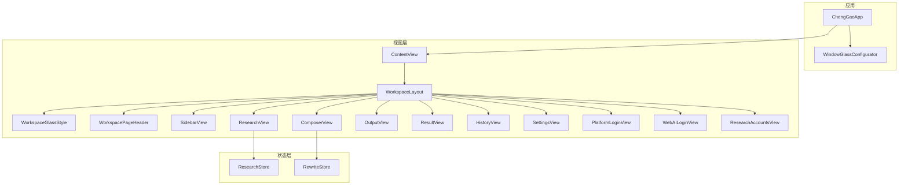
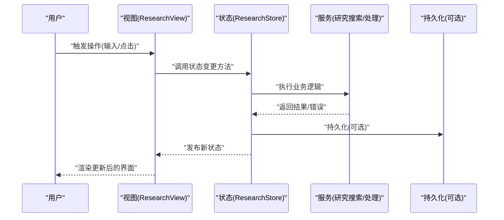
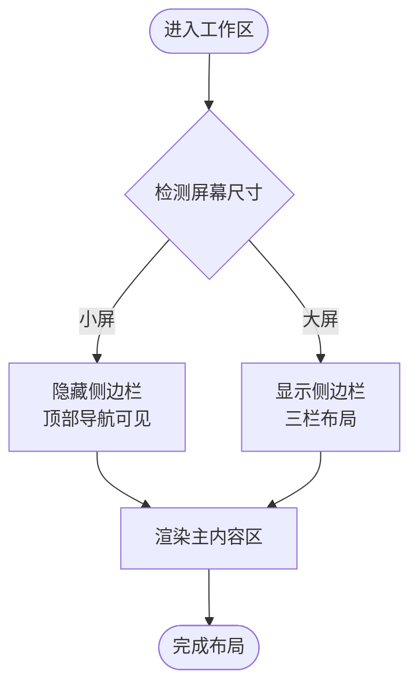
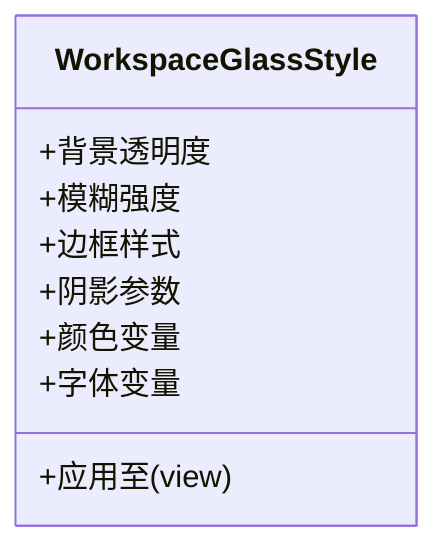
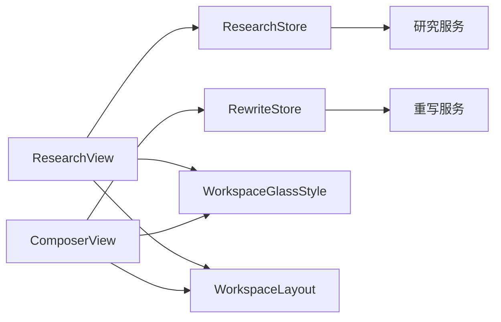

# 用户界面

<cite>
**本文引用的文件**   
- [ChengGaoApp.swift](file://Sources/ChengGao/App/ChengGaoApp.swift)
- [WindowGlassConfigurator.swift](file://Sources/ChengGao/App/WindowGlassConfigurator.swift)
- [WorkspaceLayout.swift](file://Sources/ChengGao/Views/WorkspaceLayout.swift)
- [WorkspaceGlassStyle.swift](file://Sources/ChengGao/Views/WorkspaceGlassStyle.swift)
- [WorkspacePageHeader.swift](file://Sources/ChengGao/Views/WorkspacePageHeader.swift)
- [SidebarView.swift](file://Sources/ChengGao/Views/SidebarView.swift)
- [ResearchView.swift](file://Sources/ChengGao/Views/ResearchView.swift)
- [ComposerView.swift](file://Sources/ChengGao/Views/ComposerView.swift)
- [OutputView.swift](file://Sources/ChengGao/Views/OutputView.swift)
- [ResultView.swift](file://Sources/ChengGao/Views/ResultView.swift)
- [HistoryView.swift](file://Sources/ChengGao/Views/HistoryView.swift)
- [SettingsView.swift](file://Sources/ChengGao/Views/SettingsView.swift)
- [PlatformLoginView.swift](file://Sources/ChengGao/Views/PlatformLoginView.swift)
- [WebAILoginView.swift](file://Sources/ChengGao/Views/WebAILoginView.swift)
- [ResearchAccountsView.swift](file://Sources/ChengGao/Views/ResearchAccountsView.swift)
- [ContentView.swift](file://Sources/ChengGao/Views/ContentView.swift)
- [ResearchStore.swift](file://Sources/ChengGao/Stores/ResearchStore.swift)
- [RewriteStore.swift](file://Sources/ChengGao/Stores/RewriteStore.swift)
</cite>

## 目录
1. [简介](#简介)
2. [项目结构](#项目结构)
3. [核心组件](#核心组件)
4. [架构总览](#架构总览)
5. [详细组件分析](#详细组件分析)
6. [依赖分析](#依赖分析)
7. [性能考虑](#性能考虑)
8. [故障排查指南](#故障排查指南)
9. [结论](#结论)
10. [附录](#附录)

## 简介
本文件系统性梳理 SwiftUI 用户界面的设计与实现，覆盖组件层次、布局策略、样式系统（含玻璃风格主题）、工作区布局与响应式适配、交互流程、状态同步、动画效果、自定义控件开发、主题定制、国际化支持、性能优化、可访问性、跨平台兼容性、UI 测试与调试方法。目标是帮助开发者快速理解并高效扩展该项目的 UI 层。

## 项目结构
UI 相关代码集中在 Sources/ChengGao 下：
- App：应用入口与窗口配置（如玻璃背景）
- Views：页面与组件（工作区、侧边栏、研究、输出、结果、历史、设置、登录等）
- Stores：状态管理（研究与重写任务的状态）
- Services/Models：业务逻辑与数据模型（由视图通过 Store 间接消费）

图表来源
- [ChengGaoApp.swift](file://Sources/ChengGao/App/ChengGaoApp.swift)
- [WindowGlassConfigurator.swift](file://Sources/ChengGao/App/WindowGlassConfigurator.swift)
- [ContentView.swift](file://Sources/ChengGao/Views/ContentView.swift)
- [WorkspaceLayout.swift](file://Sources/ChengGao/Views/WorkspaceLayout.swift)
- [WorkspaceGlassStyle.swift](file://Sources/ChengGao/Views/WorkspaceGlassStyle.swift)
- [WorkspacePageHeader.swift](file://Sources/ChengGao/Views/WorkspacePageHeader.swift)
- [SidebarView.swift](file://Sources/ChengGao/Views/SidebarView.swift)
- [ResearchView.swift](file://Sources/ChengGao/Views/ResearchView.swift)
- [ComposerView.swift](file://Sources/ChengGao/Views/ComposerView.swift)
- [OutputView.swift](file://Sources/ChengGao/Views/OutputView.swift)
- [ResultView.swift](file://Sources/ChengGao/Views/ResultView.swift)
- [HistoryView.swift](file://Sources/ChengGao/Views/HistoryView.swift)
- [SettingsView.swift](file://Sources/ChengGao/Views/SettingsView.swift)
- [PlatformLoginView.swift](file://Sources/ChengGao/Views/PlatformLoginView.swift)
- [WebAILoginView.swift](file://Sources/ChengGao/Views/WebAILoginView.swift)
- [ResearchAccountsView.swift](file://Sources/ChengGao/Views/ResearchAccountsView.swift)
- [ResearchStore.swift](file://Sources/ChengGao/Stores/ResearchStore.swift)
- [RewriteStore.swift](file://Sources/ChengGao/Stores/RewriteStore.swift)

章节来源
- [ChengGaoApp.swift](file://Sources/ChengGao/App/ChengGaoApp.swift)
- [ContentView.swift](file://Sources/ChengGao/Views/ContentView.swift)
- [WorkspaceLayout.swift](file://Sources/ChengGao/Views/WorkspaceLayout.swift)

## 核心组件
- 应用与窗口配置：负责启动应用、注入全局样式与环境配置，包括窗口玻璃背景与外观统一。
- 工作区布局：承载主内容区域，组合侧边栏、页面头部与具体功能页，提供响应式与自适应布局。
- 玻璃风格主题：集中定义毛玻璃、透明度、边框、阴影等视觉变量，确保全应用一致的主题体验。
- 页面与组件：研究、输出、结果、历史、设置、登录等页面，以及通用头部与侧边导航。
- 状态管理：ResearchStore 与 RewriteStore 作为单一事实源，驱动视图更新与跨组件同步。

章节来源
- [WorkspaceLayout.swift](file://Sources/ChengGao/Views/WorkspaceLayout.swift)
- [WorkspaceGlassStyle.swift](file://Sources/ChengGao/Views/WorkspaceGlassStyle.swift)
- [ResearchStore.swift](file://Sources/ChengGao/Stores/ResearchStore.swift)
- [RewriteStore.swift](file://Sources/ChengGao/Stores/RewriteStore.swift)

## 架构总览
UI 采用“视图-状态”分离的单向数据流：
- 视图层仅负责展示与用户输入捕获
- 状态层（Store）持有应用状态并提供变更接口
- 业务服务在 Store 中调用，完成网络、本地存储或 AI 推理
- 视图通过绑定或观察者订阅状态变化，自动刷新

图表来源
- [ResearchView.swift](file://Sources/ChengGao/Views/ResearchView.swift)
- [ResearchStore.swift](file://Sources/ChengGao/Stores/ResearchStore.swift)

## 详细组件分析

### 工作区布局（WorkspaceLayout）
- 职责：组织侧边栏、页面头部与主内容区；处理不同屏幕尺寸下的布局切换（如折叠/展开）。
- 布局策略：使用容器与分割器组合，按优先级分配空间；在小屏上隐藏侧边栏，在大屏上显示完整面板。
- 响应式：依据可用宽度与方向动态调整列数与间距，保证可读性与可用性。
- 可访问性：为关键区域添加语义标签与焦点顺序，便于键盘与辅助技术导航。

图表来源
- [WorkspaceLayout.swift](file://Sources/ChengGao/Views/WorkspaceLayout.swift)

章节来源
- [WorkspaceLayout.swift](file://Sources/ChengGao/Views/WorkspaceLayout.swift)

### 玻璃风格主题（WorkspaceGlassStyle）
- 职责：集中管理毛玻璃材质、透明度、描边、阴影、颜色与字体变量。
- 使用方式：通过修饰符或样式对象应用到任意视图，确保一致性。
- 定制点：支持明暗模式、高对比度、弱动画偏好等系统设置联动。

图表来源
- [WorkspaceGlassStyle.swift](file://Sources/ChengGao/Views/WorkspaceGlassStyle.swift)

章节来源
- [WorkspaceGlassStyle.swift](file://Sources/ChengGao/Views/WorkspaceGlassStyle.swift)

### 页面头部（WorkspacePageHeader）
- 职责：展示当前页面标题、操作按钮、搜索框与快捷工具。
- 交互：按钮动作委托给上层状态或命令；搜索框实时过滤列表。
- 可访问性：为按钮与输入框提供清晰的标签与提示。

章节来源
- [WorkspacePageHeader.swift](file://Sources/ChengGao/Views/WorkspacePageHeader.swift)

### 侧边栏（SidebarView）
- 职责：导航到各功能页（研究、输出、结果、历史、设置、登录等）。
- 行为：选中项高亮；支持键盘导航与快捷键；在移动端可滑出/收起。
- 状态：与路由或选择状态同步，保持页面与导航一致。

章节来源
- [SidebarView.swift](file://Sources/ChengGao/Views/SidebarView.swift)

### 研究页面（ResearchView）
- 职责：展示研究任务列表、筛选与排序、新建任务入口。
- 交互：创建、编辑、删除、批量操作；与 ResearchStore 双向同步。
- 动画：列表项增删改动效，提升流畅感。

章节来源
- [ResearchView.swift](file://Sources/ChengGao/Views/ResearchView.swift)
- [ResearchStore.swift](file://Sources/ChengGao/Stores/ResearchStore.swift)

### 编辑器与输出（ComposerView / OutputView / ResultView）
- ComposerView：富文本或结构化输入，支持模板、占位符与校验。
- OutputView：渲染生成结果（文本/媒体），支持复制、导出与分享。
- ResultView：结果详情与元数据展示，支持收藏与归档。

章节来源
- [ComposerView.swift](file://Sources/ChengGao/Views/ComposerView.swift)
- [OutputView.swift](file://Sources/ChengGao/Views/OutputView.swift)
- [ResultView.swift](file://Sources/ChengGao/Views/ResultView.swift)

### 历史与设置（HistoryView / SettingsView）
- HistoryView：历史记录浏览、检索与清理。
- SettingsView：主题、语言、隐私与高级选项；保存至平台配置。

章节来源
- [HistoryView.swift](file://Sources/ChengGao/Views/HistoryView.swift)
- [SettingsView.swift](file://Sources/ChengGao/Views/SettingsView.swift)

### 登录与账户（PlatformLoginView / WebAILoginView / ResearchAccountsView）
- PlatformLoginView：平台账号登录与授权。
- WebAILoginView：第三方 AI 服务的登录与凭据管理。
- ResearchAccountsView：多账户管理与切换。

章节来源
- [PlatformLoginView.swift](file://Sources/ChengGao/Views/PlatformLoginView.swift)
- [WebAILoginView.swift](file://Sources/ChengGao/Views/WebAILoginView.swift)
- [ResearchAccountsView.swift](file://Sources/ChengGao/Views/ResearchAccountsView.swift)

### 应用入口与窗口配置（ChengGaoApp / WindowGlassConfigurator）
- ChengGaoApp：初始化全局环境、主题与路由根节点。
- WindowGlassConfigurator：配置窗口背景、毛玻璃效果与外观一致性。

章节来源
- [ChengGaoApp.swift](file://Sources/ChengGao/App/ChengGaoApp.swift)
- [WindowGlassConfigurator.swift](file://Sources/ChengGao/App/WindowGlassConfigurator.swift)

## 依赖分析
- 视图对 Store 的依赖是单向的：视图只读取状态与调用变更方法，不直接耦合服务。
- Store 依赖服务与持久化，封装业务细节，避免视图膨胀。
- 主题与布局组件被多处复用，降低耦合，提高一致性。

图表来源
- [ResearchView.swift](file://Sources/ChengGao/Views/ResearchView.swift)
- [ComposerView.swift](file://Sources/ChengGao/Views/ComposerView.swift)
- [ResearchStore.swift](file://Sources/ChengGao/Stores/ResearchStore.swift)
- [RewriteStore.swift](file://Sources/ChengGao/Stores/RewriteStore.swift)
- [WorkspaceGlassStyle.swift](file://Sources/ChengGao/Views/WorkspaceGlassStyle.swift)
- [WorkspaceLayout.swift](file://Sources/ChengGao/Views/WorkspaceLayout.swift)

章节来源
- [ResearchStore.swift](file://Sources/ChengGao/Stores/ResearchStore.swift)
- [RewriteStore.swift](file://Sources/ChengGao/Stores/RewriteStore.swift)

## 性能考虑
- 视图更新最小化：仅在必要处使用绑定与观察者，避免全树重绘。
- 列表渲染优化：分页加载、懒加载与缓存，减少内存占用。
- 动画性能：优先使用轻量级过渡与淡入淡出，避免复杂路径动画。
- 主题渲染：将玻璃效果与阴影限制在必要区域，降低合成开销。
- 异步任务：在网络与 AI 推理时进行取消与节流，防止重复请求。

[本节为通用指导，无需特定文件引用]

## 故障排查指南
- 状态不同步：检查 Store 是否发布更新，视图是否正确订阅；确认无循环依赖。
- 玻璃效果异常：确认窗口配置已启用，系统权限允许；在不同模式下验证透明度与对比度。
- 布局错乱：检查约束与容器层级；在极端尺寸与旋转场景下验证。
- 登录失败：核对凭据存储与网络状态；查看错误码与日志。
- 性能问题：使用 Instruments 定位 CPU/GPU 热点；减少不必要的重绘。

章节来源
- [WorkspaceGlassStyle.swift](file://Sources/ChengGao/Views/WorkspaceGlassStyle.swift)
- [WindowGlassConfigurator.swift](file://Sources/ChengGao/App/WindowGlassConfigurator.swift)
- [ResearchStore.swift](file://Sources/ChengGao/Stores/ResearchStore.swift)
- [RewriteStore.swift](file://Sources/ChengGao/Stores/RewriteStore.swift)

## 结论
本项目以清晰的分层与单向数据流构建 SwiftUI 界面，工作区布局与玻璃风格主题提供了统一的视觉与交互体验。通过 Store 管理状态、组件复用与响应式布局，实现了可扩展、易维护且高性能的用户界面。建议继续完善可访问性、国际化与自动化测试，以提升整体质量与用户体验。

[本节为总结，无需特定文件引用]

## 附录

### 自定义控件开发指南
- 设计原则：单一职责、可组合、可测试、可主题化。
- 步骤：
  - 明确输入属性与回调事件
  - 使用样式对象注入主题变量
  - 提供默认值与边界条件处理
  - 编写单元测试与 UI 测试用例

[本节为通用指导，无需特定文件引用]

### 主题定制与国际化
- 主题定制：扩展 WorkspaceGlassStyle，新增颜色、字体与材质变量；通过修饰符应用到视图。
- 国际化：使用本地化资源键，结合系统语言设置；为所有可见文本提供翻译。

[本节为通用指导，无需特定文件引用]

### 界面性能优化技巧
- 延迟加载与分页
- 图像与媒体资源压缩与缓存
- 避免在主线程执行耗时操作
- 合理使用动画与转场

[本节为通用指导，无需特定文件引用]

### 可访问性支持
- 为控件添加语义标签与描述
- 支持键盘导航与焦点管理
- 适配高对比度与动态类型
- 朗读支持与语音控制

[本节为通用指导，无需特定文件引用]

### 跨平台兼容性考虑
- 针对 macOS/iOS 差异处理 API 与布局
- 使用条件编译与平台检测
- 验证触摸与鼠标交互的一致性

[本节为通用指导，无需特定文件引用]

### UI 测试策略与调试工具
- 测试策略：端到端流程测试、组件单元测试、快照对比
- 调试工具：Xcode Preview、Instruments、控制台日志与断点
- 最佳实践：稳定选择器、隔离状态、模拟外部依赖

[本节为通用指导，无需特定文件引用]