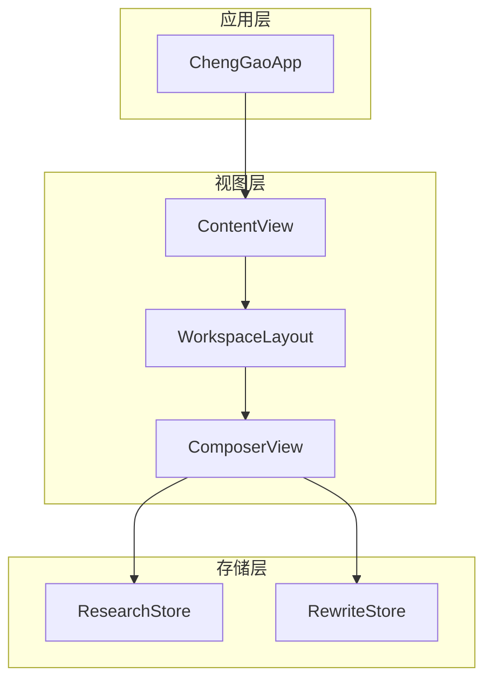
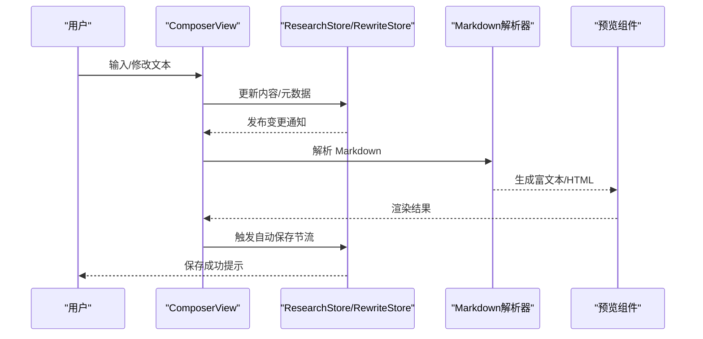
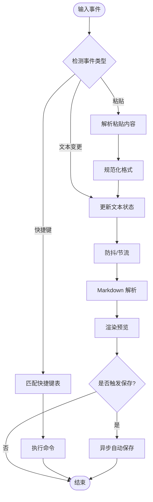
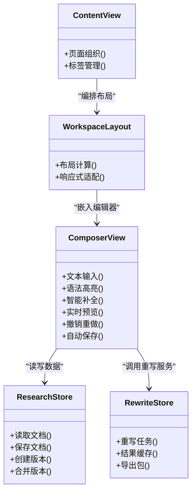

# 编辑器界面

<cite>
**本文引用的文件**   
- [ComposerView.swift](file://Sources/ChengGao/Views/ComposerView.swift)
- [ContentView.swift](file://Sources/ChengGao/Views/ContentView.swift)
- [WorkspaceLayout.swift](file://Sources/ChengGao/Views/WorkspaceLayout.swift)
- [ResearchStore.swift](file://Sources/ChengGao/Stores/ResearchStore.swift)
- [RewriteStore.swift](file://Sources/ChengGao/Stores/RewriteStore.swift)
- [ChengGaoApp.swift](file://Sources/ChengGao/App/ChengGaoApp.swift)
</cite>

## 目录
1. [简介](#简介)
2. [项目结构](#项目结构)
3. [核心组件](#核心组件)
4. [架构总览](#架构总览)
5. [详细组件分析](#详细组件分析)
6. [依赖关系分析](#依赖关系分析)
7. [性能考量](#性能考量)
8. [故障排查指南](#故障排查指南)
9. [结论](#结论)
10. [附录](#附录)

## 简介
本文件聚焦于编辑器界面的设计与实现，围绕 ComposerView 的文本编辑能力、语法高亮与智能补全机制展开，并文档化富文本编辑、Markdown 支持与实时预览的实现思路。同时覆盖撤销重做、自动保存与版本管理策略，提供自定义编辑器扩展开发指南、快捷键映射与输入法支持说明，以及针对大型文档的性能优化、内存管理与渲染技巧。

## 项目结构
本项目采用 SwiftUI 构建 UI，核心视图位于 Sources/ChengGao/Views，状态与数据持久化位于 Stores，应用入口在 App 层。编辑器相关的主要文件包括：
- 编辑器视图：ComposerView.swift
- 主内容容器：ContentView.swift
- 工作区布局：WorkspaceLayout.swift
- 数据存储与状态：ResearchStore.swift、RewriteStore.swift
- 应用初始化：ChengGaoApp.swift

图表来源
- [ChengGaoApp.swift](file://Sources/ChengGao/App/ChengGaoApp.swift)
- [ContentView.swift](file://Sources/ChengGao/Views/ContentView.swift)
- [WorkspaceLayout.swift](file://Sources/ChengGao/Views/WorkspaceLayout.swift)
- [ComposerView.swift](file://Sources/ChengGao/Views/ComposerView.swift)
- [ResearchStore.swift](file://Sources/ChengGao/Stores/ResearchStore.swift)
- [RewriteStore.swift](file://Sources/ChengGao/Stores/RewriteStore.swift)

章节来源
- [ChengGaoApp.swift](file://Sources/ChengGao/App/ChengGaoApp.swift)
- [ContentView.swift](file://Sources/ChengGao/Views/ContentView.swift)
- [WorkspaceLayout.swift](file://Sources/ChengGao/Views/WorkspaceLayout.swift)
- [ComposerView.swift](file://Sources/ChengGao/Views/ComposerView.swift)
- [ResearchStore.swift](file://Sources/ChengGao/Stores/ResearchStore.swift)
- [RewriteStore.swift](file://Sources/ChengGao/Stores/RewriteStore.swift)

## 核心组件
- ComposerView：编辑器主视图，负责文本输入、光标管理、选择范围、粘贴处理、键盘事件拦截、撤销重做栈、自动保存触发、Markdown 解析与预览联动等。
- ContentView：页面级容器，组织侧边栏、工具栏与编辑器区域，协调多标签页或分屏布局。
- WorkspaceLayout：工作区布局管理器，决定编辑器在不同窗口尺寸下的排列方式（如左右分栏、上下分栏）。
- ResearchStore / RewriteStore：状态与数据源，承载文档内容、历史版本、元数据与同步策略。

章节来源
- [ComposerView.swift](file://Sources/ChengGao/Views/ComposerView.swift)
- [ContentView.swift](file://Sources/ChengGao/Views/ContentView.swift)
- [WorkspaceLayout.swift](file://Sources/ChengGao/Views/WorkspaceLayout.swift)
- [ResearchStore.swift](file://Sources/ChengGao/Stores/ResearchStore.swift)
- [RewriteStore.swift](file://Sources/ChengGao/Stores/RewriteStore.swift)

## 架构总览
编辑器采用“视图-状态-服务”分层：
- 视图层：SwiftUI 视图组合，响应式更新。
- 状态层：@StateObject/@Observable 驱动的数据模型与 Store。
- 服务层：Markdown 解析、AI 辅助、本地持久化、搜索索引等。

图表来源
- [ComposerView.swift](file://Sources/ChengGao/Views/ComposerView.swift)
- [ResearchStore.swift](file://Sources/ChengGao/Stores/ResearchStore.swift)
- [RewriteStore.swift](file://Sources/ChengGao/Stores/RewriteStore.swift)

## 详细组件分析

### ComposerView 编辑器功能
- 文本编辑能力
  - 基于 SwiftUI TextEditor 或原生桥接实现，支持多行编辑、选择、复制粘贴、查找替换。
  - 光标位置与选择范围通过 @Binding 或 @State 维护，确保与预览和命令系统同步。
- 语法高亮与智能补全
  - 若使用原生 TextKit 或 WebView 渲染，可接入 Tokenizer 进行词法分析，按语言规则着色；智能补全通过 CompletionProvider 接口注入候选项，结合上下文与缓存提升命中率。
  - 若为纯 Markdown 场景，可在解析阶段对代码块、标题、列表等进行样式增强。
- 富文本编辑与 Markdown 支持
  - 将 Markdown AST 转换为富文本节点树，再映射到平台渲染管线（如 NSAttributedString/HTML），保证所见即所得。
  - 支持表格、图片、数学公式、脚注等扩展语法。
- 实时预览
  - 监听文本变化，使用防抖/节流策略调用解析器，避免频繁重排；预览与编辑器双向滚动同步。
- 撤销重做
  - 维护 UndoManager 或自定义栈，记录操作类型、作用范围与时间戳，支持批量撤销与跨会话恢复。
- 自动保存与版本管理
  - 基于写入合并策略，增量保存至本地数据库或文件系统；每次保存生成版本号，支持分支与合并。
- 快捷键映射与输入法支持
  - 统一快捷键表，区分平台差异；输入法事件过滤，避免 IME 组合过程中误触发命令。

图表来源
- [ComposerView.swift](file://Sources/ChengGao/Views/ComposerView.swift)

章节来源
- [ComposerView.swift](file://Sources/ChengGao/Views/ComposerView.swift)

### 视图容器与工作区布局
- ContentView 作为页面容器，组织导航、工具栏与编辑器区域，支持多标签切换与状态隔离。
- WorkspaceLayout 根据窗口尺寸与用户偏好动态调整布局（如左右分栏、全屏模式），并在旋转或缩放时保持编辑器焦点与滚动位置。

章节来源
- [ContentView.swift](file://Sources/ChengGao/Views/ContentView.swift)
- [WorkspaceLayout.swift](file://Sources/ChengGao/Views/WorkspaceLayout.swift)

### 数据存储与版本管理
- ResearchStore / RewriteStore 负责文档内容的读写、历史版本快照、标签与元数据管理。
- 版本管理策略：
  - 增量快照：仅保存变更片段与偏移量，减少存储体积。
  - 分支与合并：支持并行编辑后冲突检测与合并。
  - 回滚与对比：提供差异查看与一键回滚。

章节来源
- [ResearchStore.swift](file://Sources/ChengGao/Stores/ResearchStore.swift)
- [RewriteStore.swift](file://Sources/ChengGao/Stores/RewriteStore.swift)

## 依赖关系分析
编辑器模块依赖关系如下：
- ComposerView 依赖 Store 进行数据读写与状态同步。
- 解析器与预览组件作为外部服务被 ComposerView 调用。
- 布局与容器由 ContentView/WorkspaceLayout 编排。

图表来源
- [ComposerView.swift](file://Sources/ChengGao/Views/ComposerView.swift)
- [ResearchStore.swift](file://Sources/ChengGao/Stores/ResearchStore.swift)
- [RewriteStore.swift](file://Sources/ChengGao/Stores/RewriteStore.swift)
- [WorkspaceLayout.swift](file://Sources/ChengGao/Views/WorkspaceLayout.swift)
- [ContentView.swift](file://Sources/ChengGao/Views/ContentView.swift)

章节来源
- [ComposerView.swift](file://Sources/ChengGao/Views/ComposerView.swift)
- [ResearchStore.swift](file://Sources/ChengGao/Stores/ResearchStore.swift)
- [RewriteStore.swift](file://Sources/ChengGao/Stores/RewriteStore.swift)
- [WorkspaceLayout.swift](file://Sources/ChengGao/Views/WorkspaceLayout.swift)
- [ContentView.swift](file://Sources/ChengGao/Views/ContentView.swift)

## 性能考量
- 渲染优化
  - 使用虚拟滚动与分页加载，避免一次性渲染超大文档。
  - 预览解析采用懒加载与缓存，命中缓存直接复用。
- 内存管理
  - 大文本分块处理，及时释放中间对象；避免强引用循环。
  - 图片与媒体资源按需加载，缩略图先行显示。
- 输入与交互
  - 防抖/节流控制解析频率；IME 组合期间暂停高开销操作。
  - 撤销栈限制大小，定期清理旧快照。
- I/O 与持久化
  - 写入合并与批量提交，降低磁盘压力。
  - 异步保存与失败重试，保障数据一致性。

[本节为通用指导，不直接分析具体文件]

## 故障排查指南
- 常见问题
  - 预览卡顿：检查解析频率与缓存命中率，确认是否存在重复计算。
  - 自动保存失败：检查权限与路径有效性，确认后台任务未被系统限制。
  - 输入法异常：确认 IME 事件过滤逻辑，避免组合态下误触发。
  - 内存溢出：定位大对象持有点，启用 Instruments 分析堆快照。
- 调试建议
  - 开启详细日志，记录关键事件与耗时。
  - 使用断言与边界测试用例覆盖极端输入。
  - 模拟弱网与低内存环境验证稳定性。

[本节为通用指导，不直接分析具体文件]

## 结论
ComposerView 作为编辑器核心，整合了文本编辑、语法高亮、智能补全、Markdown 解析与实时预览等功能，并通过 Store 实现稳定的数据与版本管理。配合合理的布局与性能优化策略，能够在大型文档场景下保持流畅体验。未来可扩展更多语言支持与插件生态，进一步提升编辑器能力。

[本节为总结性内容，不直接分析具体文件]

## 附录

### 自定义编辑器扩展开发指南
- 扩展点
  - 语法定义：注册新的语言 Tokenizer 与主题。
  - 补全提供者：实现 CompletionProvider，返回上下文相关的候选项。
  - 命令处理器：注册快捷键命令，处理业务逻辑。
  - 预览渲染器：扩展 Markdown 节点到富文本映射。
- 生命周期
  - 初始化：加载配置与缓存。
  - 运行期：响应事件、更新状态、释放资源。
- 最佳实践
  - 避免阻塞主线程，使用异步队列。
  - 提供错误回调与降级方案。
  - 单元测试覆盖解析与补全逻辑。

[本节为通用指导，不直接分析具体文件]

### 快捷键映射与输入法支持
- 快捷键映射
  - 集中式键位表，支持平台差异与用户自定义。
  - 冲突检测与优先级规则，确保命令正确执行。
- 输入法支持
  - 监听 IME 开始/结束事件，在组合期间禁用高开销操作。
  - 兼容多语言输入，避免字符编码问题。

[本节为通用指导，不直接分析具体文件]

### 撤销重做、自动保存与版本管理策略
- 撤销重做
  - 操作类型枚举、作用范围与时间戳记录。
  - 批量撤销与跨会话恢复。
- 自动保存
  - 节流策略与写入合并，避免频繁 I/O。
  - 失败重试与幂等性保证。
- 版本管理
  - 增量快照、分支与合并、冲突解决。
  - 差异对比与回滚。

[本节为通用指导，不直接分析具体文件]

### 大型文档处理技巧
- 分块渲染与虚拟滚动
- 懒加载与缓存策略
- 增量解析与差异更新
- 内存监控与回收

[本节为通用指导，不直接分析具体文件]