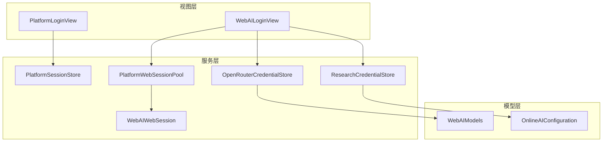
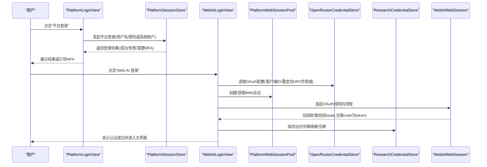
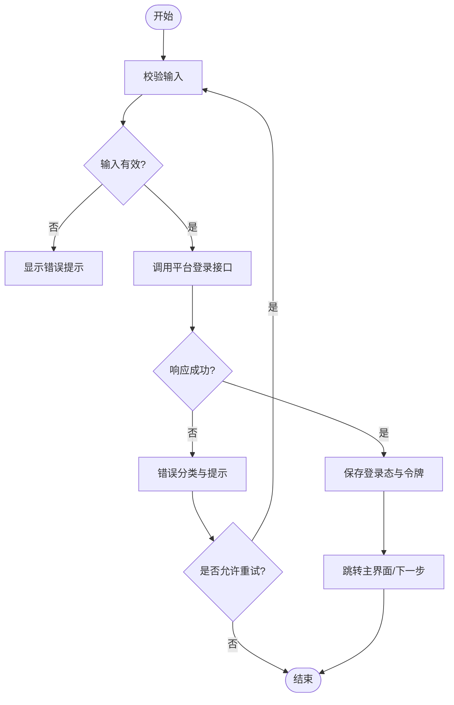
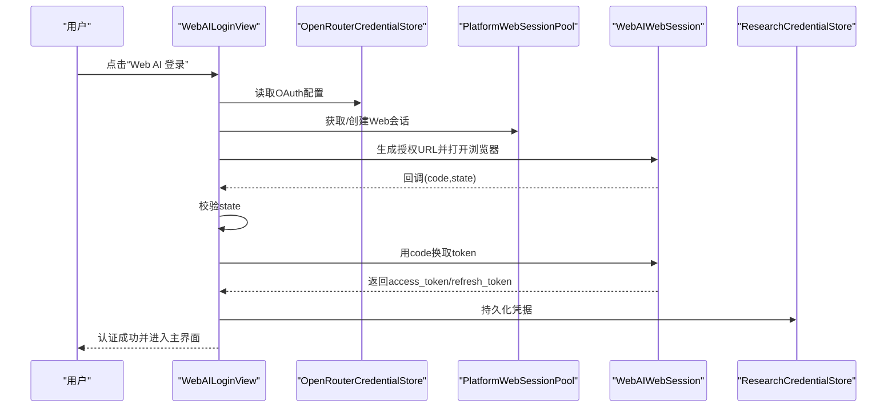
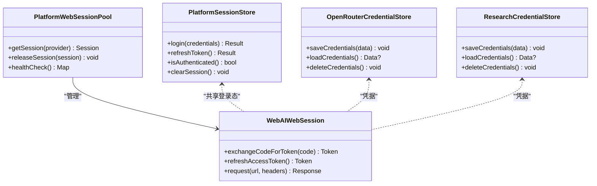
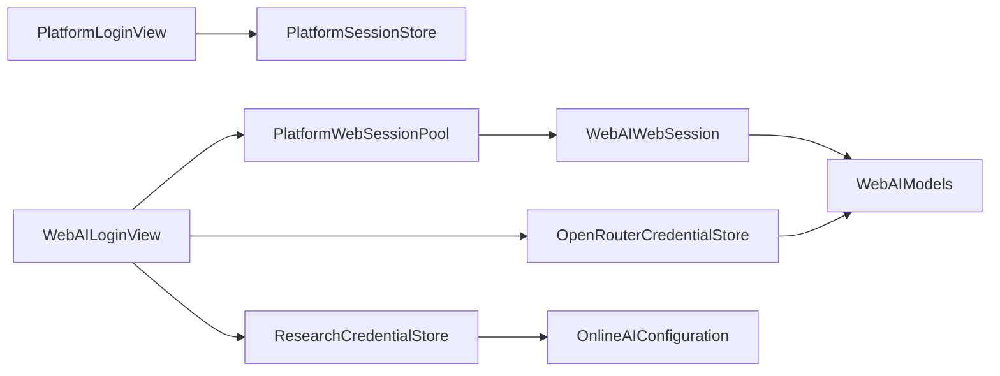

# 认证界面

<cite>
**本文引用的文件**   
- [PlatformLoginView.swift](file://Sources/ChengGao/Views/PlatformLoginView.swift)
- [WebAILoginView.swift](file://Sources/ChengGao/Views/WebAILoginView.swift)
- [PlatformSessionStore.swift](file://Sources/ChengGao/Services/PlatformSessionStore.swift)
- [PlatformWebSessionPool.swift](file://Sources/ChengGao/Services/PlatformWebSessionPool.swift)
- [OpenRouterCredentialStore.swift](file://Sources/ChengGao/Services/OpenRouterCredentialStore.swift)
- [ResearchCredentialStore.swift](file://Sources/ChengGao/Services/ResearchCredentialStore.swift)
- [WebAIModels.swift](file://Sources/ChengGao/Models/WebAIModels.swift)
- [OnlineAIConfiguration.swift](file://Sources/ChengGao/Models/OnlineAIConfiguration.swift)
- [WebAIWebSession.swift](file://Sources/ChengGao/Services/WebAIWebSession.swift)
</cite>

## 目录
1. [简介](#简介)
2. [项目结构](#项目结构)
3. [核心组件](#核心组件)
4. [架构总览](#架构总览)
5. [详细组件分析](#详细组件分析)
6. [依赖关系分析](#依赖关系分析)
7. [性能考虑](#性能考虑)
8. [故障排查指南](#故障排查指南)
9. [结论](#结论)
10. [附录](#附录)

## 简介
本文件围绕认证界面的设计与实现展开，重点覆盖：
- PlatformLoginView 的平台登录流程与状态管理
- WebAILoginView 的 Web AI 服务认证机制（含 OAuth 集成）
- 会话处理、凭据存储与安全最佳实践
- 自定义认证提供商集成、多因素认证支持与用户体验优化
- 认证流程调试工具与安全测试方法

## 项目结构
认证相关代码主要分布在 Views、Services 与 Models 三个层次：
- Views：用户交互入口，包括平台登录与 Web AI 登录界面
- Services：会话与凭据管理、网络会话池、模型配置等
- Models：数据模型与配置项定义

图表来源
- [PlatformLoginView.swift:1-200](file://Sources/ChengGao/Views/PlatformLoginView.swift#L1-L200)
- [WebAILoginView.swift:1-200](file://Sources/ChengGao/Views/WebAILoginView.swift#L1-L200)
- [PlatformSessionStore.swift:1-200](file://Sources/ChengGao/Services/PlatformSessionStore.swift#L1-L200)
- [PlatformWebSessionPool.swift:1-200](file://Sources/ChengGao/Services/PlatformWebSessionPool.swift#L1-L200)
- [OpenRouterCredentialStore.swift:1-200](file://Sources/ChengGao/Services/OpenRouterCredentialStore.swift#L1-L200)
- [ResearchCredentialStore.swift:1-200](file://Sources/ChengGao/Services/ResearchCredentialStore.swift#L1-L200)
- [WebAIWebSession.swift:1-200](file://Sources/ChengGao/Services/WebAIWebSession.swift#L1-L200)
- [WebAIModels.swift:1-200](file://Sources/ChengGao/Models/WebAIModels.swift#L1-L200)
- [OnlineAIConfiguration.swift:1-200](file://Sources/ChengGao/Models/OnlineAIConfiguration.swift#L1-L200)

章节来源
- [PlatformLoginView.swift:1-200](file://Sources/ChengGao/Views/PlatformLoginView.swift#L1-L200)
- [WebAILoginView.swift:1-200](file://Sources/ChengGao/Views/WebAILoginView.swift#L1-L200)
- [PlatformSessionStore.swift:1-200](file://Sources/ChengGao/Services/PlatformSessionStore.swift#L1-L200)
- [PlatformWebSessionPool.swift:1-200](file://Sources/ChengGao/Services/PlatformWebSessionPool.swift#L1-L200)
- [OpenRouterCredentialStore.swift:1-200](file://Sources/ChengGao/Services/OpenRouterCredentialStore.swift#1-L200)
- [ResearchCredentialStore.swift:1-200](file://Sources/ChengGao/Services/ResearchCredentialStore.swift#L1-L200)
- [WebAIWebSession.swift:1-200](file://Sources/ChengGao/Services/WebAIWebSession.swift#L1-L200)
- [WebAIModels.swift:1-200](file://Sources/ChengGao/Models/WebAIModels.swift#L1-L200)
- [OnlineAIConfiguration.swift:1-200](file://Sources/ChengGao/Models/OnlineAIConfiguration.swift#L1-L200)

## 核心组件
- PlatformLoginView：负责平台级账号登录的用户交互与状态流转，调用平台会话存储进行登录态维护。
- WebAILoginView：负责 Web AI 服务的认证流程，支持 OAuth 授权码流程、回调处理、令牌获取与会话建立。
- PlatformSessionStore：集中管理平台登录态、刷新令牌与过期策略。
- PlatformWebSessionPool：管理 Web AI 会话的生命周期、复用与回收。
- OpenRouterCredentialStore / ResearchCredentialStore：分别用于不同供应商的凭据持久化与访问控制。
- WebAIWebSession：封装 Web AI 会话的网络请求、Cookie/Token 管理与错误重试。
- WebAIModels / OnlineAIConfiguration：描述认证相关的模型与配置项（如客户端 ID、重定向 URI、作用域等）。

章节来源
- [PlatformLoginView.swift:1-200](file://Sources/ChengGao/Views/PlatformLoginView.swift#L1-L200)
- [WebAILoginView.swift:1-200](file://Sources/ChengGao/Views/WebAILoginView.swift#L1-L200)
- [PlatformSessionStore.swift:1-200](file://Sources/ChengGao/Services/PlatformSessionStore.swift#L1-L200)
- [PlatformWebSessionPool.swift:1-200](file://Sources/ChengGao/Services/PlatformWebSessionPool.swift#L1-L200)
- [OpenRouterCredentialStore.swift:1-200](file://Sources/ChengGao/Services/OpenRouterCredentialStore.swift#L1-L200)
- [ResearchCredentialStore.swift:1-200](file://Sources/ChengGao/Services/ResearchCredentialStore.swift#L1-L200)
- [WebAIWebSession.swift:1-200](file://Sources/ChengGao/Services/WebAIWebSession.swift#L1-L200)
- [WebAIModels.swift:1-200](file://Sources/ChengGao/Models/WebAIModels.swift#L1-L200)
- [OnlineAIConfiguration.swift:1-200](file://Sources/ChengGao/Models/OnlineAIConfiguration.swift#L1-L200)

## 架构总览
下图展示了从用户触发登录到完成认证的端到端流程，涵盖平台登录与 Web AI 认证两条路径。

图表来源
- [PlatformLoginView.swift:1-200](file://Sources/ChengGao/Views/PlatformLoginView.swift#L1-L200)
- [PlatformSessionStore.swift:1-200](file://Sources/ChengGao/Services/PlatformSessionStore.swift#L1-L200)
- [WebAILoginView.swift:1-200](file://Sources/ChengGao/Views/WebAILoginView.swift#L1-L200)
- [PlatformWebSessionPool.swift:1-200](file://Sources/ChengGao/Services/PlatformWebSessionPool.swift#L1-L200)
- [OpenRouterCredentialStore.swift:1-200](file://Sources/ChengGao/Services/OpenRouterCredentialStore.swift#L1-L200)
- [ResearchCredentialStore.swift:1-200](file://Sources/ChengGao/Services/ResearchCredentialStore.swift#L1-L200)
- [WebAIWebSession.swift:1-200](file://Sources/ChengGao/Services/WebAIWebSession.swift#L1-L200)

## 详细组件分析

### PlatformLoginView：平台登录流程
- 职责
  - 提供平台级登录 UI（输入框、按钮、提示）
  - 调用 PlatformSessionStore 完成认证与状态更新
  - 处理 MFA 流程（若平台支持）
  - 统一错误提示与重试逻辑
- 关键流程
  - 输入校验与防抖
  - 调用平台登录接口
  - 根据响应设置登录态、刷新令牌与过期时间
  - 失败时给出可操作的错误信息（网络错误、凭证无效、MFA 缺失等）
- 状态管理
  - 使用响应式状态驱动 UI（加载中、成功、失败、等待 MFA）
  - 与全局应用状态同步，确保登录后导航至正确页面

图表来源
- [PlatformLoginView.swift:1-200](file://Sources/ChengGao/Views/PlatformLoginView.swift#L1-L200)
- [PlatformSessionStore.swift:1-200](file://Sources/ChengGao/Services/PlatformSessionStore.swift#L1-L200)

章节来源
- [PlatformLoginView.swift:1-200](file://Sources/ChengGao/Views/PlatformLoginView.swift#L1-L200)
- [PlatformSessionStore.swift:1-200](file://Sources/ChengGao/Services/PlatformSessionStore.swift#L1-L200)

### WebAILoginView：Web AI 服务认证机制（OAuth）
- 职责
  - 管理 OAuth 授权码流程（构造授权 URL、监听回调、校验 state）
  - 通过 PlatformWebSessionPool 获取/创建 Web 会话
  - 使用 WebAIWebSession 完成 token 交换与刷新
  - 将凭据写入 ResearchCredentialStore / OpenRouterCredentialStore
- 关键流程
  - 初始化 OAuth 配置（客户端 ID、重定向 URI、作用域）
  - 打开浏览器进行授权，接收回调
  - 校验 state 防止 CSRF
  - 用 code 换取 access_token 与 refresh_token
  - 持久化凭据并建立 Web 会话
- 错误处理
  - 网络异常、授权被拒绝、state 不匹配、token 过期等
  - 提供重试与回退方案（重新授权、清除缓存）

图表来源
- [WebAILoginView.swift:1-200](file://Sources/ChengGao/Views/WebAILoginView.swift#L1-L200)
- [PlatformWebSessionPool.swift:1-200](file://Sources/ChengGao/Services/PlatformWebSessionPool.swift#L1-L200)
- [OpenRouterCredentialStore.swift:1-200](file://Sources/ChengGao/Services/OpenRouterCredentialStore.swift#L1-L200)
- [ResearchCredentialStore.swift:1-200](file://Sources/ChengGao/Services/ResearchCredentialStore.swift#L1-L200)
- [WebAIWebSession.swift:1-200](file://Sources/ChengGao/Services/WebAIWebSession.swift#L1-L200)

章节来源
- [WebAILoginView.swift:1-200](file://Sources/ChengGao/Views/WebAILoginView.swift#L1-L200)
- [PlatformWebSessionPool.swift:1-200](file://Sources/ChengGao/Services/PlatformWebSessionPool.swift#L1-L200)
- [OpenRouterCredentialStore.swift:1-200](file://Sources/ChengGao/Services/OpenRouterCredentialStore.swift#L1-L200)
- [ResearchCredentialStore.swift:1-200](file://Sources/ChengGao/Services/ResearchCredentialStore.swift#L1-L200)
- [WebAIWebSession.swift:1-200](file://Sources/ChengGao/Services/WebAIWebSession.swift#L1-L200)

### 会话与凭据管理
- PlatformSessionStore
  - 管理平台登录态、刷新令牌、过期时间与自动续期
  - 提供统一的查询与更新接口，保证线程安全
- PlatformWebSessionPool
  - 维护多个 Web 会话实例，支持并发访问与资源回收
  - 提供健康检查与失败快速失败策略
- Credential Stores
  - OpenRouterCredentialStore：面向 OpenRouter 的凭据存取
  - ResearchCredentialStore：面向研究类服务的凭据存取
  - 均遵循最小权限原则与加密存储建议

图表来源
- [PlatformSessionStore.swift:1-200](file://Sources/ChengGao/Services/PlatformSessionStore.swift#L1-L200)
- [PlatformWebSessionPool.swift:1-200](file://Sources/ChengGao/Services/PlatformWebSessionPool.swift#L1-L200)
- [OpenRouterCredentialStore.swift:1-200](file://Sources/ChengGao/Services/OpenRouterCredentialStore.swift#L1-L200)
- [ResearchCredentialStore.swift:1-200](file://Sources/ChengGao/Services/ResearchCredentialStore.swift#L1-L200)
- [WebAIWebSession.swift:1-200](file://Sources/ChengGao/Services/WebAIWebSession.swift#L1-L200)

章节来源
- [PlatformSessionStore.swift:1-200](file://Sources/ChengGao/Services/PlatformSessionStore.swift#L1-L200)
- [PlatformWebSessionPool.swift:1-200](file://Sources/ChengGao/Services/PlatformWebSessionPool.swift#L1-L200)
- [OpenRouterCredentialStore.swift:1-200](file://Sources/ChengGao/Services/OpenRouterCredentialStore.swift#L1-L200)
- [ResearchCredentialStore.swift:1-200](file://Sources/ChengGao/Services/ResearchCredentialStore.swift#L1-L200)
- [WebAIWebSession.swift:1-200](file://Sources/ChengGao/Services/WebAIWebSession.swift#L1-L200)

### 模型与配置
- WebAIModels：描述认证相关的数据结构（如授权参数、令牌、回调信息等）
- OnlineAIConfiguration：集中管理在线 AI 服务的配置（客户端 ID、重定向 URI、作用域、超时等）

章节来源
- [WebAIModels.swift:1-200](file://Sources/ChengGao/Models/WebAIModels.swift#L1-L200)
- [OnlineAIConfiguration.swift:1-200](file://Sources/ChengGao/Models/OnlineAIConfiguration.swift#L1-L200)

## 依赖关系分析
- 视图层依赖服务层：PlatformLoginView 依赖 PlatformSessionStore；WebAILoginView 依赖 PlatformWebSessionPool、CredentialStores 与 WebAIWebSession
- 服务层依赖模型层：所有服务通过 WebAIModels 与 OnlineAIConfiguration 获取结构与配置
- 外部依赖：OAuth 提供商、浏览器回调、网络栈

图表来源
- [PlatformLoginView.swift:1-200](file://Sources/ChengGao/Views/PlatformLoginView.swift#L1-L200)
- [WebAILoginView.swift:1-200](file://Sources/ChengGao/Views/WebAILoginView.swift#L1-L200)
- [PlatformSessionStore.swift:1-200](file://Sources/ChengGao/Services/PlatformSessionStore.swift#L1-L200)
- [PlatformWebSessionPool.swift:1-200](file://Sources/ChengGao/Services/PlatformWebSessionPool.swift#L1-L200)
- [OpenRouterCredentialStore.swift:1-200](file://Sources/ChengGao/Services/OpenRouterCredentialStore.swift#L1-L200)
- [ResearchCredentialStore.swift:1-200](file://Sources/ChengGao/Services/ResearchCredentialStore.swift#L1-L200)
- [WebAIWebSession.swift:1-200](file://Sources/ChengGao/Services/WebAIWebSession.swift#L1-L200)
- [WebAIModels.swift:1-200](file://Sources/ChengGao/Models/WebAIModels.swift#L1-L200)
- [OnlineAIConfiguration.swift:1-200](file://Sources/ChengGao/Models/OnlineAIConfiguration.swift#L1-L200)

章节来源
- [PlatformLoginView.swift:1-200](file://Sources/ChengGao/Views/PlatformLoginView.swift#L1-L200)
- [WebAILoginView.swift:1-200](file://Sources/ChengGao/Views/WebAILoginView.swift#L1-L200)
- [PlatformSessionStore.swift:1-200](file://Sources/ChengGao/Services/PlatformSessionStore.swift#L1-L200)
- [PlatformWebSessionPool.swift:1-200](file://Sources/ChengGao/Services/PlatformWebSessionPool.swift#L1-L200)
- [OpenRouterCredentialStore.swift:1-200](file://Sources/ChengGao/Services/OpenRouterCredentialStore.swift#L1-L200)
- [ResearchCredentialStore.swift:1-200](file://Sources/ChengGao/Services/ResearchCredentialStore.swift#L1-L200)
- [WebAIWebSession.swift:1-200](file://Sources/ChengGao/Services/WebAIWebSession.swift#L1-L200)
- [WebAIModels.swift:1-200](file://Sources/ChengGao/Models/WebAIModels.swift#L1-L200)
- [OnlineAIConfiguration.swift:1-200](file://Sources/ChengGao/Models/OnlineAIConfiguration.swift#L1-L200)

## 性能考虑
- 会话复用：PlatformWebSessionPool 应合理设置最大连接数与空闲回收策略，避免频繁创建销毁
- 令牌刷新：在接近过期前主动刷新，减少鉴权失败导致的重试开销
- 网络优化：对授权回调与 token 交换进行超时与重试控制，避免阻塞 UI
- 内存管理：及时释放不再使用的会话与临时凭据，降低内存占用

[本节为通用指导，无需引用具体文件]

## 故障排查指南
- 常见问题定位
  - OAuth 回调未触发：检查重定向 URI 配置与回调路由注册
  - state 校验失败：确认随机 state 生成与比对逻辑一致
  - token 过期：检查刷新令牌有效期与自动续期逻辑
  - 凭据无法加载：验证存储路径与权限
- 调试建议
  - 启用详细日志（授权 URL、回调参数、HTTP 状态码）
  - 使用抓包工具验证网络请求与响应
  - 模拟失败场景（网络中断、服务端错误、令牌篡改）
- 安全测试方法
  - 注入非法 state/code 以验证防御逻辑
  - 尝试重放攻击与中间人攻击模拟
  - 验证凭据加密与最小权限策略

章节来源
- [WebAILoginView.swift:1-200](file://Sources/ChengGao/Views/WebAILoginView.swift#L1-L200)
- [PlatformWebSessionPool.swift:1-200](file://Sources/ChengGao/Services/PlatformWebSessionPool.swift#L1-L200)
- [OpenRouterCredentialStore.swift:1-200](file://Sources/ChengGao/Services/OpenRouterCredentialStore.swift#L1-L200)
- [ResearchCredentialStore.swift:1-200](file://Sources/ChengGao/Services/ResearchCredentialStore.swift#L1-L200)
- [WebAIWebSession.swift:1-200](file://Sources/ChengGao/Services/WebAIWebSession.swift#L1-L200)

## 结论
本认证体系通过清晰的视图与服务分层，实现了平台登录与 Web AI 认证的双通道支持。借助会话池与凭据存储，系统在安全性与可用性之间取得平衡。建议在后续迭代中持续完善 MFA、审计日志与更细粒度的权限控制，以提升整体安全与用户体验。

[本节为总结性内容，无需引用具体文件]

## 附录
- 自定义认证提供商集成指南
  - 新增 Provider：在 OnlineAIConfiguration 中添加客户端 ID、重定向 URI、作用域等
  - 扩展 CredentialStore：实现对应凭据的加密存储与读取
  - 适配 WebAIWebSession：实现特定提供商的 token 交换与刷新逻辑
  - 更新 WebAILoginView：选择正确的 Provider 并处理回调
- 多因素认证支持
  - 在 PlatformSessionStore 中增加 MFA 状态与步骤
  - 在 PlatformLoginView 中增加 MFA 输入与校验
  - 记录 MFA 成功事件并更新登录态
- 用户体验优化
  - 提供明确的进度反馈与错误提示
  - 支持一键清理凭据与重新授权
  - 记住上次成功登录的提供商，简化重复操作

[本节为概念性内容，无需引用具体文件]