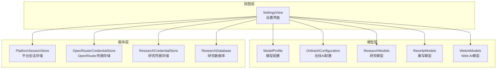
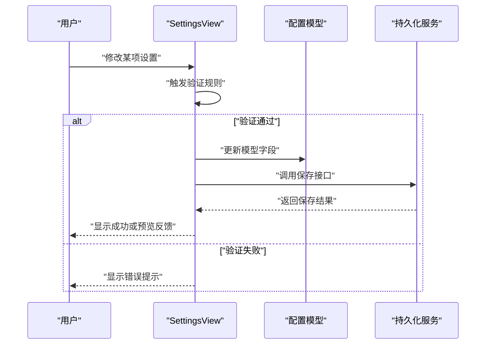
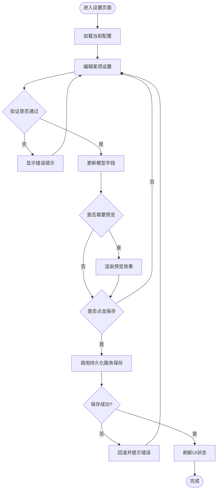
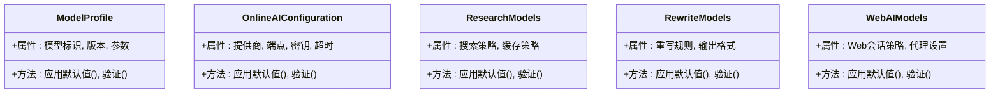
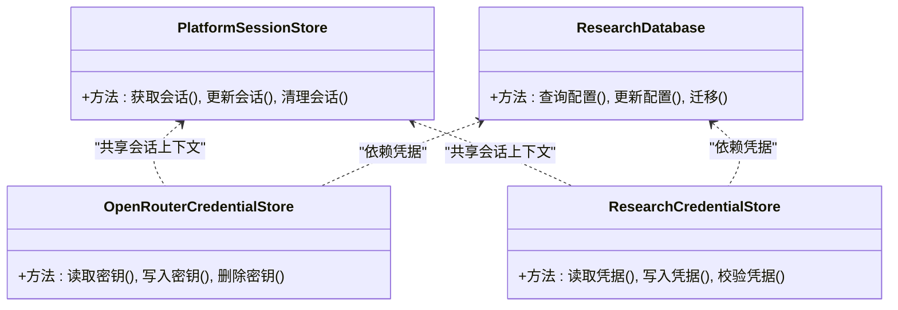
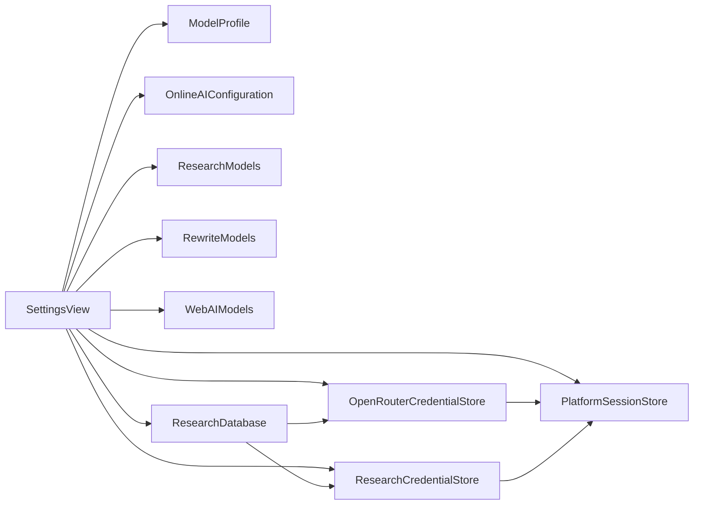

# 设置界面

<cite>
**本文引用的文件**   
- [SettingsView.swift](file://Sources/ChengGao/Views/SettingsView.swift)
- [ModelProfile.swift](file://Sources/ChengGao/Models/ModelProfile.swift)
- [OnlineAIConfiguration.swift](file://Sources/ChengGao/Models/OnlineAIConfiguration.swift)
- [ResearchModels.swift](file://Sources/ChengGao/Models/ResearchModels.swift)
- [RewriteModels.swift](file://Sources/ChengGao/Models/RewriteModels.swift)
- [WebAIModels.swift](file://Sources/ChengGao/Models/WebAIModels.swift)
- [PlatformSessionStore.swift](file://Sources/ChengGao/Services/PlatformSessionStore.swift)
- [OpenRouterCredentialStore.swift](file://Sources/ChengGao/Services/OpenRouterCredentialStore.swift)
- [ResearchCredentialStore.swift](file://Sources/ChengGao/Services/ResearchCredentialStore.swift)
- [ResearchDatabase.swift](file://Sources/ChengGao/Services/ResearchDatabase.swift)
</cite>

## 目录
1. [简介](#简介)
2. [项目结构](#项目结构)
3. [核心组件](#核心组件)
4. [架构总览](#架构总览)
5. [详细组件分析](#详细组件分析)
6. [依赖关系分析](#依赖关系分析)
7. [性能考虑](#性能考虑)
8. [故障排查指南](#故障排查指南)
9. [结论](#结论)
10. [附录](#附录)

## 简介
本文件围绕“设置界面”的设计与实现进行系统化说明，重点覆盖以下方面：
- SettingsView 的配置项组织、表单验证与用户输入处理
- 各类设置（模型配置、在线 AI、研究工具、重写规则等）的分类与默认值管理
- 配置的持久化机制（本地存储、凭据安全、数据库）
- 设置变更的实时预览、验证规则与错误提示
- 自定义设置控件开发指南、数据绑定模式与状态同步策略
- 设置的导入导出与备份恢复机制的实现要点

## 项目结构
设置相关代码主要分布在 Views 与 Models/Services 层：
- Views/SettingsView.swift：设置界面的 UI 与交互逻辑
- Models/*：各模块的数据模型与配置结构
- Services/*：凭据存储、会话管理、数据库访问等持久化能力

图表来源
- [SettingsView.swift](file://Sources/ChengGao/Views/SettingsView.swift)
- [ModelProfile.swift](file://Sources/ChengGao/Models/ModelProfile.swift)
- [OnlineAIConfiguration.swift](file://Sources/ChengGao/Models/OnlineAIConfiguration.swift)
- [ResearchModels.swift](file://Sources/ChengGao/Models/ResearchModels.swift)
- [RewriteModels.swift](file://Sources/ChengGao/Models/RewriteModels.swift)
- [WebAIModels.swift](file://Sources/ChengGao/Models/WebAIModels.swift)
- [PlatformSessionStore.swift](file://Sources/ChengGao/Services/PlatformSessionStore.swift)
- [OpenRouterCredentialStore.swift](file://Sources/ChengGao/Services/OpenRouterCredentialStore.swift)
- [ResearchCredentialStore.swift](file://Sources/ChengGao/Services/ResearchCredentialStore.swift)
- [ResearchDatabase.swift](file://Sources/ChengGao/Services/ResearchDatabase.swift)

章节来源
- [SettingsView.swift](file://Sources/ChengGao/Views/SettingsView.swift)
- [ModelProfile.swift](file://Sources/ChengGao/Models/ModelProfile.swift)
- [OnlineAIConfiguration.swift](file://Sources/ChengGao/Models/OnlineAIConfiguration.swift)
- [ResearchModels.swift](file://Sources/ChengGao/Models/ResearchModels.swift)
- [RewriteModels.swift](file://Sources/ChengGao/Models/RewriteModels.swift)
- [WebAIModels.swift](file://Sources/ChengGao/Models/WebAIModels.swift)
- [PlatformSessionStore.swift](file://Sources/ChengGao/Services/PlatformSessionStore.swift)
- [OpenRouterCredentialStore.swift](file://Sources/ChengGao/Services/OpenRouterCredentialStore.swift)
- [ResearchCredentialStore.swift](file://Sources/ChengGao/Services/ResearchCredentialStore.swift)
- [ResearchDatabase.swift](file://Sources/ChengGao/Services/ResearchDatabase.swift)

## 核心组件
- 设置视图（SettingsView）
  - 负责展示分类化的设置面板、收集用户输入、触发验证与保存
  - 通过数据绑定将 UI 状态与模型对象同步
- 配置模型（Models/*）
  - 定义各功能域的配置结构与默认值
  - 提供校验辅助方法（如格式检查、范围限制）
- 持久化服务（Services/*）
  - 凭据存储（OpenRouter、Research）
  - 会话与平台状态（PlatformSessionStore）
  - 研究数据与配置（ResearchDatabase）

章节来源
- [SettingsView.swift](file://Sources/ChengGao/Views/SettingsView.swift)
- [ModelProfile.swift](file://Sources/ChengGao/Models/ModelProfile.swift)
- [OnlineAIConfiguration.swift](file://Sources/ChengGao/Models/OnlineAIConfiguration.swift)
- [ResearchModels.swift](file://Sources/ChengGao/Models/ResearchModels.swift)
- [RewriteModels.swift](file://Sources/ChengGao/Models/RewriteModels.swift)
- [WebAIModels.swift](file://Sources/ChengGao/Models/WebAIModels.swift)
- [PlatformSessionStore.swift](file://Sources/ChengGao/Services/PlatformSessionStore.swift)
- [OpenRouterCredentialStore.swift](file://Sources/ChengGao/Services/OpenRouterCredentialStore.swift)
- [ResearchCredentialStore.swift](file://Sources/ChengGao/Services/ResearchCredentialStore.swift)
- [ResearchDatabase.swift](file://Sources/ChengGao/Services/ResearchDatabase.swift)

## 架构总览
设置界面采用“视图—模型—服务”的分层架构。视图层聚焦于用户交互与展示；模型层承载配置结构与默认值；服务层负责持久化与安全存储。

图表来源
- [SettingsView.swift](file://Sources/ChengGao/Views/SettingsView.swift)
- [ModelProfile.swift](file://Sources/ChengGao/Models/ModelProfile.swift)
- [OnlineAIConfiguration.swift](file://Sources/ChengGao/Models/OnlineAIConfiguration.swift)
- [ResearchModels.swift](file://Sources/ChengGao/Models/ResearchModels.swift)
- [RewriteModels.swift](file://Sources/ChengGao/Models/RewriteModels.swift)
- [WebAIModels.swift](file://Sources/ChengGao/Models/WebAIModels.swift)
- [PlatformSessionStore.swift](file://Sources/ChengGao/Services/PlatformSessionStore.swift)
- [OpenRouterCredentialStore.swift](file://Sources/ChengGao/Services/OpenRouterCredentialStore.swift)
- [ResearchCredentialStore.swift](file://Sources/ChengGao/Services/ResearchCredentialStore.swift)
- [ResearchDatabase.swift](file://Sources/ChengGao/Services/ResearchDatabase.swift)

## 详细组件分析

### 设置视图（SettingsView）
- 配置项组织
  - 按功能域划分面板（模型、在线 AI、研究、重写、Web AI 等）
  - 每个面板包含若干输入控件（文本框、开关、下拉选择等）
- 表单验证与用户输入处理
  - 在输入时或失焦时触发验证（必填、格式、范围）
  - 对非法输入即时提示并阻止保存
- 实时预览
  - 对可预览的设置（如模型参数、样式选项）提供即时效果反馈
- 保存流程
  - 先聚合所有待保存项，再批量提交到持久化服务
  - 成功后刷新 UI 状态，失败则回滚并提示

图表来源
- [SettingsView.swift](file://Sources/ChengGao/Views/SettingsView.swift)

章节来源
- [SettingsView.swift](file://Sources/ChengGao/Views/SettingsView.swift)

### 配置模型与默认值管理（Models/*）
- ModelProfile
  - 管理模型相关配置（名称、版本、参数等）
  - 提供默认值与校验方法
- OnlineAIConfiguration
  - 管理在线 AI 服务连接信息（端点、密钥、超时等）
  - 支持多提供商配置切换
- ResearchModels / RewriteModels / WebAIModels
  - 分别承载研究、重写、Web AI 的功能配置
  - 统一暴露默认值与验证接口

图表来源
- [ModelProfile.swift](file://Sources/ChengGao/Models/ModelProfile.swift)
- [OnlineAIConfiguration.swift](file://Sources/ChengGao/Models/OnlineAIConfiguration.swift)
- [ResearchModels.swift](file://Sources/ChengGao/Models/ResearchModels.swift)
- [RewriteModels.swift](file://Sources/ChengGao/Models/RewriteModels.swift)
- [WebAIModels.swift](file://Sources/ChengGao/Models/WebAIModels.swift)

章节来源
- [ModelProfile.swift](file://Sources/ChengGao/Models/ModelProfile.swift)
- [OnlineAIConfiguration.swift](file://Sources/ChengGao/Models/OnlineAIConfiguration.swift)
- [ResearchModels.swift](file://Sources/ChengGao/Models/ResearchModels.swift)
- [RewriteModels.swift](file://Sources/ChengGao/Models/RewriteModels.swift)
- [WebAIModels.swift](file://Sources/ChengGao/Models/WebAIModels.swift)

### 持久化服务（Services/*）
- PlatformSessionStore
  - 管理平台级会话与状态，确保跨页面一致性
- OpenRouterCredentialStore / ResearchCredentialStore
  - 安全存储凭据（加密或系统钥匙串），提供读写接口
- ResearchDatabase
  - 持久化研究相关数据与配置，支持查询与更新

图表来源
- [PlatformSessionStore.swift](file://Sources/ChengGao/Services/PlatformSessionStore.swift)
- [OpenRouterCredentialStore.swift](file://Sources/ChengGao/Services/OpenRouterCredentialStore.swift)
- [ResearchCredentialStore.swift](file://Sources/ChengGao/Services/ResearchCredentialStore.swift)
- [ResearchDatabase.swift](file://Sources/ChengGao/Services/ResearchDatabase.swift)

章节来源
- [PlatformSessionStore.swift](file://Sources/ChengGao/Services/PlatformSessionStore.swift)
- [OpenRouterCredentialStore.swift](file://Sources/ChengGao/Services/OpenRouterCredentialStore.swift)
- [ResearchCredentialStore.swift](file://Sources/ChengGao/Services/ResearchCredentialStore.swift)
- [ResearchDatabase.swift](file://Sources/ChengGao/Services/ResearchDatabase.swift)

### 自定义设置控件开发指南
- 设计原则
  - 单一职责：控件仅负责输入与基础校验
  - 可复用：通过参数化配置适配不同场景
- 数据绑定模式
  - 使用双向绑定将控件值与模型字段同步
  - 在绑定层集中处理格式化与单位转换
- 状态同步策略
  - 防抖更新：高频输入延迟写回，减少无效操作
  - 乐观更新：先更新 UI，异步持久化失败再回滚

章节来源
- [SettingsView.swift](file://Sources/ChengGao/Views/SettingsView.swift)
- [ModelProfile.swift](file://Sources/ChengGao/Models/ModelProfile.swift)
- [OnlineAIConfiguration.swift](file://Sources/ChengGao/Models/OnlineAIConfiguration.swift)

### 设置变更的实时预览与验证
- 实时预览
  - 对影响输出的设置（如模型参数、样式）提供即时预览
  - 预览需隔离副作用，避免污染真实状态
- 验证规则
  - 必填、格式、范围、依赖关系等多维校验
  - 错误提示应明确且可定位到具体控件
- 错误提示
  - 使用统一的提示组件，保证一致体验
  - 支持多错误聚合与一键修复建议

章节来源
- [SettingsView.swift](file://Sources/ChengGao/Views/SettingsView.swift)
- [ModelProfile.swift](file://Sources/ChengGao/Models/ModelProfile.swift)
- [OnlineAIConfiguration.swift](file://Sources/ChengGao/Models/OnlineAIConfiguration.swift)

### 设置导入导出与备份恢复
- 导入导出
  - 支持 JSON/YAML 等格式导出完整配置
  - 导入时进行版本兼容与冲突合并
- 备份恢复
  - 定期生成快照，支持选择性恢复
  - 敏感信息（密钥）在备份中脱敏或加密

章节来源
- [SettingsView.swift](file://Sources/ChengGao/Views/SettingsView.swift)
- [PlatformSessionStore.swift](file://Sources/ChengGao/Services/PlatformSessionStore.swift)
- [OpenRouterCredentialStore.swift](file://Sources/ChengGao/Services/OpenRouterCredentialStore.swift)
- [ResearchCredentialStore.swift](file://Sources/ChengGao/Services/ResearchCredentialStore.swift)
- [ResearchDatabase.swift](file://Sources/ChengGao/Services/ResearchDatabase.swift)

## 依赖关系分析
设置界面依赖模型与服务层，形成清晰的单向依赖流：视图依赖模型与服务，服务之间通过共享上下文协作。

图表来源
- [SettingsView.swift](file://Sources/ChengGao/Views/SettingsView.swift)
- [ModelProfile.swift](file://Sources/ChengGao/Models/ModelProfile.swift)
- [OnlineAIConfiguration.swift](file://Sources/ChengGao/Models/OnlineAIConfiguration.swift)
- [ResearchModels.swift](file://Sources/ChengGao/Models/ResearchModels.swift)
- [RewriteModels.swift](file://Sources/ChengGao/Models/RewriteModels.swift)
- [WebAIModels.swift](file://Sources/ChengGao/Models/WebAIModels.swift)
- [PlatformSessionStore.swift](file://Sources/ChengGao/Services/PlatformSessionStore.swift)
- [OpenRouterCredentialStore.swift](file://Sources/ChengGao/Services/OpenRouterCredentialStore.swift)
- [ResearchCredentialStore.swift](file://Sources/ChengGao/Services/ResearchCredentialStore.swift)
- [ResearchDatabase.swift](file://Sources/ChengGao/Services/ResearchDatabase.swift)

章节来源
- [SettingsView.swift](file://Sources/ChengGao/Views/SettingsView.swift)
- [ModelProfile.swift](file://Sources/ChengGao/Models/ModelProfile.swift)
- [OnlineAIConfiguration.swift](file://Sources/ChengGao/Models/OnlineAIConfiguration.swift)
- [ResearchModels.swift](file://Sources/ChengGao/Models/ResearchModels.swift)
- [RewriteModels.swift](file://Sources/ChengGao/Models/RewriteModels.swift)
- [WebAIModels.swift](file://Sources/ChengGao/Models/WebAIModels.swift)
- [PlatformSessionStore.swift](file://Sources/ChengGao/Services/PlatformSessionStore.swift)
- [OpenRouterCredentialStore.swift](file://Sources/ChengGao/Services/OpenRouterCredentialStore.swift)
- [ResearchCredentialStore.swift](file://Sources/ChengGao/Services/ResearchCredentialStore.swift)
- [ResearchDatabase.swift](file://Sources/ChengGao/Services/ResearchDatabase.swift)

## 性能考虑
- 输入防抖与节流：降低频繁保存与网络请求开销
- 懒加载与分页：大配置项按需加载，减少初始渲染时间
- 增量更新：仅更新受影响 UI 节点，避免全量重绘
- 缓存策略：对只读配置使用内存缓存，提升响应速度

[本节为通用指导，不直接分析具体文件]

## 故障排查指南
- 常见错误
  - 凭据无效或过期：检查凭据存储与有效期
  - 配置冲突：导入时检测并提示冲突项
  - 网络异常：在线配置保存失败时重试与降级
- 调试建议
  - 启用详细日志，记录关键步骤与返回值
  - 使用模拟数据快速定位问题边界
  - 对复杂验证规则编写单元测试

章节来源
- [OpenRouterCredentialStore.swift](file://Sources/ChengGao/Services/OpenRouterCredentialStore.swift)
- [ResearchCredentialStore.swift](file://Sources/ChengGao/Services/ResearchCredentialStore.swift)
- [PlatformSessionStore.swift](file://Sources/ChengGao/Services/PlatformSessionStore.swift)
- [ResearchDatabase.swift](file://Sources/ChengGao/Services/ResearchDatabase.swift)

## 结论
设置界面通过清晰的分层架构与完善的验证、持久化机制，提供了稳定且易用的配置管理能力。遵循本文档的开发指南与实践建议，可进一步提升用户体验与系统可靠性。

[本节为总结性内容，不直接分析具体文件]

## 附录
- 术语表
  - 配置项：用户在设置界面中可调整的具体参数
  - 凭据：用于认证与授权的安全信息（如 API Key）
  - 持久化：将数据保存到本地或远程存储的过程
- 参考路径
  - 设置视图：[SettingsView.swift](file://Sources/ChengGao/Views/SettingsView.swift)
  - 模型配置：[ModelProfile.swift](file://Sources/ChengGao/Models/ModelProfile.swift)、[OnlineAIConfiguration.swift](file://Sources/ChengGao/Models/OnlineAIConfiguration.swift)、[ResearchModels.swift](file://Sources/ChengGao/Models/ResearchModels.swift)、[RewriteModels.swift](file://Sources/ChengGao/Models/RewriteModels.swift)、[WebAIModels.swift](file://Sources/ChengGao/Models/WebAIModels.swift)
  - 持久化服务：[PlatformSessionStore.swift](file://Sources/ChengGao/Services/PlatformSessionStore.swift)、[OpenRouterCredentialStore.swift](file://Sources/ChengGao/Services/OpenRouterCredentialStore.swift)、[ResearchCredentialStore.swift](file://Sources/ChengGao/Services/ResearchCredentialStore.swift)、[ResearchDatabase.swift](file://Sources/ChengGao/Services/ResearchDatabase.swift)