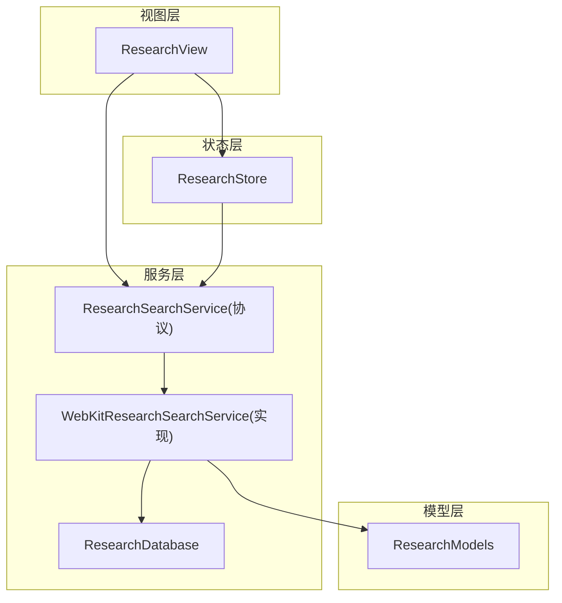
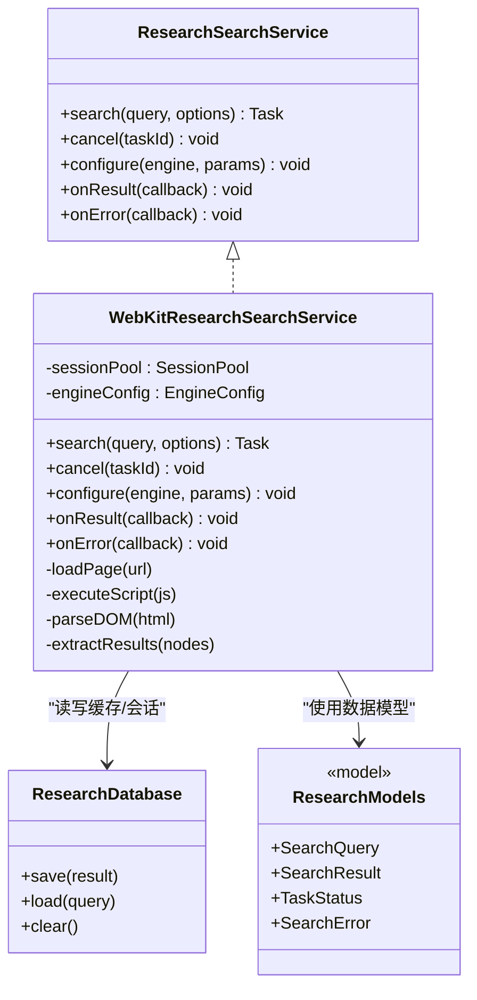
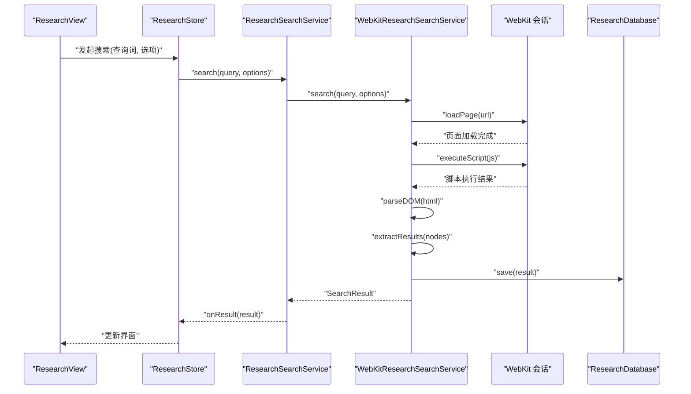
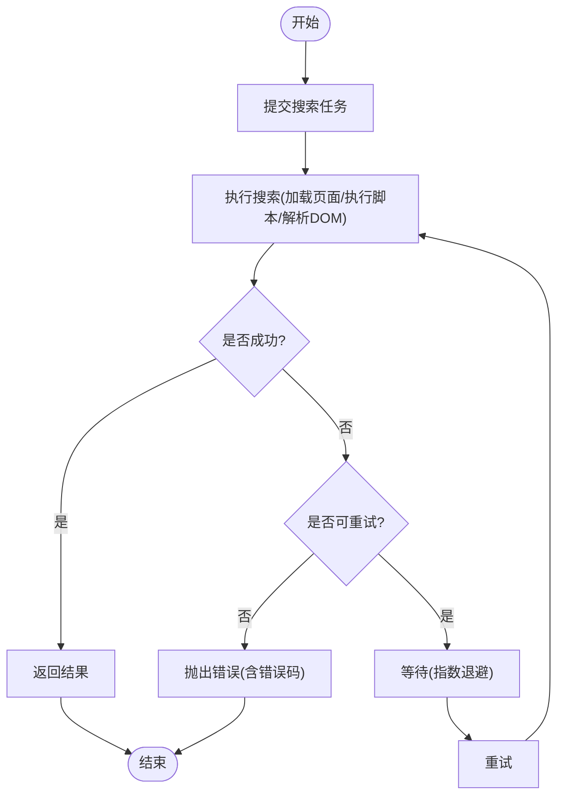
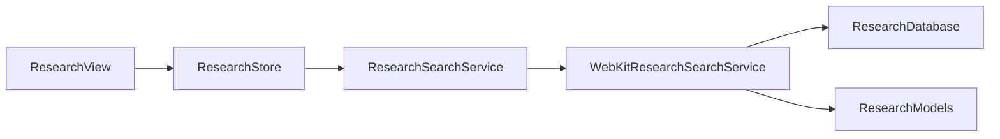

# 研究搜索服务

<cite>
**本文引用的文件**   
- [ResearchSearchService.swift](file://Sources/ChengGao/Services/ResearchSearchService.swift)
- [WebKitResearchSearchService.swift](file://Sources/ChengGao/Services/WebKitResearchSearchService.swift)
- [ResearchDatabase.swift](file://Sources/ChengGao/Services/ResearchDatabase.swift)
- [ResearchStore.swift](file://Sources/ChengGao/Stores/ResearchStore.swift)
- [ResearchModels.swift](file://Sources/ChengGao/Models/ResearchModels.swift)
- [ResearchView.swift](file://Sources/ChengGao/Views/ResearchView.swift)
</cite>

## 目录
1. [简介](#简介)
2. [项目结构](#项目结构)
3. [核心组件](#核心组件)
4. [架构总览](#架构总览)
5. [详细组件分析](#详细组件分析)
6. [依赖关系分析](#依赖关系分析)
7. [性能考虑](#性能考虑)
8. [故障排查指南](#故障排查指南)
9. [结论](#结论)
10. [附录：API 接口文档](#附录api-接口文档)

## 简介
本文件面向“研究搜索服务”的协议设计与实现，重点说明 ResearchSearchService 协议与 WebKitResearchSearchService 的具体实现。文档涵盖以下方面：
- WebKit 浏览器集成架构：页面加载、JavaScript 执行、DOM 解析与搜索结果提取机制
- 搜索任务的异步处理、错误处理与重试策略
- 搜索引擎适配器设计模式及扩展新引擎的方法
- 搜索服务的 API 接口定义（查询参数、返回结果格式、错误码）

该服务通过统一的协议抽象不同搜索引擎的实现细节，并以 WebKit 作为默认渲染与交互后端，提供稳定、可扩展的研究级搜索能力。

## 项目结构
围绕研究搜索功能的相关代码主要分布在 Services、Models、Stores 与 Views 四个层次：
- Services：核心服务层，包含 ResearchSearchService 协议与 WebKitResearchSearchService 实现，以及数据库访问等支撑服务
- Models：数据模型，如 ResearchModels 定义了搜索结果、任务状态等数据结构
- Stores：状态管理，ResearchStore 负责 UI 状态与持久化同步
- Views：UI 层，ResearchView 调用服务并展示结果

图表来源
- [ResearchSearchService.swift](file://Sources/ChengGao/Services/ResearchSearchService.swift)
- [WebKitResearchSearchService.swift](file://Sources/ChengGao/Services/WebKitResearchSearchService.swift)
- [ResearchDatabase.swift](file://Sources/ChengGao/Services/ResearchDatabase.swift)
- [ResearchModels.swift](file://Sources/ChengGao/Models/ResearchModels.swift)
- [ResearchStore.swift](file://Sources/ChengGao/Stores/ResearchStore.swift)
- [ResearchView.swift](file://Sources/ChengGao/Views/ResearchView.swift)

章节来源
- [ResearchSearchService.swift](file://Sources/ChengGao/Services/ResearchSearchService.swift)
- [WebKitResearchSearchService.swift](file://Sources/ChengGao/Services/WebKitResearchSearchService.swift)
- [ResearchDatabase.swift](file://Sources/ChengGao/Services/ResearchDatabase.swift)
- [ResearchModels.swift](file://Sources/ChengGao/Models/ResearchModels.swift)
- [ResearchStore.swift](file://Sources/ChengGao/Stores/ResearchStore.swift)
- [ResearchView.swift](file://Sources/ChengGao/Views/ResearchView.swift)

## 核心组件
- ResearchSearchService 协议：定义搜索服务的统一接口，包括发起搜索、取消任务、监听事件、配置引擎等能力
- WebKitResearchSearchService：基于 WebKit 的默认实现，负责页面生命周期管理、JS 注入与执行、DOM 解析与结果抽取
- ResearchDatabase：用于缓存或持久化搜索结果、会话信息、任务状态等
- ResearchModels：定义搜索请求、响应、任务状态、错误类型等数据模型
- ResearchStore：在 UI 层暴露可观察的状态，驱动界面更新
- ResearchView：用户入口，触发搜索、展示结果、处理用户交互

章节来源
- [ResearchSearchService.swift](file://Sources/ChengGao/Services/ResearchSearchService.swift)
- [WebKitResearchSearchService.swift](file://Sources/ChengGao/Services/WebKitResearchSearchService.swift)
- [ResearchDatabase.swift](file://Sources/ChengGao/Services/ResearchDatabase.swift)
- [ResearchModels.swift](file://Sources/ChengGao/Models/ResearchModels.swift)
- [ResearchStore.swift](file://Sources/ChengGao/Stores/ResearchStore.swift)
- [ResearchView.swift](file://Sources/ChengGao/Views/ResearchView.swift)

## 架构总览
研究搜索服务采用“协议 + 具体实现”的分层架构：
- 上层通过 ResearchSearchService 协议进行调用，屏蔽底层差异
- WebKitResearchSearchService 使用 WebKit 引擎完成页面加载、脚本执行与 DOM 解析，将网页内容结构化后输出为统一的结果模型
- 可选的搜索引擎适配器通过同一协议接入，便于扩展新的搜索后端
- 数据库与状态管理解耦，确保 UI 与服务逻辑清晰分离

图表来源
- [ResearchSearchService.swift](file://Sources/ChengGao/Services/ResearchSearchService.swift)
- [WebKitResearchSearchService.swift](file://Sources/ChengGao/Services/WebKitResearchSearchService.swift)
- [ResearchDatabase.swift](file://Sources/ChengGao/Services/ResearchDatabase.swift)
- [ResearchModels.swift](file://Sources/ChengGao/Models/ResearchModels.swift)

## 详细组件分析

### ResearchSearchService 协议设计
- 职责：定义搜索服务的统一契约，包括搜索、取消、配置、事件回调等
- 关键方法：
  - search：发起一次搜索任务，返回可跟踪的任务对象
  - cancel：根据任务 ID 取消正在进行的任务
  - configure：配置搜索引擎参数（如 UA、代理、超时、选择器规则等）
  - onResult/onError：注册结果与错误回调，支持流式或批量推送
- 设计要点：
  - 以协议隔离实现差异，便于替换或扩展搜索引擎
  - 任务与回调分离，保证 UI 与网络/渲染逻辑解耦
  - 错误类型与状态枚举集中定义，便于统一处理

章节来源
- [ResearchSearchService.swift](file://Sources/ChengGao/Services/ResearchSearchService.swift)
- [ResearchModels.swift](file://Sources/ChengGao/Models/ResearchModels.swift)

### WebKitResearchSearchService 实现
- 职责：基于 WebKit 的页面加载、JS 执行、DOM 解析与结果抽取
- 关键流程：
  - 页面加载：构造目标 URL，创建或复用 WebKit 会话，设置安全策略与超时
  - JavaScript 执行：注入抓取脚本，触发动态渲染或翻页逻辑
  - DOM 解析：获取渲染后的 HTML，按选择器规则提取标题、摘要、链接等字段
  - 结果抽取：将原始节点映射为统一的结构化结果模型
- 资源管理：
  - 会话池：避免频繁创建销毁 WebView，提升性能
  - 任务队列：限制并发，防止内存与 CPU 峰值过高
  - 清理策略：任务完成后释放 DOM 引用与脚本上下文

图表来源
- [WebKitResearchSearchService.swift](file://Sources/ChengGao/Services/WebKitResearchSearchService.swift)
- [ResearchDatabase.swift](file://Sources/ChengGao/Services/ResearchDatabase.swift)
- [ResearchStore.swift](file://Sources/ChengGao/Stores/ResearchStore.swift)
- [ResearchView.swift](file://Sources/ChengGao/Views/ResearchView.swift)

章节来源
- [WebKitResearchSearchService.swift](file://Sources/ChengGao/Services/WebKitResearchSearchService.swift)
- [ResearchDatabase.swift](file://Sources/ChengGao/Services/ResearchDatabase.swift)
- [ResearchStore.swift](file://Sources/ChengGao/Stores/ResearchStore.swift)
- [ResearchView.swift](file://Sources/ChengGao/Views/ResearchView.swift)

### 搜索引擎适配器设计模式
- 设计思想：通过协议抽象不同搜索引擎的行为，将“如何搜索”与“如何使用搜索”解耦
- 扩展步骤：
  - 定义新的搜索引擎适配器类，遵循 ResearchSearchService 协议
  - 实现 search/cancel/configure 等方法，适配特定引擎的请求与响应格式
  - 在配置中注册新引擎，或在运行时切换引擎实例
- 优势：
  - 新增引擎无需修改现有调用方
  - 便于 A/B 测试与灰度发布
  - 统一错误与重试策略，降低维护成本

章节来源
- [ResearchSearchService.swift](file://Sources/ChengGao/Services/ResearchSearchService.swift)
- [WebKitResearchSearchService.swift](file://Sources/ChengGao/Services/WebKitResearchSearchService.swift)

### 搜索任务的异步处理、错误处理与重试策略
- 异步处理：
  - 使用任务对象跟踪进度与状态，支持取消与超时
  - 回调或观察者模式推送结果，避免阻塞主线程
- 错误处理：
  - 区分网络错误、解析错误、业务错误（如无结果、反爬拦截）
  - 统一错误码与消息，便于前端展示与日志记录
- 重试策略：
  - 指数退避：失败后等待时间逐步增加
  - 最大重试次数：防止无限重试导致资源耗尽
  - 条件重试：仅对可恢复错误（如网络抖动）进行重试

章节来源
- [WebKitResearchSearchService.swift](file://Sources/ChengGao/Services/WebKitResearchSearchService.swift)
- [ResearchModels.swift](file://Sources/ChengGao/Models/ResearchModels.swift)

## 依赖关系分析
- 组件耦合：
  - WebKitResearchSearchService 依赖 ResearchDatabase 进行缓存与持久化
  - 所有实现均依赖 ResearchModels 的数据结构
  - UI 层通过 ResearchStore 订阅服务事件，保持低耦合
- 外部依赖：
  - WebKit：用于页面渲染与 JS 执行
  - 网络栈：HTTP/HTTPS 请求、代理、证书校验
  - 存储：SQLite 或本地文件（由 ResearchDatabase 封装）

图表来源
- [ResearchView.swift](file://Sources/ChengGao/Views/ResearchView.swift)
- [ResearchStore.swift](file://Sources/ChengGao/Stores/ResearchStore.swift)
- [ResearchSearchService.swift](file://Sources/ChengGao/Services/ResearchSearchService.swift)
- [WebKitResearchSearchService.swift](file://Sources/ChengGao/Services/WebKitResearchSearchService.swift)
- [ResearchDatabase.swift](file://Sources/ChengGao/Services/ResearchDatabase.swift)
- [ResearchModels.swift](file://Sources/ChengGao/Models/ResearchModels.swift)

章节来源
- [ResearchView.swift](file://Sources/ChengGao/Views/ResearchView.swift)
- [ResearchStore.swift](file://Sources/ChengGao/Stores/ResearchStore.swift)
- [ResearchSearchService.swift](file://Sources/ChengGao/Services/ResearchSearchService.swift)
- [WebKitResearchSearchService.swift](file://Sources/ChengGao/Services/WebKitResearchSearchService.swift)
- [ResearchDatabase.swift](file://Sources/ChengGao/Services/ResearchDatabase.swift)
- [ResearchModels.swift](file://Sources/ChengGao/Models/ResearchModels.swift)

## 性能考虑
- 会话复用：通过会话池减少 WebView 创建开销，降低内存占用
- 并发控制：限制同时执行的搜索任务数量，避免资源争用
- 增量解析：优先解析必要 DOM 片段，减少全量解析耗时
- 缓存策略：对热点查询结果进行短期缓存，提高重复查询效率
- 脚本优化：精简注入的 JS 代码，避免阻塞渲染线程

[本节为通用指导，不直接分析具体文件]

## 故障排查指南
- 常见问题：
  - 页面加载失败：检查网络连通性、代理配置、URL 合法性
  - JS 执行异常：确认注入脚本语法正确、目标页面结构未变更
  - DOM 解析失败：核对选择器规则是否与当前页面匹配
  - 结果缺失：检查抽取逻辑与字段映射是否正确
- 定位手段：
  - 启用调试日志，记录请求、响应与解析过程
  - 使用断点或打印关键变量，验证中间状态
  - 对比不同引擎的输出，快速定位问题范围
- 恢复措施：
  - 调整重试策略与超时参数
  - 更新选择器规则或脚本逻辑
  - 降级到备用引擎或离线缓存

章节来源
- [WebKitResearchSearchService.swift](file://Sources/ChengGao/Services/WebKitResearchSearchService.swift)
- [ResearchModels.swift](file://Sources/ChengGao/Models/ResearchModels.swift)

## 结论
研究搜索服务通过协议抽象与 WebKit 实现，提供了稳定、可扩展的搜索能力。其清晰的架构分层、完善的异步与错误处理机制，以及对搜索引擎适配器的良好支持，使得系统易于维护与扩展。建议在生产环境中结合缓存、监控与日志，持续优化性能与可靠性。

[本节为总结性内容，不直接分析具体文件]

## 附录：API 接口文档
- 查询参数：
  - query：搜索关键词
  - engine：搜索引擎标识（如 webkit、custom）
  - options：附加选项（超时、UA、代理、选择器规则、分页参数等）
- 返回结果格式：
  - results：搜索结果列表，每项包含标题、摘要、链接、来源、时间戳等字段
  - task：任务状态（进行中、已完成、已取消、失败）
  - meta：元信息（页码、总数、耗时等）
- 错误码说明：
  - 网络错误：连接失败、超时、SSL 错误
  - 解析错误：DOM 结构变化、选择器不匹配、脚本执行失败
  - 业务错误：无结果、反爬拦截、权限不足
  - 系统错误：内存不足、资源不可用

章节来源
- [ResearchModels.swift](file://Sources/ChengGao/Models/ResearchModels.swift)
- [ResearchSearchService.swift](file://Sources/ChengGao/Services/ResearchSearchService.swift)
- [WebKitResearchSearchService.swift](file://Sources/ChengGao/Services/WebKitResearchSearchService.swift)