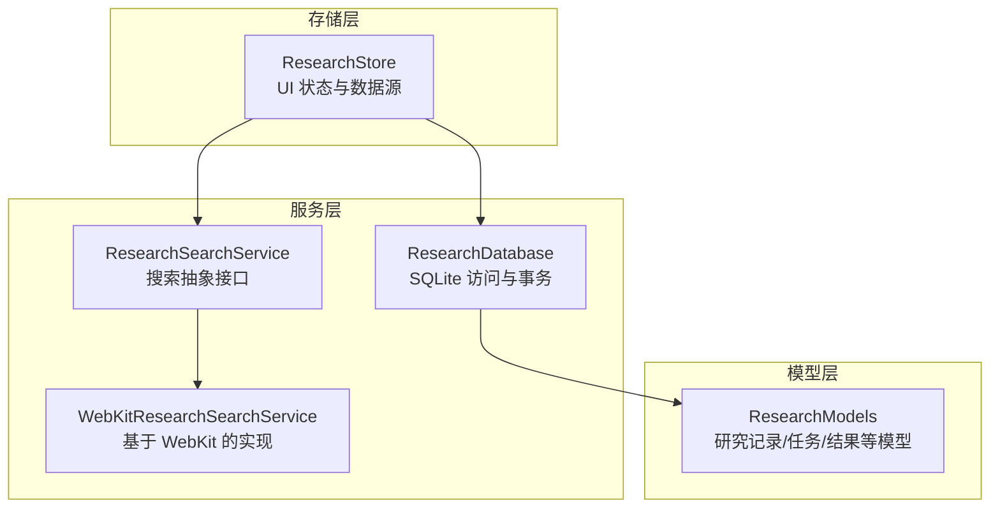
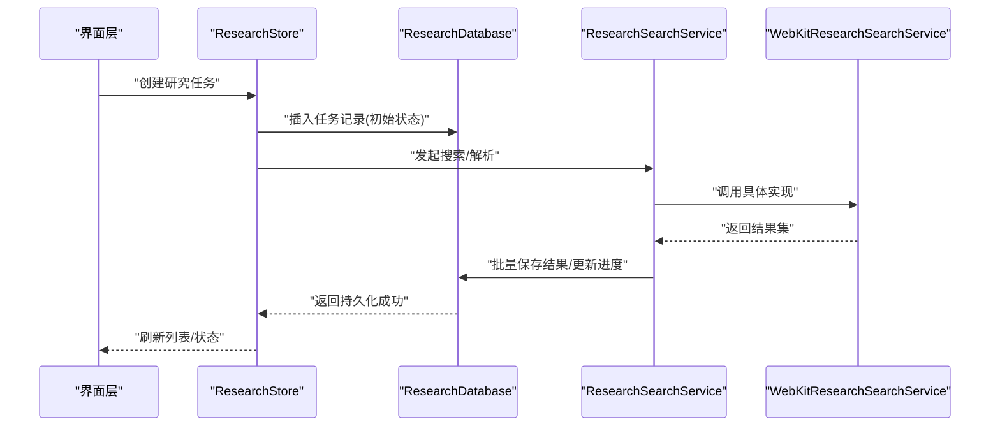
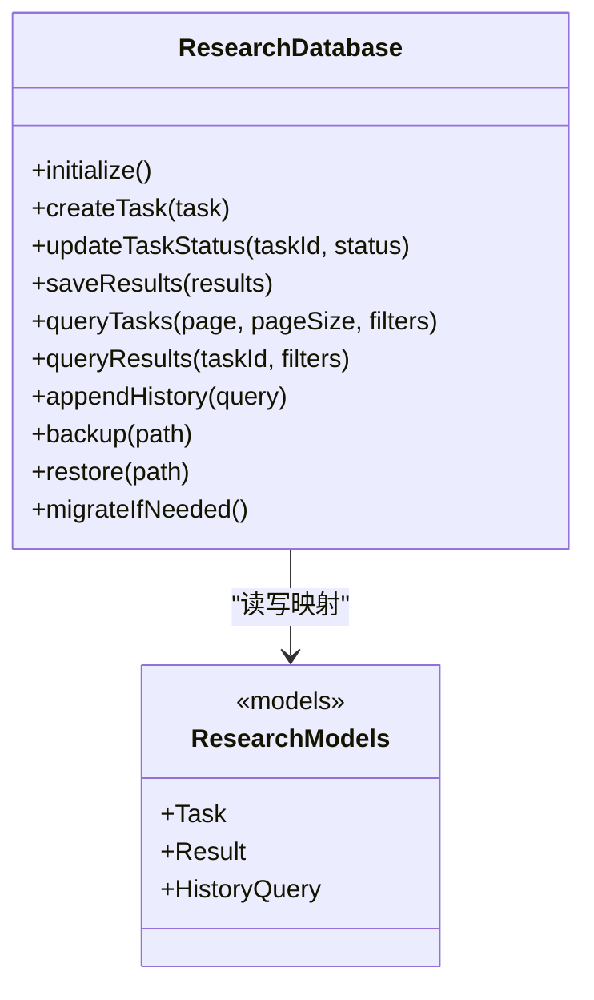
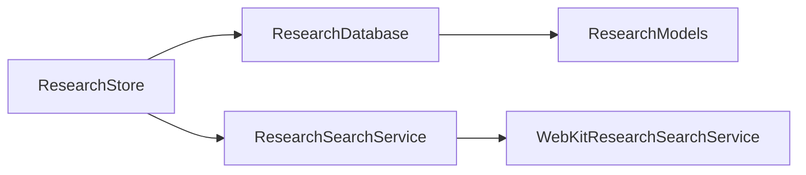

# 研究数据库管理

<cite>
**本文引用的文件**   
- [ResearchDatabase.swift](file://Sources/ChengGao/Services/ResearchDatabase.swift)
- [ResearchModels.swift](file://Sources/ChengGao/Models/ResearchModels.swift)
- [ResearchStore.swift](file://Sources/ChengGao/Stores/ResearchStore.swift)
- [ResearchSearchService.swift](file://Sources/ChengGao/Services/ResearchSearchService.swift)
- [WebKitResearchSearchService.swift](file://Sources/ChengGao/Services/WebKitResearchSearchService.swift)
</cite>

## 目录
1. [简介](#简介)
2. [项目结构](#项目结构)
3. [核心组件](#核心组件)
4. [架构总览](#架构总览)
5. [详细组件分析](#详细组件分析)
6. [依赖关系分析](#依赖关系分析)
7. [性能考虑](#性能考虑)
8. [故障排查指南](#故障排查指南)
9. [结论](#结论)
10. [附录：API 参考与使用示例](#附录api-参考与使用示例)

## 简介
本文件面向“研究数据库管理”主题，聚焦 ResearchDatabase 的 SQLite 存储设计、数据模型与关系、CRUD 操作（创建、读取、更新、删除）、状态流转、结果持久化、历史查询、数据迁移与版本管理、备份恢复策略，以及查询性能优化技巧。文档同时提供 API 参考与使用示例，帮助开发者快速集成并高效使用研究数据库能力。

## 项目结构
围绕研究数据库的核心代码主要分布在 Services、Models、Stores 三个层次：
- Services：封装数据库访问、搜索服务与业务编排
- Models：定义研究相关的数据结构与映射
- Stores：面向上层 UI 的状态管理与数据源聚合

图表来源
- [ResearchDatabase.swift](file://Sources/ChengGao/Services/ResearchDatabase.swift)
- [ResearchModels.swift](file://Sources/ChengGao/Models/ResearchModels.swift)
- [ResearchStore.swift](file://Sources/ChengGao/Stores/ResearchStore.swift)
- [ResearchSearchService.swift](file://Sources/ChengGao/Services/ResearchSearchService.swift)
- [WebKitResearchSearchService.swift](file://Sources/ChengGao/Services/WebKitResearchSearchService.swift)

章节来源
- [ResearchDatabase.swift](file://Sources/ChengGao/Services/ResearchDatabase.swift)
- [ResearchModels.swift](file://Sources/ChengGao/Models/ResearchModels.swift)
- [ResearchStore.swift](file://Sources/ChengGao/Stores/ResearchStore.swift)
- [ResearchSearchService.swift](file://Sources/ChengGao/Services/ResearchSearchService.swift)
- [WebKitResearchSearchService.swift](file://Sources/ChengGao/Services/WebKitResearchSearchService.swift)

## 核心组件
- ResearchDatabase：负责 SQLite 连接、表结构初始化、索引创建、CRUD 操作、事务与并发安全、迁移与备份。
- ResearchModels：定义研究任务、结果、历史记录等数据结构及其与 SQLite 表的映射。
- ResearchStore：为 UI 提供可观察的数据源，聚合数据库读写与搜索服务调用。
- ResearchSearchService / WebKitResearchSearchService：搜索能力的抽象与实现，支持将搜索结果落库或缓存。

章节来源
- [ResearchDatabase.swift](file://Sources/ChengGao/Services/ResearchDatabase.swift)
- [ResearchModels.swift](file://Sources/ChengGao/Models/ResearchModels.swift)
- [ResearchStore.swift](file://Sources/ChengGao/Stores/ResearchStore.swift)
- [ResearchSearchService.swift](file://Sources/ChengGao/Services/ResearchSearchService.swift)
- [WebKitResearchSearchService.swift](file://Sources/ChengGao/Services/WebKitResearchSearchService.swift)

## 架构总览
下图展示了从 UI 到数据库的完整调用链，包括研究任务的创建、执行、结果保存与历史查询。

图表来源
- [ResearchStore.swift](file://Sources/ChengGao/Stores/ResearchStore.swift)
- [ResearchDatabase.swift](file://Sources/ChengGao/Services/ResearchDatabase.swift)
- [ResearchSearchService.swift](file://Sources/ChengGao/Services/ResearchSearchService.swift)
- [WebKitResearchSearchService.swift](file://Sources/ChengGao/Services/WebKitResearchSearchService.swift)

## 详细组件分析

### ResearchDatabase：SQLite 存储设计与 CRUD
- 表结构设计
  - 研究任务表：包含任务标识、标题、关键词、状态、优先级、创建时间、更新时间等字段。
  - 研究结果表：包含结果标识、关联任务 ID、来源、标题、摘要、正文片段、URL、抓取时间、评分等。
  - 历史查询表：包含查询文本、时间戳、过滤条件、结果数量等，用于统计与推荐。
- 索引优化
  - 对常用查询列建立索引，如任务状态、创建时间、结果来源、更新时间等，提升筛选与排序性能。
  - 复合索引用于多条件查询，例如“按状态+时间范围”、“按来源+时间”。
- 数据关系
  - 任务与结果为 1:N 关系；历史查询独立，不直接关联任务/结果，但可通过时间或关键词间接关联。
- CRUD 操作
  - 创建：插入任务、批量插入结果、追加历史查询。
  - 读取：分页查询任务列表、按条件检索结果、历史查询统计。
  - 更新：任务状态流转（待处理/进行中/已完成/失败）、结果标记已读/收藏、去重合并。
  - 删除：软删除或物理删除，支持按任务 ID 级联清理结果。
- 事务与并发
  - 写操作统一在事务中执行，保证一致性；读操作采用只读事务提高并发吞吐。
- 迁移与版本管理
  - 维护数据库版本号，启动时检查并执行增量迁移脚本，确保向后兼容。
- 备份与恢复
  - 提供全量备份（复制数据库文件）与增量备份（导出变更 SQL）；恢复支持覆盖或合并策略。

图表来源
- [ResearchDatabase.swift](file://Sources/ChengGao/Services/ResearchDatabase.swift)
- [ResearchModels.swift](file://Sources/ChengGao/Models/ResearchModels.swift)

章节来源
- [ResearchDatabase.swift](file://Sources/ChengGao/Services/ResearchDatabase.swift)
- [ResearchModels.swift](file://Sources/ChengGao/Models/ResearchModels.swift)

### ResearchModels：数据模型与映射
- Task：任务主键、标题、关键词、状态枚举、优先级、时间戳、扩展元数据。
- Result：结果主键、外键关联任务、来源类型、标题、摘要、正文片段、URL、抓取时间、评分、标签。
- HistoryQuery：查询文本、时间戳、过滤参数、结果计数、是否收藏。
- 映射策略：模型属性与表字段一一对应，支持可选字段与默认值；通过序列化/反序列化工具进行转换。

章节来源
- [ResearchModels.swift](file://Sources/ChengGao/Models/ResearchModels.swift)

### ResearchStore：UI 数据源与状态管理
- 职责：暴露可观察的任务列表、结果集合、历史查询；协调 ResearchDatabase 与搜索服务。
- 生命周期：应用启动时初始化数据库与索引；监听状态变化并通知 UI。
- 典型流程：创建任务 -> 触发搜索 -> 保存结果 -> 刷新 UI。

章节来源
- [ResearchStore.swift](file://Sources/ChengGao/Stores/ResearchStore.swift)

### ResearchSearchService 与 WebKitResearchSearchService：搜索与落库
- ResearchSearchService：定义搜索接口，输入查询与过滤条件，输出结果流。
- WebKitResearchSearchService：基于 WebKit 的网页解析实现，提取标题、摘要、正文片段与 URL，并写入数据库。
- 与数据库集成：批量写入结果、更新任务进度、记录历史查询。

章节来源
- [ResearchSearchService.swift](file://Sources/ChengGao/Services/ResearchSearchService.swift)
- [WebKitResearchSearchService.swift](file://Sources/ChengGao/Services/WebKitResearchSearchService.swift)

## 依赖关系分析
- ResearchStore 依赖 ResearchDatabase 与 ResearchSearchService。
- ResearchDatabase 依赖 ResearchModels 进行数据映射。
- WebKitResearchSearchService 作为具体实现，被 ResearchSearchService 抽象解耦。

图表来源
- [ResearchStore.swift](file://Sources/ChengGao/Stores/ResearchStore.swift)
- [ResearchDatabase.swift](file://Sources/ChengGao/Services/ResearchDatabase.swift)
- [ResearchSearchService.swift](file://Sources/ChengGao/Services/ResearchSearchService.swift)
- [WebKitResearchSearchService.swift](file://Sources/ChengGao/Services/WebKitResearchSearchService.swift)
- [ResearchModels.swift](file://Sources/ChengGao/Models/ResearchModels.swift)

章节来源
- [ResearchStore.swift](file://Sources/ChengGao/Stores/ResearchStore.swift)
- [ResearchDatabase.swift](file://Sources/ChengGao/Services/ResearchDatabase.swift)
- [ResearchSearchService.swift](file://Sources/ChengGao/Services/ResearchSearchService.swift)
- [WebKitResearchSearchService.swift](file://Sources/ChengGao/Services/WebKitResearchSearchService.swift)
- [ResearchModels.swift](file://Sources/ChengGao/Models/ResearchModels.swift)

## 性能考虑
- 复杂查询构建
  - 使用预编译语句与参数绑定，避免 SQL 注入与重复解析。
  - 合理选择 WHERE、JOIN、GROUP BY，减少回表与临时表。
- 分页查询
  - 基于游标或键集分页，避免 OFFSET 在大偏移时的性能退化。
  - 对排序列建立索引，确保 ORDER BY 高效。
- 缓存策略
  - 热点查询结果短期缓存（内存），设置过期时间与失效策略。
  - 结果去重与增量更新，减少重复写入。
- 事务与批处理
  - 批量插入/更新包裹在单一事务中，降低磁盘 I/O 次数。
  - 读操作使用只读事务，提高并发度。
- 索引优化
  - 针对高频过滤与排序列建立单列或复合索引。
  - 定期分析慢查询日志，调整索引与查询计划。

[本节为通用性能建议，不直接分析具体文件]

## 故障排查指南
- 常见问题
  - 数据库锁定：检查是否存在长时间未提交的事务或并发写冲突。
  - 索引缺失导致慢查询：通过 EXPLAIN 分析查询计划，补充必要索引。
  - 迁移失败：核对版本号与迁移脚本顺序，保留回滚方案。
  - 备份恢复异常：校验备份文件完整性，恢复前备份当前数据。
- 调试手段
  - 启用 SQLite 日志与慢查询监控。
  - 在关键路径添加断点与日志，追踪事务边界与错误码。
  - 使用只读副本进行问题复现与诊断。

章节来源
- [ResearchDatabase.swift](file://Sources/ChengGao/Services/ResearchDatabase.swift)

## 结论
ResearchDatabase 以 SQLite 为核心，结合清晰的数据模型、完善的索引与事务管理，提供了稳定高效的研究数据存储与查询能力。配合 ResearchStore 与搜索服务，形成从任务创建、执行、结果保存到历史查询的完整闭环。通过合理的迁移与备份策略，保障数据的长期可用性与可恢复性。遵循本文的性能优化与故障排查建议，可进一步提升系统的稳定性与响应速度。

[本节为总结性内容，不直接分析具体文件]

## 附录：API 参考与使用示例

### ResearchDatabase API
- initialize：初始化数据库与索引
- createTask：创建研究任务
- updateTaskStatus：更新任务状态
- saveResults：批量保存结果
- queryTasks：分页查询任务列表
- queryResults：按条件查询结果
- appendHistory：追加历史查询
- backup：全量备份
- restore：恢复数据库
- migrateIfNeeded：检查并执行迁移

使用示例（步骤说明）
- 创建任务：调用 createTask 传入任务信息，返回任务标识。
- 保存结果：调用 saveResults 批量写入结果，关联任务标识。
- 查询任务：调用 queryTasks 指定页码、每页大小与过滤条件。
- 更新状态：调用 updateTaskStatus 推进任务状态。
- 备份恢复：调用 backup 生成备份文件；恢复时调用 restore 指定路径。

章节来源
- [ResearchDatabase.swift](file://Sources/ChengGao/Services/ResearchDatabase.swift)

### ResearchStore API
- 暴露可观察的任务列表、结果集合、历史查询
- 协调数据库与搜索服务，驱动 UI 刷新

使用示例（步骤说明）
- 订阅数据源：监听任务列表与结果集合的变化。
- 触发搜索：调用搜索服务获取结果并落库。
- 刷新 UI：根据数据库返回更新界面显示。

章节来源
- [ResearchStore.swift](file://Sources/ChengGao/Stores/ResearchStore.swift)

### 搜索服务 API
- ResearchSearchService：定义搜索接口
- WebKitResearchSearchService：基于 WebKit 的具体实现

使用示例（步骤说明）
- 配置搜索参数：设置查询文本、过滤条件与目标来源。
- 执行搜索：调用搜索接口获取结果流。
- 落库与更新：将结果写入数据库并更新任务进度。

章节来源
- [ResearchSearchService.swift](file://Sources/ChengGao/Services/ResearchSearchService.swift)
- [WebKitResearchSearchService.swift](file://Sources/ChengGao/Services/WebKitResearchSearchService.swift)