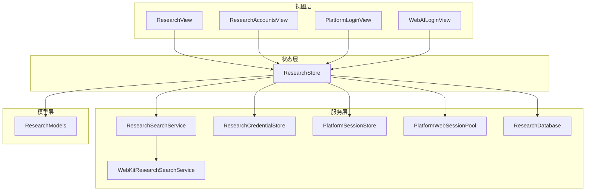
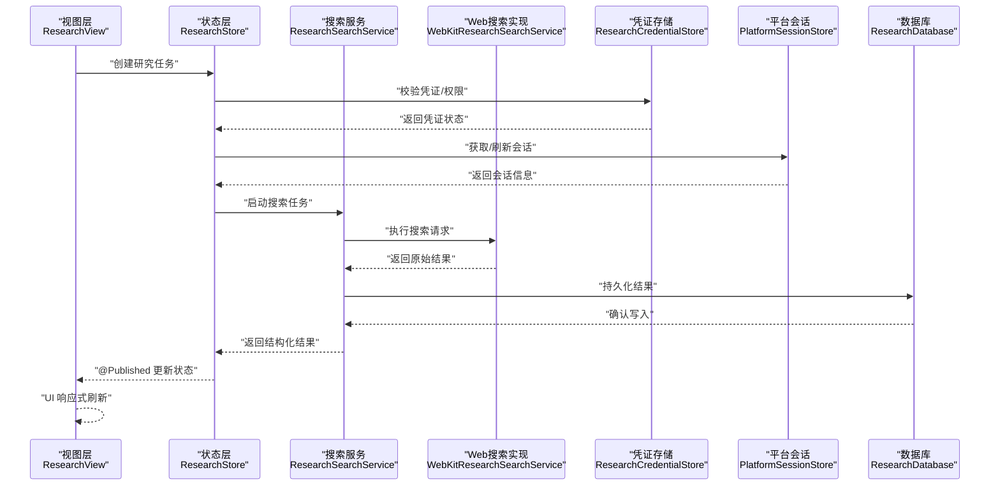
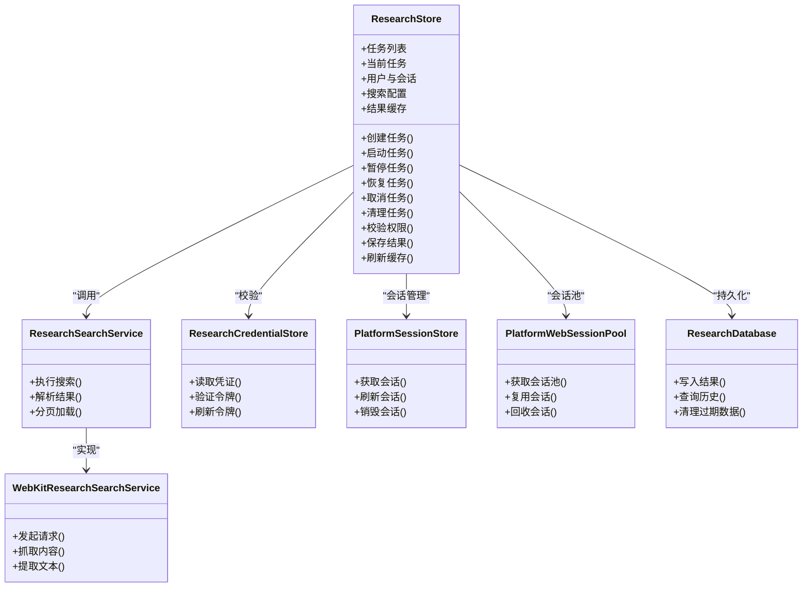
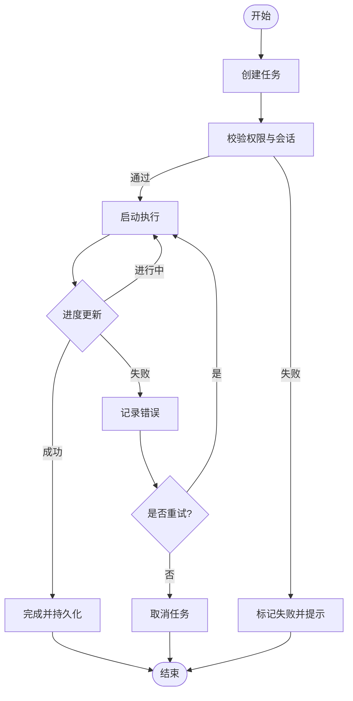
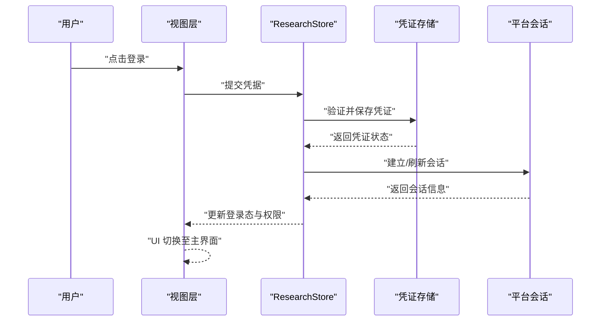
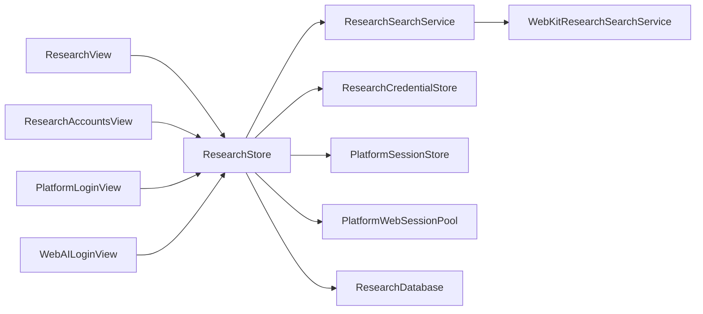

# 研究状态管理

<cite>
**本文档引用的文件**
- [ResearchStore.swift](file://Sources/ChengGao/Stores/ResearchStore.swift)
- [ResearchView.swift](file://Sources/ChengGao/Views/ResearchView.swift)
- [ResearchAccountsView.swift](file://Sources/ChengGao/Views/ResearchAccountsView.swift)
- [PlatformLoginView.swift](file://Sources/ChengGao/Views/PlatformLoginView.swift)
- [WebAILoginView.swift](file://Sources/ChengGao/Views/WebAILoginView.swift)
- [ResearchModels.swift](file://Sources/ChengGao/Models/ResearchModels.swift)
- [ResearchSearchService.swift](file://Sources/ChengGao/Services/ResearchSearchService.swift)
- [WebKitResearchSearchService.swift](file://Sources/ChengGao/Services/WebKitResearchSearchService.swift)
- [ResearchCredentialStore.swift](file://Sources/ChengGao/Services/ResearchCredentialStore.swift)
- [PlatformSessionStore.swift](file://Sources/ChengGao/Services/PlatformSessionStore.swift)
- [PlatformWebSessionPool.swift](file://Sources/ChengGao/Services/PlatformWebSessionPool.swift)
- [ResearchDatabase.swift](file://Sources/ChengGao/Services/ResearchDatabase.swift)
</cite>

## 目录
1. [简介](#简介)
2. [项目结构](#项目结构)
3. [核心组件](#核心组件)
4. [架构总览](#架构总览)
5. [详细组件分析](#详细组件分析)
6. [依赖关系分析](#依赖关系分析)
7. [性能考虑](#性能考虑)
8. [故障排查指南](#故障排查指南)
9. [结论](#结论)
10. [附录](#附录)

## 简介
本文件面向 SwiftUI 应用中的“研究”功能模块，系统性阐述 ResearchStore 的状态管理设计。重点包括：
- 使用 @StateObject 与 @Published 构建响应式状态源
- 研究任务从创建、执行到完成的全生命周期状态转换
- 多用户会话管理、登录状态同步与权限控制机制
- 实时数据绑定、UI 响应式更新与性能优化策略
- 最佳实践与常见问题解决方案

## 项目结构
围绕“研究”功能的代码主要分布在 Stores、Views、Services、Models 四个层次：
- Stores: 集中管理状态与业务逻辑（ResearchStore）
- Views: SwiftUI 界面层，订阅状态并渲染 UI
- Services: 网络搜索、凭证存储、会话池、数据库等能力
- Models: 研究相关的数据模型定义

图表来源
- [ResearchStore.swift](file://Sources/ChengGao/Stores/ResearchStore.swift)
- [ResearchView.swift](file://Sources/ChengGao/Views/ResearchView.swift)
- [ResearchAccountsView.swift](file://Sources/ChengGao/Views/ResearchAccountsView.swift)
- [PlatformLoginView.swift](file://Sources/ChengGao/Views/PlatformLoginView.swift)
- [WebAILoginView.swift](file://Sources/ChengGao/Views/WebAILoginView.swift)
- [ResearchSearchService.swift](file://Sources/ChengGao/Services/ResearchSearchService.swift)
- [WebKitResearchSearchService.swift](file://Sources/ChengGao/Services/WebKitResearchSearchService.swift)
- [ResearchCredentialStore.swift](file://Sources/ChengGao/Services/ResearchCredentialStore.swift)
- [PlatformSessionStore.swift](file://Sources/ChengGao/Services/PlatformSessionStore.swift)
- [PlatformWebSessionPool.swift](file://Sources/ChengGao/Services/PlatformWebSessionPool.swift)
- [ResearchDatabase.swift](file://Sources/ChengGao/Services/ResearchDatabase.swift)
- [ResearchModels.swift](file://Sources/ChengGao/Models/ResearchModels.swift)

章节来源
- [ResearchStore.swift](file://Sources/ChengGao/Stores/ResearchStore.swift)
- [ResearchView.swift](file://Sources/ChengGao/Views/ResearchView.swift)
- [ResearchAccountsView.swift](file://Sources/ChengGao/Views/ResearchAccountsView.swift)
- [PlatformLoginView.swift](file://Sources/ChengGao/Views/PlatformLoginView.swift)
- [WebAILoginView.swift](file://Sources/ChengGao/Views/WebAILoginView.swift)
- [ResearchSearchService.swift](file://Sources/ChengGao/Services/ResearchSearchService.swift)
- [WebKitResearchSearchService.swift](file://Sources/ChengGao/Services/WebKitResearchSearchService.swift)
- [ResearchCredentialStore.swift](file://Sources/ChengGao/Services/ResearchCredentialStore.swift)
- [PlatformSessionStore.swift](file://Sources/ChengGao/Services/PlatformSessionStore.swift)
- [PlatformWebSessionPool.swift](file://Sources/ChengGao/Services/PlatformWebSessionPool.swift)
- [ResearchDatabase.swift](file://Sources/ChengGao/Services/ResearchDatabase.swift)
- [ResearchModels.swift](file://Sources/ChengGao/Models/ResearchModels.swift)

## 核心组件
- ResearchStore
  - 作为 SwiftUI 的单一状态源，使用 @StateObject 在视图层级内保持实例稳定
  - 通过 @Published 暴露可观察属性，驱动 UI 自动刷新
  - 封装研究任务的生命周期方法：创建、启动、暂停、恢复、取消、清理
  - 维护当前用户会话、平台登录态、权限标志、搜索结果缓存等
- 视图层（ResearchView、ResearchAccountsView、PlatformLoginView、WebAILoginView）
  - 以 @StateObject 或 @ObservedObject 持有 ResearchStore 引用
  - 根据状态变化呈现不同 UI（如加载中、结果列表、错误提示）
- 服务层（ResearchSearchService、WebKitResearchSearchService、ResearchCredentialStore、PlatformSessionStore、PlatformWebSessionPool、ResearchDatabase）
  - 提供搜索、凭证、会话、持久化等能力
  - 与 ResearchStore 协作，完成异步任务与状态回写

章节来源
- [ResearchStore.swift](file://Sources/ChengGao/Stores/ResearchStore.swift)
- [ResearchView.swift](file://Sources/ChengGao/Views/ResearchView.swift)
- [ResearchAccountsView.swift](file://Sources/ChengGao/Views/ResearchAccountsView.swift)
- [PlatformLoginView.swift](file://Sources/ChengGao/Views/PlatformLoginView.swift)
- [WebAILoginView.swift](file://Sources/ChengGao/Views/WebAILoginView.swift)
- [ResearchSearchService.swift](file://Sources/ChengGao/Services/ResearchSearchService.swift)
- [WebKitResearchSearchService.swift](file://Sources/ChengGao/Services/WebKitResearchSearchService.swift)
- [ResearchCredentialStore.swift](file://Sources/ChengGao/Services/ResearchCredentialStore.swift)
- [PlatformSessionStore.swift](file://Sources/ChengGao/Services/PlatformSessionStore.swift)
- [PlatformWebSessionPool.swift](file://Sources/ChengGao/Services/PlatformWebSessionPool.swift)
- [ResearchDatabase.swift](file://Sources/ChengGao/Services/ResearchDatabase.swift)

## 架构总览
下图展示了“研究”功能的核心交互流程：视图层通过 ResearchStore 发起操作，Store 调用服务层完成工作，并将结果以 @Published 形式回推至 UI。

图表来源
- [ResearchStore.swift](file://Sources/ChengGao/Stores/ResearchStore.swift)
- [ResearchSearchService.swift](file://Sources/ChengGao/Services/ResearchSearchService.swift)
- [WebKitResearchSearchService.swift](file://Sources/ChengGao/Services/WebKitResearchSearchService.swift)
- [ResearchCredentialStore.swift](file://Sources/ChengGao/Services/ResearchCredentialStore.swift)
- [PlatformSessionStore.swift](file://Sources/ChengGao/Services/PlatformSessionStore.swift)
- [ResearchDatabase.swift](file://Sources/ChengGao/Services/ResearchDatabase.swift)

## 详细组件分析

### ResearchStore 状态模型与职责
- 状态模型
  - 研究任务集合：包含任务 ID、标题、状态、进度、错误信息等字段
  - 当前活跃任务：用于 UI 聚焦展示
  - 用户与会话：当前用户标识、平台登录态、权限标志
  - 搜索配置与缓存：关键词、过滤条件、结果缓存
- 关键职责
  - 任务生命周期管理：创建、启动、暂停、恢复、取消、清理
  - 权限与登录态校验：在任务开始前检查凭证与会话有效性
  - 结果聚合与持久化：将搜索结果落库并更新缓存
  - 错误处理与重试：统一捕获异常并提供重试入口
  - 事件通知：通过 @Published 向 UI 推送状态变更

图表来源
- [ResearchStore.swift](file://Sources/ChengGao/Stores/ResearchStore.swift)
- [ResearchSearchService.swift](file://Sources/ChengGao/Services/ResearchSearchService.swift)
- [WebKitResearchSearchService.swift](file://Sources/ChengGao/Services/WebKitResearchSearchService.swift)
- [ResearchCredentialStore.swift](file://Sources/ChengGao/Services/ResearchCredentialStore.swift)
- [PlatformSessionStore.swift](file://Sources/ChengGao/Services/PlatformSessionStore.swift)
- [PlatformWebSessionPool.swift](file://Sources/ChengGao/Services/PlatformWebSessionPool.swift)
- [ResearchDatabase.swift](file://Sources/ChengGao/Services/ResearchDatabase.swift)

章节来源
- [ResearchStore.swift](file://Sources/ChengGao/Stores/ResearchStore.swift)
- [ResearchSearchService.swift](file://Sources/ChengGao/Services/ResearchSearchService.swift)
- [WebKitResearchSearchService.swift](file://Sources/ChengGao/Services/WebKitResearchSearchService.swift)
- [ResearchCredentialStore.swift](file://Sources/ChengGao/Services/ResearchCredentialStore.swift)
- [PlatformSessionStore.swift](file://Sources/ChengGao/Services/PlatformSessionStore.swift)
- [PlatformWebSessionPool.swift](file://Sources/ChengGao/Services/PlatformWebSessionPool.swift)
- [ResearchDatabase.swift](file://Sources/ChengGao/Services/ResearchDatabase.swift)

### 研究任务生命周期
- 状态机概览
  - 待创建 -> 已创建 -> 运行中 -> 已完成 / 失败 / 已取消
  - 支持暂停/恢复，失败时提供重试入口
- 关键流程
  - 创建：初始化任务元数据与默认配置
  - 启动：校验权限与会话，准备搜索参数
  - 执行：调用搜索服务，逐步拉取结果并更新进度
  - 完成：持久化结果，更新缓存，触发 UI 刷新
  - 失败：记录错误原因，允许重试或取消
  - 取消：中断网络请求，清理临时资源

图表来源
- [ResearchStore.swift](file://Sources/ChengGao/Stores/ResearchStore.swift)
- [ResearchSearchService.swift](file://Sources/ChengGao/Services/ResearchSearchService.swift)

章节来源
- [ResearchStore.swift](file://Sources/ChengGao/Stores/ResearchStore.swift)
- [ResearchSearchService.swift](file://Sources/ChengGao/Services/ResearchSearchService.swift)

### 多用户会话管理与登录状态同步
- 多用户与会话
  - 每个用户拥有独立凭证与会话上下文
  - 平台会话由 PlatformSessionStore 统一管理，支持刷新与销毁
- 登录状态同步
  - 登录成功后更新凭证与权限标志
  - 跨视图共享登录态，避免重复登录
- 权限控制
  - 在执行敏感操作前校验权限
  - 未授权时引导用户进行认证

图表来源
- [ResearchStore.swift](file://Sources/ChengGao/Stores/ResearchStore.swift)
- [ResearchCredentialStore.swift](file://Sources/ChengGao/Services/ResearchCredentialStore.swift)
- [PlatformSessionStore.swift](file://Sources/ChengGao/Services/PlatformSessionStore.swift)
- [PlatformLoginView.swift](file://Sources/ChengGao/Views/PlatformLoginView.swift)
- [WebAILoginView.swift](file://Sources/ChengGao/Views/WebAILoginView.swift)

章节来源
- [ResearchStore.swift](file://Sources/ChengGao/Stores/ResearchStore.swift)
- [ResearchCredentialStore.swift](file://Sources/ChengGao/Services/ResearchCredentialStore.swift)
- [PlatformSessionStore.swift](file://Sources/ChengGao/Services/PlatformSessionStore.swift)
- [PlatformLoginView.swift](file://Sources/ChengGao/Views/PlatformLoginView.swift)
- [WebAILoginView.swift](file://Sources/ChengGao/Views/WebAILoginView.swift)

### 实时数据绑定与 UI 响应式更新
- 使用 @Published 暴露状态，确保 SwiftUI 自动重绘
- 使用 @StateObject 保证 Store 实例在视图层级内稳定存在
- 对大数据集采用懒加载与分页，减少初始渲染压力
- 通过局部状态与计算属性降低不必要的重绘

章节来源
- [ResearchStore.swift](file://Sources/ChengGao/Stores/ResearchStore.swift)
- [ResearchView.swift](file://Sources/ChengGao/Views/ResearchView.swift)

### 性能优化策略
- 状态粒度控制：仅发布必要字段，避免全量更新
- 防抖与节流：对频繁输入与滚动进行限流
- 并发控制：限制并行搜索任务数量，避免资源争用
- 缓存策略：结果缓存与去重，提升二次访问速度
- 内存管理：及时释放大对象与网络资源

章节来源
- [ResearchStore.swift](file://Sources/ChengGao/Stores/ResearchStore.swift)
- [ResearchSearchService.swift](file://Sources/ChengGao/Services/ResearchSearchService.swift)

## 依赖关系分析
- ResearchStore 依赖搜索服务、凭证存储、会话管理与数据库
- 视图层仅依赖 ResearchStore，不直接耦合底层服务
- 搜索服务内部可能依赖 WebKit 实现进行网页抓取
- 会话池为多个会话提供复用与回收

图表来源
- [ResearchStore.swift](file://Sources/ChengGao/Stores/ResearchStore.swift)
- [ResearchSearchService.swift](file://Sources/ChengGao/Services/ResearchSearchService.swift)
- [WebKitResearchSearchService.swift](file://Sources/ChengGao/Services/WebKitResearchSearchService.swift)
- [ResearchCredentialStore.swift](file://Sources/ChengGao/Services/ResearchCredentialStore.swift)
- [PlatformSessionStore.swift](file://Sources/ChengGao/Services/PlatformSessionStore.swift)
- [PlatformWebSessionPool.swift](file://Sources/ChengGao/Services/PlatformWebSessionPool.swift)
- [ResearchDatabase.swift](file://Sources/ChengGao/Services/ResearchDatabase.swift)
- [ResearchView.swift](file://Sources/ChengGao/Views/ResearchView.swift)
- [ResearchAccountsView.swift](file://Sources/ChengGao/Views/ResearchAccountsView.swift)
- [PlatformLoginView.swift](file://Sources/ChengGao/Views/PlatformLoginView.swift)
- [WebAILoginView.swift](file://Sources/ChengGao/Views/WebAILoginView.swift)

章节来源
- [ResearchStore.swift](file://Sources/ChengGao/Stores/ResearchStore.swift)
- [ResearchSearchService.swift](file://Sources/ChengGao/Services/ResearchSearchService.swift)
- [WebKitResearchSearchService.swift](file://Sources/ChengGao/Services/WebKitResearchSearchService.swift)
- [ResearchCredentialStore.swift](file://Sources/ChengGao/Services/ResearchCredentialStore.swift)
- [PlatformSessionStore.swift](file://Sources/ChengGao/Services/PlatformSessionStore.swift)
- [PlatformWebSessionPool.swift](file://Sources/ChengGao/Services/PlatformWebSessionPool.swift)
- [ResearchDatabase.swift](file://Sources/ChengGao/Services/ResearchDatabase.swift)
- [ResearchView.swift](file://Sources/ChengGao/Views/ResearchView.swift)
- [ResearchAccountsView.swift](file://Sources/ChengGao/Views/ResearchAccountsView.swift)
- [PlatformLoginView.swift](file://Sources/ChengGao/Views/PlatformLoginView.swift)
- [WebAILoginView.swift](file://Sources/ChengGao/Views/WebAILoginView.swift)

## 性能考虑
- 合理划分状态：将频繁变化的状态与静态配置分离
- 延迟加载：仅在需要时加载大量数据
- 并发限制：控制后台任务数量，避免阻塞主线程
- 缓存命中：优先使用本地缓存，减少网络开销
- 内存监控：关注大图与大文本对象的释放时机

[本节为通用指导，无需特定文件引用]

## 故障排查指南
- 常见症状
  - UI 无刷新：检查 @Published 是否正确更新
  - 登录失败：查看凭证存储与会话状态
  - 搜索超时：检查网络权限与服务可用性
  - 内存飙升：定位未释放的大对象与图片资源
- 排查步骤
  - 打印关键状态变更日志
  - 断点调试服务调用链
  - 检查权限与网络配置
  - 清理缓存并重启应用

章节来源
- [ResearchStore.swift](file://Sources/ChengGao/Stores/ResearchStore.swift)
- [ResearchCredentialStore.swift](file://Sources/ChengGao/Services/ResearchCredentialStore.swift)
- [PlatformSessionStore.swift](file://Sources/ChengGao/Services/PlatformSessionStore.swift)
- [ResearchSearchService.swift](file://Sources/ChengGao/Services/ResearchSearchService.swift)

## 结论
ResearchStore 通过 @StateObject 与 @Published 构建了清晰、可观测的状态中心，配合服务层实现了研究任务的完整生命周期管理。多用户与会话管理机制确保了权限控制与登录态同步。通过合理的性能优化策略与故障排查手段，可在复杂场景下保持应用的稳定性与流畅性。

[本节为总结性内容，无需特定文件引用]

## 附录
- 最佳实践
  - 单一状态源：所有研究相关状态集中在 ResearchStore
  - 不可变更新：通过新值替换旧值，避免部分修改导致的不一致
  - 明确错误边界：统一捕获并上报错误，便于问题定位
  - 渐进增强：先保证基础功能，再叠加高级特性
- 常见问题
  - 状态丢失：确保 @StateObject 生命周期正确
  - 竞态条件：对并发任务加锁或序列化
  - 内存泄漏：注意闭包捕获与观察者解绑

[本节为补充说明，无需特定文件引用]