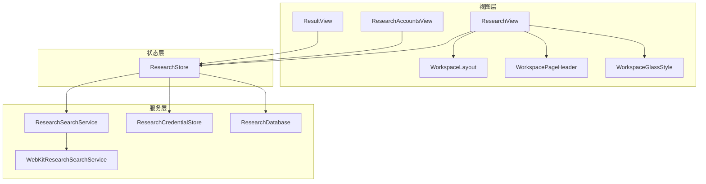
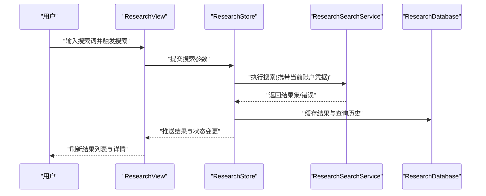
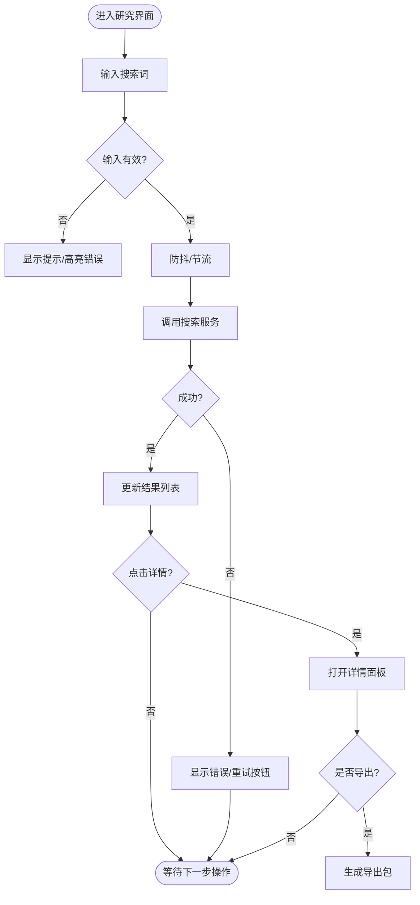
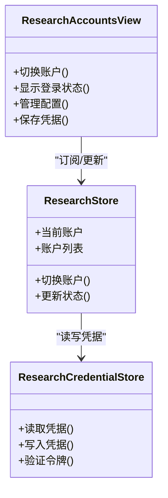
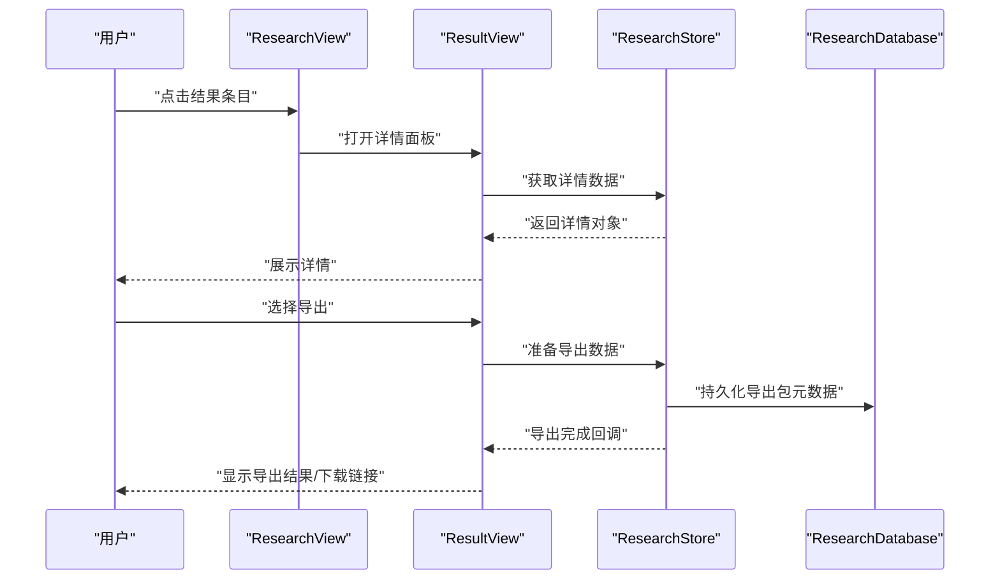
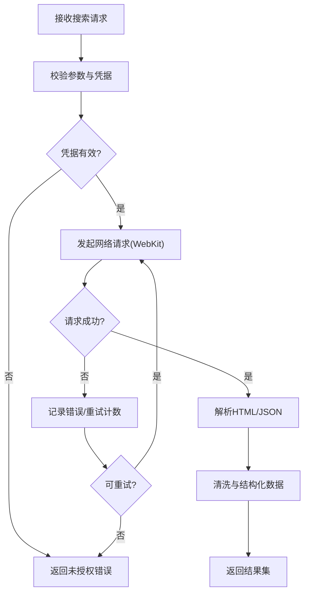
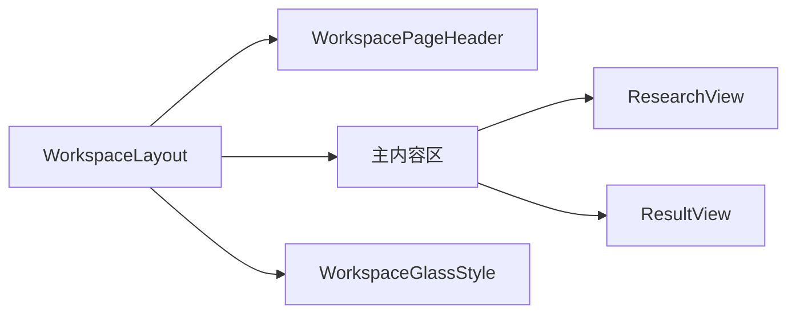
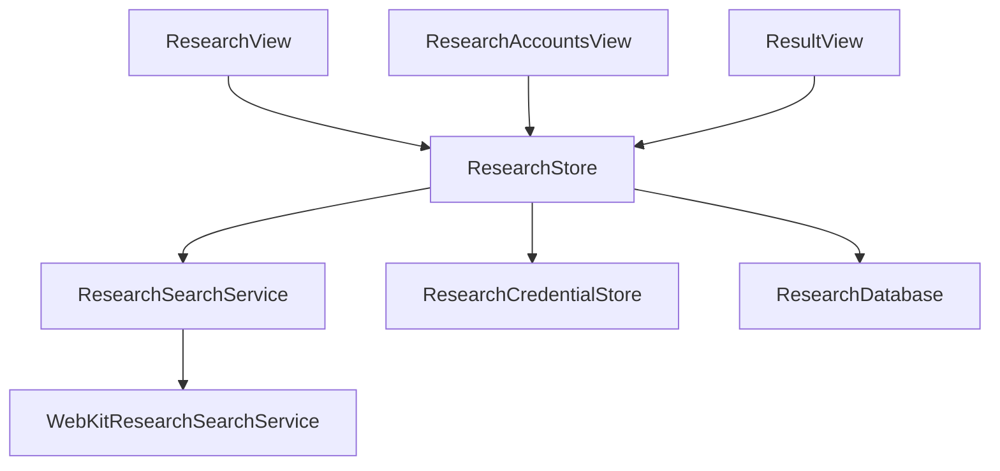

# 研究界面组件

<cite>
**本文引用的文件**   
- [ResearchView.swift](file://Sources/ChengGao/Views/ResearchView.swift)
- [ResearchAccountsView.swift](file://Sources/ChengGao/Views/ResearchAccountsView.swift)
- [ResultView.swift](file://Sources/ChengGao/Views/ResultView.swift)
- [ResearchStore.swift](file://Sources/ChengGao/Stores/ResearchStore.swift)
- [ResearchSearchService.swift](file://Sources/ChengGao/Services/ResearchSearchService.swift)
- [WebKitResearchSearchService.swift](file://Sources/ChengGao/Services/WebKitResearchSearchService.swift)
- [ResearchCredentialStore.swift](file://Sources/ChengGao/Services/ResearchCredentialStore.swift)
- [ResearchDatabase.swift](file://Sources/ChengGao/Services/ResearchDatabase.swift)
- [WorkspaceLayout.swift](file://Sources/ChengGao/Views/WorkspaceLayout.swift)
- [WorkspacePageHeader.swift](file://Sources/ChengGao/Views/WorkspacePageHeader.swift)
- [WorkspaceGlassStyle.swift](file://Sources/ChengGao/Views/WorkspaceGlassStyle.swift)
</cite>

## 目录
1. [简介](#简介)
2. [项目结构](#项目结构)
3. [核心组件](#核心组件)
4. [架构总览](#架构总览)
5. [详细组件分析](#详细组件分析)
6. [依赖关系分析](#依赖关系分析)
7. [性能考量](#性能考量)
8. [故障排查指南](#故障排查指南)
9. [结论](#结论)
10. [附录](#附录)

## 简介
本文件面向研究与检索类界面的 SwiftUI 组件，重点说明 ResearchView 主界面与 ResearchAccountsView 多账户管理界面的设计、交互流程与扩展点。内容涵盖：
- 搜索框、结果展示区域与导航布局的组织方式
- 多账户切换、登录状态显示与配置管理
- 响应式设计与主题适配（含毛玻璃风格）
- 国际化支持要点
- 用户交互流程：搜索触发、结果筛选、详情查看、导出
- UI 自定义选项与样式定制指南

## 项目结构
研究相关的前端视图位于 Views 目录，数据与业务逻辑通过 Stores 与 Services 层解耦，UI 通过 Store 订阅状态变化并驱动渲染。关键文件包括：
- 视图层：ResearchView、ResearchAccountsView、ResultView、WorkspaceLayout、WorkspacePageHeader、WorkspaceGlassStyle
- 状态层：ResearchStore
- 服务层：ResearchSearchService、WebKitResearchSearchService、ResearchCredentialStore、ResearchDatabase

图表来源
- [ResearchView.swift](file://Sources/ChengGao/Views/ResearchView.swift)
- [ResearchAccountsView.swift](file://Sources/ChengGao/Views/ResearchAccountsView.swift)
- [ResultView.swift](file://Sources/ChengGao/Views/ResultView.swift)
- [ResearchStore.swift](file://Sources/ChengGao/Stores/ResearchStore.swift)
- [ResearchSearchService.swift](file://Sources/ChengGao/Services/ResearchSearchService.swift)
- [WebKitResearchSearchService.swift](file://Sources/ChengGao/Services/WebKitResearchSearchService.swift)
- [ResearchCredentialStore.swift](file://Sources/ChengGao/Services/ResearchCredentialStore.swift)
- [ResearchDatabase.swift](file://Sources/ChengGao/Services/ResearchDatabase.swift)
- [WorkspaceLayout.swift](file://Sources/ChengGao/Views/WorkspaceLayout.swift)
- [WorkspacePageHeader.swift](file://Sources/ChengGao/Views/WorkspacePageHeader.swift)
- [WorkspaceGlassStyle.swift](file://Sources/ChengGao/Views/WorkspaceGlassStyle.swift)

章节来源
- [ResearchView.swift](file://Sources/ChengGao/Views/ResearchView.swift)
- [ResearchAccountsView.swift](file://Sources/ChengGao/Views/ResearchAccountsView.swift)
- [ResultView.swift](file://Sources/ChengGao/Views/ResultView.swift)
- [ResearchStore.swift](file://Sources/ChengGao/Stores/ResearchStore.swift)
- [ResearchSearchService.swift](file://Sources/ChengGao/Services/ResearchSearchService.swift)
- [WebKitResearchSearchService.swift](file://Sources/ChengGao/Services/WebKitResearchSearchService.swift)
- [ResearchCredentialStore.swift](file://Sources/ChengGao/Services/ResearchCredentialStore.swift)
- [ResearchDatabase.swift](file://Sources/ChengGao/Services/ResearchDatabase.swift)
- [WorkspaceLayout.swift](file://Sources/ChengGao/Views/WorkspaceLayout.swift)
- [WorkspacePageHeader.swift](file://Sources/ChengGao/Views/WorkspacePageHeader.swift)
- [WorkspaceGlassStyle.swift](file://Sources/ChengGao/Views/WorkspaceGlassStyle.swift)

## 核心组件
- ResearchView：研究主界面，包含搜索输入区、筛选控制、结果列表与详情面板，以及顶部页面头与整体布局容器。
- ResearchAccountsView：多账户管理界面，提供账户切换、登录状态显示、凭据管理与配置项设置入口。
- ResultView：搜索结果与详情展示组件，支持分页、排序、筛选与导出操作。
- ResearchStore：统一的状态管理中心，持有搜索词、筛选条件、结果集、当前账户与加载状态等。
- ResearchSearchService / WebKitResearchSearchService：搜索服务接口与基于 WebKit 的实现，负责发起请求、解析结果与错误处理。
- ResearchCredentialStore：凭据存储，管理多账户的认证信息与有效期。
- ResearchDatabase：本地持久化，缓存历史查询、结果摘要与导出包元数据。
- WorkspaceLayout / WorkspacePageHeader / WorkspaceGlassStyle：布局与主题样式，提供响应式布局、页面头部与毛玻璃风格。

章节来源
- [ResearchView.swift](file://Sources/ChengGao/Views/ResearchView.swift)
- [ResearchAccountsView.swift](file://Sources/ChengGao/Views/ResearchAccountsView.swift)
- [ResultView.swift](file://Sources/ChengGao/Views/ResultView.swift)
- [ResearchStore.swift](file://Sources/ChengGao/Stores/ResearchStore.swift)
- [ResearchSearchService.swift](file://Sources/ChengGao/Services/ResearchSearchService.swift)
- [WebKitResearchSearchService.swift](file://Sources/ChengGao/Services/WebKitResearchSearchService.swift)
- [ResearchCredentialStore.swift](file://Sources/ChengGao/Services/ResearchCredentialStore.swift)
- [ResearchDatabase.swift](file://Sources/ChengGao/Services/ResearchDatabase.swift)
- [WorkspaceLayout.swift](file://Sources/ChengGao/Views/WorkspaceLayout.swift)
- [WorkspacePageHeader.swift](file://Sources/ChengGao/Views/WorkspacePageHeader.swift)
- [WorkspaceGlassStyle.swift](file://Sources/ChengGao/Views/WorkspaceGlassStyle.swift)

## 架构总览
研究界面采用“视图-状态-服务”三层架构：
- 视图层仅负责展示与用户交互事件转发
- 状态层集中管理应用状态，并通过观察者模式通知视图更新
- 服务层封装网络、本地存储与第三方能力调用

图表来源
- [ResearchView.swift](file://Sources/ChengGao/Views/ResearchView.swift)
- [ResearchStore.swift](file://Sources/ChengGao/Stores/ResearchStore.swift)
- [ResearchSearchService.swift](file://Sources/ChengGao/Services/ResearchSearchService.swift)
- [ResearchDatabase.swift](file://Sources/ChengGao/Services/ResearchDatabase.swift)

## 详细组件分析

### ResearchView 主界面
- 搜索框：支持关键词输入、自动聚焦、快捷键触发；在输入变化时防抖或延迟触发搜索。
- 结果展示区域：网格/列表双模式，支持分页加载、排序与筛选；点击条目进入详情。
- 导航布局：使用 WorkspaceLayout 与 WorkspacePageHeader 组织顶部工具栏、面包屑与全局操作。
- 主题与国际化：通过 WorkspaceGlassStyle 提供毛玻璃背景与深浅色适配；文本与提示文案遵循本地化资源。

图表来源
- [ResearchView.swift](file://Sources/ChengGao/Views/ResearchView.swift)
- [WorkspaceLayout.swift](file://Sources/ChengGao/Views/WorkspaceLayout.swift)
- [WorkspacePageHeader.swift](file://Sources/ChengGao/Views/WorkspacePageHeader.swift)
- [WorkspaceGlassStyle.swift](file://Sources/ChengGao/Views/WorkspaceGlassStyle.swift)

章节来源
- [ResearchView.swift](file://Sources/ChengGao/Views/ResearchView.swift)
- [WorkspaceLayout.swift](file://Sources/ChengGao/Views/WorkspaceLayout.swift)
- [WorkspacePageHeader.swift](file://Sources/ChengGao/Views/WorkspacePageHeader.swift)
- [WorkspaceGlassStyle.swift](file://Sources/ChengGao/Views/WorkspaceGlassStyle.swift)

### ResearchAccountsView 多账户管理界面
- 账户切换：下拉选择或卡片切换，切换后即时更新搜索上下文与凭据。
- 登录状态显示：每个账户显示连接状态、令牌有效期与最近使用时间。
- 配置管理：提供 API 地址、代理、超时、并发数等配置项，支持导入/导出配置。
- 安全与校验：凭据加密存储，切换前校验有效性，失败时回滚并提示。

图表来源
- [ResearchAccountsView.swift](file://Sources/ChengGao/Views/ResearchAccountsView.swift)
- [ResearchStore.swift](file://Sources/ChengGao/Stores/ResearchStore.swift)
- [ResearchCredentialStore.swift](file://Sources/ChengGao/Services/ResearchCredentialStore.swift)

章节来源
- [ResearchAccountsView.swift](file://Sources/ChengGao/Views/ResearchAccountsView.swift)
- [ResearchStore.swift](file://Sources/ChengGao/Stores/ResearchStore.swift)
- [ResearchCredentialStore.swift](file://Sources/ChengGao/Services/ResearchCredentialStore.swift)

### ResultView 结果与详情展示
- 列表模式：支持网格/列表切换、排序字段选择、分页加载与骨架屏占位。
- 详情面板：标题、摘要、来源链接、时间戳、标签与全文预览；支持复制、收藏与导出。
- 筛选与搜索：按来源、时间、类型进行过滤；支持二次关键词过滤。
- 导出功能：将选中结果打包为文档或压缩包，支持进度反馈与失败重试。

图表来源
- [ResultView.swift](file://Sources/ChengGao/Views/ResultView.swift)
- [ResearchStore.swift](file://Sources/ChengGao/Stores/ResearchStore.swift)
- [ResearchDatabase.swift](file://Sources/ChengGao/Services/ResearchDatabase.swift)

章节来源
- [ResultView.swift](file://Sources/ChengGao/Views/ResultView.swift)
- [ResearchStore.swift](file://Sources/ChengGao/Stores/ResearchStore.swift)
- [ResearchDatabase.swift](file://Sources/ChengGao/Services/ResearchDatabase.swift)

### 搜索服务与实现
- ResearchSearchService：定义搜索接口，包括查询参数、结果模型、错误码与重试策略。
- WebKitResearchSearchService：基于 WebKit 的网页抓取与解析实现，处理动态渲染、反爬策略与内容清洗。
- 错误处理：网络异常、解析失败、权限不足等场景的统一错误映射与用户提示。

图表来源
- [ResearchSearchService.swift](file://Sources/ChengGao/Services/ResearchSearchService.swift)
- [WebKitResearchSearchService.swift](file://Sources/ChengGao/Services/WebKitResearchSearchService.swift)

章节来源
- [ResearchSearchService.swift](file://Sources/ChengGao/Services/ResearchSearchService.swift)
- [WebKitResearchSearchService.swift](file://Sources/ChengGao/Services/WebKitResearchSearchService.swift)

### 布局与主题
- WorkspaceLayout：提供响应式布局容器，适配不同屏幕尺寸与方向；支持侧边栏折叠与主内容区自适应。
- WorkspacePageHeader：统一的页面头部，包含标题、搜索快捷入口、全局操作按钮与面包屑导航。
- WorkspaceGlassStyle：毛玻璃风格主题，支持深浅色切换、透明度与模糊半径调节，确保可读性与视觉一致性。

图表来源
- [WorkspaceLayout.swift](file://Sources/ChengGao/Views/WorkspaceLayout.swift)
- [WorkspacePageHeader.swift](file://Sources/ChengGao/Views/WorkspacePageHeader.swift)
- [WorkspaceGlassStyle.swift](file://Sources/ChengGao/Views/WorkspaceGlassStyle.swift)

章节来源
- [WorkspaceLayout.swift](file://Sources/ChengGao/Views/WorkspaceLayout.swift)
- [WorkspacePageHeader.swift](file://Sources/ChengGao/Views/WorkspacePageHeader.swift)
- [WorkspaceGlassStyle.swift](file://Sources/ChengGao/Views/WorkspaceGlassStyle.swift)

## 依赖关系分析
- 视图对状态的单向依赖：ResearchView、ResearchAccountsView、ResultView 均通过 ResearchStore 订阅与更新状态，避免直接耦合服务层。
- 服务层解耦：ResearchSearchService 抽象了搜索实现，WebKitResearchSearchService 作为具体实现，便于替换与测试。
- 凭据与数据库：ResearchCredentialStore 与 ResearchDatabase 被状态层与服务层共同依赖，保证一致性与安全性。

图表来源
- [ResearchView.swift](file://Sources/ChengGao/Views/ResearchView.swift)
- [ResearchAccountsView.swift](file://Sources/ChengGao/Views/ResearchAccountsView.swift)
- [ResultView.swift](file://Sources/ChengGao/Views/ResultView.swift)
- [ResearchStore.swift](file://Sources/ChengGao/Stores/ResearchStore.swift)
- [ResearchSearchService.swift](file://Sources/ChengGao/Services/ResearchSearchService.swift)
- [WebKitResearchSearchService.swift](file://Sources/ChengGao/Services/WebKitResearchSearchService.swift)
- [ResearchCredentialStore.swift](file://Sources/ChengGao/Services/ResearchCredentialStore.swift)
- [ResearchDatabase.swift](file://Sources/ChengGao/Services/ResearchDatabase.swift)

章节来源
- [ResearchStore.swift](file://Sources/ChengGao/Stores/ResearchStore.swift)
- [ResearchSearchService.swift](file://Sources/ChengGao/Services/ResearchSearchService.swift)
- [WebKitResearchSearchService.swift](file://Sources/ChengGao/Services/WebKitResearchSearchService.swift)
- [ResearchCredentialStore.swift](file://Sources/ChengGao/Services/ResearchCredentialStore.swift)
- [ResearchDatabase.swift](file://Sources/ChengGao/Services/ResearchDatabase.swift)

## 性能考量
- 搜索防抖与节流：在输入频繁变化时减少无效请求，降低服务器压力与内存占用。
- 分页与懒加载：结果列表按需加载，避免一次性渲染大量数据导致卡顿。
- 缓存策略：本地缓存查询历史与结果摘要，提升重复查询速度。
- 图片与媒体优化：对大图与视频缩略图进行压缩与延迟加载，减少带宽消耗。
- 线程与异步：网络请求与解析在后台线程执行，避免阻塞主线程。

[本节为通用指导，不直接分析具体文件]

## 故障排查指南
- 搜索无结果：检查关键词与筛选条件；确认网络连通性与凭据有效性；查看错误日志与重试次数。
- 详情无法加载：确认结果 ID 正确；检查详情页数据结构完整性；必要时重新拉取原始数据。
- 导出失败：检查磁盘空间与权限；确认导出格式支持；查看导出任务队列与失败原因。
- 账户切换异常：验证令牌有效期与权限范围；清理缓存并重试；必要时重新登录。

章节来源
- [ResearchSearchService.swift](file://Sources/ChengGao/Services/ResearchSearchService.swift)
- [WebKitResearchSearchService.swift](file://Sources/ChengGao/Services/WebKitResearchSearchService.swift)
- [ResearchCredentialStore.swift](file://Sources/ChengGao/Services/ResearchCredentialStore.swift)
- [ResearchDatabase.swift](file://Sources/ChengGao/Services/ResearchDatabase.swift)

## 结论
研究界面组件以清晰的层次结构与职责分离为基础，结合 SwiftUI 的声明式 UI 与状态驱动渲染，实现了高效的搜索、结果展示与多账户管理能力。通过响应式布局、主题适配与国际化支持，提升了用户体验与可维护性。建议在实际使用中关注性能优化与错误处理，确保稳定可靠的检索体验。

[本节为总结性内容，不直接分析具体文件]

## 附录
- UI 自定义选项与样式定制指南
  - 布局：通过 WorkspaceLayout 调整间距、边距与对齐方式；支持侧边栏宽度与折叠行为。
  - 主题：在 WorkspaceGlassStyle 中修改毛玻璃透明度、模糊半径与颜色变量；支持深浅色切换。
  - 国际化：所有用户可见文本应通过本地化资源管理，避免硬编码字符串。
  - 组件扩展：ResultView 支持自定义列、排序规则与导出模板；可按需扩展筛选器与标签体系。
  - 可访问性：为关键控件添加语义描述与键盘导航支持，提升无障碍体验。

[本节为通用指导，不直接分析具体文件]