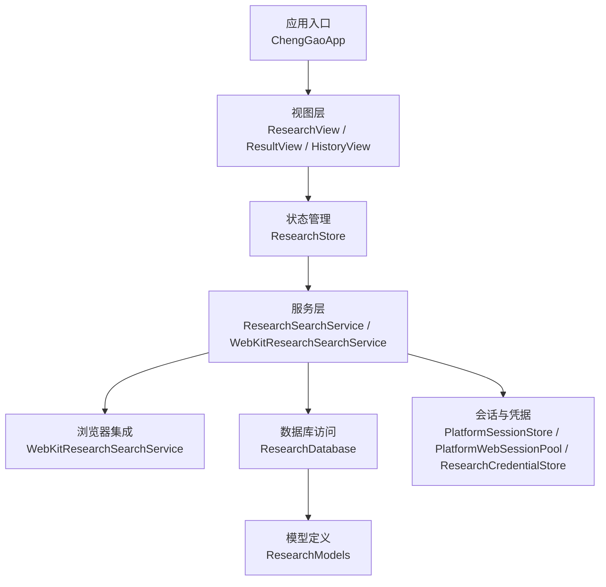
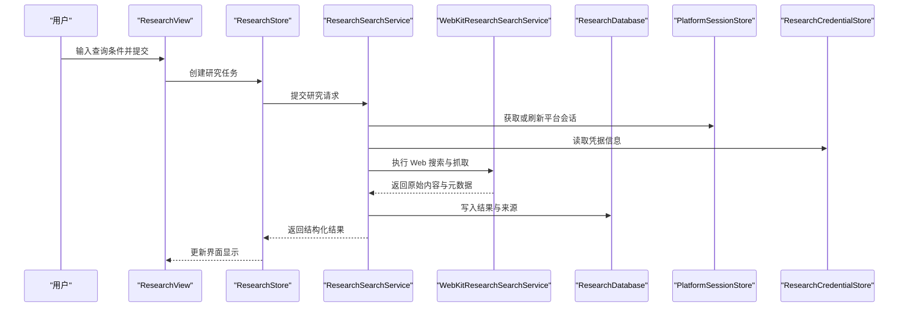
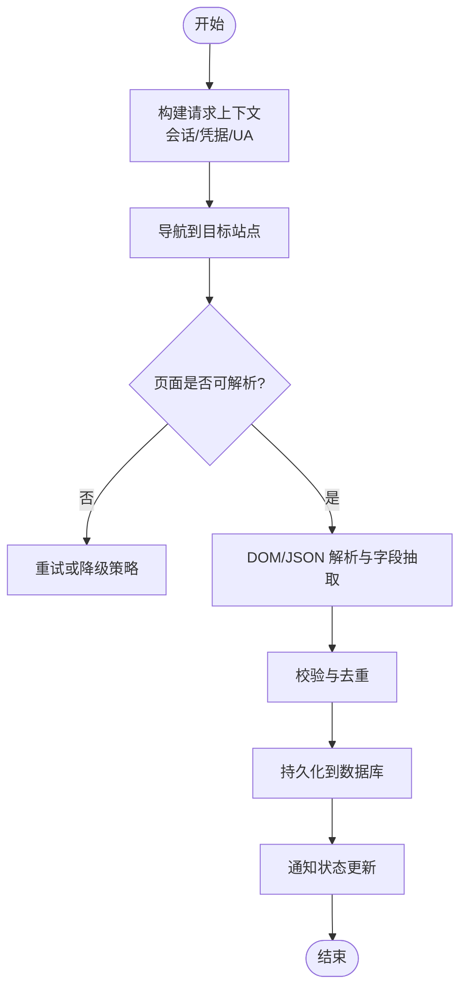
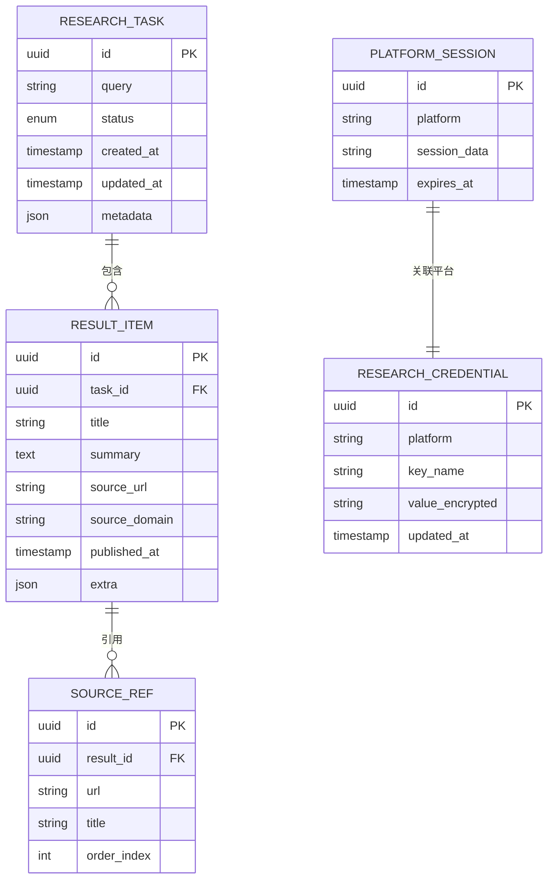
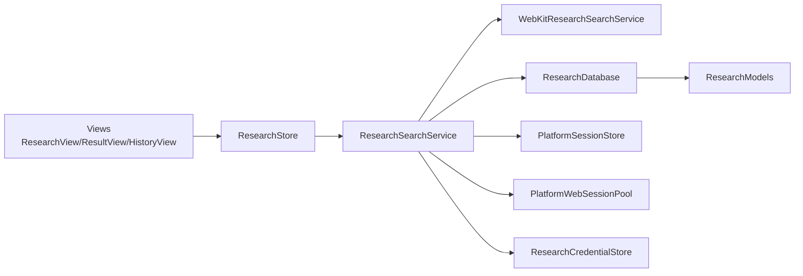

# 研究系统

<cite>
**本文引用的文件**   
- [Package.swift](file://Package.swift)
- [ChengGaoApp.swift](file://Sources/ChengGao/App/ChengGaoApp.swift)
- [ResearchSearchService.swift](file://Sources/ChengGao/Services/ResearchSearchService.swift)
- [WebKitResearchSearchService.swift](file://Sources/ChengGao/Services/WebKitResearchSearchService.swift)
- [ResearchDatabase.swift](file://Sources/ChengGao/Services/ResearchDatabase.swift)
- [ResearchStore.swift](file://Sources/ChengGao/Stores/ResearchStore.swift)
- [ResearchModels.swift](file://Sources/ChengGao/Models/ResearchModels.swift)
- [PlatformSessionStore.swift](file://Sources/ChengGao/Services/PlatformSessionStore.swift)
- [PlatformWebSessionPool.swift](file://Sources/ChengGao/Services/PlatformWebSessionPool.swift)
- [ResearchCredentialStore.swift](file://Sources/ChengGao/Services/ResearchCredentialStore.swift)
- [ResearchView.swift](file://Sources/ChengGao/Views/ResearchView.swift)
- [ResultView.swift](file://Sources/ChengGao/Views/ResultView.swift)
- [HistoryView.swift](file://Sources/ChengGao/Views/HistoryView.swift)
- [ResearchAccountsView.swift](file://Sources/ChengGao/Views/ResearchAccountsView.swift)
</cite>

## 目录
1. [简介](#简介)
2. [项目结构](#项目结构)
3. [核心组件](#核心组件)
4. [架构总览](#架构总览)
5. [详细组件分析](#详细组件分析)
6. [依赖关系分析](#依赖关系分析)
7. [性能考虑](#性能考虑)
8. [故障排查指南](#故障排查指南)
9. [结论](#结论)
10. [附录：API 与使用示例](#附录api-与使用示例)

## 简介
本文件面向开发者与维护者，系统化阐述“研究系统”的架构设计与实现要点，重点覆盖以下方面：
- WebKit 浏览器集成与搜索执行流程
- 搜索结果解析、数据存储与管理机制
- 研究数据库 Schema 设计、查询优化与缓存策略
- 研究任务的创建、执行、结果管理与历史追踪
- 多平台登录支持、会话管理与认证机制
- 研究功能的 API 接口与使用示例，便于扩展与二次开发

## 项目结构
本项目采用 Swift Package Manager 组织代码，核心模块位于 Sources/ChengGao 下，按职责划分为 App、Models、Services、Stores、Views 等目录。关键入口为应用启动点，研究能力由 Services 层提供，UI 通过 Views 层暴露交互，数据持久化与状态管理分别由 ResearchDatabase 与 ResearchStore 承担。

图表来源
- [ChengGaoApp.swift](file://Sources/ChengGao/App/ChengGaoApp.swift)
- [ResearchView.swift](file://Sources/ChengGao/Views/ResearchView.swift)
- [ResearchStore.swift](file://Sources/ChengGao/Stores/ResearchStore.swift)
- [ResearchSearchService.swift](file://Sources/ChengGao/Services/ResearchSearchService.swift)
- [WebKitResearchSearchService.swift](file://Sources/ChengGao/Services/WebKitResearchSearchService.swift)
- [ResearchDatabase.swift](file://Sources/ChengGao/Services/ResearchDatabase.swift)
- [ResearchModels.swift](file://Sources/ChengGao/Models/ResearchModels.swift)
- [PlatformSessionStore.swift](file://Sources/ChengGao/Services/PlatformSessionStore.swift)
- [PlatformWebSessionPool.swift](file://Sources/ChengGao/Services/PlatformWebSessionPool.swift)
- [ResearchCredentialStore.swift](file://Sources/ChengGao/Services/ResearchCredentialStore.swift)

章节来源
- [Package.swift](file://Package.swift)
- [ChengGaoApp.swift](file://Sources/ChengGao/App/ChengGaoApp.swift)

## 核心组件
- 研究搜索服务（ResearchSearchService）：对外暴露统一的研究搜索接口，协调任务生命周期、结果聚合与错误处理。
- WebKit 集成（WebKitResearchSearchService）：基于 WebKit 驱动浏览器进行页面加载、交互与内容抓取，负责与目标站点交互并提取结构化数据。
- 研究数据库（ResearchDatabase）：封装 SQLite 存储，提供表结构初始化、CRUD 操作、索引与事务支持。
- 研究状态管理（ResearchStore）：在 UI 层维护研究任务、结果与历史的响应式状态，驱动界面更新。
- 会话与凭据（PlatformSessionStore / PlatformWebSessionPool / ResearchCredentialStore）：管理跨平台登录态、Web 会话池与敏感凭据存取。
- 模型定义（ResearchModels）：定义研究任务、结果条目、来源信息等数据结构。

章节来源
- [ResearchSearchService.swift](file://Sources/ChengGao/Services/ResearchSearchService.swift)
- [WebKitResearchSearchService.swift](file://Sources/ChengGao/Services/WebKitResearchSearchService.swift)
- [ResearchDatabase.swift](file://Sources/ChengGao/Services/ResearchDatabase.swift)
- [ResearchStore.swift](file://Sources/ChengGao/Stores/ResearchStore.swift)
- [PlatformSessionStore.swift](file://Sources/ChengGao/Services/PlatformSessionStore.swift)
- [PlatformWebSessionPool.swift](file://Sources/ChengGao/Services/PlatformWebSessionPool.swift)
- [ResearchCredentialStore.swift](file://Sources/ChengGao/Services/ResearchCredentialStore.swift)
- [ResearchModels.swift](file://Sources/ChengGao/Models/ResearchModels.swift)

## 架构总览
研究系统采用分层架构：视图层发起研究请求，状态管理层协调服务调用，服务层调度 WebKit 浏览器执行搜索与解析，并将结果持久化到数据库；同时通过会话与凭据模块完成多平台登录与会话复用。

图表来源
- [ResearchView.swift](file://Sources/ChengGao/Views/ResearchView.swift)
- [ResearchStore.swift](file://Sources/ChengGao/Stores/ResearchStore.swift)
- [ResearchSearchService.swift](file://Sources/ChengGao/Services/ResearchSearchService.swift)
- [WebKitResearchSearchService.swift](file://Sources/ChengGao/Services/WebKitResearchSearchService.swift)
- [ResearchDatabase.swift](file://Sources/ChengGao/Services/ResearchDatabase.swift)
- [PlatformSessionStore.swift](file://Sources/ChengGao/Services/PlatformSessionStore.swift)
- [ResearchCredentialStore.swift](file://Sources/ChengGao/Services/ResearchCredentialStore.swift)

## 详细组件分析

### WebKit 浏览器集成与搜索执行
- 功能要点
  - 基于 WebKit 创建无头或可见浏览器实例，注入必要 Cookie/Headers。
  - 根据目标站点规则构造导航与交互动作（如点击、滚动、等待）。
  - 监听页面加载事件与网络请求，捕获关键响应数据。
  - 将 HTML/JSON 转换为结构化结果，包含标题、摘要、来源链接、时间戳等。
- 关键流程
  - 构建请求上下文（含会话、凭据、UA、Referer 等）。
  - 执行页面导航与动态渲染。
  - 解析 DOM/JSON，抽取字段并去重。
  - 回写结果至数据库，并通知上层状态更新。

图表来源
- [WebKitResearchSearchService.swift](file://Sources/ChengGao/Services/WebKitResearchSearchService.swift)
- [ResearchSearchService.swift](file://Sources/ChengGao/Services/ResearchSearchService.swift)

章节来源
- [WebKitResearchSearchService.swift](file://Sources/ChengGao/Services/WebKitResearchSearchService.swift)
- [ResearchSearchService.swift](file://Sources/ChengGao/Services/ResearchSearchService.swift)

### 搜索结果解析与数据处理
- 解析策略
  - 针对不同类型站点定义解析器，优先尝试 JSON 接口，失败时回退到 DOM 选择器。
  - 对文本进行清洗（去除多余空白、HTML 标签），并对链接进行规范化。
  - 对时间、价格、评分等字段进行类型转换与单位归一。
- 质量保障
  - 关键字段缺失检测与默认值填充。
  - 重复项合并与冲突解决策略。
  - 异常捕获与降级路径（例如切换备用站点或返回空结果集）。

章节来源
- [WebKitResearchSearchService.swift](file://Sources/ChengGao/Services/WebKitResearchSearchService.swift)
- [ResearchModels.swift](file://Sources/ChengGao/Models/ResearchModels.swift)

### 数据存储与管理机制（ResearchDatabase）
- 设计目标
  - 高内聚的数据访问层，屏蔽底层 SQLite 细节。
  - 提供事务、索引、分页、排序等常用能力。
- 主要能力
  - 表结构初始化与迁移。
  - 增删改查接口，支持批量写入与条件查询。
  - 结果缓存与失效策略（内存缓存 + 磁盘持久化）。
  - 审计日志与错误码映射。

章节来源
- [ResearchDatabase.swift](file://Sources/ChengGao/Services/ResearchDatabase.swift)
- [ResearchModels.swift](file://Sources/ChengGao/Models/ResearchModels.swift)

### 研究数据库 Schema 设计
以下为建议的实体关系图，用于指导研究与结果数据的建模与查询优化。实际字段以实现为准。

图表来源
- [ResearchModels.swift](file://Sources/ChengGao/Models/ResearchModels.swift)
- [ResearchDatabase.swift](file://Sources/ChengGao/Services/ResearchDatabase.swift)

章节来源
- [ResearchModels.swift](file://Sources/ChengGao/Models/ResearchModels.swift)
- [ResearchDatabase.swift](file://Sources/ChengGao/Services/ResearchDatabase.swift)

### 查询优化与缓存策略
- 索引建议
  - 对任务表的查询字段（如状态、创建时间）建立复合索引。
  - 对结果表的任务外键、域名、发布时间建立索引，加速列表与筛选。
- 缓存策略
  - 热点结果短期内存缓存（LRU），设置 TTL 与容量上限。
  - 相同查询参数命中缓存直接返回，减少 Web 请求与解析开销。
  - 缓存失效触发条件包括：任务过期、站点变更、配置更新。
- 分页与排序
  - 使用游标分页替代偏移分页，提升大数据量下的查询性能。
  - 默认排序按发布时间降序，支持自定义排序字段。

章节来源
- [ResearchDatabase.swift](file://Sources/ChengGao/Services/ResearchDatabase.swift)
- [ResearchStore.swift](file://Sources/ChengGao/Stores/ResearchStore.swift)

### 研究任务的创建、执行、结果管理与历史追踪
- 任务生命周期
  - 创建：接收查询条件，生成唯一任务 ID，写入初始状态。
  - 执行：调度 WebKit 搜索与解析，逐步推进状态（进行中、部分成功、完成、失败）。
  - 结果管理：增量写入结果，支持去重与合并。
  - 历史追踪：记录每次执行的输入、输出摘要、耗时与错误信息。
- 并发控制
  - 限制并发任务数，避免资源耗尽。
  - 任务优先级队列，保证重要查询优先执行。

章节来源
- [ResearchSearchService.swift](file://Sources/ChengGao/Services/ResearchSearchService.swift)
- [ResearchStore.swift](file://Sources/ChengGao/Stores/ResearchStore.swift)
- [HistoryView.swift](file://Sources/ChengGao/Views/HistoryView.swift)

### 多平台登录支持、会话管理与认证机制
- 登录支持
  - 支持多平台账号登录，凭据加密存储。
  - 自动刷新 Token/Cookie，保持会话有效性。
- 会话管理
  - 平台会话存储与共享，避免重复登录。
  - Web 会话池复用，降低握手与鉴权开销。
- 认证流程
  - 首次登录引导授权，后续自动续期。
  - 失败重试与降级策略（如切换到匿名模式）。

章节来源
- [PlatformSessionStore.swift](file://Sources/ChengGao/Services/PlatformSessionStore.swift)
- [PlatformWebSessionPool.swift](file://Sources/ChengGao/Services/PlatformWebSessionPool.swift)
- [ResearchCredentialStore.swift](file://Sources/ChengGao/Services/ResearchCredentialStore.swift)
- [ResearchAccountsView.swift](file://Sources/ChengGao/Views/ResearchAccountsView.swift)

## 依赖关系分析
研究系统的依赖关系清晰分层：视图依赖状态管理，状态管理依赖服务层，服务层依赖浏览器集成、数据库与会话凭据模块。

图表来源
- [ResearchView.swift](file://Sources/ChengGao/Views/ResearchView.swift)
- [ResultView.swift](file://Sources/ChengGao/Views/ResultView.swift)
- [HistoryView.swift](file://Sources/ChengGao/Views/HistoryView.swift)
- [ResearchStore.swift](file://Sources/ChengGao/Stores/ResearchStore.swift)
- [ResearchSearchService.swift](file://Sources/ChengGao/Services/ResearchSearchService.swift)
- [WebKitResearchSearchService.swift](file://Sources/ChengGao/Services/WebKitResearchSearchService.swift)
- [ResearchDatabase.swift](file://Sources/ChengGao/Services/ResearchDatabase.swift)
- [PlatformSessionStore.swift](file://Sources/ChengGao/Services/PlatformSessionStore.swift)
- [PlatformWebSessionPool.swift](file://Sources/ChengGao/Services/PlatformWebSessionPool.swift)
- [ResearchCredentialStore.swift](file://Sources/ChengGao/Services/ResearchCredentialStore.swift)
- [ResearchModels.swift](file://Sources/ChengGao/Models/ResearchModels.swift)

章节来源
- [ResearchStore.swift](file://Sources/ChengGao/Stores/ResearchStore.swift)
- [ResearchSearchService.swift](file://Sources/ChengGao/Services/ResearchSearchService.swift)

## 性能考虑
- 浏览器端
  - 复用 WebKit 实例与会话，减少启动与握手成本。
  - 按需加载与懒解析，避免一次性渲染大页面。
  - 合理设置超时与重试，防止阻塞主线程。
- 解析端
  - 优先使用结构化接口（JSON），回退到 DOM 解析。
  - 增量解析与流式处理，降低内存峰值。
- 数据层
  - 合理使用索引与分页，避免全表扫描。
  - 缓存热点数据，缩短响应时间。
  - 批量写入与事务包裹，提高吞吐。

[本节为通用性能建议，不直接分析具体文件]

## 故障排查指南
- 常见问题定位
  - 登录失败：检查凭据存储与有效期，确认会话刷新逻辑。
  - 解析失败：查看站点结构变化，调整解析规则与回退策略。
  - 性能问题：监控浏览器实例数量、缓存命中率与数据库慢查询。
- 调试手段
  - 启用详细日志，记录请求 URL、响应状态与解析结果。
  - 使用断点与可视化调试工具观察 WebKit 页面状态。
  - 导出任务与结果快照，复现问题场景。

章节来源
- [ResearchSearchService.swift](file://Sources/ChengGao/Services/ResearchSearchService.swift)
- [WebKitResearchSearchService.swift](file://Sources/ChengGao/Services/WebKitResearchSearchService.swift)
- [ResearchDatabase.swift](file://Sources/ChengGao/Services/ResearchDatabase.swift)

## 结论
研究系统通过清晰的层次划分与模块化设计，实现了从 WebKit 浏览器集成、搜索结果解析到数据存储与管理的完整闭环。借助会话与凭据管理，系统具备多平台登录与认证能力；通过查询优化与缓存策略，提升了整体性能与用户体验。开发者可基于现有 API 与模型快速扩展新的站点解析器与功能特性。

[本节为总结性内容，不直接分析具体文件]

## 附录：API 与使用示例
- 研究搜索服务接口（概念性说明）
  - 创建研究任务：传入查询条件与平台标识，返回任务 ID。
  - 执行研究任务：异步执行搜索与解析，支持进度回调。
  - 查询结果：按任务 ID 分页获取结果列表，支持过滤与排序。
  - 历史追踪：获取任务执行历史与统计信息。
- 使用示例（步骤说明）
  - 初始化研究服务与数据库连接。
  - 配置平台会话与凭据。
  - 提交研究任务并监听状态更新。
  - 展示结果与历史记录，支持导出与分享。

章节来源
- [ResearchSearchService.swift](file://Sources/ChengGao/Services/ResearchSearchService.swift)
- [ResearchStore.swift](file://Sources/ChengGao/Stores/ResearchStore.swift)
- [ResearchModels.swift](file://Sources/ChengGao/Models/ResearchModels.swift)