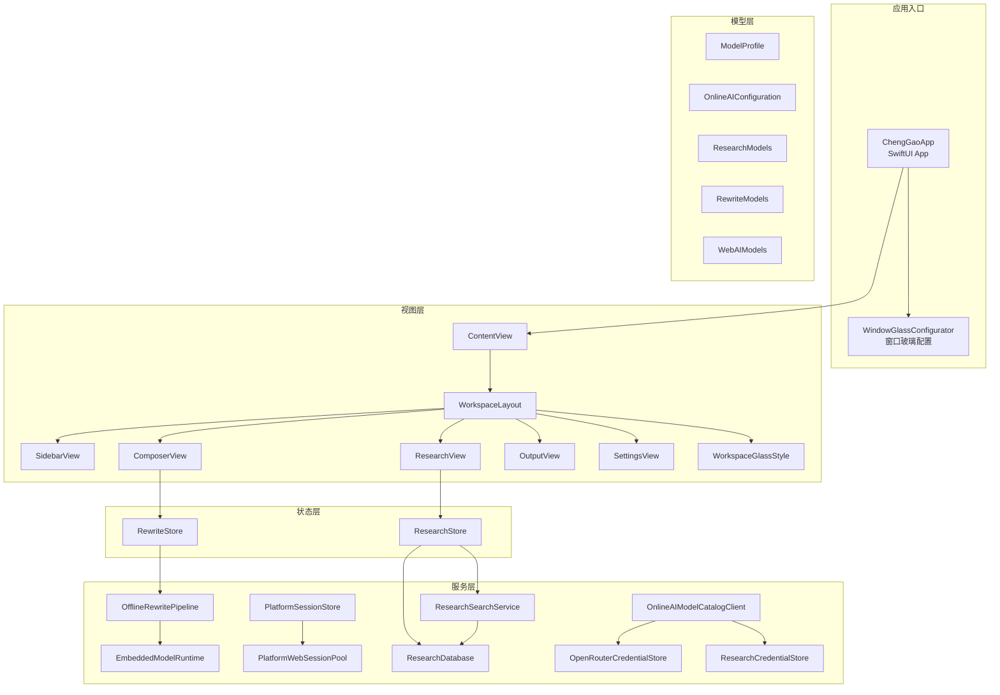
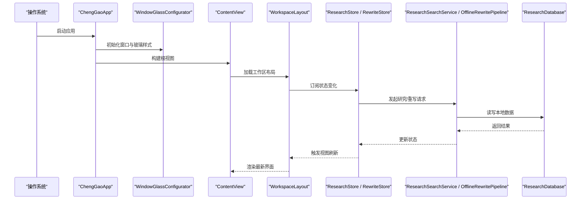
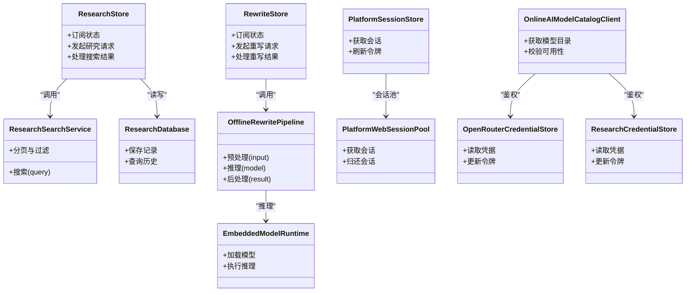
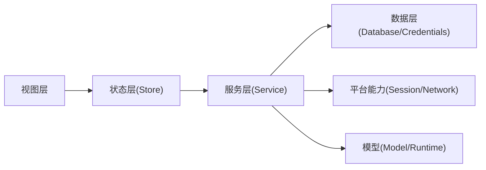

# 应用架构设计

<cite>
**本文引用的文件**   
- [Package.swift](file://Package.swift)
- [ChengGaoApp.swift](file://Sources/ChengGao/App/ChengGaoApp.swift)
- [WindowGlassConfigurator.swift](file://Sources/ChengGao/App/WindowGlassConfigurator.swift)
- [ContentView.swift](file://Sources/ChengGao/Views/ContentView.swift)
- [WorkspaceLayout.swift](file://Sources/ChengGao/Views/WorkspaceLayout.swift)
- [WorkspaceGlassStyle.swift](file://Sources/ChengGao/Views/WorkspaceGlassStyle.swift)
- [SidebarView.swift](file://Sources/ChengGao/Views/SidebarView.swift)
- [ResearchView.swift](file://Sources/ChengGao/Views/ResearchView.swift)
- [ComposerView.swift](file://Sources/ChengGao/Views/ComposerView.swift)
- [OutputView.swift](file://Sources/ChengGao/Views/OutputView.swift)
- [SettingsView.swift](file://Sources/ChengGao/Views/SettingsView.swift)
- [ResearchStore.swift](file://Sources/ChengGao/Stores/ResearchStore.swift)
- [RewriteStore.swift](file://Sources/ChengGao/Stores/RewriteStore.swift)
- [EmbeddedModelRuntime.swift](file://Sources/ChengGao/Services/EmbeddedModelRuntime.swift)
- [OfflineRewritePipeline.swift](file://Sources/ChengGao/Services/OfflineRewritePipeline.swift)
- [OnlineAIModelCatalogClient.swift](file://Sources/ChengGao/Services/OnlineAIModelCatalogClient.swift)
- [PlatformSessionStore.swift](file://Sources/ChengGao/Services/PlatformSessionStore.swift)
- [PlatformWebSessionPool.swift](file://Sources/ChengGao/Services/PlatformWebSessionPool.swift)
- [ResearchDatabase.swift](file://Sources/ChengGao/Services/ResearchDatabase.swift)
- [ResearchSearchService.swift](file://Sources/ChengGao/Services/ResearchSearchService.swift)
- [OpenRouterCredentialStore.swift](file://Sources/ChengGao/Services/OpenRouterCredentialStore.swift)
- [ResearchCredentialStore.swift](file://Sources/ChengGao/Services/ResearchCredentialStore.swift)
- [ModelProfile.swift](file://Sources/ChengGao/Models/ModelProfile.swift)
- [OnlineAIConfiguration.swift](file://Sources/ChengGao/Models/OnlineAIConfiguration.swift)
- [ResearchModels.swift](file://Sources/ChengGao/Models/ResearchModels.swift)
- [RewriteModels.swift](file://Sources/ChengGao/Models/RewriteModels.swift)
- [WebAIModels.swift](file://Sources/ChengGao/Models/WebAIModels.swift)
</cite>

## 目录
1. [简介](#简介)
2. [项目结构](#项目结构)
3. [核心组件](#核心组件)
4. [架构总览](#架构总览)
5. [详细组件分析](#详细组件分析)
6. [依赖关系分析](#依赖关系分析)
7. [性能考量](#性能考量)
8. [故障排查指南](#故障排查指南)
9. [结论](#结论)
10. [附录](#附录)

## 简介
本文件面向 ChengGao 应用的顶层架构与实现要点，重点覆盖：
- SwiftUI App 生命周期管理与启动流程
- 主窗口配置与玻璃效果（毛玻璃）样式
- 视图层次结构与页面组织
- 应用初始化、依赖注入与核心服务注册
- 配置管理、主题系统与平台特性集成
- 架构图与数据流向，帮助开发者理解扩展点与二次开发方式

## 项目结构
ChengGao 采用模块化 Swift Package 组织，核心代码位于 Sources/ChengGao，按职责划分为 App、Models、Services、Stores、Support、Views 等子模块。入口为 SwiftUI App 定义，窗口与样式由专用配置器与样式类负责；业务逻辑通过 Services 暴露，状态集中在 Stores，UI 以 Views 呈现。

图表来源
- [ChengGaoApp.swift](file://Sources/ChengGao/App/ChengGaoApp.swift)
- [WindowGlassConfigurator.swift](file://Sources/ChengGao/App/WindowGlassConfigurator.swift)
- [ContentView.swift](file://Sources/ChengGao/Views/ContentView.swift)
- [WorkspaceLayout.swift](file://Sources/ChengGao/Views/WorkspaceLayout.swift)
- [WorkspaceGlassStyle.swift](file://Sources/ChengGao/Views/WorkspaceGlassStyle.swift)
- [SidebarView.swift](file://Sources/ChengGao/Views/SidebarView.swift)
- [ResearchView.swift](file://Sources/ChengGao/Views/ResearchView.swift)
- [ComposerView.swift](file://Sources/ChengGao/Views/ComposerView.swift)
- [OutputView.swift](file://Sources/ChengGao/Views/OutputView.swift)
- [SettingsView.swift](file://Sources/ChengGao/Views/SettingsView.swift)
- [ResearchStore.swift](file://Sources/ChengGao/Stores/ResearchStore.swift)
- [RewriteStore.swift](file://Sources/ChengGao/Stores/RewriteStore.swift)
- [EmbeddedModelRuntime.swift](file://Sources/ChengGao/Services/EmbeddedModelRuntime.swift)
- [OfflineRewritePipeline.swift](file://Sources/ChengGao/Services/OfflineRewritePipeline.swift)
- [OnlineAIModelCatalogClient.swift](file://Sources/ChengGao/Services/OnlineAIModelCatalogClient.swift)
- [PlatformSessionStore.swift](file://Sources/ChengGao/Services/PlatformSessionStore.swift)
- [PlatformWebSessionPool.swift](file://Sources/ChengGao/Services/PlatformWebSessionPool.swift)
- [ResearchDatabase.swift](file://Sources/ChengGao/Services/ResearchDatabase.swift)
- [ResearchSearchService.swift](file://Sources/ChengGao/Services/ResearchSearchService.swift)
- [OpenRouterCredentialStore.swift](file://Sources/ChengGao/Services/OpenRouterCredentialStore.swift)
- [ResearchCredentialStore.swift](file://Sources/ChengGao/Services/ResearchCredentialStore.swift)
- [ModelProfile.swift](file://Sources/ChengGao/Models/ModelProfile.swift)
- [OnlineAIConfiguration.swift](file://Sources/ChengGao/Models/OnlineAIConfiguration.swift)
- [ResearchModels.swift](file://Sources/ChengGao/Models/ResearchModels.swift)
- [RewriteModels.swift](file://Sources/ChengGao/Models/RewriteModels.swift)
- [WebAIModels.swift](file://Sources/ChengGao/Models/WebAIModels.swift)

章节来源
- [Package.swift](file://Package.swift)

## 核心组件
- 应用入口与生命周期
  - SwiftUI App 定义负责应用启动、环境设置、窗口与样式初始化、全局状态注入。
  - 窗口玻璃效果由专用配置器在窗口创建阶段统一设置，确保一致的视觉风格。
- 视图层
  - ContentView 作为根视图，承载 WorkspaceLayout 布局容器。
  - SidebarView 提供导航与功能入口；ResearchView、ComposerView、OutputView、SettingsView 分别承担研究、创作、输出与设置等场景。
  - WorkspaceGlassStyle 集中管理毛玻璃样式与主题变量。
- 状态层
  - ResearchStore 与 RewriteStore 使用 SwiftUI 的状态管理机制，驱动 UI 更新并协调服务调用。
- 服务层
  - 离线推理与重写管线：EmbeddedModelRuntime、OfflineRewritePipeline。
  - 在线 AI 能力：OnlineAIModelCatalogClient、各类凭证存储（OpenRouter、Research）。
  - 平台会话与持久化：PlatformSessionStore、PlatformWebSessionPool、ResearchDatabase。
  - 搜索与研究：ResearchSearchService、ResearchDatabase。
- 模型层
  - ModelProfile、OnlineAIConfiguration、ResearchModels、RewriteModels、WebAIModels 定义跨层数据结构与序列化契约。

章节来源
- [ChengGaoApp.swift](file://Sources/ChengGao/App/ChengGaoApp.swift)
- [WindowGlassConfigurator.swift](file://Sources/ChengGao/App/WindowGlassConfigurator.swift)
- [ContentView.swift](file://Sources/ChengGao/Views/ContentView.swift)
- [WorkspaceLayout.swift](file://Sources/ChengGao/Views/WorkspaceLayout.swift)
- [WorkspaceGlassStyle.swift](file://Sources/ChengGao/Views/WorkspaceGlassStyle.swift)
- [SidebarView.swift](file://Sources/ChengGao/Views/SidebarView.swift)
- [ResearchView.swift](file://Sources/ChengGao/Views/ResearchView.swift)
- [ComposerView.swift](file://Sources/ChengGao/Views/ComposerView.swift)
- [OutputView.swift](file://Sources/ChengGao/Views/OutputView.swift)
- [SettingsView.swift](file://Sources/ChengGao/Views/SettingsView.swift)
- [ResearchStore.swift](file://Sources/ChengGao/Stores/ResearchStore.swift)
- [RewriteStore.swift](file://Sources/ChengGao/Stores/RewriteStore.swift)
- [EmbeddedModelRuntime.swift](file://Sources/ChengGao/Services/EmbeddedModelRuntime.swift)
- [OfflineRewritePipeline.swift](file://Sources/ChengGao/Services/OfflineRewritePipeline.swift)
- [OnlineAIModelCatalogClient.swift](file://Sources/ChengGao/Services/OnlineAIModelCatalogClient.swift)
- [PlatformSessionStore.swift](file://Sources/ChengGao/Services/PlatformSessionStore.swift)
- [PlatformWebSessionPool.swift](file://Sources/ChengGao/Services/PlatformWebSessionPool.swift)
- [ResearchDatabase.swift](file://Sources/ChengGao/Services/ResearchDatabase.swift)
- [ResearchSearchService.swift](file://Sources/ChengGao/Services/ResearchSearchService.swift)
- [OpenRouterCredentialStore.swift](file://Sources/ChengGao/Services/OpenRouterCredentialStore.swift)
- [ResearchCredentialStore.swift](file://Sources/ChengGao/Services/ResearchCredentialStore.swift)
- [ModelProfile.swift](file://Sources/ChengGao/Models/ModelProfile.swift)
- [OnlineAIConfiguration.swift](file://Sources/ChengGao/Models/OnlineAIConfiguration.swift)
- [ResearchModels.swift](file://Sources/ChengGao/Models/ResearchModels.swift)
- [RewriteModels.swift](file://Sources/ChengGao/Models/RewriteModels.swift)
- [WebAIModels.swift](file://Sources/ChengGao/Models/WebAIModels.swift)

## 架构总览
下图展示从应用启动到视图渲染、状态同步与服务调用的整体流程。

图表来源
- [ChengGaoApp.swift](file://Sources/ChengGao/App/ChengGaoApp.swift)
- [WindowGlassConfigurator.swift](file://Sources/ChengGao/App/WindowGlassConfigurator.swift)
- [ContentView.swift](file://Sources/ChengGao/Views/ContentView.swift)
- [WorkspaceLayout.swift](file://Sources/ChengGao/Views/WorkspaceLayout.swift)
- [ResearchStore.swift](file://Sources/ChengGao/Stores/ResearchStore.swift)
- [RewriteStore.swift](file://Sources/ChengGao/Stores/RewriteStore.swift)
- [ResearchSearchService.swift](file://Sources/ChengGao/Services/ResearchSearchService.swift)
- [OfflineRewritePipeline.swift](file://Sources/ChengGao/Services/OfflineRewritePipeline.swift)
- [ResearchDatabase.swift](file://Sources/ChengGao/Services/ResearchDatabase.swift)

## 详细组件分析

### 应用启动与 SwiftUI 生命周期
- 启动顺序
  - 系统加载 App 定义，执行生命周期回调。
  - 窗口配置器在窗口创建阶段注入玻璃样式与环境属性。
  - 根视图被构建并挂载到窗口内容中。
- 关键职责
  - 应用级环境值注入（如主题、配置、日志级别）。
  - 全局单例或共享实例的初始化（如会话池、数据库连接）。
  - 首次运行时的必要检查与迁移。

章节来源
- [ChengGaoApp.swift](file://Sources/ChengGao/App/ChengGaoApp.swift)
- [WindowGlassConfigurator.swift](file://Sources/ChengGao/App/WindowGlassConfigurator.swift)

### 主窗口与玻璃效果配置
- 窗口配置器负责：
  - 设置窗口尺寸、标题、行为（如最小化、全屏）。
  - 应用毛玻璃背景与透明度参数，保证在不同平台的一致性。
  - 监听窗口事件（显示/隐藏、缩放），动态调整样式。
- 样式系统
  - WorkspaceGlassStyle 集中定义颜色、模糊半径、阴影等主题变量。
  - 支持明暗主题切换与运行时更新。

章节来源
- [WindowGlassConfigurator.swift](file://Sources/ChengGao/App/WindowGlassConfigurator.swift)
- [WorkspaceGlassStyle.swift](file://Sources/ChengGao/Views/WorkspaceGlassStyle.swift)

### 视图层次结构与页面组织
- 根视图与布局
  - ContentView 作为入口，承载 WorkspaceLayout。
  - WorkspaceLayout 划分侧边栏与主内容区，支持响应式布局。
- 页面视图
  - SidebarView：导航菜单、快捷操作、账户与设置入口。
  - ResearchView：研究任务列表、搜索、结果预览。
  - ComposerView：文本编辑、提示词模板、生成控制。
  - OutputView：结果展示、导出、分享。
  - SettingsView：应用配置、主题、账号与凭据管理。
- 样式与主题
  - 所有页面复用 WorkspaceGlassStyle，确保统一的玻璃外观。

章节来源
- [ContentView.swift](file://Sources/ChengGao/Views/ContentView.swift)
- [WorkspaceLayout.swift](file://Sources/ChengGao/Views/WorkspaceLayout.swift)
- [SidebarView.swift](file://Sources/ChengGao/Views/SidebarView.swift)
- [ResearchView.swift](file://Sources/ChengGao/Views/ResearchView.swift)
- [ComposerView.swift](file://Sources/ChengGao/Views/ComposerView.swift)
- [OutputView.swift](file://Sources/ChengGao/Views/OutputView.swift)
- [SettingsView.swift](file://Sources/ChengGao/Views/SettingsView.swift)
- [WorkspaceGlassStyle.swift](file://Sources/ChengGao/Views/WorkspaceGlassStyle.swift)

### 状态管理与依赖注入
- 状态管理
  - ResearchStore 与 RewriteStore 管理各自领域的数据与变更，向视图发布更新。
  - 视图通过绑定与观察者模式消费状态，避免直接耦合服务。
- 依赖注入
  - 应用启动时注入服务实例（如数据库、会话池、凭证存储）到 Store 与 View 的环境值中。
  - 服务之间通过接口解耦，便于替换与测试。

章节来源
- [ResearchStore.swift](file://Sources/ChengGao/Stores/ResearchStore.swift)
- [RewriteStore.swift](file://Sources/ChengGao/Stores/RewriteStore.swift)
- [ChengGaoApp.swift](file://Sources/ChengGao/App/ChengGaoApp.swift)

### 核心服务与数据流
- 离线推理与重写
  - EmbeddedModelRuntime 封装本地模型运行时。
  - OfflineRewritePipeline 编排输入预处理、模型推理、后处理与结果回写。
- 在线 AI 能力
  - OnlineAIModelCatalogClient 获取模型目录与元信息。
  - OpenRouterCredentialStore、ResearchCredentialStore 管理凭据与鉴权。
- 平台与会话
  - PlatformSessionStore 管理用户会话与登录态。
  - PlatformWebSessionPool 维护 Web 会话池，提升并发访问效率。
- 研究与数据
  - ResearchSearchService 提供搜索能力。
  - ResearchDatabase 负责本地数据持久化与查询。

图表来源
- [ResearchStore.swift](file://Sources/ChengGao/Stores/ResearchStore.swift)
- [RewriteStore.swift](file://Sources/ChengGao/Stores/RewriteStore.swift)
- [ResearchSearchService.swift](file://Sources/ChengGao/Services/ResearchSearchService.swift)
- [OfflineRewritePipeline.swift](file://Sources/ChengGao/Services/OfflineRewritePipeline.swift)
- [EmbeddedModelRuntime.swift](file://Sources/ChengGao/Services/EmbeddedModelRuntime.swift)
- [ResearchDatabase.swift](file://Sources/ChengGao/Services/ResearchDatabase.swift)
- [PlatformSessionStore.swift](file://Sources/ChengGao/Services/PlatformSessionStore.swift)
- [PlatformWebSessionPool.swift](file://Sources/ChengGao/Services/PlatformWebSessionPool.swift)
- [OnlineAIModelCatalogClient.swift](file://Sources/ChengGao/Services/OnlineAIModelCatalogClient.swift)
- [OpenRouterCredentialStore.swift](file://Sources/ChengGao/Services/OpenRouterCredentialStore.swift)
- [ResearchCredentialStore.swift](file://Sources/ChengGao/Services/ResearchCredentialStore.swift)

章节来源
- [ResearchStore.swift](file://Sources/ChengGao/Stores/ResearchStore.swift)
- [RewriteStore.swift](file://Sources/ChengGao/Stores/RewriteStore.swift)
- [ResearchSearchService.swift](file://Sources/ChengGao/Services/ResearchSearchService.swift)
- [OfflineRewritePipeline.swift](file://Sources/ChengGao/Services/OfflineRewritePipeline.swift)
- [EmbeddedModelRuntime.swift](file://Sources/ChengGao/Services/EmbeddedModelRuntime.swift)
- [ResearchDatabase.swift](file://Sources/ChengGao/Services/ResearchDatabase.swift)
- [PlatformSessionStore.swift](file://Sources/ChengGao/Services/PlatformSessionStore.swift)
- [PlatformWebSessionPool.swift](file://Sources/ChengGao/Services/PlatformWebSessionPool.swift)
- [OnlineAIModelCatalogClient.swift](file://Sources/ChengGao/Services/OnlineAIModelCatalogClient.swift)
- [OpenRouterCredentialStore.swift](file://Sources/ChengGao/Services/OpenRouterCredentialStore.swift)
- [ResearchCredentialStore.swift](file://Sources/ChengGao/Services/ResearchCredentialStore.swift)

### 配置管理与主题系统
- 配置管理
  - 应用启动时加载配置（如网络超时、缓存策略、模型路径）。
  - 支持热更新与默认值回退。
- 主题系统
  - WorkspaceGlassStyle 提供主题变量（颜色、模糊度、阴影）。
  - 支持明暗主题切换与平台差异适配。

章节来源
- [WorkspaceGlassStyle.swift](file://Sources/ChengGao/Views/WorkspaceGlassStyle.swift)
- [ChengGaoApp.swift](file://Sources/ChengGao/App/ChengGaoApp.swift)

### 平台特定功能集成
- 窗口与样式
  - WindowGlassConfigurator 针对 macOS/iOS 等平台进行差异化配置。
- 会话与网络
  - PlatformSessionStore、PlatformWebSessionPool 封装平台网络栈与缓存策略。
- 数据存储
  - ResearchDatabase 使用平台推荐的持久化方案（如 SQLite 或 Keychain）。

章节来源
- [WindowGlassConfigurator.swift](file://Sources/ChengGao/App/WindowGlassConfigurator.swift)
- [PlatformSessionStore.swift](file://Sources/ChengGao/Services/PlatformSessionStore.swift)
- [PlatformWebSessionPool.swift](file://Sources/ChengGao/Services/PlatformWebSessionPool.swift)
- [ResearchDatabase.swift](file://Sources/ChengGao/Services/ResearchDatabase.swift)

## 依赖关系分析
- 低耦合高内聚
  - 视图仅依赖 Store，不直接访问服务。
  - Store 通过接口调用服务，屏蔽底层实现细节。
- 外部依赖
  - 模型目录客户端依赖凭证存储进行鉴权。
  - 会话池依赖平台会话存储进行生命周期管理。
- 可能的循环依赖
  - 通过引入接口与依赖注入避免循环引用。

图表来源
- [ContentView.swift](file://Sources/ChengGao/Views/ContentView.swift)
- [ResearchStore.swift](file://Sources/ChengGao/Stores/ResearchStore.swift)
- [RewriteStore.swift](file://Sources/ChengGao/Stores/RewriteStore.swift)
- [ResearchSearchService.swift](file://Sources/ChengGao/Services/ResearchSearchService.swift)
- [OfflineRewritePipeline.swift](file://Sources/ChengGao/Services/OfflineRewritePipeline.swift)
- [EmbeddedModelRuntime.swift](file://Sources/ChengGao/Services/EmbeddedModelRuntime.swift)
- [ResearchDatabase.swift](file://Sources/ChengGao/Services/ResearchDatabase.swift)
- [PlatformSessionStore.swift](file://Sources/ChengGao/Services/PlatformSessionStore.swift)
- [PlatformWebSessionPool.swift](file://Sources/ChengGao/Services/PlatformWebSessionPool.swift)

章节来源
- [ContentView.swift](file://Sources/ChengGao/Views/ContentView.swift)
- [ResearchStore.swift](file://Sources/ChengGao/Stores/ResearchStore.swift)
- [RewriteStore.swift](file://Sources/ChengGao/Stores/RewriteStore.swift)
- [ResearchSearchService.swift](file://Sources/ChengGao/Services/ResearchSearchService.swift)
- [OfflineRewritePipeline.swift](file://Sources/ChengGao/Services/OfflineRewritePipeline.swift)
- [EmbeddedModelRuntime.swift](file://Sources/ChengGao/Services/EmbeddedModelRuntime.swift)
- [ResearchDatabase.swift](file://Sources/ChengGao/Services/ResearchDatabase.swift)
- [PlatformSessionStore.swift](file://Sources/ChengGao/Services/PlatformSessionStore.swift)
- [PlatformWebSessionPool.swift](file://Sources/ChengGao/Services/PlatformWebSessionPool.swift)

## 性能考量
- 视图渲染
  - 使用惰性加载与按需渲染减少首屏开销。
  - 大列表使用分页与虚拟滚动。
- 状态更新
  - 合并频繁状态更新，避免不必要的重绘。
  - 将计算密集型任务下沉至后台线程。
- 网络与会话
  - 复用 Web 会话与连接池，降低握手成本。
  - 合理设置超时与重试策略。
- 本地数据
  - 使用索引与查询优化提升检索性能。
  - 定期清理过期数据与缓存。

[本节为通用指导，无需具体文件来源]

## 故障排查指南
- 启动失败
  - 检查窗口配置器是否正确初始化样式与环境。
  - 确认依赖服务（数据库、会话池、凭证存储）可用。
- 视图不更新
  - 验证 Store 状态是否发布更新。
  - 检查视图绑定是否正确。
- 网络错误
  - 查看凭证是否有效，令牌是否过期。
  - 检查网络超时与重试配置。
- 本地数据异常
  - 检查数据库版本与迁移脚本。
  - 确认读写权限与存储空间。

章节来源
- [ChengGaoApp.swift](file://Sources/ChengGao/App/ChengGaoApp.swift)
- [WindowGlassConfigurator.swift](file://Sources/ChengGao/App/WindowGlassConfigurator.swift)
- [ResearchStore.swift](file://Sources/ChengGao/Stores/ResearchStore.swift)
- [RewriteStore.swift](file://Sources/ChengGao/Stores/RewriteStore.swift)
- [ResearchDatabase.swift](file://Sources/ChengGao/Services/ResearchDatabase.swift)
- [PlatformSessionStore.swift](file://Sources/ChengGao/Services/PlatformSessionStore.swift)
- [PlatformWebSessionPool.swift](file://Sources/ChengGao/Services/PlatformWebSessionPool.swift)
- [OpenRouterCredentialStore.swift](file://Sources/ChengGao/Services/OpenRouterCredentialStore.swift)
- [ResearchCredentialStore.swift](file://Sources/ChengGao/Services/ResearchCredentialStore.swift)

## 结论
ChengGao 采用清晰的分层与模块化设计：应用入口负责生命周期与窗口样式，视图层专注交互与展示，状态层统一管理数据与变更，服务层封装业务逻辑与外部依赖，模型层定义跨层契约。通过依赖注入与接口抽象，系统具备良好的可扩展性与可测试性。玻璃样式与主题系统提升了用户体验，平台特性封装确保了跨平台一致性。建议在新功能开发时遵循现有分层与注入模式，保持低耦合与高内聚。

[本节为总结性内容，无需具体文件来源]

## 附录
- 术语表
  - 玻璃效果：毛玻璃背景与透明度的视觉样式。
  - 依赖注入：在运行时将依赖对象注入到需要它的组件中。
  - 会话池：复用网络连接与会话以提升性能。
- 扩展点
  - 新增服务：实现接口并通过应用启动注入。
  - 新增视图：在 WorkspaceLayout 中注册新页面。
  - 新增主题：在 WorkspaceGlassStyle 中添加变量并支持切换。

[本节为补充信息，无需具体文件来源]