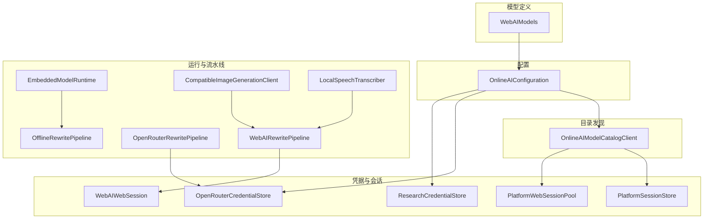
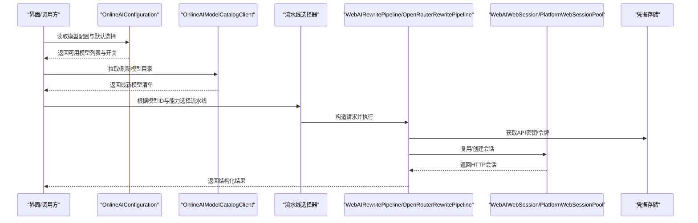
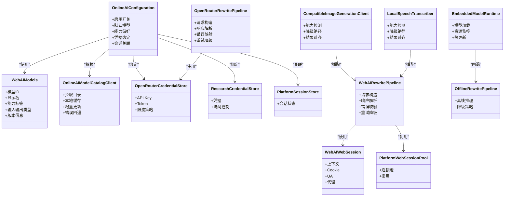

# AI模型扩展机制

<cite>
**本文档引用的文件**   
- [OnlineAIConfiguration.swift](file://Sources/ChengGao/Models/OnlineAIConfiguration.swift)
- [WebAIModels.swift](file://Sources/ChengGao/Models/WebAIModels.swift)
- [OnlineAIModelCatalogClient.swift](file://Sources/ChengGao/Services/OnlineAIModelCatalogClient.swift)
- [OpenRouterCredentialStore.swift](file://Sources/ChengGao/Services/OpenRouterCredentialStore.swift)
- [ResearchCredentialStore.swift](file://Sources/ChengGao/Services/ResearchCredentialStore.swift)
- [PlatformSessionStore.swift](file://Sources/ChengGao/Services/PlatformSessionStore.swift)
- [PlatformWebSessionPool.swift](file://Sources/ChengGao/Services/PlatformWebSessionPool.swift)
- [WebAIWebSession.swift](file://Sources/ChengGao/Services/WebAIWebSession.swift)
- [WebAIRewritePipeline.swift](file://Sources/ChengGao/Services/WebAIRewritePipeline.swift)
- [OpenRouterRewritePipeline.swift](file://Sources/ChengGao/Services/OpenRouterRewritePipeline.swift)
- [EmbeddedModelRuntime.swift](file://Sources/ChengGao/Services/EmbeddedModelRuntime.swift)
- [CompatibleImageGenerationClient.swift](file://Sources/ChengGao/Services/CompatibleImage生成客户端.swift)
- [LocalSpeechTranscriber.swift](file://Sources/ChengGao/Services/LocalSpeechTranscriber.swift)
- [OfflineRewritePipeline.swift](file://Sources/ChengGao/Services/OfflineRewritePipeline.swift)
</cite>

## 目录
1. [简介](#简介)
2. [项目结构](#项目结构)
3. [核心组件](#核心组件)
4. [架构总览](#架构总览)
5. [详细组件分析](#详细组件分析)
6. [依赖关系分析](#依赖关系分析)
7. [性能考量](#性能考量)
8. [故障排查指南](#故障排查指南)
9. [结论](#结论)
10. [附录](#附录)

## 简介
本文件系统化阐述 ChengGao 系统的 AI 模型扩展机制，重点覆盖：
- 配置架构与模型注册机制
- OnlineAIConfiguration 的配置结构与用途
- WebAIModels 的模型定义规范
- 模型目录客户端（OnlineAIModelCatalogClient）的实现原理
- 新 AI 服务接入流程、模型接口规范、参数映射规则与错误处理
- 模型版本兼容性检查、功能特性检测与降级策略
- 具体示例路径，展示如何添加新的 AI 提供商（含 API 密钥管理、请求格式转换、响应解析）

## 项目结构
ChengGao 将 AI 相关能力按“模型定义—配置—运行时—网络会话—流水线”分层组织：
- 模型定义层：WebAIModels.swift 提供统一的模型枚举与元数据
- 配置层：OnlineAIConfiguration.swift 集中管理在线模型配置、凭据与开关
- 目录发现层：OnlineAIModelCatalogClient.swift 负责远程模型目录拉取与本地缓存
- 凭据与会话层：OpenRouterCredentialStore、ResearchCredentialStore、PlatformSessionStore、PlatformWebSessionPool、WebAIWebSession 等
- 运行层：WebAIRewritePipeline、OpenRouterRewritePipeline、EmbeddedModelRuntime、OfflineRewritePipeline 等
- 兼容层：CompatibleImageGenerationClient、LocalSpeechTranscriber 等用于能力适配与降级

图表来源
- [WebAIModels.swift](file://Sources/ChengGao/Models/WebAIModels.swift)
- [OnlineAIConfiguration.swift](file://Sources/ChengGao/Models/OnlineAIConfiguration.swift)
- [OnlineAIModelCatalogClient.swift](file://Sources/ChengGao/Services/OnlineAIModelCatalogClient.swift)
- [OpenRouterCredentialStore.swift](file://Sources/ChengGao/Services/OpenRouterCredentialStore.swift)
- [ResearchCredentialStore.swift](file://Sources/ChengGao/Services/ResearchCredentialStore.swift)
- [PlatformSessionStore.swift](file://Sources/ChengGao/Services/PlatformSessionStore.swift)
- [PlatformWebSessionPool.swift](file://Sources/ChengGao/Services/PlatformWebSessionPool.swift)
- [WebAIWebSession.swift](file://Sources/ChengGao/Services/WebAIWebSession.swift)
- [WebAIRewritePipeline.swift](file://Sources/ChengGao/Services/WebAIRewritePipeline.swift)
- [OpenRouterRewritePipeline.swift](file://Sources/ChengGao/Services/OpenRouterRewritePipeline.swift)
- [EmbeddedModelRuntime.swift](file://Sources/ChengGao/Services/EmbeddedModelRuntime.swift)
- [CompatibleImageGenerationClient.swift](file://Sources/ChengGao/Services/CompatibleImage生成客户端.swift)
- [LocalSpeechTranscriber.swift](file://Sources/ChengGao/Services/LocalSpeechTranscriber.swift)

章节来源
- [WebAIModels.swift](file://Sources/ChengGao/Models/WebAIModels.swift)
- [OnlineAIConfiguration.swift](file://Sources/ChengGao/Models/OnlineAIConfiguration.swift)
- [OnlineAIModelCatalogClient.swift](file://Sources/ChengGao/Services/OnlineAIModelCatalogClient.swift)

## 核心组件
- OnlineAIConfiguration：集中管理在线模型配置项、启用开关、默认模型选择、凭据引用与平台会话关联。
- WebAIModels：统一模型枚举与元数据，包括模型 ID、名称、能力标签、支持的输入输出类型、版本信息等。
- OnlineAIModelCatalogClient：从远程目录拉取可用模型清单，进行本地缓存与增量更新，供上层选择与路由。
- 凭据与会话：OpenRouterCredentialStore、ResearchCredentialStore 管理不同提供商的密钥；PlatformSessionStore、PlatformWebSessionPool、WebAIWebSession 管理浏览器/会话状态。
- 运行与流水线：WebAIRewritePipeline、OpenRouterRewritePipeline 封装不同提供商的请求构造与响应解析；EmbeddedModelRuntime、OfflineRewritePipeline 提供离线或嵌入式推理能力；CompatibleImageGenerationClient、LocalSpeechTranscriber 做能力适配与降级。

章节来源
- [OnlineAIConfiguration.swift](file://Sources/ChengGao/Models/OnlineAIConfiguration.swift)
- [WebAIModels.swift](file://Sources/ChengGao/Models/WebAIModels.swift)
- [OnlineAIModelCatalogClient.swift](file://Sources/ChengGao/Services/OnlineAIModelCatalogClient.swift)
- [OpenRouterCredentialStore.swift](file://Sources/ChengGao/Services/OpenRouterCredentialStore.swift)
- [ResearchCredentialStore.swift](file://Sources/ChengGao/Services/ResearchCredentialStore.swift)
- [PlatformSessionStore.swift](file://Sources/ChengGao/Services/PlatformSessionStore.swift)
- [PlatformWebSessionPool.swift](file://Sources/ChengGao/Services/PlatformWebSessionPool.swift)
- [WebAIWebSession.swift](file://Sources/ChengGao/Services/WebAIWebSession.swift)
- [WebAIRewritePipeline.swift](file://Sources/ChengGao/Services/WebAIRewritePipeline.swift)
- [OpenRouterRewritePipeline.swift](file://Sources/ChengGao/Services/OpenRouterRewritePipeline.swift)
- [EmbeddedModelRuntime.swift](file://Sources/ChengGao/Services/EmbeddedModelRuntime.swift)
- [OfflineRewritePipeline.swift](file://Sources/ChengGao/Services/OfflineRewritePipeline.swift)
- [CompatibleImageGenerationClient.swift](file://Sources/ChengGao/Services/CompatibleImage生成客户端.swift)
- [LocalSpeechTranscriber.swift](file://Sources/ChengGao/Services/LocalSpeechTranscriber.swift)

## 架构总览
ChengGao 的 AI 扩展架构遵循“配置驱动 + 目录发现 + 流水线编排”的模式：
- 配置驱动：通过 OnlineAIConfiguration 声明式启用/禁用模型、设置默认模型与凭据绑定。
- 目录发现：OnlineAIModelCatalogClient 定期拉取远程模型目录，维护本地缓存，保证可用性。
- 流水线编排：根据模型能力与当前环境，选择 WebAIRewritePipeline 或 OpenRouterRewritePipeline 等实现，必要时回退到 EmbeddedModelRuntime 或 OfflineRewritePipeline。

图表来源
- [OnlineAIConfiguration.swift](file://Sources/ChengGao/Models/OnlineAIConfiguration.swift)
- [OnlineAIModelCatalogClient.swift](file://Sources/ChengGao/Services/OnlineAIModelCatalogClient.swift)
- [WebAIRewritePipeline.swift](file://Sources/ChengGao/Services/WebAIRewritePipeline.swift)
- [OpenRouterRewritePipeline.swift](file://Sources/ChengGao/Services/OpenRouterRewritePipeline.swift)
- [WebAIWebSession.swift](file://Sources/ChengGao/Services/WebAIWebSession.swift)
- [PlatformWebSessionPool.swift](file://Sources/ChengGao/Services/PlatformWebSessionPool.swift)
- [OpenRouterCredentialStore.swift](file://Sources/ChengGao/Services/OpenRouterCredentialStore.swift)
- [ResearchCredentialStore.swift](file://Sources/ChengGao/Services/ResearchCredentialStore.swift)

## 详细组件分析

### OnlineAIConfiguration 配置结构
- 职责：集中管理在线模型的启用开关、默认模型、模型能力偏好、凭据绑定与平台会话关联。
- 关键要点：
  - 模型开关：按模型ID维度控制启用/禁用，便于灰度与回滚。
  - 默认模型：支持按任务类型（文本改写、研究搜索、图像生成、语音转写）指定默认模型。
  - 能力偏好：如“优先低延迟”、“优先高质量”、“仅本地”等策略。
  - 凭据绑定：将模型与对应凭据存储（OpenRouter、Research）关联。
  - 会话关联：与 PlatformSessionStore、PlatformWebSessionPool 联动，确保会话生命周期一致。

章节来源
- [OnlineAIConfiguration.swift](file://Sources/ChengGao/Models/OnlineAIConfiguration.swift)
- [PlatformSessionStore.swift](file://Sources/ChengGao/Services/PlatformSessionStore.swift)
- [PlatformWebSessionPool.swift](file://Sources/ChengGao/Services/PlatformWebSessionPool.swift)
- [OpenRouterCredentialStore.swift](file://Sources/ChengGao/Services/OpenRouterCredentialStore.swift)
- [ResearchCredentialStore.swift](file://Sources/ChengGao/Services/ResearchCredentialStore.swift)

### WebAIModels 模型定义规范
- 职责：为所有在线模型提供统一枚举与元数据描述，包含模型ID、显示名、能力标签、输入输出类型、版本信息等。
- 关键要点：
  - 模型ID：唯一标识，用于路由与配置。
  - 能力标签：如“文本改写”、“图像生成”、“语音转写”、“研究搜索”。
  - 输入输出：定义支持的媒体类型与数据结构。
  - 版本信息：用于兼容性检查与降级策略。
  - 扩展点：新增模型只需在枚举中追加，并在配置中启用。

章节来源
- [WebAIModels.swift](file://Sources/ChengGao/Models/WebAIModels.swift)

### 模型目录客户端（OnlineAIModelCatalogClient）
- 职责：从远程目录拉取可用模型清单，进行本地缓存与增量更新，供上层选择与路由。
- 关键要点：
  - 远程目录：JSON/YAML 形式的模型清单，包含模型ID、版本、能力、端点等信息。
  - 本地缓存：持久化最近一次拉取的清单，提升启动速度与离线可用性。
  - 增量更新：对比版本号或时间戳，避免重复下载。
  - 错误处理：网络异常时回退到本地缓存，并记录日志。

章节来源
- [OnlineAIModelCatalogClient.swift](file://Sources/ChengGao/Services/OnlineAIModelCatalogClient.swift)

### 凭据与会话管理
- 凭据存储：
  - OpenRouterCredentialStore：管理 OpenRouter 的 API Key、Token、限流策略。
  - ResearchCredentialStore：管理研究类服务的凭据与访问控制。
- 会话管理：
  - PlatformSessionStore：跨模块共享会话状态。
  - PlatformWebSessionPool：连接池化管理 HTTP 会话，提高并发与复用效率。
  - WebAIWebSession：封装单次请求所需的上下文、Cookie、UA、代理等。

章节来源
- [OpenRouterCredentialStore.swift](file://Sources/ChengGao/Services/OpenRouterCredentialStore.swift)
- [ResearchCredentialStore.swift](file://Sources/ChengGao/Services/ResearchCredentialStore.swift)
- [PlatformSessionStore.swift](file://Sources/ChengGao/Services/PlatformSessionStore.swift)
- [PlatformWebSessionPool.swift](file://Sources/ChengGao/Services/PlatformWebSessionPool.swift)
- [WebAIWebSession.swift](file://Sources/ChengGao/Services/WebAIWebSession.swift)

### 运行与流水线（WebAIRewritePipeline / OpenRouterRewritePipeline）
- 职责：封装不同提供商的请求构造、鉴权、重试、超时、响应解析与错误映射。
- 关键要点：
  - 请求构造：根据 WebAIModels 的能力标签与参数映射规则，生成标准化请求。
  - 响应解析：将不同格式的响应统一转换为内部数据结构。
  - 错误映射：将提供商错误码映射为系统级错误，便于统一处理。
  - 重试与降级：支持指数退避、熔断与回退到其他模型或离线模式。

章节来源
- [WebAIRewritePipeline.swift](file://Sources/ChengGao/Services/WebAIRewritePipeline.swift)
- [OpenRouterRewritePipeline.swift](file://Sources/ChengGao/Services/OpenRouterRewritePipeline.swift)

### 嵌入式与离线推理（EmbeddedModelRuntime / OfflineRewritePipeline）
- 职责：在无网络或弱网环境下，使用本地模型或轻量推理引擎提供服务。
- 关键要点：
  - 模型加载：按需加载本地模型文件，支持热更新。
  - 资源限制：CPU/GPU 占用监控与自动降级。
  - 降级策略：当在线模型不可用时，自动切换至离线模式。

章节来源
- [EmbeddedModelRuntime.swift](file://Sources/ChengGao/Services/EmbeddedModelRuntime.swift)
- [OfflineRewritePipeline.swift](file://Sources/ChengGao/Services/OfflineRewritePipeline.swift)

### 兼容与降级（CompatibleImageGenerationClient / LocalSpeechTranscriber）
- 职责：对特定能力（图像生成、语音转写）进行适配与降级，确保在不同环境与提供商下的一致性体验。
- 关键要点：
  - 能力检测：动态检测当前环境是否支持某能力。
  - 降级路径：当首选方案不可用时，切换到备用方案或简化模式。
  - 结果对齐：确保不同路径输出的数据结构与语义一致。

章节来源
- [CompatibleImageGenerationClient.swift](file://Sources/ChengGao/Services/CompatibleImage生成客户端.swift)
- [LocalSpeechTranscriber.swift](file://Sources/ChengGao/Services/LocalSpeechTranscriber.swift)

## 依赖关系分析
- 松耦合设计：模型定义（WebAIModels）与配置（OnlineAIConfiguration）解耦，便于独立演进。
- 目录发现与缓存：OnlineAIModelCatalogClient 依赖网络与持久化，但不直接依赖具体提供商。
- 凭据与会话：凭据存储与会话池被多个流水线复用，降低耦合度。
- 流水线抽象：WebAIRewritePipeline 与 OpenRouterRewritePipeline 实现同一接口，便于替换与扩展。

图表来源
- [OnlineAIConfiguration.swift](file://Sources/ChengGao/Models/OnlineAIConfiguration.swift)
- [WebAIModels.swift](file://Sources/ChengGao/Models/WebAIModels.swift)
- [OnlineAIModelCatalogClient.swift](file://Sources/ChengGao/Services/OnlineAIModelCatalogClient.swift)
- [OpenRouterCredentialStore.swift](file://Sources/ChengGao/Services/OpenRouterCredentialStore.swift)
- [ResearchCredentialStore.swift](file://Sources/ChengGao/Services/ResearchCredentialStore.swift)
- [PlatformSessionStore.swift](file://Sources/ChengGao/Services/PlatformSessionStore.swift)
- [PlatformWebSessionPool.swift](file://Sources/ChengGao/Services/PlatformWebSessionPool.swift)
- [WebAIWebSession.swift](file://Sources/ChengGao/Services/WebAIWebSession.swift)
- [WebAIRewritePipeline.swift](file://Sources/ChengGao/Services/WebAIRewritePipeline.swift)
- [OpenRouterRewritePipeline.swift](file://Sources/ChengGao/Services/OpenRouterRewritePipeline.swift)
- [EmbeddedModelRuntime.swift](file://Sources/ChengGao/Services/EmbeddedModelRuntime.swift)
- [OfflineRewritePipeline.swift](file://Sources/ChengGao/Services/OfflineRewritePipeline.swift)
- [CompatibleImageGenerationClient.swift](file://Sources/ChengGao/Services/CompatibleImage生成客户端.swift)
- [LocalSpeechTranscriber.swift](file://Sources/ChengGao/Services/LocalSpeechTranscriber.swift)

## 性能考量
- 连接池与会话复用：PlatformWebSessionPool 减少握手开销，提升吞吐。
- 目录缓存：OnlineAIModelCatalogClient 本地缓存避免频繁网络请求。
- 异步与并发：流水线内使用异步 IO，避免阻塞主线程。
- 资源监控：EmbeddedModelRuntime 监控 CPU/GPU 占用，防止过载。
- 降级与熔断：在网络抖动或服务不可用时快速回退，保障用户体验。

[本节为通用指导，不直接分析具体文件]

## 故障排查指南
- 常见问题：
  - 模型不可用：检查 OnlineAIConfiguration 中的启用开关与默认模型设置。
  - 凭据错误：验证 OpenRouterCredentialStore 或 ResearchCredentialStore 中的密钥与 Token。
  - 会话失效：确认 PlatformSessionStore 与 PlatformWebSessionPool 的状态，必要时重建会话。
  - 目录拉取失败：检查网络连接与 OnlineAIModelCatalogClient 的缓存策略。
  - 流水线错误：查看 WebAIRewritePipeline 或 OpenRouterRewritePipeline 的错误映射与重试日志。
- 调试建议：
  - 开启详细日志，记录请求头、响应体与错误码。
  - 使用离线模式验证本地推理是否正常。
  - 逐步缩小问题范围，先验证目录拉取，再验证凭据与会话，最后验证流水线逻辑。

章节来源
- [OnlineAIConfiguration.swift](file://Sources/ChengGao/Models/OnlineAIConfiguration.swift)
- [OpenRouterCredentialStore.swift](file://Sources/ChengGao/Services/OpenRouterCredentialStore.swift)
- [ResearchCredentialStore.swift](file://Sources/ChengGao/Services/ResearchCredentialStore.swift)
- [PlatformSessionStore.swift](file://Sources/ChengGao/Services/PlatformSessionStore.swift)
- [PlatformWebSessionPool.swift](file://Sources/ChengGao/Services/PlatformWebSessionPool.swift)
- [OnlineAIModelCatalogClient.swift](file://Sources/ChengGao/Services/OnlineAIModelCatalogClient.swift)
- [WebAIRewritePipeline.swift](file://Sources/ChengGao/Services/WebAIRewritePipeline.swift)
- [OpenRouterRewritePipeline.swift](file://Sources/ChengGao/Services/OpenRouterRewritePipeline.swift)

## 结论
ChengGao 的 AI 模型扩展机制以配置驱动为核心，结合目录发现与流水线编排，实现了高内聚、低耦合的扩展架构。通过统一的模型定义、灵活的凭据与会话管理、健壮的降级与错误处理，系统能够平滑接入新的 AI 提供商，并在复杂网络与资源约束下保持稳定服务。

[本节为总结性内容，不直接分析具体文件]

## 附录

### 新 AI 服务接入流程
- 步骤概览：
  1. 在 WebAIModels 中新增模型枚举项，补充元数据（ID、名称、能力标签、输入输出、版本）。
  2. 在 OnlineAIConfiguration 中启用该模型，设置默认模型与能力偏好。
  3. 若为新提供商，新增凭据存储（参考 OpenRouterCredentialStore），管理 API Key 与 Token。
  4. 实现对应的流水线（参考 WebAIRewritePipeline 或 OpenRouterRewritePipeline），完成请求构造、响应解析与错误映射。
  5. 如需适配特定能力，新增兼容层（参考 CompatibleImageGenerationClient 或 LocalSpeechTranscriber）。
  6. 更新 OnlineAIModelCatalogClient 的目录清单，确保远程可发现。
  7. 测试端到端流程，验证凭据、会话、流水线与降级策略。

章节来源
- [WebAIModels.swift](file://Sources/ChengGao/Models/WebAIModels.swift)
- [OnlineAIConfiguration.swift](file://Sources/ChengGao/Models/OnlineAIConfiguration.swift)
- [OpenRouterCredentialStore.swift](file://Sources/ChengGao/Services/OpenRouterCredentialStore.swift)
- [WebAIRewritePipeline.swift](file://Sources/ChengGao/Services/WebAIRewritePipeline.swift)
- [OpenRouterRewritePipeline.swift](file://Sources/ChengGao/Services/OpenRouterRewritePipeline.swift)
- [CompatibleImageGenerationClient.swift](file://Sources/ChengGao/Services/CompatibleImage生成客户端.swift)
- [LocalSpeechTranscriber.swift](file://Sources/ChengGao/Services/LocalSpeechTranscriber.swift)
- [OnlineAIModelCatalogClient.swift](file://Sources/ChengGao/Services/OnlineAIModelCatalogClient.swift)

### 模型接口规范
- 输入：
  - 文本：字符串或结构化提示词。
  - 图像：URL、Base64 或文件路径。
  - 音频：URL、Base64 或文件路径。
- 输出：
  - 文本：字符串或结构化对象。
  - 图像：URL、Base64 或文件路径。
  - 音频：URL、Base64 或文件路径。
- 元数据：
  - 模型ID、版本、能力标签、耗时、错误码。

章节来源
- [WebAIModels.swift](file://Sources/ChengGao/Models/WebAIModels.swift)

### 参数映射规则
- 提示词映射：将用户输入转换为提供商要求的 Prompt 格式。
- 媒体映射：将图像/音频转换为提供商支持的编码与传输格式。
- 控制参数：温度、最大长度、TopP、频率惩罚等统一映射到各提供商字段。
- 安全参数：敏感词过滤、内容审核开关等。

章节来源
- [WebAIRewritePipeline.swift](file://Sources/ChengGao/Services/WebAIRewritePipeline.swift)
- [OpenRouterRewritePipeline.swift](file://Sources/ChengGao/Services/OpenRouterRewritePipeline.swift)

### 错误处理机制
- 网络错误：超时、DNS 解析失败、SSL 握手失败等，触发重试与降级。
- 业务错误：提供商返回的业务错误码，映射为系统级错误，便于统一处理。
- 资源错误：内存不足、GPU 过载等，触发离线模式或简化输出。
- 会话错误：Cookie 过期、Token 失效，触发重新登录与会话重建。

章节来源
- [WebAIRewritePipeline.swift](file://Sources/ChengGao/Services/WebAIRewritePipeline.swift)
- [OpenRouterRewritePipeline.swift](file://Sources/ChengGao/Services/OpenRouterRewritePipeline.swift)
- [PlatformSessionStore.swift](file://Sources/ChengGao/Services/PlatformSessionStore.swift)
- [PlatformWebSessionPool.swift](file://Sources/ChengGao/Services/PlatformWebSessionPool.swift)

### 模型版本兼容性检查、功能特性检测与降级策略
- 版本检查：比较模型版本与最低支持版本，不兼容时拒绝使用或提示升级。
- 功能检测：动态检测提供商是否支持某能力（如图像生成、语音转写），不支持时走降级路径。
- 降级策略：在线不可用→离线推理；高质量→低质量；长文本→分段处理；高延迟→短文本优先。

章节来源
- [WebAIModels.swift](file://Sources/ChengGao/Models/WebAIModels.swift)
- [EmbeddedModelRuntime.swift](file://Sources/ChengGao/Services/EmbeddedModelRuntime.swift)
- [OfflineRewritePipeline.swift](file://Sources/ChengGao/Services/OfflineRewritePipeline.swift)
- [CompatibleImageGenerationClient.swift](file://Sources/ChengGao/Services/CompatibleImage生成客户端.swift)
- [LocalSpeechTranscriber.swift](file://Sources/ChengGao/Services/LocalSpeechTranscriber.swift)

### 代码示例路径（添加新 AI 提供商）
- 新增模型枚举与元数据：[WebAIModels.swift](file://Sources/ChengGao/Models/WebAIModels.swift)
- 启用模型与配置默认值：[OnlineAIConfiguration.swift](file://Sources/ChengGao/Models/OnlineAIConfiguration.swift)
- 新增凭据存储（API Key、Token）：[OpenRouterCredentialStore.swift](file://Sources/ChengGao/Services/OpenRouterCredentialStore.swift)、[ResearchCredentialStore.swift](file://Sources/ChengGao/Services/ResearchCredentialStore.swift)
- 实现请求构造与响应解析：[WebAIRewritePipeline.swift](file://Sources/ChengGao/Services/WebAIRewritePipeline.swift)、[OpenRouterRewritePipeline.swift](file://Sources/ChengGao/Services/OpenRouterRewritePipeline.swift)
- 适配能力与降级：[CompatibleImageGenerationClient.swift](file://Sources/ChengGao/Services/CompatibleImage生成客户端.swift)、[LocalSpeechTranscriber.swift](file://Sources/ChengGao/Services/LocalSpeechTranscriber.swift)
- 更新模型目录与缓存：[OnlineAIModelCatalogClient.swift](file://Sources/ChengGao/Services/OnlineAIModelCatalogClient.swift)

章节来源
- [WebAIModels.swift](file://Sources/ChengGao/Models/WebAIModels.swift)
- [OnlineAIConfiguration.swift](file://Sources/ChengGao/Models/OnlineAIConfiguration.swift)
- [OpenRouterCredentialStore.swift](file://Sources/ChengGao/Services/OpenRouterCredentialStore.swift)
- [ResearchCredentialStore.swift](file://Sources/ChengGao/Services/ResearchCredentialStore.swift)
- [WebAIRewritePipeline.swift](file://Sources/ChengGao/Services/WebAIRewritePipeline.swift)
- [OpenRouterRewritePipeline.swift](file://Sources/ChengGao/Services/OpenRouterRewritePipeline.swift)
- [CompatibleImageGenerationClient.swift](file://Sources/ChengGao/Services/CompatibleImage生成客户端.swift)
- [LocalSpeechTranscriber.swift](file://Sources/ChengGao/Services/LocalSpeechTranscriber.swift)
- [OnlineAIModelCatalogClient.swift](file://Sources/ChengGao/Services/OnlineAIModelCatalogClient.swift)