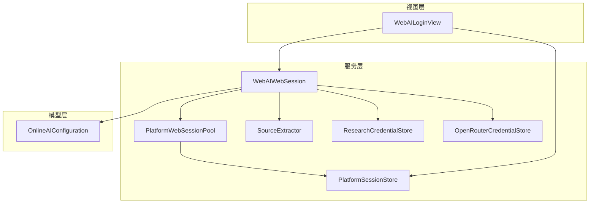
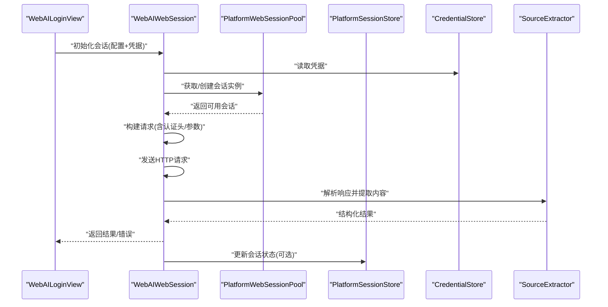
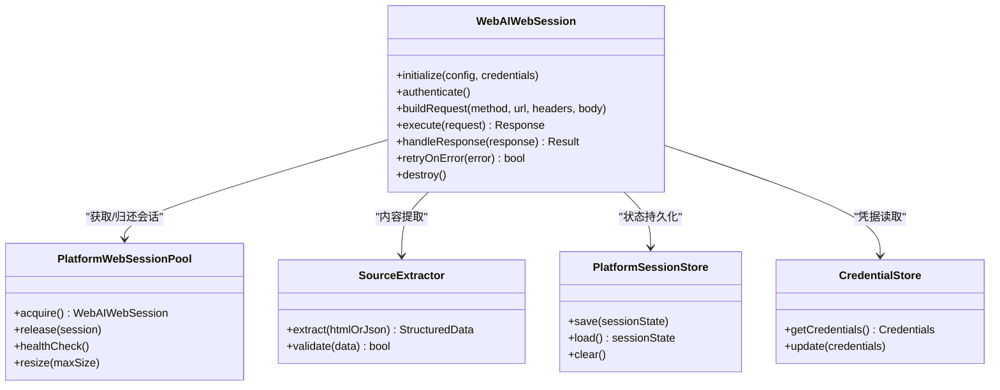
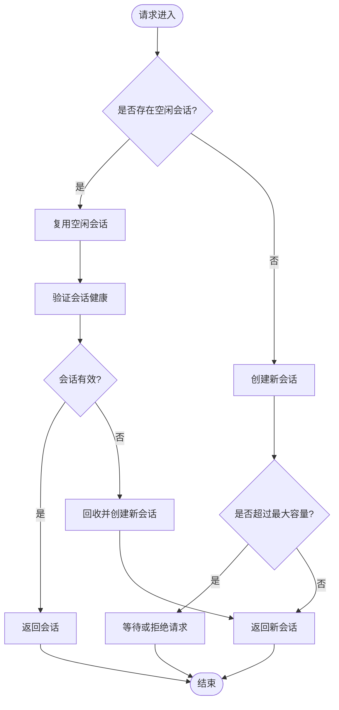
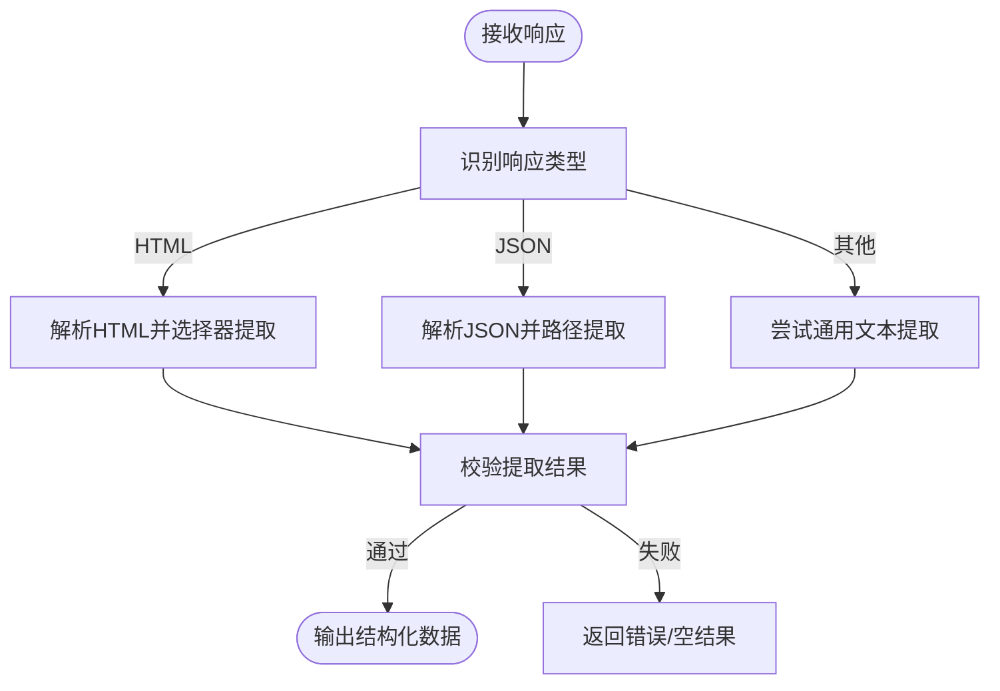
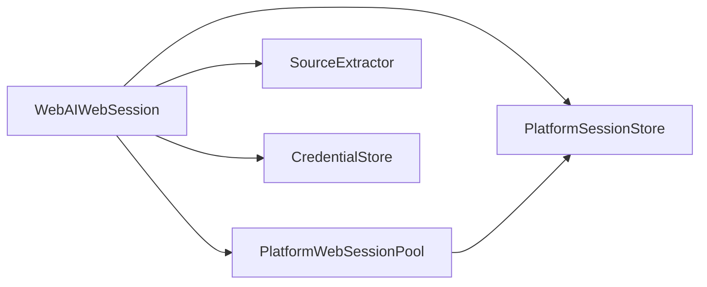

# Web服务集成框架

<cite>
**本文引用的文件**   
- [WebAIWebSession.swift](file://Sources/ChengGao/Services/WebAIWebSession.swift)
- [PlatformWebSessionPool.swift](file://Sources/ChengGao/Services/PlatformWebSessionPool.swift)
- [SourceExtractor.swift](file://Sources/ChengGao/Services/SourceExtractor.swift)
- [WebAILoginView.swift](file://Sources/ChengGao/Views/WebAILoginView.swift)
- [OnlineAIConfiguration.swift](file://Sources/ChengGao/Models/OnlineAIConfiguration.swift)
- [ResearchCredentialStore.swift](file://Sources/ChengGao/Services/ResearchCredentialStore.swift)
- [OpenRouterCredentialStore.swift](file://Sources/ChengGao/Services/OpenRouterCredentialStore.swift)
- [PlatformSessionStore.swift](file://Sources/ChengGao/Services/PlatformSessionStore.swift)
</cite>

## 目录
1. [简介](#简介)
2. [项目结构](#项目结构)
3. [核心组件](#核心组件)
4. [架构总览](#架构总览)
5. [详细组件分析](#详细组件分析)
6. [依赖关系分析](#依赖关系分析)
7. [性能考量](#性能考量)
8. [故障排查指南](#故障排查指南)
9. [结论](#结论)
10. [附录：新服务接入流程与示例](#附录新服务接入流程与示例)

## 简介
本文件系统化阐述 ChengGao 系统中的 Web 服务集成框架，重点覆盖以下方面：
- Web 服务的抽象设计与统一接入方式
- 会话管理与连接池管理（WebAIWebSession、PlatformWebSessionPool）
- 内容提取机制（SourceExtractor）
- 新 Web 服务接入流程、HTTP 客户端配置、认证机制与错误处理
- 连接复用策略、超时控制与重试机制
- 具体集成示例（请求构建、响应解析、状态管理）

该框架旨在为多种在线 AI 平台提供一致的接入体验，屏蔽底层 HTTP 差异，提升可维护性与扩展性。

## 项目结构
与 Web 服务集成相关的核心代码位于 Sources/ChengGao/Services 与 Sources/ChengGao/Models、Sources/ChengGao/Views 等目录中。关键文件包括：
- Services/WebAIWebSession.swift：封装单个 Web 会话的生命周期、认证与请求执行
- Services/PlatformWebSessionPool.swift：管理多个会话实例的连接池与资源分配
- Services/SourceExtractor.swift：从网页或结构化数据中提取目标内容
- Views/WebAILoginView.swift：用户登录与凭据输入界面
- Models/OnlineAIConfiguration.swift：在线 AI 平台的配置模型
- Services/*CredentialStore.swift：各类凭据存储实现
- Services/PlatformSessionStore.swift：会话持久化存储

图表来源 
- [WebAIWebSession.swift](file://Sources/ChengGao/Services/WebAIWebSession.swift)
- [PlatformWebSessionPool.swift](file://Sources/ChengGao/Services/PlatformWebSessionPool.swift)
- [SourceExtractor.swift](file://Sources/ChengGao/Services/SourceExtractor.swift)
- [WebAILoginView.swift](file://Sources/ChengGao/Views/WebAILoginView.swift)
- [OnlineAIConfiguration.swift](file://Sources/ChengGao/Models/OnlineAIConfiguration.swift)
- [ResearchCredentialStore.swift](file://Sources/ChengGao/Services/ResearchCredentialStore.swift)
- [OpenRouterCredentialStore.swift](file://Sources/ChengGao/Services/OpenRouterCredentialStore.swift)
- [PlatformSessionStore.swift](file://Sources/ChengGao/Services/PlatformSessionStore.swift)

章节来源
- [WebAIWebSession.swift](file://Sources/ChengGao/Services/WebAIWebSession.swift)
- [PlatformWebSessionPool.swift](file://Sources/ChengGao/Services/PlatformWebSessionPool.swift)
- [SourceExtractor.swift](file://Sources/ChengGao/Services/SourceExtractor.swift)
- [WebAILoginView.swift](file://Sources/ChengGao/Views/WebAILoginView.swift)
- [OnlineAIConfiguration.swift](file://Sources/ChengGao/Models/OnlineAIConfiguration.swift)
- [ResearchCredentialStore.swift](file://Sources/ChengGao/Services/ResearchCredentialStore.swift)
- [OpenRouterCredentialStore.swift](file://Sources/ChengGao/Services/OpenRouterCredentialStore.swift)
- [PlatformSessionStore.swift](file://Sources/ChengGao/Services/PlatformSessionStore.swift)

## 核心组件
- WebAIWebSession：封装单一 Web 会话的认证、请求构造、响应解析与生命周期管理。负责与特定平台交互，并向上层暴露统一的调用接口。
- PlatformWebSessionPool：维护一组 Web 会话实例，提供获取、归还、健康检查与容量控制能力，支持连接复用与并发访问。
- SourceExtractor：对返回内容进行清洗与提取，支持 HTML、JSON、Markdown 等多种格式，输出结构化结果供上层使用。
- 凭据与会话存储：ResearchCredentialStore、OpenRouterCredentialStore、PlatformSessionStore 分别负责不同平台的凭据与会话持久化。

章节来源
- [WebAIWebSession.swift](file://Sources/ChengGao/Services/WebAIWebSession.swift)
- [PlatformWebSessionPool.swift](file://Sources/ChengGao/Services/PlatformWebSessionPool.swift)
- [SourceExtractor.swift](file://Sources/ChengGao/Services/SourceExtractor.swift)
- [ResearchCredentialStore.swift](file://Sources/ChengGao/Services/ResearchCredentialStore.swift)
- [OpenRouterCredentialStore.swift](file://Sources/ChengGao/Services/OpenRouterCredentialStore.swift)
- [PlatformSessionStore.swift](file://Sources/ChengGao/Services/PlatformSessionStore.swift)

## 架构总览
下图展示了从 UI 到服务层的整体调用链，以及会话池与内容提取的协作关系。

图表来源 
- [WebAILoginView.swift](file://Sources/ChengGao/Views/WebAILoginView.swift)
- [WebAIWebSession.swift](file://Sources/ChengGao/Services/WebAIWebSession.swift)
- [PlatformWebSessionPool.swift](file://Sources/ChengGao/Services/PlatformWebSessionPool.swift)
- [PlatformSessionStore.swift](file://Sources/ChengGao/Services/PlatformSessionStore.swift)
- [ResearchCredentialStore.swift](file://Sources/ChengGao/Services/ResearchCredentialStore.swift)
- [OpenRouterCredentialStore.swift](file://Sources/ChengGao/Services/OpenRouterCredentialStore.swift)
- [SourceExtractor.swift](file://Sources/ChengGao/Services/SourceExtractor.swift)

## 详细组件分析

### WebAIWebSession：会话控制与请求执行
职责概述
- 会话生命周期：创建、认证、保活、销毁
- 请求构建：根据平台配置生成 URL、头部、Body、查询参数
- 响应处理：状态码判断、错误映射、重试触发
- 内容提取：委托 SourceExtractor 进行结构化抽取
- 状态同步：与 PlatformSessionStore 同步会话状态

关键行为说明
- 认证机制：优先从对应 CredentialStore 读取凭据，必要时触发重新登录流程
- 超时控制：为连接、读取、写入设置合理超时；支持按平台配置调整
- 重试策略：针对网络抖动与临时错误进行指数退避重试
- 错误处理：将平台错误转换为统一错误类型，便于上层展示与处理

图表来源 
- [WebAIWebSession.swift](file://Sources/ChengGao/Services/WebAIWebSession.swift)
- [PlatformWebSessionPool.swift](file://Sources/ChengGao/Services/PlatformWebSessionPool.swift)
- [SourceExtractor.swift](file://Sources/ChengGao/Services/SourceExtractor.swift)
- [PlatformSessionStore.swift](file://Sources/ChengGao/Services/PlatformSessionStore.swift)
- [ResearchCredentialStore.swift](file://Sources/ChengGao/Services/ResearchCredentialStore.swift)
- [OpenRouterCredentialStore.swift](file://Sources/ChengGao/Services/OpenRouterCredentialStore.swift)

章节来源
- [WebAIWebSession.swift](file://Sources/ChengGao/Services/WebAIWebSession.swift)

### PlatformWebSessionPool：连接池管理
职责概述
- 会话实例的创建与回收
- 并发安全地分配与释放会话
- 健康检查与自动清理失效会话
- 容量控制与动态扩容

关键行为说明
- 获取策略：优先复用空闲会话，否则创建新实例
- 归还策略：校验会话有效性后放回池中
- 健康检查：定期检测会话存活状态，剔除异常实例
- 容量限制：防止过多会话导致资源耗尽

图表来源 
- [PlatformWebSessionPool.swift](file://Sources/ChengGao/Services/PlatformWebSessionPool.swift)

章节来源
- [PlatformWebSessionPool.swift](file://Sources/ChengGao/Services/PlatformWebSessionPool.swift)

### SourceExtractor：内容提取逻辑
职责概述
- 解析多种响应格式（HTML、JSON、Markdown 等）
- 提取目标字段与结构化数据
- 数据校验与规范化

关键行为说明
- 格式识别：根据 Content-Type 或内容特征选择解析器
- 提取规则：支持 XPath/CSS 选择器或 JSON 路径
- 容错处理：对缺失字段提供默认值或降级策略

图表来源 
- [SourceExtractor.swift](file://Sources/ChengGao/Services/SourceExtractor.swift)

章节来源
- [SourceExtractor.swift](file://Sources/ChengGao/Services/SourceExtractor.swift)

### 认证与凭据管理
- ResearchCredentialStore：面向研究类平台的凭据存取
- OpenRouterCredentialStore：面向 OpenRouter 平台的 API Key 管理
- PlatformSessionStore：会话状态的持久化与恢复

章节来源
- [ResearchCredentialStore.swift](file://Sources/ChengGao/Services/ResearchCredentialStore.swift)
- [OpenRouterCredentialStore.swift](file://Sources/ChengGao/Services/OpenRouterCredentialStore.swift)
- [PlatformSessionStore.swift](file://Sources/ChengGao/Services/PlatformSessionStore.swift)

### 配置模型
- OnlineAIConfiguration：描述平台端点、鉴权方式、超时、重试等配置项

章节来源
- [OnlineAIConfiguration.swift](file://Sources/ChengGao/Models/OnlineAIConfiguration.swift)

## 依赖关系分析
- WebAIWebSession 依赖 PlatformWebSessionPool 进行会话管理，依赖 SourceExtractor 进行内容解析，依赖 CredentialStore 获取凭据，依赖 PlatformSessionStore 持久化状态。
- PlatformWebSessionPool 依赖 PlatformSessionStore 进行会话状态管理。
- SourceExtractor 无外部依赖，专注于解析与提取。

图表来源 
- [WebAIWebSession.swift](file://Sources/ChengGao/Services/WebAIWebSession.swift)
- [PlatformWebSessionPool.swift](file://Sources/ChengGao/Services/PlatformWebSessionPool.swift)
- [SourceExtractor.swift](file://Sources/ChengGao/Services/SourceExtractor.swift)
- [ResearchCredentialStore.swift](file://Sources/ChengGao/Services/ResearchCredentialStore.swift)
- [OpenRouterCredentialStore.swift](file://Sources/ChengGao/Services/OpenRouterCredentialStore.swift)
- [PlatformSessionStore.swift](file://Sources/ChengGao/Services/PlatformSessionStore.swift)

章节来源
- [WebAIWebSession.swift](file://Sources/ChengGao/Services/WebAIWebSession.swift)
- [PlatformWebSessionPool.swift](file://Sources/ChengGao/Services/PlatformWebSessionPool.swift)
- [SourceExtractor.swift](file://Sources/ChengGao/Services/SourceExtractor.swift)
- [PlatformSessionStore.swift](file://Sources/ChengGao/Services/PlatformSessionStore.swift)
- [ResearchCredentialStore.swift](file://Sources/ChengGao/Services/ResearchCredentialStore.swift)
- [OpenRouterCredentialStore.swift](file://Sources/ChengGao/Services/OpenRouterCredentialStore.swift)

## 性能考量
- 连接复用：通过 PlatformWebSessionPool 复用会话，减少握手开销
- 超时控制：为连接、读取、写入设置合理超时，避免长时间阻塞
- 重试机制：对瞬时错误采用指数退避重试，提高成功率
- 容量控制：限制最大会话数，防止内存与句柄耗尽
- 内容提取优化：按需解析，避免全量加载大文档

[本节为通用指导，不直接分析具体文件]

## 故障排查指南
常见问题与定位建议
- 认证失败：检查凭据是否正确、是否过期；查看 CredentialStore 的读取与更新流程
- 会话不可用：检查 PlatformWebSessionPool 的健康检查与回收逻辑
- 内容提取为空：确认 SourceExtractor 的解析规则与响应格式匹配
- 超时或重试过多：调整超时阈值与重试次数，观察网络状况

章节来源
- [WebAIWebSession.swift](file://Sources/ChengGao/Services/WebAIWebSession.swift)
- [PlatformWebSessionPool.swift](file://Sources/ChengGao/Services/PlatformWebSessionPool.swift)
- [SourceExtractor.swift](file://Sources/ChengGao/Services/SourceExtractor.swift)
- [ResearchCredentialStore.swift](file://Sources/ChengGao/Services/ResearchCredentialStore.swift)
- [OpenRouterCredentialStore.swift](file://Sources/ChengGao/Services/OpenRouterCredentialStore.swift)
- [PlatformSessionStore.swift](file://Sources/ChengGao/Services/PlatformSessionStore.swift)

## 结论
本框架通过统一的会话抽象、连接池管理与内容提取机制，为多平台 Web 服务提供了稳定、可扩展的集成方案。借助合理的超时、重试与容量控制，系统在复杂网络环境下仍能保持良好表现。后续可按“新服务接入流程”快速扩展新的 Web 平台。

[本节为总结性内容，不直接分析具体文件]

## 附录：新服务接入流程与示例
接入步骤概览
- 定义配置：在 OnlineAIConfiguration 中新增平台端点、鉴权方式、超时与重试策略
- 实现凭据存储：根据需要实现或扩展 CredentialStore（如 ResearchCredentialStore、OpenRouterCredentialStore）
- 配置会话：在 WebAIWebSession 中注入配置与凭据，完成认证与请求构建
- 配置连接池：在 PlatformWebSessionPool 中设置容量与健康检查策略
- 配置内容提取：在 SourceExtractor 中添加解析规则，适配新平台响应格式
- UI 集成：在 WebAILoginView 中提供登录与凭据输入入口

请求构建与响应解析示例要点
- 请求构建：依据平台规范组装 URL、Header、Body、Query 参数
- 响应解析：根据 Content-Type 选择解析器，提取关键字段并校验
- 状态管理：通过 PlatformSessionStore 保存会话状态，支持恢复与续期

连接复用、超时与重试示例要点
- 连接复用：从 PlatformWebSessionPool 获取会话，使用完毕后归还
- 超时控制：为连接、读取、写入设置合理超时，避免阻塞
- 重试机制：对瞬时错误进行指数退避重试，限制最大重试次数

章节来源
- [WebAILoginView.swift](file://Sources/ChengGao/Views/WebAILoginView.swift)
- [OnlineAIConfiguration.swift](file://Sources/ChengGao/Models/OnlineAIConfiguration.swift)
- [ResearchCredentialStore.swift](file://Sources/ChengGao/Services/ResearchCredentialStore.swift)
- [OpenRouterCredentialStore.swift](file://Sources/ChengGao/Services/OpenRouterCredentialStore.swift)
- [PlatformSessionStore.swift](file://Sources/ChengGao/Services/PlatformSessionStore.swift)
- [WebAIWebSession.swift](file://Sources/ChengGao/Services/WebAIWebSession.swift)
- [PlatformWebSessionPool.swift](file://Sources/ChengGao/Services/PlatformWebSessionPool.swift)
- [SourceExtractor.swift](file://Sources/ChengGao/Services/SourceExtractor.swift)