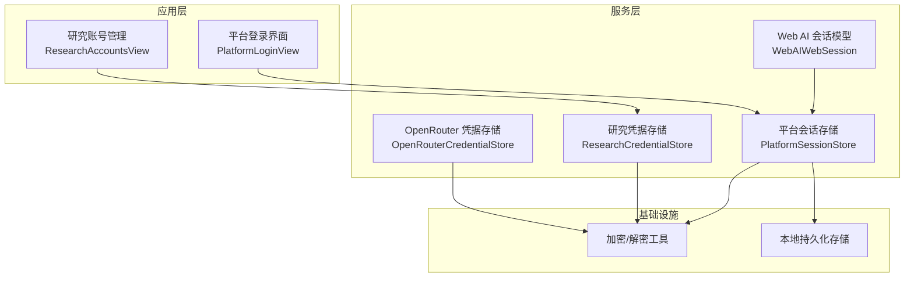
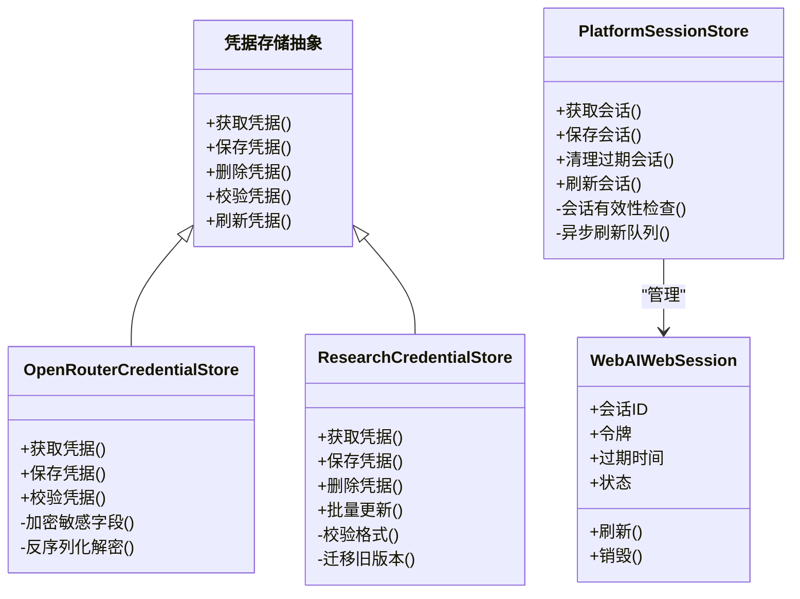
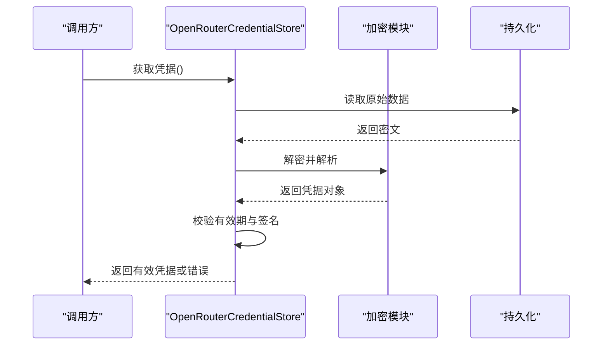
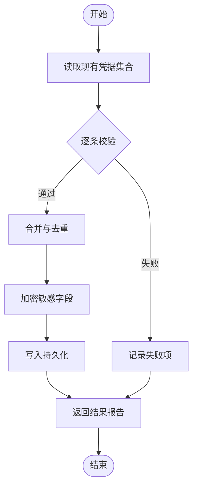
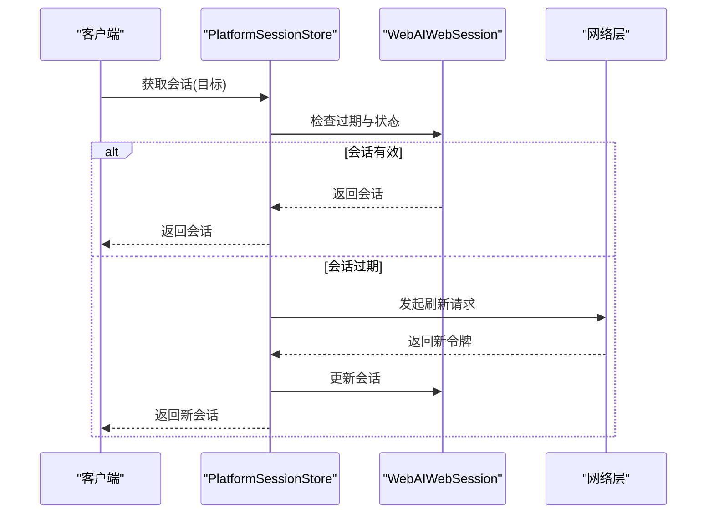
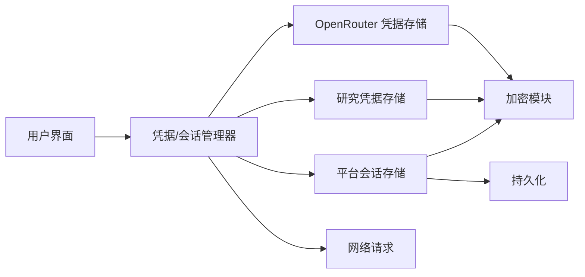
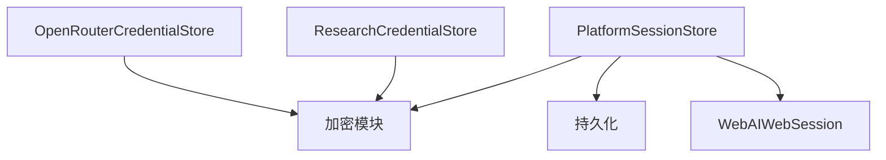

# 凭据存储扩展

<cite>
**本文引用的文件**   
- [OpenRouterCredentialStore.swift](file://Sources/ChengGao/Services/OpenRouterCredentialStore.swift)
- [ResearchCredentialStore.swift](file://Sources/ChengGao/Services/ResearchCredentialStore.swift)
- [PlatformSessionStore.swift](file://Sources/ChengGao/Services/PlatformSessionStore.swift)
- [WebAIWebSession.swift](file://Sources/ChengGao/Services/WebAIWebSession.swift)
- [PlatformLoginView.swift](file://Sources/ChengGao/Views/PlatformLoginView.swift)
- [ResearchAccountsView.swift](file://Sources/ChengGao/Views/ResearchAccountsView.swift)
- [Package.swift](file://Package.swift)
</cite>

## 目录
1. [简介](#简介)
2. [项目结构](#项目结构)
3. [核心组件](#核心组件)
4. [架构总览](#架构总览)
5. [详细组件分析](#详细组件分析)
6. [依赖关系分析](#依赖关系分析)
7. [性能考虑](#性能考虑)
8. [故障排查指南](#故障排查指南)
9. [结论](#结论)
10. [附录：自定义凭据接入流程与示例](#附录自定义凭据接入流程与示例)

## 简介
本文件面向 ChengGao 系统的凭据存储扩展机制，系统性阐述凭据管理的架构设计、存储抽象层以及不同凭据类型的实现方式。重点覆盖 OpenRouterCredentialStore、ResearchCredentialStore 与 PlatformSessionStore 的设计模式与接口规范，并给出新凭据类型接入流程、加密存储机制、会话管理策略与安全最佳实践。文档同时提供实现自定义凭据存储的参考路径与步骤说明，涵盖数据序列化、验证规则、安全传输、生命周期管理、自动刷新与故障恢复等关键主题。

## 项目结构
ChengGao 将凭据与会话相关能力集中在 Services 层，UI 层通过视图进行配置与交互，模块通过 Package.swift 组织。凭据存储相关的关键文件如下：
- Services/OpenRouterCredentialStore.swift：OpenRouter 凭据的持久化与访问封装
- Services/ResearchCredentialStore.swift：研究功能所需凭据的持久化与访问封装
- Services/PlatformSessionStore.swift：平台会话（如 Web 会话）的持久化与访问封装
- Services/WebAIWebSession.swift：Web AI 会话模型与行为定义
- Views/PlatformLoginView.swift：平台登录入口与凭据输入界面
- Views/ResearchAccountsView.swift：研究账号管理与凭据维护界面
- Package.swift：Swift 包清单，声明模块与依赖

图表来源
- [OpenRouterCredentialStore.swift](file://Sources/ChengGao/Services/OpenRouterCredentialStore.swift)
- [ResearchCredentialStore.swift](file://Sources/ChengGao/Services/ResearchCredentialStore.swift)
- [PlatformSessionStore.swift](file://Sources/ChengGao/Services/PlatformSessionStore.swift)
- [WebAIWebSession.swift](file://Sources/ChengGao/Services/WebAIWebSession.swift)
- [PlatformLoginView.swift](file://Sources/ChengGao/Views/PlatformLoginView.swift)
- [ResearchAccountsView.swift](file://Sources/ChengGao/Views/ResearchAccountsView.swift)

章节来源
- [Package.swift](file://Package.swift)

## 核心组件
- OpenRouterCredentialStore：负责 OpenRouter 相关凭据（如 API Key、密钥元数据）的读取、写入、校验与缓存。通常提供统一的访问接口，屏蔽底层加密与持久化细节。
- ResearchCredentialStore：负责研究场景所需的凭据（例如第三方学术或数据源认证信息）的存取与管理，支持多凭据项与版本兼容。
- PlatformSessionStore：负责平台级会话（如 Cookie、Token、设备指纹等）的持久化、加载、过期检测与清理，为上层网络请求与会话复用提供支撑。
- WebAIWebSession：描述 Web 会话的数据结构与行为，包括会话标识、状态、超时策略与刷新钩子，供 PlatformSessionStore 统一调度。

章节来源
- [OpenRouterCredentialStore.swift](file://Sources/ChengGao/Services/OpenRouterCredentialStore.swift)
- [ResearchCredentialStore.swift](file://Sources/ChengGao/Services/ResearchCredentialStore.swift)
- [PlatformSessionStore.swift](file://Sources/ChengGao/Services/PlatformSessionStore.swift)
- [WebAIWebSession.swift](file://Sources/ChengGao/Services/WebAIWebSession.swift)

## 架构总览
凭据与会话的架构遵循“存储抽象 + 具体实现”的分层设计：
- 抽象层：定义统一的凭据与会话访问协议（如获取、保存、删除、校验、刷新），确保上层调用一致。
- 实现层：各具体 Store 实现不同的加密算法、序列化格式与持久化后端（如 Keychain、UserDefaults、SQLite）。
- 集成层：UI 与业务逻辑通过抽象接口调用，无需关心具体实现；错误处理与重试策略在 Store 内部集中管理。

图表来源
- [OpenRouterCredentialStore.swift](file://Sources/ChengGao/Services/OpenRouterCredentialStore.swift)
- [ResearchCredentialStore.swift](file://Sources/ChengGao/Services/ResearchCredentialStore.swift)
- [PlatformSessionStore.swift](file://Sources/ChengGao/Services/PlatformSessionStore.swift)
- [WebAIWebSession.swift](file://Sources/ChengGao/Services/WebAIWebSession.swift)

## 详细组件分析

### OpenRouterCredentialStore 分析
- 职责：封装 OpenRouter 凭据的增删改查、校验与缓存；对敏感字段进行加密存储；对外暴露稳定的访问接口。
- 设计要点：
  - 使用统一的凭据模型，包含密钥、元数据与有效期。
  - 加密存储采用系统级安全存储（如 Keychain）或可插拔加密后端。
  - 提供幂等的保存与更新方法，避免重复写入。
  - 失败时返回明确的错误码，便于上层重试或降级。
- 典型流程：读取凭据 → 校验格式与有效期 → 若过期则触发刷新 → 返回可用凭据。

图表来源
- [OpenRouterCredentialStore.swift](file://Sources/ChengGao/Services/OpenRouterCredentialStore.swift)

章节来源
- [OpenRouterCredentialStore.swift](file://Sources/ChengGao/Services/OpenRouterCredentialStore.swift)

### ResearchCredentialStore 分析
- 职责：管理研究场景的多类凭据（如学术数据库、API Token），支持批量操作与版本迁移。
- 设计要点：
  - 凭据项具备唯一标识与版本字段，便于向后兼容。
  - 提供批量保存与增量更新接口，减少 IO 开销。
  - 内置格式校验与白名单校验，防止非法凭据入库。
  - 支持按用途分类检索与按需加载。
- 典型流程：批量保存 → 逐项校验 → 写入持久化 → 返回成功计数与失败列表。

图表来源
- [ResearchCredentialStore.swift](file://Sources/ChengGao/Services/ResearchCredentialStore.swift)

章节来源
- [ResearchCredentialStore.swift](file://Sources/ChengGao/Services/ResearchCredentialStore.swift)

### PlatformSessionStore 分析
- 职责：统一管理平台级会话（Cookie、Token、设备指纹等），负责会话的生命周期、过期清理与异步刷新。
- 设计要点：
  - 会话模型包含 ID、令牌、过期时间与状态，支持刷新钩子。
  - 提供会话池与并发控制，避免竞态条件。
  - 支持定时任务与事件驱动的过期清理。
  - 失败时提供回退策略（如重新登录、清空脏数据）。
- 典型流程：获取会话 → 检查有效性 → 若过期则触发刷新 → 返回可用会话或错误。

图表来源
- [PlatformSessionStore.swift](file://Sources/ChengGao/Services/PlatformSessionStore.swift)
- [WebAIWebSession.swift](file://Sources/ChengGao/Services/WebAIWebSession.swift)

章节来源
- [PlatformSessionStore.swift](file://Sources/ChengGao/Services/PlatformSessionStore.swift)
- [WebAIWebSession.swift](file://Sources/ChengGao/Services/WebAIWebSession.swift)

### 概念性概览
下图展示凭据与会话在系统中的整体流转，强调从 UI 到存储再到网络的端到端路径。

[本图为概念性流程图，不直接映射具体源码文件]

## 依赖关系分析
- 组件耦合：
  - OpenRouterCredentialStore 与 ResearchCredentialStore 均依赖加密模块与持久化后端，但彼此解耦。
  - PlatformSessionStore 依赖 WebAIWebSession 作为会话模型，并通过加密与持久化保障数据安全。
- 外部依赖：
  - 系统安全存储（如 Keychain）用于高安全级别凭据。
  - 轻量存储（如 UserDefaults 或 SQLite）用于非敏感或结构化数据。
- 潜在循环依赖：
  - 应避免 Store 之间互相引用，通过统一抽象或事件总线解耦。

图表来源
- [OpenRouterCredentialStore.swift](file://Sources/ChengGao/Services/OpenRouterCredentialStore.swift)
- [ResearchCredentialStore.swift](file://Sources/ChengGao/Services/ResearchCredentialStore.swift)
- [PlatformSessionStore.swift](file://Sources/ChengGao/Services/PlatformSessionStore.swift)
- [WebAIWebSession.swift](file://Sources/ChengGao/Services/WebAIWebSession.swift)

章节来源
- [OpenRouterCredentialStore.swift](file://Sources/ChengGao/Services/OpenRouterCredentialStore.swift)
- [ResearchCredentialStore.swift](file://Sources/ChengGao/Services/ResearchCredentialStore.swift)
- [PlatformSessionStore.swift](file://Sources/ChengGao/Services/PlatformSessionStore.swift)
- [WebAIWebSession.swift](file://Sources/ChengGao/Services/WebAIWebSession.swift)

## 性能考虑
- 缓存策略：对频繁读取的凭据与会话设置短期内存缓存，降低 IO 压力。
- 批量操作：ResearchCredentialStore 支持批量写入与增量更新，减少磁盘写入次数。
- 异步刷新：PlatformSessionStore 使用异步队列处理刷新任务，避免阻塞主线程。
- 压缩与分片：大体积会话数据可采用压缩与分片存储，提升读写效率。
- 懒加载：按需加载凭据项，避免启动时一次性加载全部数据。

[本节为通用性能建议，不直接分析具体文件]

## 故障排查指南
- 常见错误：
  - 解密失败：检查密钥来源与权限，确认密文未被篡改。
  - 会话过期：确认刷新钩子是否被正确触发，网络请求是否成功。
  - 写入失败：检查持久化后端可用性与磁盘空间。
- 调试手段：
  - 启用详细日志，记录凭据加载、校验与刷新的关键节点。
  - 提供导出与导入功能，便于离线分析与复现问题。
  - 单元测试覆盖异常路径，如空值、损坏数据、网络超时。
- 恢复策略：
  - 自动重试与退避策略，避免雪崩效应。
  - 清理脏数据并重建会话，必要时引导用户重新登录。

章节来源
- [PlatformLoginView.swift](file://Sources/ChengGao/Views/PlatformLoginView.swift)
- [ResearchAccountsView.swift](file://Sources/ChengGao/Views/ResearchAccountsView.swift)

## 结论
ChengGao 的凭据存储扩展机制以清晰的抽象层与模块化实现为基础，提供了可扩展、安全且高性能的凭据与会话管理能力。通过 OpenRouterCredentialStore、ResearchCredentialStore 与 PlatformSessionStore 的职责分离，系统能够灵活接入新的凭据类型，并在加密、序列化、生命周期管理与故障恢复等方面保持一致的最佳实践。

[本节为总结性内容，不直接分析具体文件]

## 附录：自定义凭据接入流程与示例
- 接入步骤：
  - 定义凭据模型：包含必要字段（如 ID、令牌、元数据、有效期）、序列化方法与校验规则。
  - 实现 Store：继承或实现统一的凭据存储抽象，完成加密、持久化、读取与更新逻辑。
  - 注册与发现：在模块初始化时注册新的 Store，确保 UI 与业务层可通过抽象接口访问。
  - 集成 UI：在登录或设置界面提供凭据输入与编辑入口，绑定对应的 Store。
- 数据序列化：
  - 选择 JSON 或二进制格式，确保跨版本兼容与可读性。
  - 对敏感字段进行单独加密后再序列化，避免明文泄露。
- 验证规则：
  - 格式校验（长度、字符集、正则匹配）。
  - 业务校验（白名单、权限范围、有效期）。
  - 完整性校验（哈希或签名）。
- 安全传输：
  - 使用 HTTPS 与证书固定，防止中间人攻击。
  - 最小权限原则，仅传输必要字段。
- 生命周期管理：
  - 明确创建、激活、刷新、失效与销毁阶段。
  - 提供自动刷新钩子与手动刷新入口。
- 自动刷新机制：
  - 基于时间戳与到期阈值触发刷新。
  - 支持并发刷新去重与失败重试。
- 故障恢复策略：
  - 捕获异常并记录上下文，提供降级方案。
  - 支持回滚与快照恢复，保证数据一致性。

[本节为通用指导，不直接分析具体文件]