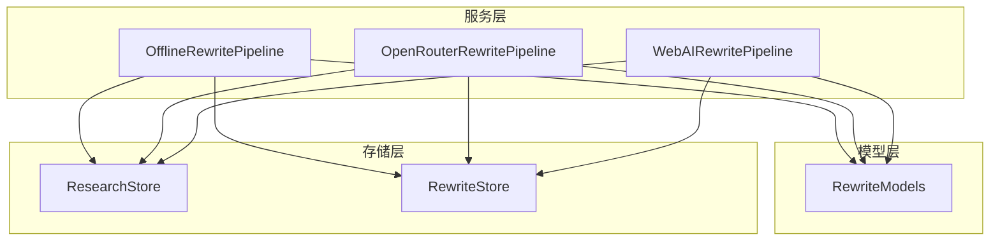
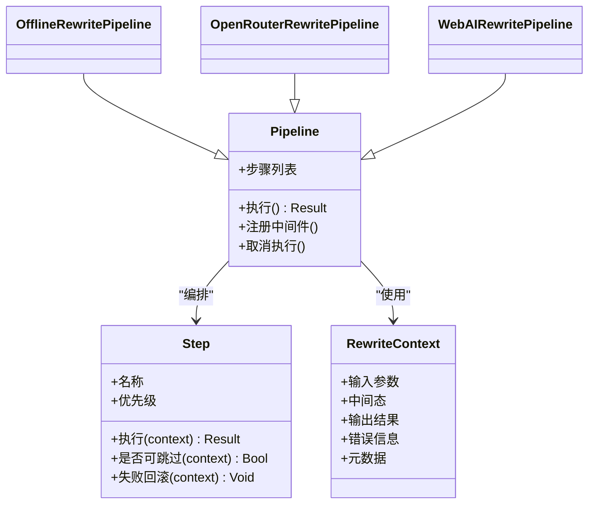
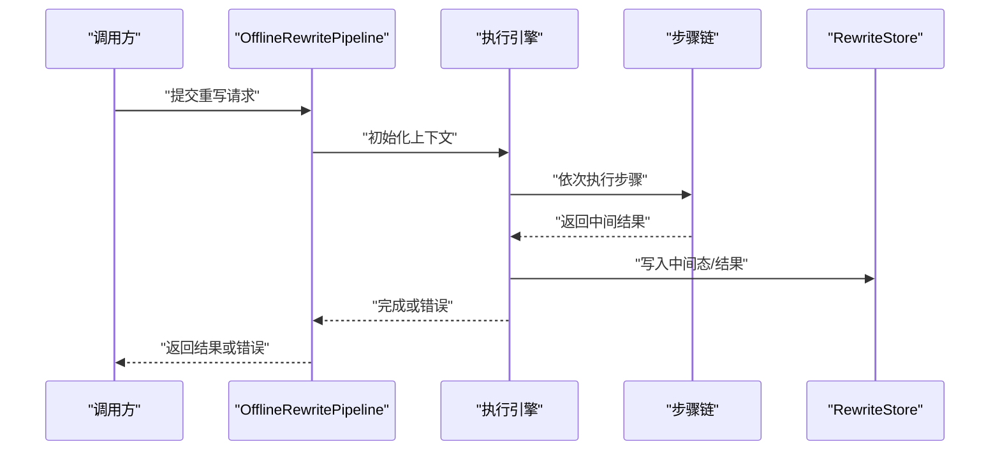
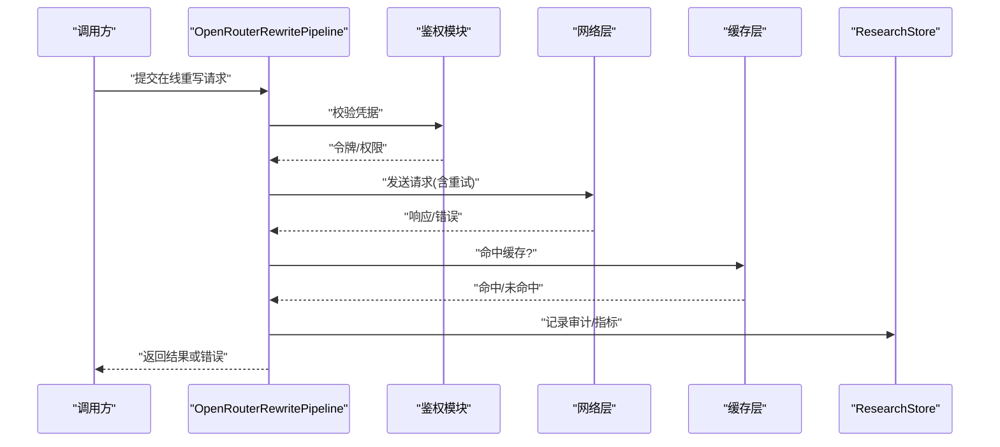
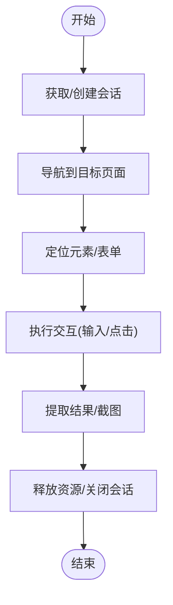
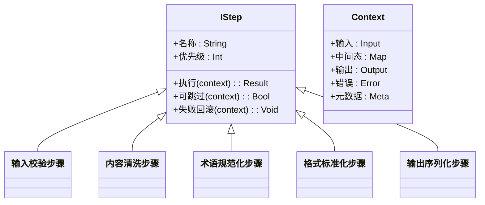
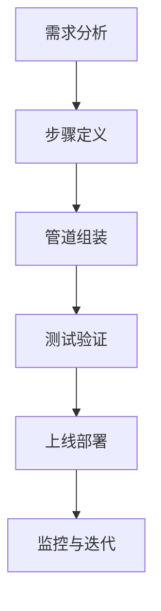
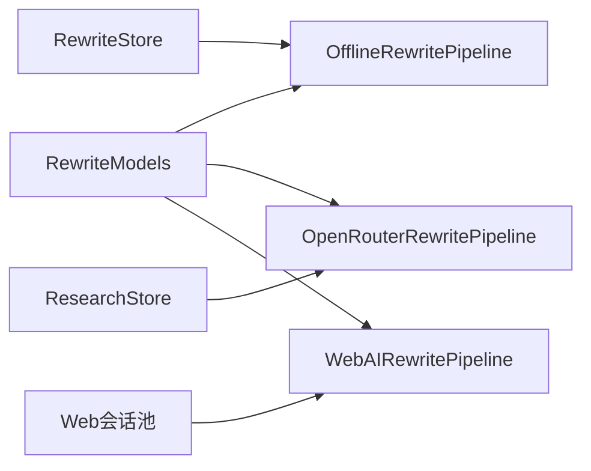

# 处理管道扩展

<cite>
**本文引用的文件**   
- [OfflineRewritePipeline.swift](file://Sources/ChengGao/Services/OfflineRewritePipeline.swift)
- [OpenRouterRewritePipeline.swift](file://Sources/ChengGao/Services/OpenRouterRewritePipeline.swift)
- [WebAIRewritePipeline.swift](file://Sources/ChengGao/Services/WebAIRewritePipeline.swift)
- [RewriteModels.swift](file://Sources/ChengGao/Models/RewriteModels.swift)
- [ResearchStore.swift](file://Sources/ChengGao/Stores/ResearchStore.swift)
- [RewriteStore.swift](file://Sources/ChengGao/Stores/RewriteStore.swift)
- [OfflineRewritePipelineTests.swift](file://Tests/ChengGaoTests/OfflineRewritePipelineTests.swift)
</cite>

## 目录
1. [简介](#简介)
2. [项目结构](#项目结构)
3. [核心组件](#核心组件)
4. [架构总览](#架构总览)
5. [详细组件分析](#详细组件分析)
6. [依赖关系分析](#依赖关系分析)
7. [性能考量](#性能考量)
8. [故障排查指南](#故障排查指南)
9. [结论](#结论)
10. [附录](#附录)

## 简介
本文件面向 ChengGao 系统的“处理管道扩展机制”，聚焦于重写（Rewrite）管道的架构设计、步骤编排与执行引擎。文档围绕三类具体实现：离线重写管道 OfflineRewritePipeline、OpenRouter 在线重写管道 OpenRouterRewritePipeline，以及 Web AI 重写管道 WebAIRewritePipeline，系统阐述其模式、扩展点、数据传递与错误传播策略，并提供自定义管道开发流程、步骤接口规范、中间件开发与性能优化建议，以及监控、日志与调试工具的使用说明。

## 项目结构
ChengGao 的 Swift Package 中，处理管道相关代码主要位于 Services 层，模型定义在 Models 层，状态与持久化在 Stores 层，测试用例位于 Tests 层。整体组织遵循“按功能域分层”的原则：
- Services：封装各类型重写管道的编排与执行逻辑
- Models：定义输入、输出、中间态等数据结构
- Stores：管理会话、配置与结果缓存
- Tests：覆盖关键路径与边界条件

图表来源
- [OfflineRewritePipeline.swift:1-200](file://Sources/ChengGao/Services/OfflineRewritePipeline.swift#L1-L200)
- [OpenRouterRewritePipeline.swift:1-200](file://Sources/ChengGao/Services/OpenRouterRewritePipeline.swift#L1-L200)
- [WebAIRewritePipeline.swift:1-200](file://Sources/ChengGao/Services/WebAIRewritePipeline.swift#L1-L200)
- [RewriteModels.swift:1-200](file://Sources/ChengGao/Models/RewriteModels.swift#L1-L200)
- [ResearchStore.swift:1-200](file://Sources/ChengGao/Stores/ResearchStore.swift#L1-L200)
- [RewriteStore.swift:1-200](file://Sources/ChengGao/Stores/RewriteStore.swift#L1-L200)

章节来源
- [OfflineRewritePipeline.swift:1-200](file://Sources/ChengGao/Services/OfflineRewritePipeline.swift#L1-L200)
- [OpenRouterRewritePipeline.swift:1-200](file://Sources/ChengGao/Services/OpenRouterRewritePipeline.swift#L1-L200)
- [WebAIRewritePipeline.swift:1-200](file://Sources/ChengGao/Services/WebAIRewritePipeline.swift#L1-L200)
- [RewriteModels.swift:1-200](file://Sources/ChengGao/Models/RewriteModels.swift#L1-L200)
- [ResearchStore.swift:1-200](file://Sources/ChengGao/Stores/ResearchStore.swift#L1-L200)
- [RewriteStore.swift:1-200](file://Sources/ChengGao/Stores/RewriteStore.swift#L1-L200)

## 核心组件
- 重写模型（RewriteModels）：统一描述输入参数、上下文、中间态与最终输出的数据结构，确保各管道间的数据契约一致。
- 离线重写管道（OfflineRewritePipeline）：本地可执行的步骤链，适合无网络或离线场景，强调可控性与稳定性。
- OpenRouter 重写管道（OpenRouterRewritePipeline）：通过 OpenRouter 网关调用在线模型，具备鉴权、重试与限流能力。
- Web AI 重写管道（WebAIRewritePipeline）：基于 Web 会话池与浏览器环境进行交互，适合需要网页交互能力的场景。

章节来源
- [RewriteModels.swift:1-200](file://Sources/ChengGao/Models/RewriteModels.swift#L1-L200)
- [OfflineRewritePipeline.swift:1-200](file://Sources/ChengGao/Services/OfflineRewritePipeline.swift#L1-L200)
- [OpenRouterRewritePipeline.swift:1-200](file://Sources/ChengGao/Services/OpenRouterRewritePipeline.swift#L1-L200)
- [WebAIRewritePipeline.swift:1-200](file://Sources/ChengGao/Services/WebAIRewritePipeline.swift#L1-L200)

## 架构总览
处理管道采用“步骤编排 + 执行引擎”的模式：
- 步骤接口：每个步骤实现统一的输入/输出契约，支持前置校验、转换、副作用与错误抛出。
- 执行引擎：负责顺序或并行执行步骤，维护上下文对象，捕获并传播错误，提供中间件钩子用于日志、监控与重试。
- 数据传递：通过上下文对象在各步骤间传递，避免全局状态污染。
- 错误传播：异常被收集并转换为结构化错误，便于上层统一处理与展示。

图表来源
- [RewriteModels.swift:1-200](file://Sources/ChengGao/Models/RewriteModels.swift#L1-L200)
- [OfflineRewritePipeline.swift:1-200](file://Sources/ChengGao/Services/OfflineRewritePipeline.swift#L1-L200)
- [OpenRouterRewritePipeline.swift:1-200](file://Sources/ChengGao/Services/OpenRouterRewritePipeline.swift#L1-L200)
- [WebAIRewritePipeline.swift:1-200](file://Sources/ChengGao/Services/WebAIRewritePipeline.swift#L1-L200)

## 详细组件分析

### OfflineRewritePipeline（离线重写管道）
- 目标：在无网络环境下完成文本/内容的重写任务，保证稳定与可复现。
- 步骤编排：典型步骤包括输入校验、内容清洗、术语规范化、格式标准化、输出序列化。
- 执行引擎：顺序执行，支持步骤级取消与超时控制；错误被包装为结构化错误并附带上下文。
- 扩展点：新增步骤只需实现统一接口，并在注册表中声明依赖与优先级。

图表来源
- [OfflineRewritePipeline.swift:1-200](file://Sources/ChengGao/Services/OfflineRewritePipeline.swift#L1-L200)
- [RewriteStore.swift:1-200](file://Sources/ChengGao/Stores/RewriteStore.swift#L1-L200)

章节来源
- [OfflineRewritePipeline.swift:1-200](file://Sources/ChengGao/Services/OfflineRewritePipeline.swift#L1-L200)
- [RewriteStore.swift:1-200](file://Sources/ChengGao/Stores/RewriteStore.swift#L1-L200)

### OpenRouterRewritePipeline（OpenRouter 在线重写管道）
- 目标：通过 OpenRouter 网关调用在线模型，具备鉴权、重试、限流与错误降级能力。
- 步骤编排：鉴权检查、参数构建、网络请求、响应解析、结果缓存。
- 执行引擎：支持并发请求、退避重试、熔断保护；错误分类（网络、鉴权、业务）并上报监控。
- 扩展点：新增模型供应商只需实现适配器接口，并在路由表注册。

图表来源
- [OpenRouterRewritePipeline.swift:1-200](file://Sources/ChengGao/Services/OpenRouterRewritePipeline.swift#L1-L200)
- [ResearchStore.swift:1-200](file://Sources/ChengGao/Stores/ResearchStore.swift#L1-L200)

章节来源
- [OpenRouterRewritePipeline.swift:1-200](file://Sources/ChengGao/Services/OpenRouterRewritePipeline.swift#L1-L200)
- [ResearchStore.swift:1-200](file://Sources/ChengGao/Stores/ResearchStore.swift#L1-L200)

### WebAIRewritePipeline（Web AI 重写管道）
- 目标：基于 Web 会话池与浏览器环境进行交互，适用于需网页交互或动态渲染的场景。
- 步骤编排：会话获取、页面导航、元素定位、交互操作、结果提取。
- 执行引擎：会话复用、资源清理、异常恢复；对网络波动与页面变化具备容错能力。
- 扩展点：新增站点适配只需实现页面解析器与交互脚本。

图表来源
- [WebAIRewritePipeline.swift:1-200](file://Sources/ChengGao/Services/WebAIRewritePipeline.swift#L1-L200)

章节来源
- [WebAIRewritePipeline.swift:1-200](file://Sources/ChengGao/Services/WebAIRewritePipeline.swift#L1-L200)

### 步骤接口规范与数据传递机制
- 步骤接口：所有步骤需实现统一的输入/输出契约，包含名称、优先级、执行方法、可跳过判断与失败回滚。
- 数据传递：通过上下文对象在各步骤间传递，避免全局状态；上下文包含输入参数、中间态、输出结果、错误信息与元数据。
- 错误传播：步骤抛出的错误被收集并转换为结构化错误，包含错误码、消息与堆栈，便于上层统一处理。

图表来源
- [RewriteModels.swift:1-200](file://Sources/ChengGao/Models/RewriteModels.swift#L1-L200)

章节来源
- [RewriteModels.swift:1-200](file://Sources/ChengGao/Models/RewriteModels.swift#L1-L200)

### 新处理管道开发流程
- 需求分析：明确输入/输出、步骤清单、依赖与约束。
- 步骤定义：实现统一接口，声明依赖与优先级。
- 管道组装：将步骤按顺序或并行编排，注册中间件（日志、监控、重试）。
- 测试验证：编写单元测试与集成测试，覆盖正常路径与异常分支。
- 上线部署：配置环境变量与密钥，灰度发布并监控指标。

[此图为概念流程图，不直接映射具体源码文件]

### 中间件开发与性能优化
- 中间件：在步骤执行前后插入横切逻辑，如日志记录、指标上报、缓存读写、重试与熔断。
- 性能优化：
  - 步骤级缓存：对昂贵计算或网络请求的结果进行缓存。
  - 并行执行：对无依赖的步骤进行并行化处理。
  - 资源复用：会话、连接、线程池等资源复用。
  - 背压与限流：防止上游过载导致系统崩溃。

章节来源
- [OfflineRewritePipeline.swift:1-200](file://Sources/ChengGao/Services/OfflineRewritePipeline.swift#L1-L200)
- [OpenRouterRewritePipeline.swift:1-200](file://Sources/ChengGao/Services/OpenRouterRewritePipeline.swift#L1-L200)
- [WebAIRewritePipeline.swift:1-200](file://Sources/ChengGao/Services/WebAIRewritePipeline.swift#L1-L200)

## 依赖关系分析
- 内部依赖：
  - 各管道均依赖 RewriteModels 提供的数据结构。
  - OfflineRewritePipeline 依赖 RewriteStore 进行中间态与结果持久化。
  - OpenRouterRewritePipeline 依赖 ResearchStore 进行审计与指标记录。
  - WebAIRewritePipeline 依赖会话池与浏览器资源管理。
- 外部依赖：
  - OpenRouter 网关、网络库、缓存服务。
  - WebKit 或浏览器自动化框架。

图表来源
- [RewriteModels.swift:1-200](file://Sources/ChengGao/Models/RewriteModels.swift#L1-L200)
- [OfflineRewritePipeline.swift:1-200](file://Sources/ChengGao/Services/OfflineRewritePipeline.swift#L1-L200)
- [OpenRouterRewritePipeline.swift:1-200](file://Sources/ChengGao/Services/OpenRouterRewritePipeline.swift#L1-L200)
- [WebAIRewritePipeline.swift:1-200](file://Sources/ChengGao/Services/WebAIRewritePipeline.swift#L1-L200)
- [RewriteStore.swift:1-200](file://Sources/ChengGao/Stores/RewriteStore.swift#L1-L200)
- [ResearchStore.swift:1-200](file://Sources/ChengGao/Stores/ResearchStore.swift#L1-L200)

章节来源
- [RewriteModels.swift:1-200](file://Sources/ChengGao/Models/RewriteModels.swift#L1-L200)
- [OfflineRewritePipeline.swift:1-200](file://Sources/ChengGao/Services/OfflineRewritePipeline.swift#L1-L200)
- [OpenRouterRewritePipeline.swift:1-200](file://Sources/ChengGao/Services/OpenRouterRewritePipeline.swift#L1-L200)
- [WebAIRewritePipeline.swift:1-200](file://Sources/ChengGao/Services/WebAIRewritePipeline.swift#L1-L200)
- [RewriteStore.swift:1-200](file://Sources/ChengGao/Stores/RewriteStore.swift#L1-L200)
- [ResearchStore.swift:1-200](file://Sources/ChengGao/Stores/ResearchStore.swift#L1-L200)

## 性能考量
- 步骤级缓存：对重复输入进行结果缓存，减少重复计算与网络请求。
- 并行执行：对无依赖步骤进行并行处理，提升吞吐。
- 资源复用：会话、连接、线程池等资源复用，降低开销。
- 背压与限流：防止上游过载，保障系统稳定性。
- 内存管理：及时释放中间态与大对象，避免内存泄漏。

[本节为通用性能指导，不直接分析具体文件]

## 故障排查指南
- 常见错误：
  - 输入校验失败：检查输入参数是否符合契约。
  - 网络请求失败：检查网络状态、鉴权令牌与限流策略。
  - 页面解析失败：检查选择器与页面结构变化。
- 调试工具：
  - 启用详细日志：记录步骤执行轨迹与中间态。
  - 指标上报：监控成功率、延迟与错误率。
  - 断点与快照：在关键步骤设置断点，保存上下文快照。
- 恢复策略：
  - 重试与退避：对临时性错误进行重试。
  - 降级与熔断：对持续失败的服务进行熔断，切换备用方案。
  - 回滚与补偿：对已执行步骤进行回滚或补偿。

章节来源
- [OfflineRewritePipelineTests.swift:1-200](file://Tests/ChengGaoTests/OfflineRewritePipelineTests.swift#L1-L200)

## 结论
ChengGao 的处理管道扩展机制以统一的步骤接口与执行引擎为核心，支持离线、在线与 Web 三种场景的重写任务。通过清晰的架构设计与扩展点，开发者可以快速构建自定义管道，并通过中间件实现监控、日志与性能优化。建议在开发过程中严格遵循接口规范，完善测试覆盖，并结合监控与调试工具进行持续优化。

[本节为总结性内容，不直接分析具体文件]

## 附录
- 最佳实践：
  - 步骤职责单一，避免复杂逻辑。
  - 使用上下文传递数据，避免全局状态。
  - 错误结构化，便于上层处理。
  - 中间件横切关注点，保持主流程清晰。
- 参考示例：
  - 自定义步骤：实现统一接口，注册到管道。
  - 中间件开发：在步骤前后插入横切逻辑。
  - 性能调优：启用缓存、并行与资源复用。

[本节为补充信息，不直接分析具体文件]