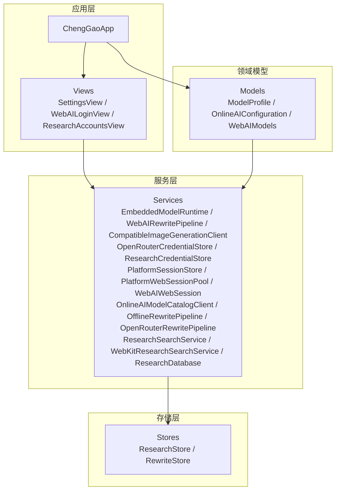
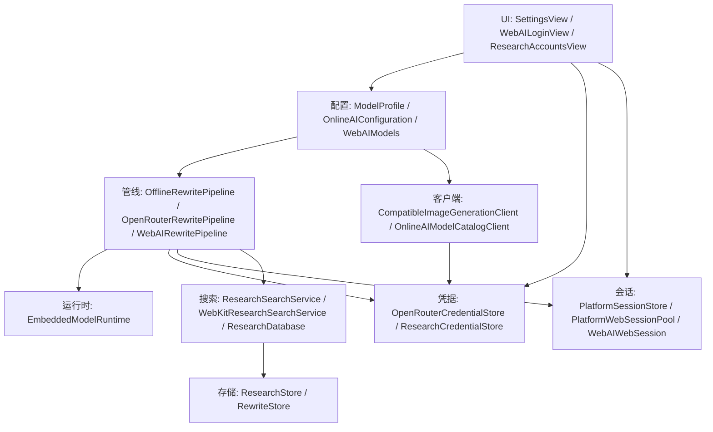
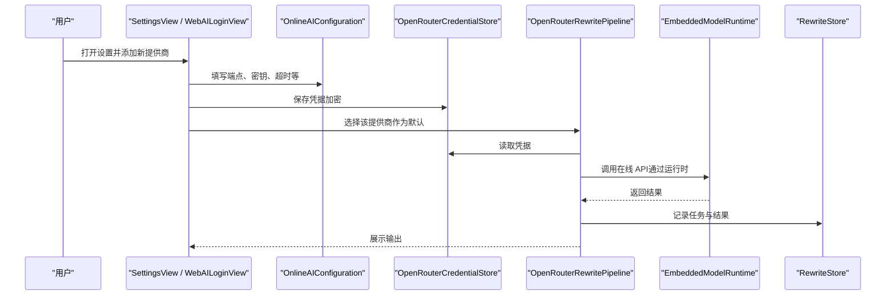
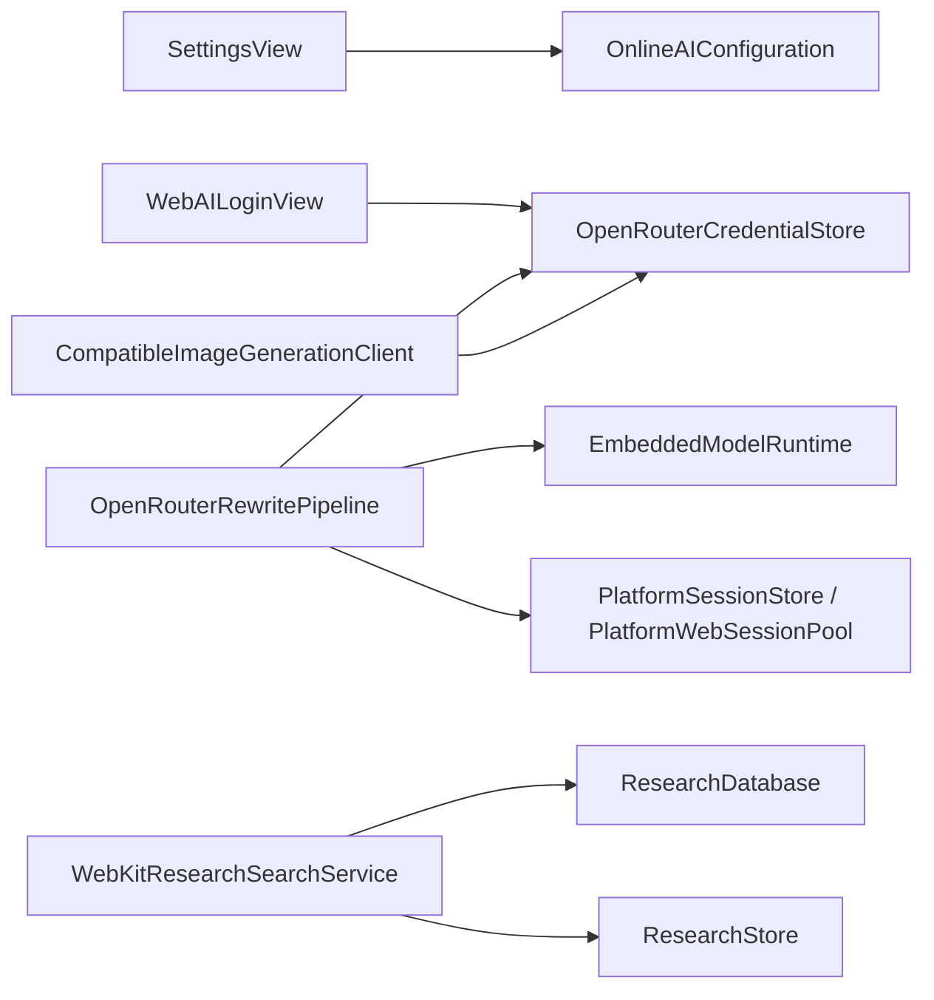

# 扩展点设计

<cite>
**本文引用的文件**   
- [Package.swift](file://Package.swift)
- [README.md](file://README.md)
- [ChengGaoApp.swift](file://Sources/ChengGao/App/ChengGaoApp.swift)
- [ModelProfile.swift](file://Sources/ChengGao/Models/ModelProfile.swift)
- [OnlineAIConfiguration.swift](file://Sources/ChengGao/Models/OnlineAIConfiguration.swift)
- [WebAIModels.swift](file://Sources/ChengGao/Models/WebAIModels.swift)
- [EmbeddedModelRuntime.swift](file://Sources/ChengGao/Services/EmbeddedModelRuntime.swift)
- [WebAIRewritePipeline.swift](file://Sources/ChengGao/Services/WebAIRewritePipeline.swift)
- [OpenRouterCredentialStore.swift](file://Sources/ChengGao/Services/OpenRouterCredentialStore.swift)
- [ResearchCredentialStore.swift](file://Sources/ChengGao/Services/ResearchCredentialStore.swift)
- [PlatformSessionStore.swift](file://Sources/ChengGao/Services/PlatformSessionStore.swift)
- [PlatformWebSessionPool.swift](file://Sources/ChengGao/Services/PlatformWebSessionPool.swift)
- [WebAIWebSession.swift](file://Sources/ChengGao/Services/WebAIWebSession.swift)
- [OnlineAIModelCatalogClient.swift](file://Sources/ChengGao/Services/OnlineAIModel目录客户端.swift)
- [CompatibleImageGenerationClient.swift](file://Sources/ChengGao/Services/CompatibleImageGenerationClient.swift)
- [OfflineRewritePipeline.swift](file://Sources/ChengGao/Services/OfflineRewritePipeline.swift)
- [OpenRouterRewritePipeline.swift](file://Sources/ChengGao/Services/OpenRouterRewritePipeline.swift)
- [ResearchSearchService.swift](file://Sources/ChengGao/Services/ResearchSearchService.swift)
- [WebKitResearchSearchService.swift](file://Sources/ChengGao/Services/WebKitResearchSearchService.swift)
- [ResearchDatabase.swift](file://Sources/ChengGao/Services/ResearchDatabase.swift)
- [ResearchStore.swift](file://Sources/ChengGao/Stores/ResearchStore.swift)
- [RewriteStore.swift](file://Sources/ChengGao/Stores/RewriteStore.swift)
- [SettingsView.swift](file://Sources/ChengGao/Views/SettingsView.swift)
- [WebAILoginView.swift](file://Sources/ChengGao/Views/WebAILoginView.swift)
- [ResearchAccountsView.swift](file://Sources/ChengGao/Views/ResearchAccountsView.swift)
</cite>

## 目录
1. [简介](#简介)
2. [项目结构](#项目结构)
3. [核心组件](#核心组件)
4. [架构总览](#架构总览)
5. [详细组件分析](#详细组件分析)
6. [依赖分析](#依赖分析)
7. [性能考虑](#性能考虑)
8. [故障排查指南](#故障排查指南)
9. [结论](#结论)
10. [附录](#附录)

## 简介
本文件面向 ChengGao 的扩展点设计与集成规范，聚焦以下目标：
- 插件化架构与扩展点定义：统一模型接入、凭据存储、会话管理、重写流水线等扩展点。
- API 接口规范：对外暴露稳定的配置、认证、调用与结果回调契约。
- 第三方集成机制：支持在线 AI（如 OpenRouter）、Web AI 适配、本地离线推理等。
- 新服务接入流程：从注册、配置模板、校验到上线灰度的完整路径。
- 版本兼容与功能开关：保障向后兼容与渐进式发布。
- 开发指南与最佳实践：帮助开发者快速集成新功能与外部服务。

## 项目结构
ChengGao 采用 Swift Package Manager 组织源码，核心位于 Sources/ChengGao，按职责分层：
- App：应用入口与窗口样式配置
- Models：模型描述、在线配置、Web AI 数据模型
- Services：各类运行时、网络、搜索、重写、图像生成、凭据与会话管理等
- Stores：持久化状态与缓存
- Views：用户界面与设置页

图表来源
- [ChengGaoApp.swift](file://Sources/ChengGao/App/ChengGaoApp.swift)
- [SettingsView.swift](file://Sources/ChengGao/Views/SettingsView.swift)
- [WebAILoginView.swift](file://Sources/ChengGao/Views/WebAILoginView.swift)
- [ResearchAccountsView.swift](file://Sources/ChengGao/Views/ResearchAccountsView.swift)
- [ModelProfile.swift](file://Sources/ChengGao/Models/ModelProfile.swift)
- [OnlineAIConfiguration.swift](file://Sources/ChengGao/Models/OnlineAIConfiguration.swift)
- [WebAIModels.swift](file://Sources/ChengGao/Models/WebAIModels.swift)
- [EmbeddedModelRuntime.swift](file://Sources/ChengGao/Services/EmbeddedModelRuntime.swift)
- [WebAIRewritePipeline.swift](file://Sources/ChengGao/Services/WebAIRewritePipeline.swift)
- [CompatibleImageGenerationClient.swift](file://Sources/ChengGao/Services/CompatibleImageGenerationClient.swift)
- [OpenRouterCredentialStore.swift](file://Sources/ChengGao/Services/OpenRouterCredentialStore.swift)
- [ResearchCredentialStore.swift](file://Sources/ChengGao/Services/ResearchCredentialStore.swift)
- [PlatformSessionStore.swift](file://Sources/ChengGao/Services/PlatformSessionStore.swift)
- [PlatformWebSessionPool.swift](file://Sources/ChengGao/Services/PlatformWebSessionPool.swift)
- [WebAIWebSession.swift](file://Sources/ChengGao/Services/WebAIWebSession.swift)
- [OnlineAIModelCatalogClient.swift](file://Sources/ChengGao/Services/OnlineAIModelCatalogClient.swift)
- [OfflineRewritePipeline.swift](file://Sources/ChengGao/Services/OfflineRewritePipeline.swift)
- [OpenRouterRewritePipeline.swift](file://Sources/ChengGao/Services/OpenRouterRewritePipeline.swift)
- [ResearchSearchService.swift](file://Sources/ChengGao/Services/ResearchSearchService.swift)
- [WebKitResearchSearchService.swift](file://Sources/ChengGao/Services/WebKitResearchSearchService.swift)
- [ResearchDatabase.swift](file://Sources/ChengGao/Services/ResearchDatabase.swift)
- [ResearchStore.swift](file://Sources/ChengGao/Stores/ResearchStore.swift)
- [RewriteStore.swift](file://Sources/ChengGao/Stores/RewriteStore.swift)

章节来源
- [Package.swift](file://Package.swift)
- [README.md](file://README.md)

## 核心组件
围绕扩展点设计的核心组件包括：
- 模型描述与配置：ModelProfile、OnlineAIConfiguration、WebAIModels
- 运行时与管线：EmbeddedModelRuntime、OfflineRewritePipeline、OpenRouterRewritePipeline、WebAIRewritePipeline
- 凭据与会话：OpenRouterCredentialStore、ResearchCredentialStore、PlatformSessionStore、PlatformWebSessionPool、WebAIWebSession
- 目录与兼容客户端：OnlineAIModelCatalogClient、CompatibleImageGenerationClient
- 研究与搜索：ResearchSearchService、WebKitResearchSearchService、ResearchDatabase
- 存储：ResearchStore、RewriteStore

这些组件通过清晰的接口与协议抽象，形成可扩展的插件体系，便于新增 AI 提供商、Web 平台或本地运行时。

章节来源
- [ModelProfile.swift](file://Sources/ChengGao/Models/ModelProfile.swift)
- [OnlineAIConfiguration.swift](file://Sources/ChengGao/Models/OnlineAIConfiguration.swift)
- [WebAIModels.swift](file://Sources/ChengGao/Models/WebAIModels.swift)
- [EmbeddedModelRuntime.swift](file://Sources/ChengGao/Services/EmbeddedModelRuntime.swift)
- [OfflineRewritePipeline.swift](file://Sources/ChengGao/Services/OfflineRewritePipeline.swift)
- [OpenRouterRewritePipeline.swift](file://Sources/ChengGao/Services/OpenRouterRewritePipeline.swift)
- [WebAIRewritePipeline.swift](file://Sources/ChengGao/Services/WebAIRewritePipeline.swift)
- [OpenRouterCredentialStore.swift](file://Sources/ChengGao/Services/OpenRouterCredentialStore.swift)
- [ResearchCredentialStore.swift](file://Sources/ChengGao/Services/ResearchCredentialStore.swift)
- [PlatformSessionStore.swift](file://Sources/ChengGao/Services/PlatformSessionStore.swift)
- [PlatformWebSessionPool.swift](file://Sources/ChengGao/Services/PlatformWebSessionPool.swift)
- [WebAIWebSession.swift](file://Sources/ChengGao/Services/WebAIWebSession.swift)
- [OnlineAIModelCatalogClient.swift](file://Sources/ChengGao/Services/OnlineAIModelCatalogClient.swift)
- [CompatibleImageGenerationClient.swift](file://Sources/ChengGao/Services/CompatibleImageGenerationClient.swift)
- [ResearchSearchService.swift](file://Sources/ChengGao/Services/ResearchSearchService.swift)
- [WebKitResearchSearchService.swift](file://Sources/ChengGao/Services/WebKitResearchSearchService.swift)
- [ResearchDatabase.swift](file://Sources/ChengGao/Services/ResearchDatabase.swift)
- [ResearchStore.swift](file://Sources/ChengGao/Stores/ResearchStore.swift)
- [RewriteStore.swift](file://Sources/ChengGao/Stores/RewriteStore.swift)

## 架构总览
系统以“模型描述 + 配置 + 运行时 + 管线 + 凭据/会话 + 存储”的分层架构实现扩展点。上层 UI 通过 SettingsView 与 WebAILoginView 进行配置与登录；中间层由各种 Pipeline 与 Client 组合不同后端；底层通过 Store 与 Database 持久化。

图表来源
- [SettingsView.swift](file://Sources/ChengGao/Views/SettingsView.swift)
- [WebAILoginView.swift](file://Sources/ChengGao/Views/WebAILoginView.swift)
- [ResearchAccountsView.swift](file://Sources/ChengGao/Views/ResearchAccountsView.swift)
- [ModelProfile.swift](file://Sources/ChengGao/Models/ModelProfile.swift)
- [OnlineAIConfiguration.swift](file://Sources/ChengGao/Models/OnlineAIConfiguration.swift)
- [WebAIModels.swift](file://Sources/ChengGao/Models/WebAIModels.swift)
- [EmbeddedModelRuntime.swift](file://Sources/ChengGao/Services/EmbeddedModelRuntime.swift)
- [OfflineRewritePipeline.swift](file://Sources/ChengGao/Services/OfflineRewritePipeline.swift)
- [OpenRouterRewritePipeline.swift](file://Sources/ChengGao/Services/OpenRouterRewritePipeline.swift)
- [WebAIRewritePipeline.swift](file://Sources/ChengGao/Services/WebAIRewritePipeline.swift)
- [CompatibleImageGenerationClient.swift](file://Sources/ChengGao/Services/CompatibleImageGenerationClient.swift)
- [OnlineAIModelCatalogClient.swift](file://Sources/ChengGao/Services/OnlineAIModelCatalogClient.swift)
- [OpenRouterCredentialStore.swift](file://Sources/ChengGao/Services/OpenRouterCredentialStore.swift)
- [ResearchCredentialStore.swift](file://Sources/ChengGao/Services/ResearchCredentialStore.swift)
- [PlatformSessionStore.swift](file://Sources/ChengGao/Services/PlatformSessionStore.swift)
- [PlatformWebSessionPool.swift](file://Sources/ChengGao/Services/PlatformWebSessionPool.swift)
- [WebAIWebSession.swift](file://Sources/ChengGao/Services/WebAIWebSession.swift)
- [ResearchSearchService.swift](file://Sources/ChengGao/Services/ResearchSearchService.swift)
- [WebKitResearchSearchService.swift](file://Sources/ChengGao/Services/WebKitResearchSearchService.swift)
- [ResearchDatabase.swift](file://Sources/ChengGao/Services/ResearchDatabase.swift)
- [ResearchStore.swift](file://Sources/ChengGao/Stores/ResearchStore.swift)
- [RewriteStore.swift](file://Sources/ChengGao/Stores/RewriteStore.swift)

## 详细组件分析

### 模型与配置扩展点
- 模型描述：ModelProfile 提供统一的模型元数据与能力标识，用于选择与路由。
- 在线配置：OnlineAIConfiguration 承载密钥、端点、超时、重试等参数，支持多提供商。
- Web AI 模型：WebAIModels 定义 Web 平台模型的输入输出结构与行为约束。

建议扩展方式：
- 新增模型类型时，扩展 ModelProfile 的能力枚举与字段。
- 新增提供商时，在 OnlineAIConfiguration 中增加对应配置项，并在 UI 中提供表单校验。
- Web AI 模型需遵循 WebAIModels 的数据契约，确保序列化与反序列一致。

章节来源
- [ModelProfile.swift](file://Sources/ChengGao/Models/ModelProfile.swift)
- [OnlineAIConfiguration.swift](file://Sources/ChengGao/Models/OnlineAIConfiguration.swift)
- [WebAIModels.swift](file://Sources/ChengGao/Models/WebAIModels.swift)

### 运行时与管线扩展点
- 嵌入式运行时：EmbeddedModelRuntime 负责本地模型加载、执行与资源管理。
- 离线重写管线：OfflineRewritePipeline 提供无网络的文本处理流程。
- OpenRouter 重写管线：OpenRouterRewritePipeline 对接在线 API，封装鉴权与重试。
- Web AI 重写管线：WebAIRewritePipeline 适配 Web 平台的交互与渲染流程。

建议扩展方式：
- 新增运行时：实现统一的运行时接口，注册到调度器。
- 新增管线：实现标准步骤（预处理、调用、后处理、错误恢复），并注入凭据与会话。
- 管线编排：通过配置决定使用本地还是在线管线，支持动态切换。

章节来源
- [EmbeddedModelRuntime.swift](file://Sources/ChengGao/Services/EmbeddedModelRuntime.swift)
- [OfflineRewritePipeline.swift](file://Sources/ChengGao/Services/OfflineRewritePipeline.swift)
- [OpenRouterRewritePipeline.swift](file://Sources/ChengGao/Services/OpenRouterRewritePipeline.swift)
- [WebAIRewritePipeline.swift](file://Sources/ChengGao/Services/WebAIRewritePipeline.swift)

### 凭据与会话扩展点
- 凭据存储：OpenRouterCredentialStore、ResearchCredentialStore 分别管理不同服务的密钥与令牌。
- 平台会话：PlatformSessionStore、PlatformWebSessionPool、WebAIWebSession 管理浏览器/平台会话生命周期。

建议扩展方式：
- 新增凭据提供者：实现安全存取接口，支持加密存储与自动刷新。
- 新增会话池：实现会话创建、复用、回收与异常恢复策略。
- 登录流程：通过 WebAILoginView 引导用户完成授权，成功后写入凭据与会话。

章节来源
- [OpenRouterCredentialStore.swift](file://Sources/ChengGao/Services/OpenRouterCredentialStore.swift)
- [ResearchCredentialStore.swift](file://Sources/ChengGao/Services/ResearchCredentialStore.swift)
- [PlatformSessionStore.swift](file://Sources/ChengGao/Services/PlatformSessionStore.swift)
- [PlatformWebSessionPool.swift](file://Sources/ChengGao/Services/PlatformWebSessionPool.swift)
- [WebAIWebSession.swift](file://Sources/ChengGao/Services/WebAIWebSession.swift)
- [WebAILoginView.swift](file://Sources/ChengGao/Views/WebAILoginView.swift)

### 目录与兼容客户端扩展点
- 模型目录：OnlineAIModelCatalogClient 提供远程模型清单与版本信息。
- 图像生成兼容：CompatibleImageGenerationClient 屏蔽不同图像生成 API 的差异。

建议扩展方式：
- 新增目录源：实现清单拉取与解析，支持缓存与增量更新。
- 新增图像后端：实现统一接口，映射差异参数与返回格式。

章节来源
- [OnlineAIModelCatalogClient.swift](file://Sources/ChengGao/Services/OnlineAIModelCatalogClient.swift)
- [CompatibleImageGenerationClient.swift](file://Sources/ChengGao/Services/CompatibleImageGenerationClient.swift)

### 研究与搜索扩展点
- 搜索服务：ResearchSearchService 定义搜索接口，WebKitResearchSearchService 基于 WebKit 实现。
- 数据库：ResearchDatabase 提供结构化数据存储与查询。

建议扩展方式：
- 新增搜索引擎：实现统一搜索接口，支持分页、过滤与排序。
- 数据模型扩展：在 ResearchDatabase 中新增表与索引，保持迁移兼容性。

章节来源
- [ResearchSearchService.swift](file://Sources/ChengGao/Services/ResearchSearchService.swift)
- [WebKitResearchSearchService.swift](file://Sources/ChengGao/Services/WebKitResearchSearchService.swift)
- [ResearchDatabase.swift](file://Sources/ChengGao/Services/ResearchDatabase.swift)

### 存储扩展点
- ResearchStore：研究相关数据的读写与缓存。
- RewriteStore：重写任务的状态与结果持久化。

建议扩展方式：
- 新增存储域：实现一致的 CRUD 接口，支持事务与并发控制。
- 数据迁移：提供版本化迁移脚本，保证升级平滑。

章节来源
- [ResearchStore.swift](file://Sources/ChengGao/Stores/ResearchStore.swift)
- [RewriteStore.swift](file://Sources/ChengGao/Stores/RewriteStore.swift)

### 新服务接入流程（示例：新增一个在线 AI 提供商）

图表来源
- [SettingsView.swift](file://Sources/ChengGao/Views/SettingsView.swift)
- [WebAILoginView.swift](file://Sources/ChengGao/Views/WebAILoginView.swift)
- [OnlineAIConfiguration.swift](file://Sources/ChengGao/Models/OnlineAIConfiguration.swift)
- [OpenRouterCredentialStore.swift](file://Sources/ChengGao/Services/OpenRouterCredentialStore.swift)
- [OpenRouterRewritePipeline.swift](file://Sources/ChengGao/Services/OpenRouterRewritePipeline.swift)
- [EmbeddedModelRuntime.swift](file://Sources/ChengGao/Services/EmbeddedModelRuntime.swift)
- [RewriteStore.swift](file://Sources/ChengGao/Stores/RewriteStore.swift)

### 配置模板与验证规则
- 配置模板：为每个提供商定义必填字段、默认值与可选参数。
- 验证规则：
  - 必填校验：端点 URL、API Key、模型名称等
  - 格式校验：URL 合法性、超时范围、重试次数上限
  - 连通性测试：启动时进行健康检查，失败则禁用该提供商
- 版本兼容：
  - 配置项版本号：向后兼容旧版配置，提供迁移工具
  - 模型能力矩阵：根据 ModelProfile 的能力字段决定是否启用某功能

章节来源
- [OnlineAIConfiguration.swift](file://Sources/ChengGao/Models/OnlineAIConfiguration.swift)
- [ModelProfile.swift](file://Sources/ChengGao/Models/ModelProfile.swift)

### 版本兼容管理与灰度发布
- 版本兼容：
  - 配置迁移：在应用启动时检测版本并自动迁移
  - 接口稳定：对外暴露的 API 保持语义稳定，废弃字段标记弃用时间线
- 功能开关：
  - 全局开关：通过 SettingsView 控制是否启用某提供商或特性
  - 灰度策略：按用户组或比例逐步放量，结合日志与指标监控
- 回滚机制：
  - 配置快照：每次变更保留快照，支持一键回滚
  - 降级策略：在线不可用时自动切换到离线管线或备用提供商

章节来源
- [SettingsView.swift](file://Sources/ChengGao/Views/SettingsView.swift)
- [OnlineAIConfiguration.swift](file://Sources/ChengGao/Models/OnlineAIConfiguration.swift)
- [OfflineRewritePipeline.swift](file://Sources/ChengGao/Services/OfflineRewritePipeline.swift)

### 扩展开发指南与最佳实践
- 插件化原则：
  - 单一职责：每个扩展只关注一种能力（凭据、会话、管线、客户端）
  - 接口优先：通过协议定义边界，避免紧耦合
  - 可测试性：为关键路径编写单元测试与集成测试
- 开发步骤：
  - 定义模型与配置：扩展 ModelProfile 与 OnlineAIConfiguration
  - 实现凭据与会话：新建 CredentialStore 与 SessionPool
  - 实现管线：封装请求、响应、错误与重试逻辑
  - 接入 UI：在 SettingsView 与 WebAILoginView 中添加表单与流程
  - 持久化：在相应 Store 中维护状态与结果
- 最佳实践：
  - 错误分类：区分网络、认证、限流、业务错误，提供用户友好提示
  - 性能优化：连接池、缓存、批处理、异步处理
  - 安全合规：敏感信息加密存储，最小权限原则，审计日志

章节来源
- [ModelProfile.swift](file://Sources/ChengGao/Models/ModelProfile.swift)
- [OnlineAIConfiguration.swift](file://Sources/ChengGao/Models/OnlineAIConfiguration.swift)
- [OpenRouterCredentialStore.swift](file://Sources/ChengGao/Services/OpenRouterCredentialStore.swift)
- [PlatformSessionStore.swift](file://Sources/ChengGao/Services/PlatformSessionStore.swift)
- [OpenRouterRewritePipeline.swift](file://Sources/ChengGao/Services/OpenRouterRewritePipeline.swift)
- [SettingsView.swift](file://Sources/ChengGao/Views/SettingsView.swift)
- [WebAILoginView.swift](file://Sources/ChengGao/Views/WebAILoginView.swift)

## 依赖分析
组件间依赖关系清晰，核心依赖如下：
- UI 依赖配置与凭据
- 管线依赖运行时、凭据与会话
- 客户端依赖凭据
- 搜索服务依赖数据库与存储

图表来源
- [SettingsView.swift](file://Sources/ChengGao/Views/SettingsView.swift)
- [WebAILoginView.swift](file://Sources/ChengGao/Views/WebAILoginView.swift)
- [OnlineAIConfiguration.swift](file://Sources/ChengGao/Models/OnlineAIConfiguration.swift)
- [OpenRouterCredentialStore.swift](file://Sources/ChengGao/Services/OpenRouterCredentialStore.swift)
- [OpenRouterRewritePipeline.swift](file://Sources/ChengGao/Services/OpenRouterRewritePipeline.swift)
- [EmbeddedModelRuntime.swift](file://Sources/ChengGao/Services/EmbeddedModelRuntime.swift)
- [PlatformSessionStore.swift](file://Sources/ChengGao/Services/PlatformSessionStore.swift)
- [PlatformWebSessionPool.swift](file://Sources/ChengGao/Services/PlatformWebSessionPool.swift)
- [CompatibleImageGenerationClient.swift](file://Sources/ChengGao/Services/CompatibleImageGenerationClient.swift)
- [WebKitResearchSearchService.swift](file://Sources/ChengGao/Services/WebKitResearchSearchService.swift)
- [ResearchDatabase.swift](file://Sources/ChengGao/Services/ResearchDatabase.swift)
- [ResearchStore.swift](file://Sources/ChengGao/Stores/ResearchStore.swift)

章节来源
- [Package.swift](file://Package.swift)

## 性能考虑
- 连接与会话：
  - 使用连接池与会话池减少握手开销
  - 合理设置超时与重试，避免雪崩
- 缓存与批处理：
  - 对模型清单与常用结果进行缓存
  - 批量请求合并，降低网络往返
- 异步与并发：
  - 长耗时操作异步执行，避免阻塞 UI
  - 限制并发度，防止资源耗尽
- 内存与磁盘：
  - 及时释放大对象，避免内存泄漏
  - 定期清理过期数据，控制存储增长

[本节为通用指导，不直接分析具体文件]

## 故障排查指南
常见问题与定位方法：
- 凭据无效：
  - 检查 OpenRouterCredentialStore 与 ResearchCredentialStore 中的密钥是否正确
  - 确认登录流程成功写入凭据与会话
- 网络错误：
  - 查看 OnlineAIModelCatalogClient 与 CompatibleImageGenerationClient 的错误码
  - 检查超时与重试配置
- 会话失效：
  - 检查 PlatformSessionStore 与 PlatformWebSessionPool 的生命周期管理
  - 重新触发 WebAILoginView 的授权流程
- 数据不一致：
  - 核对 ResearchStore 与 RewriteStore 的事务与一致性
  - 检查 ResearchDatabase 的迁移与索引

章节来源
- [OpenRouterCredentialStore.swift](file://Sources/ChengGao/Services/OpenRouterCredentialStore.swift)
- [ResearchCredentialStore.swift](file://Sources/ChengGao/Services/ResearchCredentialStore.swift)
- [PlatformSessionStore.swift](file://Sources/ChengGao/Services/PlatformSessionStore.swift)
- [PlatformWebSessionPool.swift](file://Sources/ChengGao/Services/PlatformWebSessionPool.swift)
- [WebAILoginView.swift](file://Sources/ChengGao/Views/WebAILoginView.swift)
- [OnlineAIModelCatalogClient.swift](file://Sources/ChengGao/Services/OnlineAIModelCatalogClient.swift)
- [CompatibleImageGenerationClient.swift](file://Sources/ChengGao/Services/CompatibleImageGenerationClient.swift)
- [ResearchStore.swift](file://Sources/ChengGao/Stores/ResearchStore.swift)
- [RewriteStore.swift](file://Sources/ChengGao/Stores/RewriteStore.swift)
- [ResearchDatabase.swift](file://Sources/ChengGao/Services/ResearchDatabase.swift)

## 结论
ChengGao 的扩展点设计以清晰的层次与接口为核心，支撑模型、凭据、会话、管线、客户端与存储的多维度扩展。通过配置模板、验证规则、版本兼容与灰度发布，确保系统在演进过程中的稳定性与可维护性。遵循本文的开发指南与最佳实践，开发者可以快速集成新的 AI 提供商与外部服务，提升产品能力与用户体验。

[本节为总结性内容，不直接分析具体文件]

## 附录
- 术语表：
  - 模型描述：ModelProfile，定义模型元数据与能力
  - 在线配置：OnlineAIConfiguration，承载提供商参数
  - 凭据存储：CredentialStore，管理密钥与令牌
  - 会话管理：SessionStore/Pool，管理用户会话
  - 管线：RewritePipeline，编排调用流程
  - 客户端：Client，封装外部 API 调用
  - 存储：Store，持久化数据与状态
- 参考视图：
  - SettingsView：配置与功能开关
  - WebAILoginView：Web 平台登录与授权
  - ResearchAccountsView：研究账号管理

[本节为概念性内容，不直接分析具体文件]