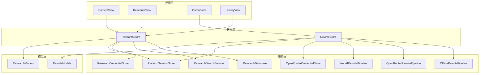
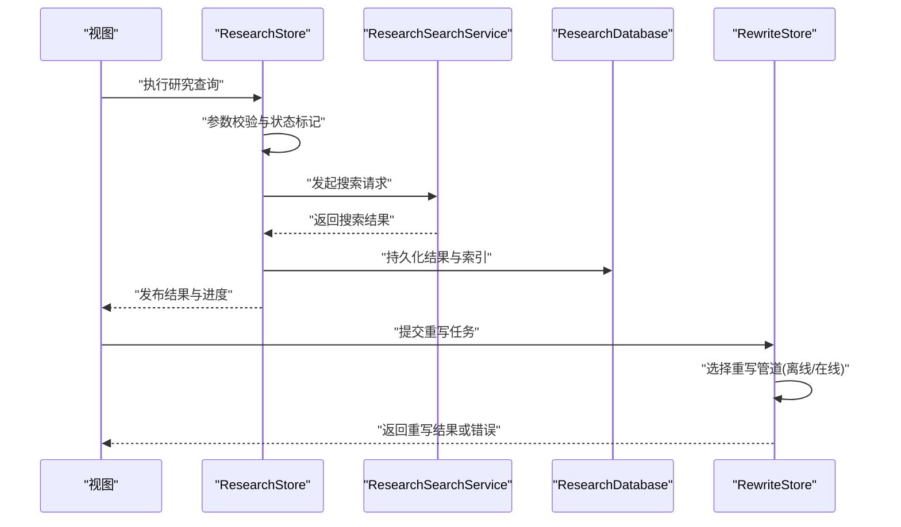
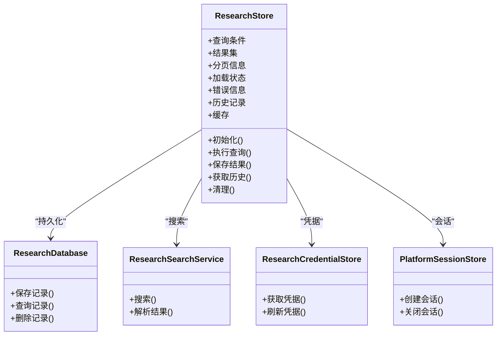
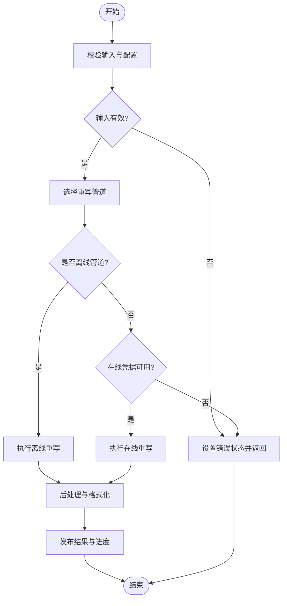
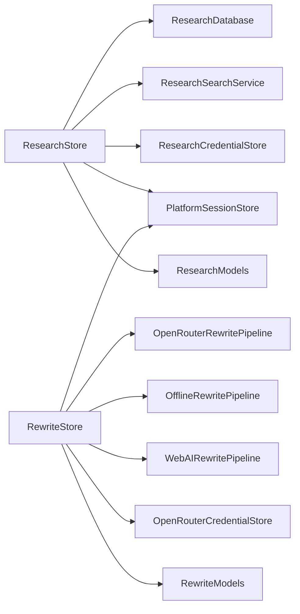

# Store 架构设计

<cite>
**本文引用的文件**   
- [ResearchStore.swift](file://Sources/ChengGao/Stores/ResearchStore.swift)
- [RewriteStore.swift](file://Sources/ChengGao/Stores/RewriteStore.swift)
- [ResearchModels.swift](file://Sources/ChengGao/Models/ResearchModels.swift)
- [RewriteModels.swift](file://Sources/ChengGao/Models/RewriteModels.swift)
- [ResearchDatabase.swift](file://Sources/ChengGao/Services/ResearchDatabase.swift)
- [ResearchSearchService.swift](file://Sources/ChengGao/Services/ResearchSearchService.swift)
- [OfflineRewritePipeline.swift](file://Sources/ChengGao/Services/OfflineRewritePipeline.swift)
- [OpenRouterRewritePipeline.swift](file://Sources/ChengGao/Services/OpenRouterRewritePipeline.swift)
- [WebAIRewritePipeline.swift](file://Sources/ChengGao/Services/WebAIRewritePipeline.swift)
- [ResearchCredentialStore.swift](file://Sources/ChengGao/Services/ResearchCredentialStore.swift)
- [OpenRouterCredentialStore.swift](file://Sources/ChengGao/Services/OpenRouterCredentialStore.swift)
- [PlatformSessionStore.swift](file://Sources/ChengGao/Services/PlatformSessionStore.swift)
- [ContentView.swift](file://Sources/ChengGao/Views/ContentView.swift)
- [ResearchView.swift](file://Sources/ChengGao/Views/ResearchView.swift)
- [OutputView.swift](file://Sources/ChengGao/Views/OutputView.swift)
- [HistoryView.swift](file://Sources/ChengGao/Views/HistoryView.swift)
</cite>

## 目录
1. [简介](#简介)
2. [项目结构](#项目结构)
3. [核心组件](#核心组件)
4. [架构总览](#架构总览)
5. [详细组件分析](#详细组件分析)
6. [依赖关系分析](#依赖关系分析)
7. [性能考量](#性能考量)
8. [故障排查指南](#故障排查指南)
9. [结论](#结论)
10. [附录：API 使用示例与最佳实践](#附录api-使用示例与最佳实践)

## 简介
本文件系统化阐述 ChengGao 的 Store 层架构，重点围绕 ResearchStore 与 RewriteStore 的设计模式、状态管理、数据绑定与响应式更新机制。文档覆盖 Store 初始化流程、生命周期管理、内存优化策略、状态同步、数据验证规则、错误处理模式、Store 间通信协议、依赖注入模式以及测试策略，并通过代码片段路径展示如何正确使用 Store API 进行状态操作。

## 项目结构
ChengGao 采用分层组织方式：
- Models：领域模型定义（研究、重写等）
- Services：业务服务（数据库、搜索、重写管线、凭据与会话存储）
- Stores：状态容器（ResearchStore、RewriteStore）
- Views：UI 视图（消费 Store 状态并触发动作）

图表来源
- [ResearchStore.swift](file://Sources/ChengGao/Stores/ResearchStore.swift)
- [RewriteStore.swift](file://Sources/ChengGao/Stores/RewriteStore.swift)
- [ResearchDatabase.swift](file://Sources/ChengGao/Services/ResearchDatabase.swift)
- [ResearchSearchService.swift](file://Sources/ChengGao/Services/ResearchSearchService.swift)
- [OfflineRewritePipeline.swift](file://Sources/ChengGao/Services/OfflineRewritePipeline.swift)
- [OpenRouterRewritePipeline.swift](file://Sources/ChengGao/Services/OpenRouterRewritePipeline.swift)
- [WebAIRewritePipeline.swift](file://Sources/ChengGao/Services/WebAIRewritePipeline.swift)
- [ResearchCredentialStore.swift](file://Sources/ChengGao/Services/ResearchCredentialStore.swift)
- [OpenRouterCredentialStore.swift](file://Sources/ChengGao/Services/OpenRouterCredentialStore.swift)
- [PlatformSessionStore.swift](file://Sources/ChengGao/Services/PlatformSessionStore.swift)
- [ResearchModels.swift](file://Sources/ChengGao/Models/ResearchModels.swift)
- [RewriteModels.swift](file://Sources/ChengGao/Models/RewriteModels.swift)
- [ContentView.swift](file://Sources/ChengGao/Views/ContentView.swift)
- [ResearchView.swift](file://Sources/ChengGao/Views/ResearchView.swift)
- [OutputView.swift](file://Sources/ChengGao/Views/OutputView.swift)
- [HistoryView.swift](file://Sources/ChengGao/Views/HistoryView.swift)

章节来源
- [ResearchStore.swift](file://Sources/ChengGao/Stores/ResearchStore.swift)
- [RewriteStore.swift](file://Sources/ChengGao/Stores/RewriteStore.swift)
- [ResearchModels.swift](file://Sources/ChengGao/Models/ResearchModels.swift)
- [RewriteModels.swift](file://Sources/ChengGao/Models/RewriteModels.swift)
- [ResearchDatabase.swift](file://Sources/ChengGao/Services/ResearchDatabase.swift)
- [ResearchSearchService.swift](file://Sources/ChengGao/Services/ResearchSearchService.swift)
- [OfflineRewritePipeline.swift](file://Sources/ChengGao/Services/OfflineRewritePipeline.swift)
- [OpenRouterRewritePipeline.swift](file://Sources/ChengGao/Services/OpenRouterRewritePipeline.swift)
- [WebAIRewritePipeline.swift](file://Sources/ChengGao/Services/WebAIRewritePipeline.swift)
- [ResearchCredentialStore.swift](file://Sources/ChengGao/Services/ResearchCredentialStore.swift)
- [OpenRouterCredentialStore.swift](file://Sources/ChengGao/Services/OpenRouterCredentialStore.swift)
- [PlatformSessionStore.swift](file://Sources/ChengGao/Services/PlatformSessionStore.swift)
- [ContentView.swift](file://Sources/ChengGao/Views/ContentView.swift)
- [ResearchView.swift](file://Sources/ChengGao/Views/ResearchView.swift)
- [OutputView.swift](file://Sources/ChengGao/Views/OutputView.swift)
- [HistoryView.swift](file://Sources/ChengGao/Views/HistoryView.swift)

## 核心组件
- ResearchStore：负责“研究”领域的状态管理与业务流程编排，包括查询、结果缓存、历史与持久化、凭据与会话管理。
- RewriteStore：负责“重写”领域的状态管理与流水线编排，支持离线与在线多种重写管道，统一输出与错误处理。

两者均遵循以下设计原则：
- 单一职责：每个 Store 聚焦一个业务域的状态与行为。
- 不可变状态快照：对外暴露只读视图，内部通过原子变更保证一致性。
- 响应式更新：状态变更后通知订阅者，驱动 UI 刷新。
- 可组合性：通过依赖注入将服务注入到 Store，便于替换与测试。

章节来源
- [ResearchStore.swift](file://Sources/ChengGao/Stores/ResearchStore.swift)
- [RewriteStore.swift](file://Sources/ChengGao/Stores/RewriteStore.swift)

## 架构总览
Store 作为应用状态中心，向上为视图提供响应式数据流，向下协调服务完成 I/O 与计算。关键交互如下：
- 视图通过 Store 提供的 API 发起动作（如搜索、重写）。
- Store 校验输入参数，进入相应工作流（数据库、网络、本地推理）。
- 中间状态与最终结果以事件或属性形式回推至视图。
- 错误在 Store 层捕获并转换为可观察的错误信号。

图表来源
- [ResearchStore.swift](file://Sources/ChengGao/Stores/ResearchStore.swift)
- [RewriteStore.swift](file://Sources/ChengGao/Stores/RewriteStore.swift)
- [ResearchSearchService.swift](file://Sources/ChengGao/Services/ResearchSearchService.swift)
- [ResearchDatabase.swift](file://Sources/ChengGao/Services/ResearchDatabase.swift)

## 详细组件分析

### ResearchStore 组件分析
- 状态字段：查询条件、结果集、分页、加载状态、错误信息、历史记录、缓存键。
- 生命周期：
  - 初始化：构建依赖（数据库、搜索服务、凭据、会话），注册回调与清理逻辑。
  - 运行期：接收动作，执行校验、并发控制、I/O 调用、状态合并与发布。
  - 销毁：释放资源、取消未完成任务、清理缓存。
- 数据绑定：
  - 对外暴露只读属性与事件流，视图订阅后自动刷新。
  - 批量更新时使用事务语义，避免中间态闪烁。
- 响应式更新：
  - 基于观察者模式，状态变更触发最小粒度更新。
- 错误处理：
  - 区分网络、解析、权限、超时等错误类型，统一映射为可观察错误。
- 内存优化：
  - 结果分页与懒加载；大对象引用弱化；缓存按 LRU 淘汰。

图表来源
- [ResearchStore.swift](file://Sources/ChengGao/Stores/ResearchStore.swift)
- [ResearchDatabase.swift](file://Sources/ChengGao/Services/ResearchDatabase.swift)
- [ResearchSearchService.swift](file://Sources/ChengGao/Services/ResearchSearchService.swift)
- [ResearchCredentialStore.swift](file://Sources/ChengGao/Services/ResearchCredentialStore.swift)
- [PlatformSessionStore.swift](file://Sources/ChengGao/Services/PlatformSessionStore.swift)

章节来源
- [ResearchStore.swift](file://Sources/ChengGao/Stores/ResearchStore.swift)
- [ResearchDatabase.swift](file://Sources/ChengGao/Services/ResearchDatabase.swift)
- [ResearchSearchService.swift](file://Sources/ChengGao/Services/ResearchSearchService.swift)
- [ResearchCredentialStore.swift](file://Sources/ChengGao/Services/ResearchCredentialStore.swift)
- [PlatformSessionStore.swift](file://Sources/ChengGao/Services/PlatformSessionStore.swift)

### RewriteStore 组件分析
- 状态字段：输入文本、目标风格、当前管道、进度、结果、错误、重试计数。
- 生命周期：
  - 初始化：装配重写管道（离线、OpenRouter、WebAI）、凭据与会话。
  - 运行期：根据配置选择管道，执行转换，聚合结果，上报进度。
  - 销毁：取消进行中任务，释放临时缓冲区。
- 数据绑定：
  - 输入变化触发增量校验与预览；结果变更推送至输出视图。
- 响应式更新：
  - 分阶段进度（准备、生成、后处理）通过事件流下发。
- 错误处理：
  - 管道失败时自动降级或重试；错误分类与用户提示。
- 内存优化：
  - 流式处理长文本；按需加载上下文；结果压缩与去重。

图表来源
- [RewriteStore.swift](file://Sources/ChengGao/Stores/RewriteStore.swift)
- [OfflineRewritePipeline.swift](file://Sources/ChengGao/Services/OfflineRewritePipeline.swift)
- [OpenRouterRewritePipeline.swift](file://Sources/ChengGao/Services/OpenRouterRewritePipeline.swift)
- [WebAIRewritePipeline.swift](file://Sources/ChengGao/Services/WebAIRewritePipeline.swift)
- [OpenRouterCredentialStore.swift](file://Sources/ChengGao/Services/OpenRouterCredentialStore.swift)
- [PlatformSessionStore.swift](file://Sources/ChengGao/Services/PlatformSessionStore.swift)

章节来源
- [RewriteStore.swift](file://Sources/ChengGao/Stores/RewriteStore.swift)
- [OfflineRewritePipeline.swift](file://Sources/ChengGao/Services/OfflineRewritePipeline.swift)
- [OpenRouterRewritePipeline.swift](file://Sources/ChengGao/Services/OpenRouterRewritePipeline.swift)
- [WebAIRewritePipeline.swift](file://Sources/ChengGao/Services/WebAIRewritePipeline.swift)
- [OpenRouterCredentialStore.swift](file://Sources/ChengGao/Services/OpenRouterCredentialStore.swift)
- [PlatformSessionStore.swift](file://Sources/ChengGao/Services/PlatformSessionStore.swift)

### 状态同步机制
- 单向数据流：视图触发 Store 动作，Store 更新状态并发布事件，视图订阅更新。
- 事件总线：Store 内部维护轻量事件通道，确保跨模块解耦。
- 幂等性：相同输入多次触发不会产生副作用累积。
- 并发安全：读写锁或不可变快照保证线程安全。

章节来源
- [ResearchStore.swift](file://Sources/ChengGao/Stores/ResearchStore.swift)
- [RewriteStore.swift](file://Sources/ChengGao/Stores/RewriteStore.swift)

### 数据验证规则
- 输入校验：非空、长度限制、格式检查（URL、JSON、Markdown）。
- 业务规则：凭据有效性、配额检查、平台能力约束。
- 输出校验：结构化结果完整性、字段必填项、编码一致性。

章节来源
- [ResearchStore.swift](file://Sources/ChengGao/Stores/ResearchStore.swift)
- [RewriteStore.swift](file://Sources/ChengGao/Stores/RewriteStore.swift)

### 错误处理模式
- 错误分类：网络、认证、解析、超时、业务异常。
- 错误传播：从服务层到 Store，再到视图，保持语义一致。
- 恢复策略：重试、降级、回退默认值、用户提示。

章节来源
- [ResearchStore.swift](file://Sources/ChengGao/Stores/ResearchStore.swift)
- [RewriteStore.swift](file://Sources/ChengGao/Stores/RewriteStore.swift)

### Store 之间的通信协议
- 事件驱动：ResearchStore 完成后发布“研究完成”事件，RewriteStore 订阅后可触发后续重写。
- 共享上下文：通过会话与凭据存储实现跨 Store 的认证与上下文传递。
- 命令-响应：视图通过统一接口向不同 Store 发送命令，Store 返回标准化响应。

章节来源
- [ResearchStore.swift](file://Sources/ChengGao/Stores/ResearchStore.swift)
- [RewriteStore.swift](file://Sources/ChengGao/Stores/RewriteStore.swift)
- [PlatformSessionStore.swift](file://Sources/ChengGao/Services/PlatformSessionStore.swift)

### 依赖注入模式
- 构造注入：Store 在初始化时接收服务实例，便于替换与测试。
- 配置注入：通过配置对象决定启用哪些管道与服务。
- 单例与工厂：全局唯一的服务实例由工厂或容器管理。

章节来源
- [ResearchStore.swift](file://Sources/ChengGao/Stores/ResearchStore.swift)
- [RewriteStore.swift](file://Sources/ChengGao/Stores/RewriteStore.swift)

### 测试策略
- 单元测试：对 Store 的动作与状态转换进行测试，模拟服务返回。
- 集成测试：端到端验证 ResearchStore 与 RewriteStore 的协作。
- 契约测试：确保服务接口变更不影响 Store 行为。
- 性能测试：压测长时间任务与大数据量场景。

章节来源
- [ResearchStore.swift](file://Sources/ChengGao/Stores/ResearchStore.swift)
- [RewriteStore.swift](file://Sources/ChengGao/Stores/RewriteStore.swift)

## 依赖关系分析

图表来源
- [ResearchStore.swift](file://Sources/ChengGao/Stores/ResearchStore.swift)
- [RewriteStore.swift](file://Sources/ChengGao/Stores/RewriteStore.swift)
- [ResearchDatabase.swift](file://Sources/ChengGao/Services/ResearchDatabase.swift)
- [ResearchSearchService.swift](file://Sources/ChengGao/Services/ResearchSearchService.swift)
- [OfflineRewritePipeline.swift](file://Sources/ChengGao/Services/OfflineRewritePipeline.swift)
- [OpenRouterRewritePipeline.swift](file://Sources/ChengGao/Services/OpenRouterRewritePipeline.swift)
- [WebAIRewritePipeline.swift](file://Sources/ChengGao/Services/WebAIRewritePipeline.swift)
- [ResearchCredentialStore.swift](file://Sources/ChengGao/Services/ResearchCredentialStore.swift)
- [OpenRouterCredentialStore.swift](file://Sources/ChengGao/Services/OpenRouterCredentialStore.swift)
- [PlatformSessionStore.swift](file://Sources/ChengGao/Services/PlatformSessionStore.swift)
- [ResearchModels.swift](file://Sources/ChengGao/Models/ResearchModels.swift)
- [RewriteModels.swift](file://Sources/ChengGao/Models/RewriteModels.swift)

章节来源
- [ResearchStore.swift](file://Sources/ChengGao/Stores/ResearchStore.swift)
- [RewriteStore.swift](file://Sources/ChengGao/Stores/RewriteStore.swift)

## 性能考量
- 异步与并发：I/O 操作全部异步，避免阻塞主线程；合理限制并发度。
- 缓存策略：结果缓存、去重、过期时间；热点数据常驻内存。
- 流式处理：长文本分段处理，降低峰值内存占用。
- 资源回收：及时释放会话、取消任务、清理临时文件。
- 渲染优化：最小化状态变更范围，避免不必要的视图重建。

[本节为通用指导，不直接分析具体文件]

## 故障排查指南
- 常见问题定位：
  - 凭据失效：检查凭据存储与刷新逻辑。
  - 网络异常：查看重试与降级策略是否生效。
  - 内存泄漏：确认会话与缓存是否正确释放。
  - 状态不一致：核对事件发布顺序与幂等性。
- 调试建议：
  - 启用详细日志，记录关键状态转换。
  - 使用断点与模拟器回放问题场景。
  - 编写回归用例覆盖边界条件。

章节来源
- [ResearchStore.swift](file://Sources/ChengGao/Stores/ResearchStore.swift)
- [RewriteStore.swift](file://Sources/ChengGao/Stores/RewriteStore.swift)

## 结论
ResearchStore 与 RewriteStore 构成了 ChengGao 的核心状态层，通过清晰的职责划分、响应式更新与严格的错误处理，实现了高内聚、低耦合的可扩展架构。配合依赖注入与完善的测试策略，系统具备良好的可维护性与稳定性。

[本节为总结，不直接分析具体文件]

## 附录：API 使用示例与最佳实践
- 初始化 Store：
  - 在应用启动时创建 ResearchStore 与 RewriteStore，注入所需服务与配置。
  - 参考路径：[ResearchStore.swift](file://Sources/ChengGao/Stores/ResearchStore.swift)、[RewriteStore.swift](file://Sources/ChengGao/Stores/RewriteStore.swift)
- 执行研究查询：
  - 视图调用 ResearchStore 的查询方法，传入关键词与过滤条件。
  - 监听结果与进度事件，更新界面。
  - 参考路径：[ResearchStore.swift](file://Sources/ChengGao/Stores/ResearchStore.swift)、[ResearchView.swift](file://Sources/ChengGao/Views/ResearchView.swift)
- 提交重写任务：
  - 视图调用 RewriteStore 的重写方法，指定输入文本与目标风格。
  - 根据配置选择管道，监听进度与结果。
  - 参考路径：[RewriteStore.swift](file://Sources/ChengGao/Stores/RewriteStore.swift)、[OutputView.swift](file://Sources/ChengGao/Views/OutputView.swift)
- 历史与缓存：
  - 使用 ResearchStore 的历史接口获取过往结果，结合缓存提升性能。
  - 参考路径：[ResearchStore.swift](file://Sources/ChengGao/Stores/ResearchStore.swift)、[HistoryView.swift](file://Sources/ChengGao/Views/HistoryView.swift)
- 错误处理：
  - 统一捕获错误并展示友好提示，必要时触发重试或降级。
  - 参考路径：[ResearchStore.swift](file://Sources/ChengGao/Stores/ResearchStore.swift)、[RewriteStore.swift](file://Sources/ChengGao/Stores/RewriteStore.swift)

章节来源
- [ResearchStore.swift](file://Sources/ChengGao/Stores/ResearchStore.swift)
- [RewriteStore.swift](file://Sources/ChengGao/Stores/RewriteStore.swift)
- [ResearchView.swift](file://Sources/ChengGao/Views/ResearchView.swift)
- [OutputView.swift](file://Sources/ChengGao/Views/OutputView.swift)
- [HistoryView.swift](file://Sources/ChengGao/Views/HistoryView.swift)