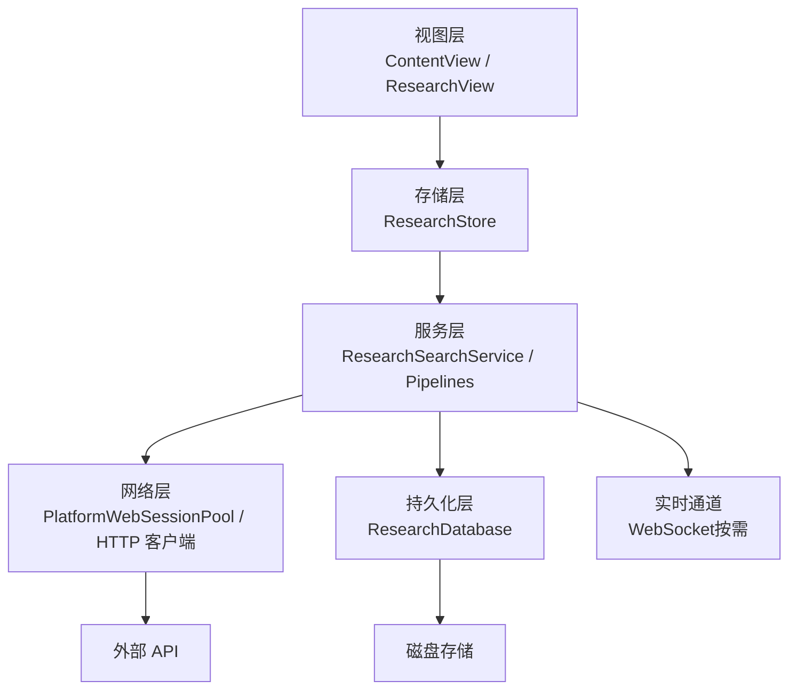
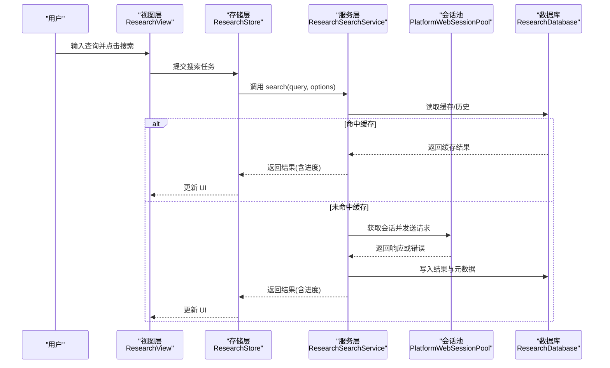
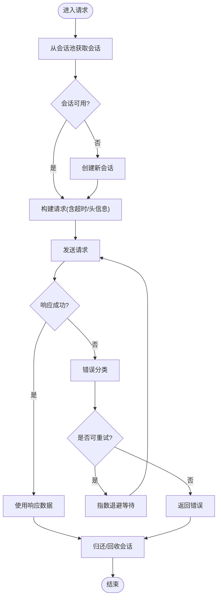
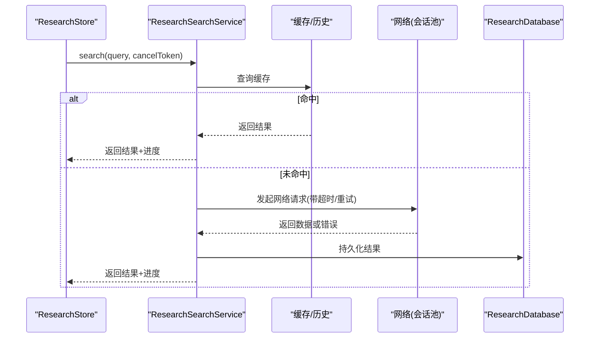
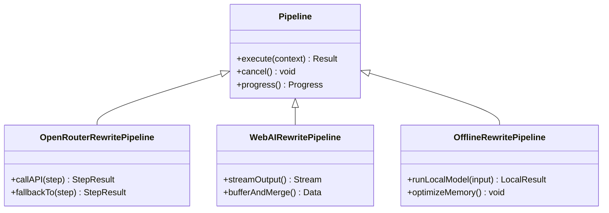
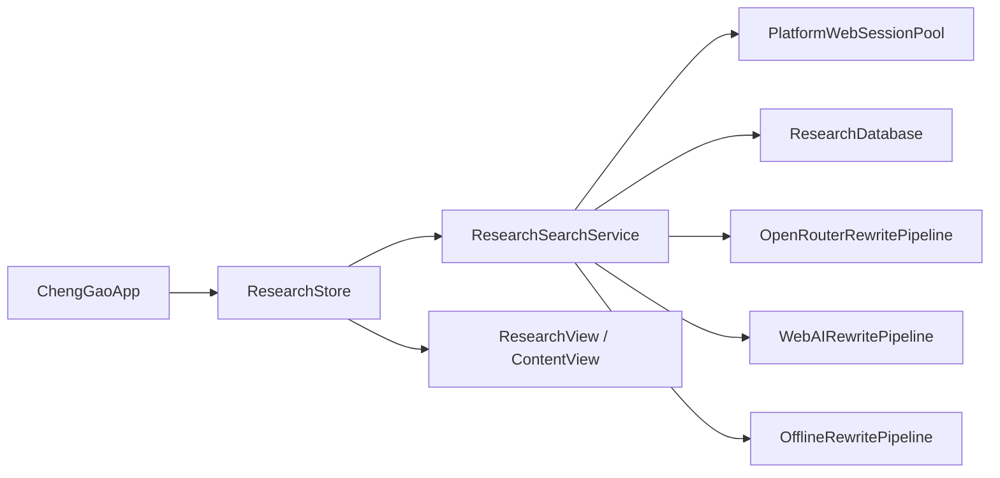

# 异步数据流处理

<cite>
**本文引用的文件**   
- [ChengGaoApp.swift](file://Sources/ChengGao/App/ChengGaoApp.swift)
- [PlatformWebSessionPool.swift](file://Sources/ChengGao/Services/PlatformWebSessionPool.swift)
- [ResearchSearchService.swift](file://Sources/ChengGao/Services/ResearchSearchService.swift)
- [ResearchDatabase.swift](file://Sources/ChengGao/Services/ResearchDatabase.swift)
- [ResearchStore.swift](file://Sources/ChengGao/Stores/ResearchStore.swift)
- [ContentView.swift](file://Sources/ChengGao/Views/ContentView.swift)
- [ResearchView.swift](file://Sources/ChengGao/Views/ResearchView.swift)
- [OpenRouterRewritePipeline.swift](file://Sources/ChengGao/Services/OpenRouterRewritePipeline.swift)
- [WebAIRewritePipeline.swift](file://Sources/ChengGao/Services/WebAIRewritePipeline.swift)
- [OfflineRewritePipeline.swift](file://Sources/ChengGao/Services/OfflineRewritePipeline.swift)
- [OnlineAIModelCatalogClient.swift](file://Sources/ChengGao/Services/OnlineAIModel目录客户端.swift)
- [PlatformSessionStore.swift](file://Sources/ChengGao/Services/PlatformSessionStore.swift)
- [OpenRouterCredentialStore.swift](file://Sources/ChengGao/Services/OpenRouterCredentialStore.swift)
- [ResearchCredentialStore.swift](file://Sources/ChengGao/Services/ResearchCredentialStore.swift)
</cite>

## 目录
1. [简介](#简介)
2. [项目结构](#项目结构)
3. [核心组件](#核心组件)
4. [架构总览](#架构总览)
5. [详细组件分析](#详细组件分析)
6. [依赖关系分析](#依赖关系分析)
7. [性能考量](#性能考量)
8. [故障排查指南](#故障排查指南)
9. [结论](#结论)
10. [附录](#附录)

## 简介
本文件面向 ChengGao 项目的异步数据流处理机制，围绕网络请求的数据流、错误重试与超时控制、WebSocket 连接管理、实时推送与消息队列、后台任务调度、资源清理与内存泄漏防护、并发控制与线程安全、性能监控、取消机制与进度反馈、以及复杂异步场景的错误恢复策略进行系统化说明。文档以“从用户界面到服务层再到持久化”的端到端视角展开，帮助读者快速理解并掌握该系统的异步设计要点与最佳实践。

## 项目结构
ChengGao 采用分层组织：应用入口、视图层、存储层、服务层与模型层清晰分离。异步数据流主要贯穿以下路径：
- 视图层发起交互（如搜索、重写）
- 存储层协调状态与事件
- 服务层执行网络请求、会话池管理、数据库读写
- 模型层承载数据结构与配置

图表来源
- [ContentView.swift](file://Sources/ChengGao/Views/ContentView.swift)
- [ResearchView.swift](file://Sources/ChengGao/Views/ResearchView.swift)
- [ResearchStore.swift](file://Sources/ChengGao/Stores/ResearchStore.swift)
- [ResearchSearchService.swift](file://Sources/ChengGao/Services/ResearchSearchService.swift)
- [PlatformWebSessionPool.swift](file://Sources/ChengGao/Services/PlatformWebSessionPool.swift)
- [ResearchDatabase.swift](file://Sources/ChengGao/Services/ResearchDatabase.swift)

章节来源
- [ChengGaoApp.swift](file://Sources/ChengGao/App/ChengGaoApp.swift)
- [ContentView.swift](file://Sources/ChengGao/Views/ContentView.swift)
- [ResearchView.swift](file://Sources/ChengGao/Views/ResearchView.swift)
- [ResearchStore.swift](file://Sources/ChengGao/Stores/ResearchStore.swift)
- [ResearchSearchService.swift](file://Sources/ChengGao/Services/ResearchSearchService.swift)
- [PlatformWebSessionPool.swift](file://Sources/ChengGao/Services/PlatformWebSessionPool.swift)
- [ResearchDatabase.swift](file://Sources/ChengGao/Services/ResearchDatabase.swift)

## 核心组件
- 应用入口与生命周期管理：负责初始化关键服务、注册全局状态与监听器，确保异步资源在应用启动时建立并在退出时释放。
- 会话池与网络层：维护平台 Web 会话池，复用连接、限流与超时控制，统一错误分类与重试策略。
- 研究搜索服务：编排搜索流程，组合缓存、网络请求与结果聚合，提供进度与取消支持。
- 数据库访问：封装本地读写，保证事务性与一致性，避免阻塞主线程。
- 存储层（Store）：作为 UI 与服务的桥梁，集中状态、事件与副作用，驱动界面更新。
- 重写管线（在线/离线）：将多阶段任务串/并联执行，支持分片、回退与增量输出。

章节来源
- [ChengGaoApp.swift](file://Sources/ChengGao/App/ChengGaoApp.swift)
- [PlatformWebSessionPool.swift](file://Sources/ChengGao/Services/PlatformWebSessionPool.swift)
- [ResearchSearchService.swift](file://Sources/ChengGao/Services/ResearchSearchService.swift)
- [ResearchDatabase.swift](file://Sources/ChengGao/Services/ResearchDatabase.swift)
- [ResearchStore.swift](file://Sources/ChengGao/Stores/ResearchStore.swift)
- [OpenRouterRewritePipeline.swift](file://Sources/ChengGao/Services/OpenRouterRewritePipeline.swift)
- [WebAIRewritePipeline.swift](file://Sources/ChengGao/Services/WebAIRewritePipeline.swift)
- [OfflineRewritePipeline.swift](file://Sources/ChengGao/Services/OfflineRewritePipeline.swift)

## 架构总览
下图展示一次典型“研究搜索”的异步数据流：UI 触发 → Store 编排 → SearchService 调用网络/缓存/DB → 结果回推至 Store → UI 更新。

图表来源
- [ResearchView.swift](file://Sources/ChengGao/Views/ResearchView.swift)
- [ResearchStore.swift](file://Sources/ChengGao/Stores/ResearchStore.swift)
- [ResearchSearchService.swift](file://Sources/ChengGao/Services/ResearchSearchService.swift)
- [PlatformWebSessionPool.swift](file://Sources/ChengGao/Services/PlatformWebSessionPool.swift)
- [ResearchDatabase.swift](file://Sources/ChengGao/Services/ResearchDatabase.swift)

## 详细组件分析

### 网络请求与会话池（PlatformWebSessionPool）
- 职责：维护平台级 Web 会话，实现连接复用、并发限制、超时与重试。
- 关键点：
  - 会话生命周期：创建、复用、回收；异常时自动重建。
  - 并发控制：令牌桶/信号量限制并发数，避免雪崩。
  - 超时策略：请求级与连接级超时，可配置指数退避重试。
  - 错误分类：网络错误、认证失败、业务错误分别处理。
  - 资源清理：关闭空闲连接，释放缓冲区，防止内存泄漏。

图表来源
- [PlatformWebSessionPool.swift](file://Sources/ChengGao/Services/PlatformWebSessionPool.swift)

章节来源
- [PlatformWebSessionPool.swift](file://Sources/ChengGao/Services/PlatformWebSessionPool.swift)

### 研究搜索服务（ResearchSearchService）
- 职责：编排搜索流程，整合缓存、网络与数据库，暴露带进度与取消能力的接口。
- 关键点：
  - 缓存优先：先查本地缓存/历史，命中则直接返回。
  - 并行与串行：对多个子任务（如多源检索）做合理并行，合并结果。
  - 进度上报：通过回调或状态对象向 Store 推送阶段性进度。
  - 取消机制：支持外层取消信号，及时中断底层 I/O。
  - 错误恢复：部分失败不影响整体，记录日志并降级。

图表来源
- [ResearchSearchService.swift](file://Sources/ChengGao/Services/ResearchSearchService.swift)
- [ResearchDatabase.swift](file://Sources/ChengGao/Services/ResearchDatabase.swift)

章节来源
- [ResearchSearchService.swift](file://Sources/ChengGao/Services/ResearchSearchService.swift)
- [ResearchDatabase.swift](file://Sources/ChengGao/Services/ResearchDatabase.swift)

### 存储层（ResearchStore）
- 职责：集中状态、事件与副作用，驱动 UI 更新，协调服务调用。
- 关键点：
  - 状态不可变更新：基于快照或差异更新，避免竞态。
  - 事件总线：发布/订阅模式解耦 UI 与服务。
  - 取消传播：将上层取消信号传递给服务与网络层。
  - 进度同步：将服务进度映射为 UI 可见状态。

章节来源
- [ResearchStore.swift](file://Sources/ChengGao/Stores/ResearchStore.swift)

### 重写管线（在线/离线）
- 在线重写（OpenRouter/WebAI）：串联多步 LLM 调用，支持流式输出、断点续传与回退策略。
- 离线重写：本地模型推理，强调资源占用控制与批处理。
- 共同特性：
  - 阶段化：每步可独立重试与回滚。
  - 进度与取消：每步上报进度，支持中途取消。
  - 错误隔离：单步失败不影响其他步骤，必要时整体回滚。

图表来源
- [OpenRouterRewritePipeline.swift](file://Sources/ChengGao/Services/OpenRouterRewritePipeline.swift)
- [WebAIRewritePipeline.swift](file://Sources/ChengGao/Services/WebAIRewritePipeline.swift)
- [OfflineRewritePipeline.swift](file://Sources/ChengGao/Services/OfflineRewritePipeline.swift)

章节来源
- [OpenRouterRewritePipeline.swift](file://Sources/ChengGao/Services/OpenRouterRewritePipeline.swift)
- [WebAIRewritePipeline.swift](file://Sources/ChengGao/Services/WebAIRewritePipeline.swift)
- [OfflineRewritePipeline.swift](file://Sources/ChengGao/Services/OfflineRewritePipeline.swift)

### 实时数据推送与 WebSocket（按需提供）
- 适用场景：长连接实时数据、增量更新、聊天流式输出。
- 设计要点：
  - 连接管理：自动重连、心跳检测、背压控制。
  - 消息队列：入队/出队有序处理，避免乱序与丢失。
  - 错误恢复：网络抖动时的指数退避与幂等处理。
  - 资源清理：断开时释放缓冲区与订阅者。

章节来源
- [PlatformWebSessionPool.swift](file://Sources/ChengGao/Services/PlatformWebSessionPool.swift)
- [ResearchSearchService.swift](file://Sources/ChengGao/Services/ResearchSearchService.swift)

### 后台任务调度与资源清理
- 调度策略：优先级队列、延迟任务、周期性任务。
- 资源清理：任务完成或取消后释放句柄、关闭连接、清空缓存。
- 内存保护：弱引用持有观察者，避免循环引用；大对象及时释放。

章节来源
- [ChengGaoApp.swift](file://Sources/ChengGao/App/ChengGaoApp.swift)
- [PlatformWebSessionPool.swift](file://Sources/ChengGao/Services/PlatformWebSessionPool.swift)

### 并发控制与线程安全
- 并发模型：主线程更新 UI，后台线程执行 I/O 与计算。
- 同步原语：互斥锁、原子变量、无锁队列用于热点路径。
- 防抖与节流：高频事件（如输入）去抖，批量提交。

章节来源
- [ResearchStore.swift](file://Sources/ChengGao/Stores/ResearchStore.swift)
- [PlatformWebSessionPool.swift](file://Sources/ChengGao/Services/PlatformWebSessionPool.swift)

### 性能监控方案
- 指标采集：请求耗时、成功率、重试次数、队列长度、内存峰值。
- 采样与上报：低开销采样，批量上报，避免影响主路径。
- 可视化：仪表盘与告警阈值，定位瓶颈。

章节来源
- [PlatformWebSessionPool.swift](file://Sources/ChengGao/Services/PlatformWebSessionPool.swift)
- [ResearchSearchService.swift](file://Sources/ChengGao/Services/ResearchSearchService.swift)

## 依赖关系分析

图表来源
- [ChengGaoApp.swift](file://Sources/ChengGao/App/ChengGaoApp.swift)
- [ResearchStore.swift](file://Sources/ChengGao/Stores/ResearchStore.swift)
- [ResearchSearchService.swift](file://Sources/ChengGao/Services/ResearchSearchService.swift)
- [PlatformWebSessionPool.swift](file://Sources/ChengGao/Services/PlatformWebSessionPool.swift)
- [ResearchDatabase.swift](file://Sources/ChengGao/Services/ResearchDatabase.swift)
- [OpenRouterRewritePipeline.swift](file://Sources/ChengGao/Services/OpenRouterRewritePipeline.swift)
- [WebAIRewritePipeline.swift](file://Sources/ChengGao/Services/WebAIRewritePipeline.swift)
- [OfflineRewritePipeline.swift](file://Sources/ChengGao/Services/OfflineRewritePipeline.swift)

章节来源
- [ChengGaoApp.swift](file://Sources/ChengGao/App/ChengGaoApp.swift)
- [ResearchStore.swift](file://Sources/ChengGao/Stores/ResearchStore.swift)
- [ResearchSearchService.swift](file://Sources/ChengGao/Services/ResearchSearchService.swift)
- [PlatformWebSessionPool.swift](file://Sources/ChengGao/Services/PlatformWebSessionPool.swift)
- [ResearchDatabase.swift](file://Sources/ChengGao/Services/ResearchDatabase.swift)
- [OpenRouterRewritePipeline.swift](file://Sources/ChengGao/Services/OpenRouterRewritePipeline.swift)
- [WebAIRewritePipeline.swift](file://Sources/ChengGao/Services/WebAIRewritePipeline.swift)
- [OfflineRewritePipeline.swift](file://Sources/ChengGao/Services/OfflineRewritePipeline.swift)

## 性能考量
- 连接复用与会话池：减少握手开销，提升吞吐。
- 缓存与预取：命中本地缓存降低延迟，预测性加载提高体验。
- 批处理与合并：合并小请求，减少系统调用。
- 背压与限流：防止下游过载，保障稳定性。
- 内存管理：避免大对象驻留，及时释放临时缓冲。

[本节为通用指导，不直接分析具体文件]

## 故障排查指南
- 常见问题定位：
  - 网络超时/重试风暴：检查会话池并发与退避参数。
  - 内存增长：排查未释放的观察者与大对象引用。
  - 数据不一致：核对事务边界与幂等键。
  - UI 卡顿：确认 I/O 不在主线程，事件去抖生效。
- 诊断手段：
  - 启用详细日志与指标采集。
  - 使用压力测试模拟高并发与弱网。
  - 观察队列长度与连接池利用率。

章节来源
- [PlatformWebSessionPool.swift](file://Sources/ChengGao/Services/PlatformWebSessionPool.swift)
- [ResearchSearchService.swift](file://Sources/ChengGao/Services/ResearchSearchService.swift)
- [ResearchDatabase.swift](file://Sources/ChengGao/Services/ResearchDatabase.swift)

## 结论
ChengGao 的异步数据流以“会话池 + 服务编排 + 存储层”为核心，结合缓存、重试、超时、取消与进度反馈，形成稳定高效的端到端处理链路。通过严格的并发控制、资源清理与监控体系，系统在复杂异步场景下具备良好鲁棒性与可观测性。建议在生产环境持续完善指标与告警，并结合真实负载调优参数。

[本节为总结性内容，不直接分析具体文件]

## 附录
- 最佳实践清单：
  - 所有 I/O 操作必须支持取消与超时。
  - 使用幂等键与去重逻辑避免重复处理。
  - 将 UI 更新限定在主线程，后台仅处理数据。
  - 对敏感凭据使用安全存储与最小权限原则。
- 相关组件参考：
  - 凭据与配置：OpenRouterCredentialStore、ResearchCredentialStore、PlatformSessionStore、OnlineAIModelCatalogClient。

章节来源
- [OpenRouterCredentialStore.swift](file://Sources/ChengGao/Services/OpenRouterCredentialStore.swift)
- [ResearchCredentialStore.swift](file://Sources/ChengGao/Services/ResearchCredentialStore.swift)
- [PlatformSessionStore.swift](file://Sources/ChengGao/Services/PlatformSessionStore.swift)
- [OnlineAIModelCatalogClient.swift](file://Sources/ChengGao/Services/OnlineAIModel目录客户端.swift)