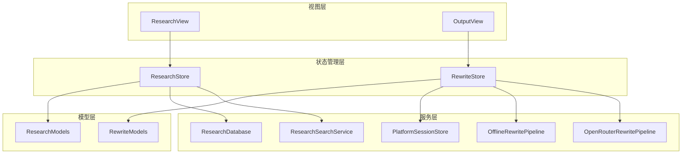
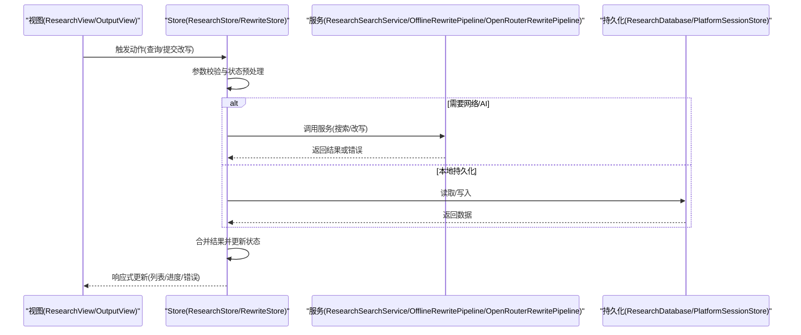
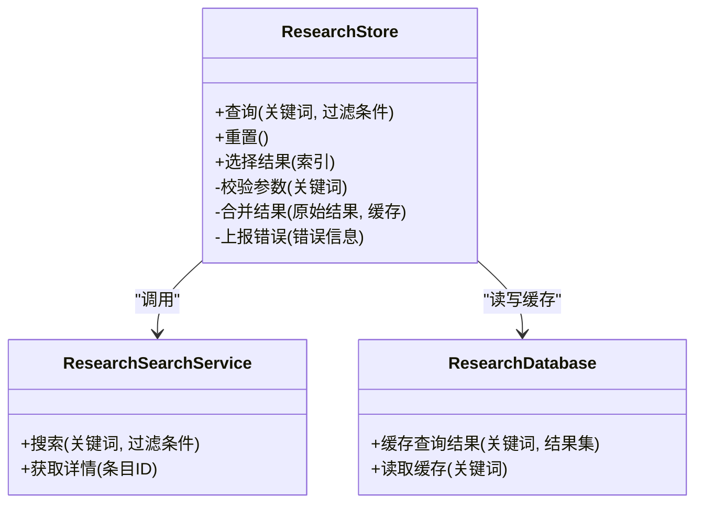
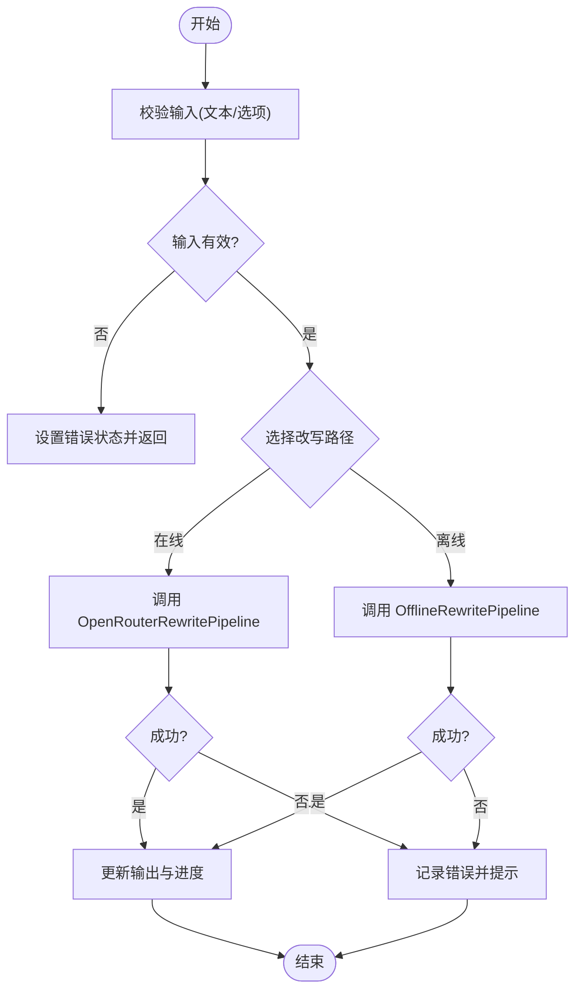
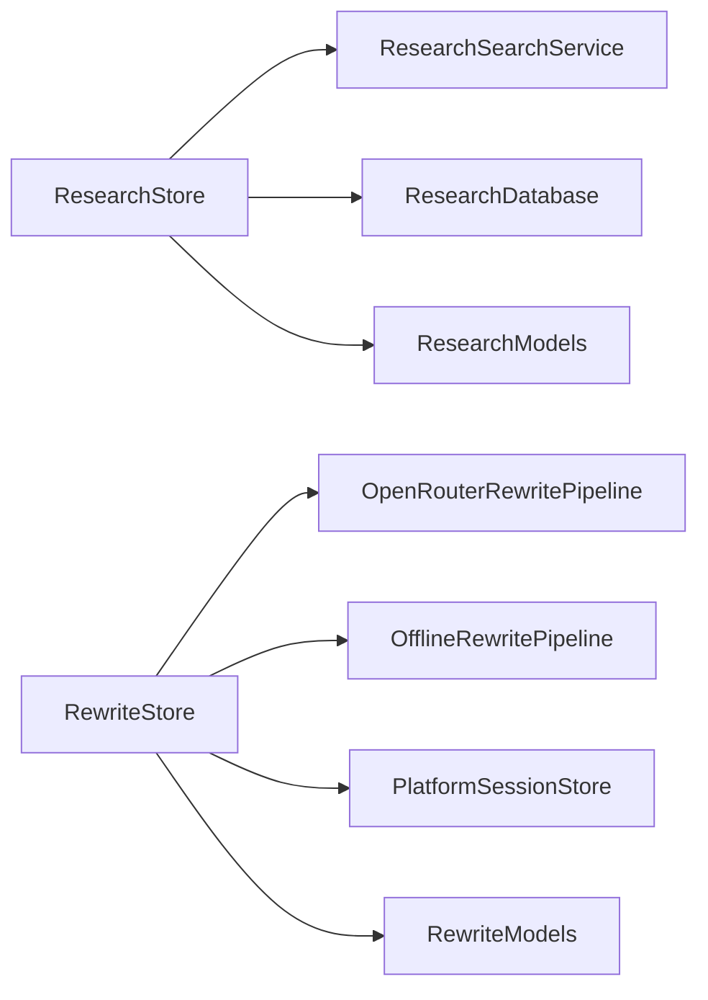

# 数据流模式

<cite>
**本文引用的文件**   
- [ResearchStore.swift](file://Sources/ChengGao/Stores/ResearchStore.swift)
- [RewriteStore.swift](file://Sources/ChengGao/Stores/RewriteStore.swift)
- [ResearchModels.swift](file://Sources/ChengGao/Models/ResearchModels.swift)
- [RewriteModels.swift](file://Sources/ChengGao/Models/RewriteModels.swift)
- [ResearchSearchService.swift](file://Sources/ChengGao/Services/ResearchSearchService.swift)
- [OfflineRewritePipeline.swift](file://Sources/ChengGao/Services/OfflineRewritePipeline.swift)
- [OpenRouterRewritePipeline.swift](file://Sources/ChengGao/Services/OpenRouterRewritePipeline.swift)
- [ResearchDatabase.swift](file://Sources/ChengGao/Services/ResearchDatabase.swift)
- [PlatformSessionStore.swift](file://Sources/ChengGao/Services/PlatformSessionStore.swift)
- [ResearchView.swift](file://Sources/ChengGao/Views/ResearchView.swift)
- [OutputView.swift](file://Sources/ChengGao/Views/OutputView.swift)
</cite>

## 目录
1. [简介](#简介)
2. [项目结构](#项目结构)
3. [核心组件](#核心组件)
4. [架构总览](#架构总览)
5. [详细组件分析](#详细组件分析)
6. [依赖分析](#依赖分析)
7. [性能考虑](#性能考虑)
8. [故障排查指南](#故障排查指南)
9. [结论](#结论)
10. [附录](#附录)

## 简介
本文件系统性梳理 ChengGao 的数据流模式，重点围绕 Store 模式在状态管理中的应用，深入解析 ResearchStore 与 RewriteStore 的实现原理。文档涵盖单向数据流、状态同步机制、响应式更新策略、数据验证、错误处理、状态持久化方案，以及异步操作处理、并发安全与性能优化技巧。同时提供从用户交互到状态更新的完整数据流图，并总结跨组件通信的最佳实践。

## 项目结构
ChengGao 采用分层组织：
- Views 层负责用户交互与界面渲染
- Stores 层作为单一状态源，暴露可观察的状态与变更方法
- Services 层封装业务逻辑、外部服务调用与持久化
- Models 层定义数据结构与校验规则

图表来源
- [ResearchStore.swift](file://Sources/ChengGao/Stores/ResearchStore.swift)
- [RewriteStore.swift](file://Sources/ChengGao/Stores/RewriteStore.swift)
- [ResearchSearchService.swift](file://Sources/ChengGao/Services/ResearchSearchService.swift)
- [OfflineRewritePipeline.swift](file://Sources/ChengGao/Services/OfflineRewritePipeline.swift)
- [OpenRouterRewritePipeline.swift](file://Sources/ChengGao/Services/OpenRouterRewritePipeline.swift)
- [ResearchDatabase.swift](file://Sources/ChengGao/Services/ResearchDatabase.swift)
- [PlatformSessionStore.swift](file://Sources/ChengGao/Services/PlatformSessionStore.swift)
- [ResearchModels.swift](file://Sources/ChengGao/Models/ResearchModels.swift)
- [RewriteModels.swift](file://Sources/ChengGao/Models/RewriteModels.swift)
- [ResearchView.swift](file://Sources/ChengGao/Views/ResearchView.swift)
- [OutputView.swift](file://Sources/ChengGao/Views/OutputView.swift)

章节来源
- [ResearchStore.swift](file://Sources/ChengGao/Stores/ResearchStore.swift)
- [RewriteStore.swift](file://Sources/ChengGao/Stores/RewriteStore.swift)
- [ResearchModels.swift](file://Sources/ChengGao/Models/ResearchModels.swift)
- [RewriteModels.swift](file://Sources/ChengGao/Models/RewriteModels.swift)
- [ResearchSearchService.swift](file://Sources/ChengGao/Services/ResearchSearchService.swift)
- [OfflineRewritePipeline.swift](file://Sources/ChengGao/Services/OfflineRewritePipeline.swift)
- [OpenRouterRewritePipeline.swift](file://Sources/ChengGao/Services/OpenRouterRewritePipeline.swift)
- [ResearchDatabase.swift](file://Sources/ChengGao/Services/ResearchDatabase.swift)
- [PlatformSessionStore.swift](file://Sources/ChengGao/Services/PlatformSessionStore.swift)
- [ResearchView.swift](file://Sources/ChengGao/Views/ResearchView.swift)
- [OutputView.swift](file://Sources/ChengGao/Views/OutputView.swift)

## 核心组件
- ResearchStore：面向“研究”场景的单一状态源，聚合搜索任务、结果列表、加载与错误状态，并提供查询、分页、筛选等变更接口。
- RewriteStore：面向“改写”场景的单一状态源，管理改写任务队列、当前任务、输出内容与进度，支持在线与离线两种改写管线。
- ResearchModels / RewriteModels：定义领域模型与校验规则，确保进入 Store 的数据具备一致性。
- Services：ResearchSearchService 负责检索与结果聚合；OfflineRewritePipeline 与 OpenRouterRewritePipeline 分别实现本地与在线改写；ResearchDatabase 与 PlatformSessionStore 负责持久化与会话管理。

章节来源
- [ResearchStore.swift](file://Sources/ChengGao/Stores/ResearchStore.swift)
- [RewriteStore.swift](file://Sources/ChengGao/Stores/RewriteStore.swift)
- [ResearchModels.swift](file://Sources/ChengGao/Models/ResearchModels.swift)
- [RewriteModels.swift](file://Sources/ChengGao/Models/RewriteModels.swift)
- [ResearchSearchService.swift](file://Sources/ChengGao/Services/ResearchSearchService.swift)
- [OfflineRewritePipeline.swift](file://Sources/ChengGao/Services/OfflineRewritePipeline.swift)
- [OpenRouterRewritePipeline.swift](file://Sources/ChengGao/Services/OpenRouterRewritePipeline.swift)
- [ResearchDatabase.swift](file://Sources/ChengGao/Services/ResearchDatabase.swift)
- [PlatformSessionStore.swift](file://Sources/ChengGao/Services/PlatformSessionStore.swift)

## 架构总览
ChengGao 采用单向数据流与 Store 模式：
- 视图发起动作（Action）
- Store 接收动作，进行输入校验与状态转换
- Store 调用服务执行异步任务（网络、数据库、AI 管线）
- 服务返回结果或错误，Store 更新内部状态并通过响应式通道通知视图
- 视图根据新状态重新渲染

图表来源
- [ResearchStore.swift](file://Sources/ChengGao/Stores/ResearchStore.swift)
- [RewriteStore.swift](file://Sources/ChengGao/Stores/RewriteStore.swift)
- [ResearchSearchService.swift](file://Sources/ChengGao/Services/ResearchSearchService.swift)
- [OfflineRewritePipeline.swift](file://Sources/ChengGao/Services/OfflineRewritePipeline.swift)
- [OpenRouterRewritePipeline.swift](file://Sources/ChengGao/Services/OpenRouterRewritePipeline.swift)
- [ResearchDatabase.swift](file://Sources/ChengGao/Services/ResearchDatabase.swift)
- [PlatformSessionStore.swift](file://Sources/ChengGao/Services/PlatformSessionStore.swift)

## 详细组件分析

### ResearchStore 分析
- 职责：维护搜索结果、任务状态、分页与筛选条件；对外暴露查询、重置、选择等操作。
- 数据流：视图调用查询 -> Store 校验参数 -> 调用 ResearchSearchService -> 合并结果 -> 更新状态 -> 视图刷新。
- 错误处理：捕获网络与服务异常，转换为统一错误状态，避免崩溃。
- 持久化：可选缓存搜索结果与会话上下文，提升二次访问速度。

图表来源
- [ResearchStore.swift](file://Sources/ChengGao/Stores/ResearchStore.swift)
- [ResearchSearchService.swift](file://Sources/ChengGao/Services/ResearchSearchService.swift)
- [ResearchDatabase.swift](file://Sources/ChengGao/Services/ResearchDatabase.swift)

章节来源
- [ResearchStore.swift](file://Sources/ChengGao/Stores/ResearchStore.swift)
- [ResearchSearchService.swift](file://Sources/ChengGao/Services/ResearchSearchService.swift)
- [ResearchDatabase.swift](file://Sources/ChengGao/Services/ResearchDatabase.swift)

### RewriteStore 分析
- 职责：管理改写任务队列、当前任务、输出内容、进度与错误；支持在线与离线两种改写路径。
- 数据流：视图提交改写请求 -> Store 校验输入 -> 选择管线(在线/离线) -> 执行改写 -> 更新输出与进度 -> 视图刷新。
- 并发控制：同一时刻仅允许一个活跃改写任务，避免资源竞争与状态不一致。
- 错误处理：区分网络错误、模型错误与本地失败，提供重试与降级策略。

图表来源
- [RewriteStore.swift](file://Sources/ChengGao/Stores/RewriteStore.swift)
- [OfflineRewritePipeline.swift](file://Sources/ChengGao/Services/OfflineRewritePipeline.swift)
- [OpenRouterRewritePipeline.swift](file://Sources/ChengGao/Services/OpenRouterRewritePipeline.swift)

章节来源
- [RewriteStore.swift](file://Sources/ChengGao/Stores/RewriteStore.swift)
- [OfflineRewritePipeline.swift](file://Sources/ChengGao/Services/OfflineRewritePipeline.swift)
- [OpenRouterRewritePipeline.swift](file://Sources/ChengGao/Services/OpenRouterRewritePipeline.swift)

### 数据验证与错误处理
- 输入验证：对关键词长度、特殊字符、改写文本大小等进行前置校验，减少无效调用。
- 错误分类：网络错误、服务不可用、模型限制、本地存储失败等，统一映射为错误状态。
- 恢复策略：重试、降级到离线管线、清空缓存后重试、提示用户修正输入。

章节来源
- [ResearchStore.swift](file://Sources/ChengGao/Stores/ResearchStore.swift)
- [RewriteStore.swift](file://Sources/ChengGao/Stores/RewriteStore.swift)
- [ResearchModels.swift](file://Sources/ChengGao/Models/ResearchModels.swift)
- [RewriteModels.swift](file://Sources/ChengGao/Models/RewriteModels.swift)

### 状态同步与响应式更新
- 单向数据流：视图只读状态，通过 Store 暴露的方法修改状态，避免双向绑定带来的副作用。
- 响应式更新：Store 内部使用响应式容器（如 Combine/Observable）将状态变化广播给订阅者。
- 细粒度更新：按字段级别发布更新，减少不必要的重渲染。

章节来源
- [ResearchStore.swift](file://Sources/ChengGao/Stores/ResearchStore.swift)
- [RewriteStore.swift](file://Sources/ChengGao/Stores/RewriteStore.swift)

### 状态持久化方案
- 缓存策略：对搜索结果与常用改写模板进行本地缓存，缩短冷启动与重复查询时间。
- 会话管理：平台会话与会话池由 PlatformSessionStore 统一管理，保证登录态一致。
- 数据一致性：写操作先落盘再更新内存状态，读操作优先命中缓存，必要时回源同步。

章节来源
- [ResearchDatabase.swift](file://Sources/ChengGao/Services/ResearchDatabase.swift)
- [PlatformSessionStore.swift](file://Sources/ChengGao/Services/PlatformSessionStore.swift)

### 异步操作处理与并发安全
- 异步编排：使用结构化并发或任务组管理网络请求与 I/O 操作，确保生命周期可控。
- 并发安全：Store 内部状态变更加锁或使用线程安全的容器，避免竞态条件。
- 取消与超时：支持任务取消与超时控制，防止长时间阻塞 UI。

章节来源
- [ResearchStore.swift](file://Sources/ChengGao/Stores/ResearchStore.swift)
- [RewriteStore.swift](file://Sources/ChengGao/Stores/RewriteStore.swift)
- [ResearchSearchService.swift](file://Sources/ChengGao/Services/ResearchSearchService.swift)
- [OfflineRewritePipeline.swift](file://Sources/ChengGao/Services/OfflineRewritePipeline.swift)
- [OpenRouterRewritePipeline.swift](file://Sources/ChengGao/Services/OpenRouterRewritePipeline.swift)

### 性能优化技巧
- 去抖与节流：对频繁输入（如搜索框）进行去抖，降低请求频率。
- 分页与懒加载：按需加载结果与详情，减少首屏压力。
- 增量更新：仅更新变化的数据段，避免全量刷新。
- 缓存预热：应用启动时预加载必要配置与会话，提升首次体验。

章节来源
- [ResearchStore.swift](file://Sources/ChengGao/Stores/ResearchStore.swift)
- [RewriteStore.swift](file://Sources/ChengGao/Stores/RewriteStore.swift)
- [ResearchDatabase.swift](file://Sources/ChengGao/Services/ResearchDatabase.swift)

## 依赖分析
- 低耦合高内聚：Store 仅依赖服务接口与模型，不直接感知视图细节。
- 明确边界：服务层屏蔽网络、数据库与 AI 管线差异，Store 聚焦状态转换。
- 潜在循环依赖：需避免 Store 与服务之间相互引用，通过协议或回调解耦。

图表来源
- [ResearchStore.swift](file://Sources/ChengGao/Stores/ResearchStore.swift)
- [RewriteStore.swift](file://Sources/ChengGao/Stores/RewriteStore.swift)
- [ResearchSearchService.swift](file://Sources/ChengGao/Services/ResearchSearchService.swift)
- [OfflineRewritePipeline.swift](file://Sources/ChengGao/Services/OfflineRewritePipeline.swift)
- [OpenRouterRewritePipeline.swift](file://Sources/ChengGao/Services/OpenRouterRewritePipeline.swift)
- [ResearchDatabase.swift](file://Sources/ChengGao/Services/ResearchDatabase.swift)
- [PlatformSessionStore.swift](file://Sources/ChengGao/Services/PlatformSessionStore.swift)
- [ResearchModels.swift](file://Sources/ChengGao/Models/ResearchModels.swift)
- [RewriteModels.swift](file://Sources/ChengGao/Models/RewriteModels.swift)

章节来源
- [ResearchStore.swift](file://Sources/ChengGao/Stores/ResearchStore.swift)
- [RewriteStore.swift](file://Sources/ChengGao/Stores/RewriteStore.swift)
- [ResearchSearchService.swift](file://Sources/ChengGao/Services/ResearchSearchService.swift)
- [OfflineRewritePipeline.swift](file://Sources/ChengGao/Services/OfflineRewritePipeline.swift)
- [OpenRouterRewritePipeline.swift](file://Sources/ChengGao/Services/OpenRouterRewritePipeline.swift)
- [ResearchDatabase.swift](file://Sources/ChengGao/Services/ResearchDatabase.swift)
- [PlatformSessionStore.swift](file://Sources/ChengGao/Services/PlatformSessionStore.swift)
- [ResearchModels.swift](file://Sources/ChengGao/Models/ResearchModels.swift)
- [RewriteModels.swift](file://Sources/ChengGao/Models/RewriteModels.swift)

## 性能考虑
- 合理划分状态粒度，避免大对象频繁拷贝。
- 使用惰性计算与延迟初始化，减少不必要开销。
- 对长耗时任务进行后台执行，并及时释放资源。
- 监控内存与 CPU 占用，定位热点路径进行优化。

[本节为通用指导，无需具体文件来源]

## 故障排查指南
- 常见问题
  - 搜索无结果：检查关键词合法性、网络连通性与服务可用性。
  - 改写失败：确认凭据与配额、模型版本与输入格式。
  - 状态不同步：检查响应式订阅是否被正确建立与销毁。
- 诊断步骤
  - 查看 Store 的错误状态字段与日志。
  - 在服务层增加调试输出，定位失败阶段。
  - 清理缓存与会话后重试，排除脏数据影响。

章节来源
- [ResearchStore.swift](file://Sources/ChengGao/Stores/ResearchStore.swift)
- [RewriteStore.swift](file://Sources/ChengGao/Stores/RewriteStore.swift)
- [ResearchSearchService.swift](file://Sources/ChengGao/Services/ResearchSearchService.swift)
- [OfflineRewritePipeline.swift](file://Sources/ChengGao/Services/OfflineRewritePipeline.swift)
- [OpenRouterRewritePipeline.swift](file://Sources/ChengGao/Services/OpenRouterRewritePipeline.swift)
- [ResearchDatabase.swift](file://Sources/ChengGao/Services/ResearchDatabase.swift)
- [PlatformSessionStore.swift](file://Sources/ChengGao/Services/PlatformSessionStore.swift)

## 结论
ChengGao 通过 Store 模式实现了清晰、可预测的单向数据流，结合响应式更新与严格的输入校验，保证了状态的一致性与用户体验的流畅性。ResearchStore 与 RewriteStore 分别聚焦研究与改写两大场景，借助服务层抽象与持久化能力，提供了稳定、可扩展的状态管理机制。遵循本文档中的并发安全与性能优化建议，可进一步提升系统的稳定性与吞吐能力。

[本节为总结性内容，无需具体文件来源]

## 附录
- 术语表
  - Store：单一状态源，集中管理状态与变更逻辑
  - Action：视图触发的状态变更请求
  - Service：封装外部依赖与复杂业务逻辑
  - Model：领域数据结构与校验规则
- 最佳实践
  - 保持 Store 的纯函数式状态转换，避免副作用
  - 使用明确的错误类型与消息，便于前端展示与日志追踪
  - 对关键路径添加单元测试与集成测试，保障回归质量

[本节为补充说明，无需具体文件来源]