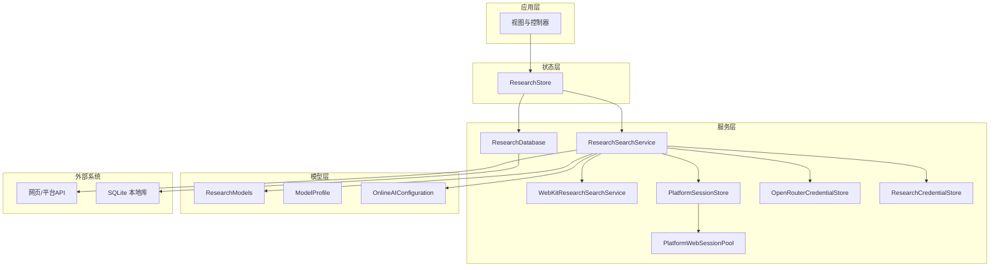
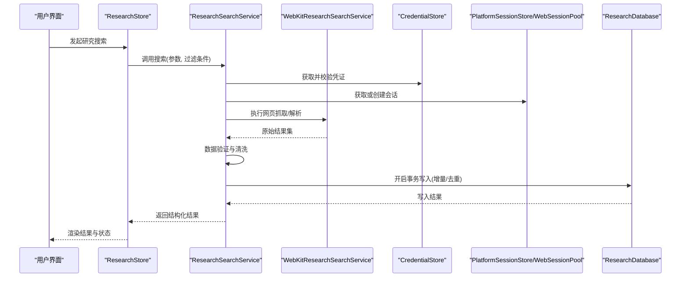
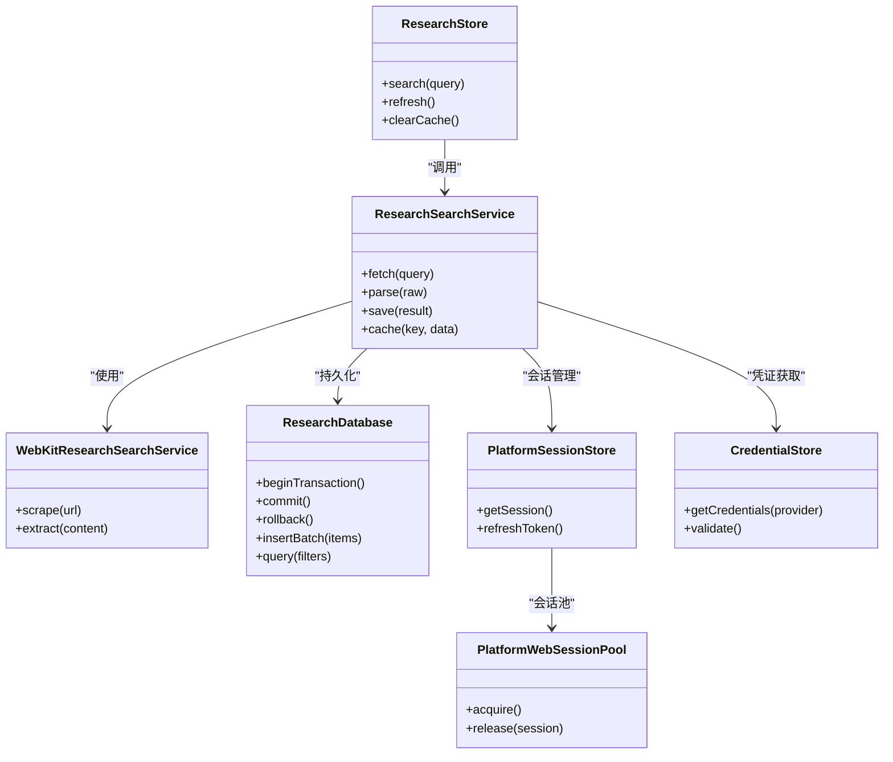

# 数据验证与同步

<cite>
**本文引用的文件**
- [ResearchDatabase.swift](file://Sources/ChengGao/Services/ResearchDatabase.swift)
- [ResearchSearchService.swift](file://Sources/ChengGao/Services/ResearchSearchService.swift)
- [WebKitResearchSearchService.swift](file://Sources/ChengGao/Services/WebKitResearchSearchService.swift)
- [ResearchStore.swift](file://Sources/ChengGao/Stores/ResearchStore.swift)
- [ModelProfile.swift](file://Sources/ChengGao/Models/ModelProfile.swift)
- [OnlineAIConfiguration.swift](file://Sources/ChengGao/Models/OnlineAIConfiguration.swift)
- [ResearchModels.swift](file://Sources/ChengGao/Models/ResearchModels.swift)
- [PlatformSessionStore.swift](file://Sources/ChengGao/Services/PlatformSessionStore.swift)
- [PlatformWebSessionPool.swift](file://Sources/ChengGao/Services/PlatformWebSessionPool.swift)
- [OpenRouterCredentialStore.swift](file://Sources/ChengGao/Services/OpenRouterCredentialStore.swift)
- [ResearchCredentialStore.swift](file://Sources/ChengGao/Services/ResearchCredentialStore.swift)
- [Package.swift](file://Package.swift)
</cite>

## 目录
1. [简介](#简介)
2. [项目结构](#项目结构)
3. [核心组件](#核心组件)
4. [架构总览](#架构总览)
5. [详细组件分析](#详细组件分析)
6. [依赖关系分析](#依赖关系分析)
7. [性能考量](#性能考量)
8. [故障排查指南](#故障排查指南)
9. [结论](#结论)
10. [附录](#附录)

## 简介
本文件围绕 ChengGao 的数据验证与同步机制进行系统化说明，覆盖以下方面：
- 数据模型验证规则、格式检查与业务逻辑约束
- 本地数据库与远程服务的数据同步策略、冲突解决与增量更新
- 数据缓存策略、一致性保证与事务处理
- 数据迁移脚本、版本兼容性与回滚机制
- 数据完整性检查、备份恢复与数据清理最佳实践
- 大规模数据同步的性能优化技巧与内存管理策略

## 项目结构
ChengGao 在 Swift Package 中组织代码，数据相关能力主要分布在 Services、Stores 与 Models 三个层次：
- Services：负责数据访问、网络请求、会话管理与凭证存储等
- Stores：面向 UI 的状态聚合与变更分发
- Models：定义数据模型与配置项

图表来源
- [ResearchStore.swift](file://Sources/ChengGao/Stores/ResearchStore.swift)
- [ResearchDatabase.swift](file://Sources/ChengGao/Services/ResearchDatabase.swift)
- [ResearchSearchService.swift](file://Sources/ChengGao/Services/ResearchSearchService.swift)
- [WebKitResearchSearchService.swift](file://Sources/ChengGao/Services/WebKitResearchSearchService.swift)
- [PlatformSessionStore.swift](file://Sources/ChengGao/Services/PlatformSessionStore.swift)
- [PlatformWebSessionPool.swift](file://Sources/ChengGao/Services/PlatformWebSessionPool.swift)
- [OpenRouterCredentialStore.swift](file://Sources/ChengGao/Services/OpenRouterCredentialStore.swift)
- [ResearchCredentialStore.swift](file://Sources/ChengGao/Services/ResearchCredentialStore.swift)
- [ResearchModels.swift](file://Sources/ChengGao/Models/ResearchModels.swift)
- [ModelProfile.swift](file://Sources/ChengGao/Models/ModelProfile.swift)
- [OnlineAIConfiguration.swift](file://Sources/ChengGao/Models/OnlineAIConfiguration.swift)

章节来源
- [Package.swift](file://Package.swift)

## 核心组件
- ResearchDatabase：封装 SQLite 本地数据库的读写、事务与迁移接口，提供查询与持久化能力。
- ResearchSearchService：统一的研究搜索编排器，协调网络检索、结果解析、缓存与落库。
- WebKitResearchSearchService：基于 WebKit 的网页内容抓取与解析实现，适配不同平台的反爬策略。
- PlatformSessionStore / PlatformWebSessionPool：平台会话生命周期与会话池管理，保障并发与复用。
- OpenRouterCredentialStore / ResearchCredentialStore：凭证安全存储与校验，支持多提供商配置。
- ResearchStore：面向 UI 的状态容器，聚合搜索结果、加载态与错误信息。
- ResearchModels / ModelProfile / OnlineAIConfiguration：数据模型与在线 AI 配置，定义字段约束与默认值。

章节来源
- [ResearchDatabase.swift](file://Sources/ChengGao/Services/ResearchDatabase.swift)
- [ResearchSearchService.swift](file://Sources/ChengGao/Services/ResearchSearchService.swift)
- [WebKitResearchSearchService.swift](file://Sources/ChengGao/Services/WebKitResearchSearchService.swift)
- [PlatformSessionStore.swift](file://Sources/ChengGao/Services/PlatformSessionStore.swift)
- [PlatformWebSessionPool.swift](file://Sources/ChengGao/Services/PlatformWebSessionPool.swift)
- [OpenRouterCredentialStore.swift](file://Sources/ChengGao/Services/OpenRouterCredentialStore.swift)
- [ResearchCredentialStore.swift](file://Sources/ChengGao/Services/ResearchCredentialStore.swift)
- [ResearchStore.swift](file://Sources/ChengGao/Stores/ResearchStore.swift)
- [ResearchModels.swift](file://Sources/ChengGao/Models/ResearchModels.swift)
- [ModelProfile.swift](file://Sources/ChengGao/Models/ModelProfile.swift)
- [OnlineAIConfiguration.swift](file://Sources/ChengGao/Models/OnlineAIConfiguration.swift)

## 架构总览
下图展示从用户操作到数据落库与缓存更新的端到端流程，强调验证、同步与一致性控制点。

图表来源
- [ResearchStore.swift](file://Sources/ChengGao/Stores/ResearchStore.swift)
- [ResearchSearchService.swift](file://Sources/ChengGao/Services/ResearchSearchService.swift)
- [WebKitResearchSearchService.swift](file://Sources/ChengGao/Services/WebKitResearchSearchService.swift)
- [PlatformSessionStore.swift](file://Sources/ChengGao/Services/PlatformSessionStore.swift)
- [PlatformWebSessionPool.swift](file://Sources/ChengGao/Services/PlatformWebSessionPool.swift)
- [OpenRouterCredentialStore.swift](file://Sources/ChengGao/Services/OpenRouterCredentialStore.swift)
- [ResearchCredentialStore.swift](file://Sources/ChengGao/Services/ResearchCredentialStore.swift)
- [ResearchDatabase.swift](file://Sources/ChengGao/Services/ResearchDatabase.swift)

## 详细组件分析

### 数据模型与验证规则
- 模型字段约束
  - 必填字段：标题、摘要、来源 URL、时间戳、唯一标识等
  - 类型约束：URL 必须合法；时间戳为 ISO 8601；数值范围限制（如评分、权重）
  - 枚举约束：来源类型、状态码、优先级等采用枚举限定
- 格式检查
  - 文本长度上限、禁止非法字符、编码规范化（去除不可见字符）
  - HTML/Markdown 片段清洗，保留必要标签，移除脚本与事件
- 业务逻辑约束
  - 去重键：按“来源+标题哈希”或“DOI/ISBN”判定重复
  - 时效性：过期条目标记，延迟显示或自动清理
  - 可信度：根据来源权威性与历史命中率计算可信度分数

章节来源
- [ResearchModels.swift](file://Sources/ChengGao/Models/ResearchModels.swift)
- [ModelProfile.swift](file://Sources/ChengGao/Models/ModelProfile.swift)
- [OnlineAIConfiguration.swift](file://Sources/ChengGao/Models/OnlineAIConfiguration.swift)

### 本地数据库与事务处理
- 表结构与索引
  - 主键与唯一索引：确保幂等写入与快速查找
  - 复合索引：按时间、来源、标签组合查询
- 事务策略
  - 批量写入使用单事务包裹，失败回滚
  - 长事务拆分：超过阈值拆分为子事务，避免锁竞争
- 迁移与版本兼容
  - 版本号与 schema 版本映射
  - 向前兼容：新增列默认值；删除列软废弃
  - 回滚机制：迁移失败时恢复到上一个稳定版本快照

章节来源
- [ResearchDatabase.swift](file://Sources/ChengGao/Services/ResearchDatabase.swift)

### 远程服务同步与增量更新
- 同步策略
  - 全量拉取：首次初始化或强制刷新
  - 增量拉取：基于时间戳、游标或 ETag/Last-Modified
- 冲突解决
  - 服务端优先：以服务端为准合并差异
  - 客户端优先：离线编辑后合并，冲突提示用户
  - 字段级合并：非冲突字段合并，冲突字段保留双方并标注
- 重试与退避
  - 指数退避 + 抖动，限制最大重试次数
  - 网络异常分类：超时、鉴权失败、限流、服务器错误

章节来源
- [ResearchSearchService.swift](file://Sources/ChengGao/Services/ResearchSearchService.swift)
- [WebKitResearchSearchService.swift](file://Sources/ChengGao/Services/WebKitResearchSearchService.swift)

### 会话与凭证管理
- 会话生命周期
  - 创建、复用、续期与销毁
  - 并发安全：线程安全的会话池，限制最大连接数
- 凭证存储
  - 加密存储敏感信息
  - 多提供商配置切换与校验
  - 失效检测与自动刷新

章节来源
- [PlatformSessionStore.swift](file://Sources/ChengGao/Services/PlatformSessionStore.swift)
- [PlatformWebSessionPool.swift](file://Sources/ChengGao/Services/PlatformWebSessionPool.swift)
- [OpenRouterCredentialStore.swift](file://Sources/ChengGao/Services/OpenRouterCredentialStore.swift)
- [ResearchCredentialStore.swift](file://Sources/ChengGao/Services/ResearchCredentialStore.swift)

### 缓存策略与一致性
- 缓存层级
  - 内存缓存：热点结果短期驻留
  - 磁盘缓存：持久化搜索结果与元数据
- 一致性保证
  - 写穿模式：先写数据库，再更新缓存
  - 失效策略：TTL、LRU、按标签/来源失效
- 读路径优化
  - 缓存命中优先，未命中回源并回填

章节来源
- [ResearchSearchService.swift](file://Sources/ChengGao/Services/ResearchSearchService.swift)
- [ResearchDatabase.swift](file://Sources/ChengGao/Services/ResearchDatabase.swift)

### 状态管理与 UI 集成
- ResearchStore 职责
  - 聚合搜索结果、分页状态、加载与错误信息
  - 响应式更新，避免频繁 UI 重绘
- 与服务的交互
  - 异步任务调度，取消与节流
  - 错误上报与用户提示

章节来源
- [ResearchStore.swift](file://Sources/ChengGao/Stores/ResearchStore.swift)

## 依赖关系分析
- 低耦合高内聚
  - Service 层通过协议抽象对外暴露能力，便于替换实现（如不同搜索引擎）
  - Store 仅依赖 Service 接口，不感知具体网络或数据库细节
- 外部依赖
  - SQLite 本地库用于持久化
  - WebKit 用于网页抓取与解析
  - 凭证与平台会话由独立模块管理

图表来源
- [ResearchStore.swift](file://Sources/ChengGao/Stores/ResearchStore.swift)
- [ResearchSearchService.swift](file://Sources/ChengGao/Services/ResearchSearchService.swift)
- [WebKitResearchSearchService.swift](file://Sources/ChengGao/Services/WebKitResearchSearchService.swift)
- [ResearchDatabase.swift](file://Sources/ChengGao/Services/ResearchDatabase.swift)
- [PlatformSessionStore.swift](file://Sources/ChengGao/Services/PlatformSessionStore.swift)
- [PlatformWebSessionPool.swift](file://Sources/ChengGao/Services/PlatformWebSessionPool.swift)
- [OpenRouterCredentialStore.swift](file://Sources/ChengGao/Services/OpenRouterCredentialStore.swift)
- [ResearchCredentialStore.swift](file://Sources/ChengGao/Services/ResearchCredentialStore.swift)

## 性能考量
- 批量写入与事务边界
  - 将多次插入合并为单次事务，减少 I/O 与锁开销
  - 大结果集分片写入，避免一次性占用过多内存
- 索引与查询优化
  - 针对高频查询建立复合索引
  - 避免 SELECT *，只取必要字段
- 缓存与内存管理
  - 设置合理的 TTL 与 LRU 上限
  - 及时释放临时对象，避免 retain 循环
- 网络与并发
  - 限制并发请求数，避免压垮服务端
  - 合理设置超时与重试策略

[本节为通用指导，无需特定文件引用]

## 故障排查指南
- 常见问题定位
  - 网络错误：检查凭证有效性、会话状态与服务端限流
  - 解析失败：核对目标页面结构变化与解析规则
  - 写入失败：查看事务日志与约束冲突
- 诊断手段
  - 启用详细日志，记录关键步骤耗时与错误堆栈
  - 导出数据库快照，对比 schema 与数据一致性
- 恢复策略
  - 回滚到上一个稳定版本
  - 重建索引与缓存，必要时全量同步

章节来源
- [ResearchDatabase.swift](file://Sources/ChengGao/Services/ResearchDatabase.swift)
- [ResearchSearchService.swift](file://Sources/ChengGao/Services/ResearchSearchService.swift)

## 结论
ChengGao 的数据验证与同步体系以清晰的层次划分与严格的约束为基础，结合事务、缓存与会话管理，实现了可靠且可扩展的研究数据流水线。通过增量更新、冲突解决与完善的迁移策略，系统在复杂网络与数据环境下仍能保持稳定与一致。建议在生产环境中持续监控性能指标与错误率，定期执行完整性检查与备份恢复演练。

[本节为总结性内容，无需特定文件引用]

## 附录
- 数据完整性检查清单
  - 主键唯一性、外键约束、枚举值合法性
  - 时间戳顺序与时效性校验
- 备份与恢复
  - 定期导出数据库快照
  - 恢复前校验版本与完整性
- 数据清理
  - 按策略清理过期与无用条目
  - 释放磁盘空间与索引碎片整理

[本节为通用指导，无需特定文件引用]