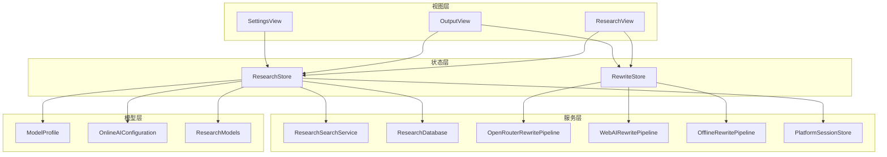
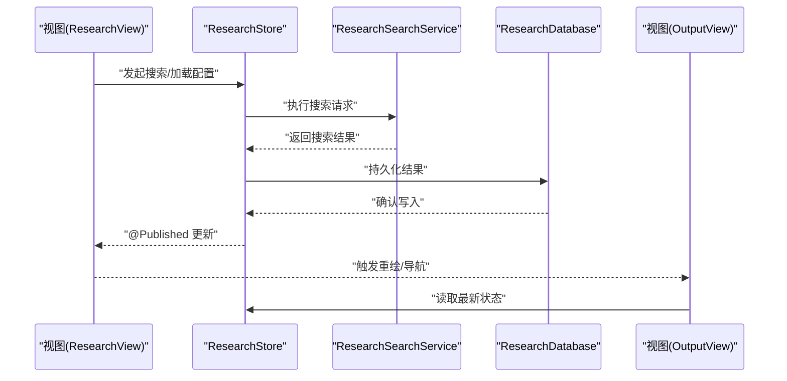
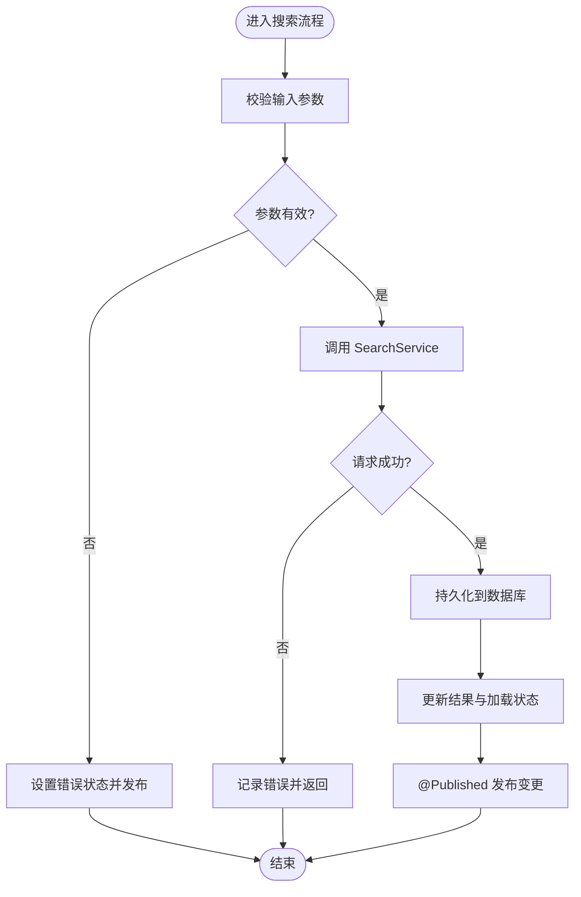
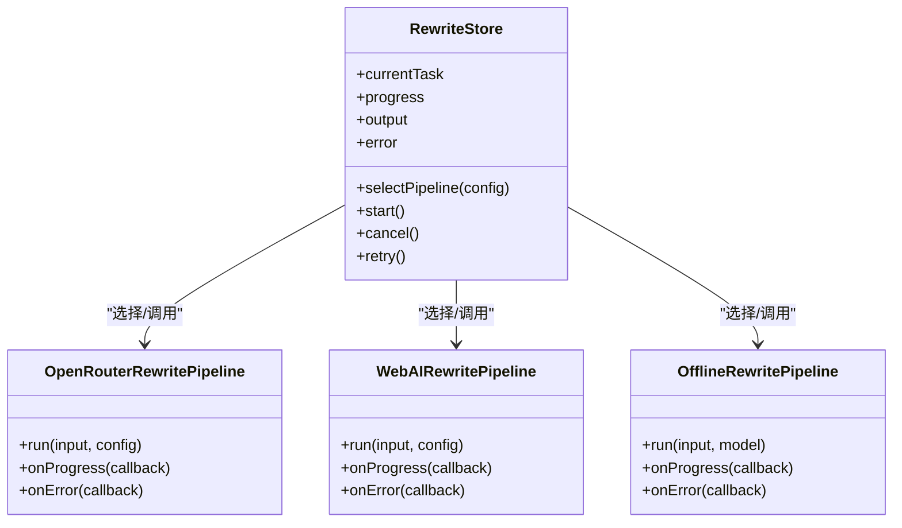
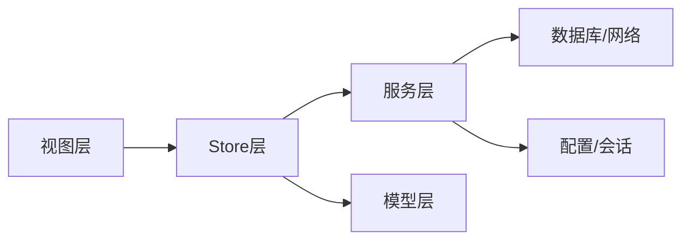

# 状态管理模式

<cite>
**本文引用的文件**   
- [ChengGaoApp.swift](file://Sources/ChengGao/App/ChengGaoApp.swift)
- [ResearchStore.swift](file://Sources/ChengGao/Stores/ResearchStore.swift)
- [RewriteStore.swift](file://Sources/ChengGao/Stores/RewriteStore.swift)
- [ModelProfile.swift](file://Sources/ChengGao/Models/ModelProfile.swift)
- [OnlineAIConfiguration.swift](file://Sources/ChengGao/Models/OnlineAIConfiguration.swift)
- [ResearchModels.swift](file://Sources/ChengGao/Models/ResearchModels.swift)
- [ResearchSearchService.swift](file://Sources/ChengGao/Services/ResearchSearchService.swift)
- [ResearchDatabase.swift](file://Sources/ChengGao/Services/ResearchDatabase.swift)
- [OfflineRewritePipeline.swift](file://Sources/ChengGao/Services/OfflineRewritePipeline.swift)
- [OpenRouterRewritePipeline.swift](file://Sources/ChengGao/Services/OpenRouterRewritePipeline.swift)
- [WebAIRewritePipeline.swift](file://Sources/ChengGao/Services/WebAIRewritePipeline.swift)
- [PlatformSessionStore.swift](file://Sources/ChengGao/Services/PlatformSessionStore.swift)
- [ResearchView.swift](file://Sources/ChengGao/Views/ResearchView.swift)
- [OutputView.swift](file://Sources/ChengGao/Views/OutputView.swift)
- [SettingsView.swift](file://Sources/ChengGao/Views/SettingsView.swift)
</cite>

## 目录
1. [简介](#简介)
2. [项目结构](#项目结构)
3. [核心组件](#核心组件)
4. [架构总览](#架构总览)
5. [详细组件分析](#详细组件分析)
6. [依赖关系分析](#依赖关系分析)
7. [性能考虑](#性能考虑)
8. [故障排查指南](#故障排查指南)
9. [结论](#结论)
10. [附录](#附录)

## 简介
本文件系统化梳理 ChengGao 的状态管理模式，围绕单向数据流、派生状态计算与副作用处理展开，重点说明 @Published 属性的使用模式、状态订阅与更新策略。文档还涵盖异步状态更新、并发安全保证、性能优化技巧、状态持久化方案、数据迁移策略与版本兼容性处理，并提供调试工具使用方法与常见问题排查指南，帮助在复杂状态场景下遵循最佳实践并避免反模式。

## 项目结构
ChengGao 采用“视图层 + Store（状态容器）+ Service（业务/IO）+ Model（数据模型）”的分层组织：
- Views：UI 展示与用户交互入口，订阅 Store 的发布属性以驱动界面刷新。
- Stores：集中管理应用状态，暴露 @Published 属性供 UI 订阅；封装命令式操作与副作用。
- Services：实现网络请求、本地存储、离线推理等 IO 与计算密集型任务。
- Models：定义数据结构与配置项，贯穿各层。

图表来源
- [ResearchView.swift](file://Sources/ChengGao/Views/ResearchView.swift)
- [OutputView.swift](file://Sources/ChengGao/Views/OutputView.swift)
- [SettingsView.swift](file://Sources/ChengGao/Views/SettingsView.swift)
- [ResearchStore.swift](file://Sources/ChengGao/Stores/ResearchStore.swift)
- [RewriteStore.swift](file://Sources/ChengGao/Stores/RewriteStore.swift)
- [ResearchSearchService.swift](file://Sources/ChengGao/Services/ResearchSearchService.swift)
- [ResearchDatabase.swift](file://Sources/ChengGao/Services/ResearchDatabase.swift)
- [OpenRouterRewritePipeline.swift](file://Sources/ChengGao/Services/OpenRouterRewritePipeline.swift)
- [WebAIRewritePipeline.swift](file://Sources/ChengGao/Services/WebAIRewritePipeline.swift)
- [OfflineRewritePipeline.swift](file://Sources/ChengGao/Services/OfflineRewritePipeline.swift)
- [PlatformSessionStore.swift](file://Sources/ChengGao/Services/PlatformSessionStore.swift)
- [ModelProfile.swift](file://Sources/ChengGao/Models/ModelProfile.swift)
- [OnlineAIConfiguration.swift](file://Sources/ChengGao/Models/OnlineAIConfiguration.swift)
- [ResearchModels.swift](file://Sources/ChengGao/Models/ResearchModels.swift)

章节来源
- [ChengGaoApp.swift](file://Sources/ChengGao/App/ChengGaoApp.swift)

## 核心组件
- ResearchStore：研究流程的核心状态容器，负责搜索、结果聚合、导出与设置同步。对外暴露 @Published 属性，供多个视图订阅。
- RewriteStore：重写流程的状态容器，协调多种重写管线（在线/离线/网页），维护当前任务、进度与输出。
- Services：ResearchSearchService、ResearchDatabase、各类 RewritePipeline、PlatformSessionStore 等，承担 IO 与计算职责，被 Store 调用以产生副作用。
- Models：ModelProfile、OnlineAIConfiguration、ResearchModels 等，作为跨层数据契约。

章节来源
- [ResearchStore.swift](file://Sources/ChengGao/Stores/ResearchStore.swift)
- [RewriteStore.swift](file://Sources/ChengGao/Stores/RewriteStore.swift)
- [ResearchSearchService.swift](file://Sources/ChengGao/Services/ResearchSearchService.swift)
- [ResearchDatabase.swift](file://Sources/ChengGao/Services/ResearchDatabase.swift)
- [OpenRouterRewritePipeline.swift](file://Sources/ChengGao/Services/OpenRouterRewritePipeline.swift)
- [WebAIRewritePipeline.swift](file://Sources/ChengGao/Services/WebAIRewritePipeline.swift)
- [OfflineRewritePipeline.swift](file://Sources/ChengGao/Services/OfflineRewritePipeline.swift)
- [PlatformSessionStore.swift](file://Sources/ChengGao/Services/PlatformSessionStore.swift)
- [ModelProfile.swift](file://Sources/ChengGao/Models/ModelProfile.swift)
- [OnlineAIConfiguration.swift](file://Sources/ChengGao/Models/OnlineAIConfiguration.swift)
- [ResearchModels.swift](file://Sources/ChengGao/Models/ResearchModels.swift)

## 架构总览
ChengGao 采用单向数据流：
- 视图通过 SwiftUI 的 @StateObject/@ObservedObject 订阅 Store 的 @Published 属性。
- 用户交互触发 Store 中的方法，执行副作用（网络、数据库、文件系统）。
- 副作用完成后，Store 更新内部状态并发布变更，驱动视图重新渲染。
- 派生状态由 Store 内部计算得出，避免视图层重复计算。

图表来源
- [ResearchView.swift](file://Sources/ChengGao/Views/ResearchView.swift)
- [ResearchStore.swift](file://Sources/ChengGao/Stores/ResearchStore.swift)
- [ResearchSearchService.swift](file://Sources/ChengGao/Services/ResearchSearchService.swift)
- [ResearchDatabase.swift](file://Sources/ChengGao/Services/ResearchDatabase.swift)
- [OutputView.swift](file://Sources/ChengGao/Views/OutputView.swift)

## 详细组件分析

### ResearchStore：研究流程状态容器
- 职责
  - 管理搜索参数、结果列表、错误信息、加载状态。
  - 协调 ResearchSearchService 与 ResearchDatabase，完成 IO 与持久化。
  - 暴露 @Published 属性供多视图订阅。
- 关键模式
  - 单向数据流：所有变更通过方法进入 Store，再发布给视图。
  - 派生状态：根据原始结果计算摘要、过滤、排序等，减少视图层逻辑。
  - 副作用隔离：网络与磁盘 I/O 集中在 Service 层，Store 仅编排流程。
- 并发与线程
  - 将耗时任务放入后台队列，回调在主线程更新 @Published 属性，确保 SwiftUI 线程安全。
- 错误处理
  - 统一捕获异常，转换为可观察的错误状态，便于 UI 提示与重试。

图表来源
- [ResearchStore.swift](file://Sources/ChengGao/Stores/ResearchStore.swift)
- [ResearchSearchService.swift](file://Sources/ChengGao/Services/ResearchSearchService.swift)
- [ResearchDatabase.swift](file://Sources/ChengGao/Services/ResearchDatabase.swift)

章节来源
- [ResearchStore.swift](file://Sources/ChengGao/Stores/ResearchStore.swift)
- [ResearchSearchService.swift](file://Sources/ChengGao/Services/ResearchSearchService.swift)
- [ResearchDatabase.swift](file://Sources/ChengGao/Services/ResearchDatabase.swift)

### RewriteStore：重写流程状态容器
- 职责
  - 管理重写任务（在线 OpenRouter、网页 WebAI、离线本地模型）。
  - 跟踪任务进度、中间产物与最终输出。
  - 提供取消、重试、切换管线的能力。
- 关键模式
  - 管线选择：根据配置与可用性动态选择合适重写管线。
  - 增量更新：对长耗时任务进行分步推进，保持 UI 响应性。
  - 资源清理：任务取消或失败时释放临时资源，避免内存泄漏。
- 并发与线程
  - 每个管线运行在独立工作单元，避免阻塞主线程；结果合并回主线程更新状态。
- 错误处理
  - 区分网络错误、解析错误、模型不可用等，提供差异化 UI 反馈。

图表来源
- [RewriteStore.swift](file://Sources/ChengGao/Stores/RewriteStore.swift)
- [OpenRouterRewritePipeline.swift](file://Sources/ChengGao/Services/OpenRouterRewritePipeline.swift)
- [WebAIRewritePipeline.swift](file://Sources/ChengGao/Services/WebAIRewritePipeline.swift)
- [OfflineRewritePipeline.swift](file://Sources/ChengGao/Services/OfflineRewritePipeline.swift)

章节来源
- [RewriteStore.swift](file://Sources/ChengGao/Stores/RewriteStore.swift)
- [OpenRouterRewritePipeline.swift](file://Sources/ChengGao/Services/OpenRouterRewritePipeline.swift)
- [WebAIRewritePipeline.swift](file://Sources/ChengGao/Services/WebAIRewritePipeline.swift)
- [OfflineRewritePipeline.swift](file://Sources/ChengGao/Services/OfflineRewritePipeline.swift)

### 视图层：订阅与更新策略
- ResearchView、OutputView、SettingsView 通过 @StateObject/@ObservedObject 订阅 Store 的 @Published 属性。
- 更新策略
  - 最小化重绘：仅在必要字段变化时触发视图更新。
  - 防抖与节流：对频繁更新的进度或日志进行采样显示。
  - 条件渲染：根据加载状态与错误状态切换 UI 分支。
- 最佳实践
  - 避免在视图中直接修改 Store 状态，统一通过 Store 方法。
  - 将派生计算下沉至 Store，减少视图层复杂度。

章节来源
- [ResearchView.swift](file://Sources/ChengGao/Views/ResearchView.swift)
- [OutputView.swift](file://Sources/ChengGao/Views/OutputView.swift)
- [SettingsView.swift](file://Sources/ChengGao/Views/SettingsView.swift)

### 模型与配置：数据契约
- ModelProfile、OnlineAIConfiguration、ResearchModels 定义了跨层的数据结构与配置项。
- 版本兼容
  - 为新增字段提供默认值与向后兼容解析。
  - 对旧版数据进行迁移映射，确保平滑升级。

章节来源
- [ModelProfile.swift](file://Sources/ChengGao/Models/ModelProfile.swift)
- [OnlineAIConfiguration.swift](file://Sources/ChengGao/Models/OnlineAIConfiguration.swift)
- [ResearchModels.swift](file://Sources/ChengGao/Models/ResearchModels.swift)

## 依赖关系分析
- Store 依赖 Service 与 Model，视图依赖 Store。
- Service 之间相对解耦，通过 Store 编排协作。
- 平台会话与配置由 PlatformSessionStore 统一管理，避免分散状态。

图表来源
- [ResearchStore.swift](file://Sources/ChengGao/Stores/ResearchStore.swift)
- [RewriteStore.swift](file://Sources/ChengGao/Stores/RewriteStore.swift)
- [ResearchSearchService.swift](file://Sources/ChengGao/Services/ResearchSearchService.swift)
- [ResearchDatabase.swift](file://Sources/ChengGao/Services/ResearchDatabase.swift)
- [PlatformSessionStore.swift](file://Sources/ChengGao/Services/PlatformSessionStore.swift)

章节来源
- [ResearchStore.swift](file://Sources/ChengGao/Stores/ResearchStore.swift)
- [RewriteStore.swift](file://Sources/ChengGao/Stores/RewriteStore.swift)
- [ResearchSearchService.swift](file://Sources/ChengGao/Services/ResearchSearchService.swift)
- [ResearchDatabase.swift](file://Sources/ChengGao/Services/ResearchDatabase.swift)
- [PlatformSessionStore.swift](file://Sources/ChengGao/Services/PlatformSessionStore.swift)

## 性能考虑
- 派生状态计算
  - 在 Store 内缓存派生结果，避免重复计算。
  - 使用惰性求值与按需更新，减少不必要的刷新。
- 并发与线程
  - 将 IO 与 CPU 密集任务移至后台队列，主线程仅做状态发布。
  - 控制并发度，避免过多并行请求导致资源争用。
- 内存与生命周期
  - 及时取消未完成任务，释放临时对象。
  - 避免循环引用，使用弱引用或闭包捕获列表。
- UI 渲染优化
  - 使用 diffing 友好的数据结构，减少大对象频繁替换。
  - 分页与懒加载，降低首屏压力。

[本节为通用指导，不直接分析具体文件]

## 故障排查指南
- 常见问题
  - 状态未更新：检查 @Published 是否在主线程更新；确认视图是否正确订阅。
  - 内存泄漏：检查闭包捕获与观察者生命周期，确保正确释放。
  - 并发冲突：确认多线程访问共享状态的互斥与顺序。
  - 网络错误：区分超时、鉴权失败、服务端错误，提供明确提示。
- 调试工具与方法
  - 打印状态快照：在关键路径输出状态前后对比。
  - 启用详细日志：按模块分级输出，便于定位问题。
  - 模拟失败：注入错误路径验证健壮性。
- 恢复策略
  - 重试机制：对瞬时错误进行指数退避重试。
  - 降级策略：当某管线不可用时切换到备用方案。
  - 数据修复：提供迁移脚本与校验工具，自动修复不一致数据。

章节来源
- [ResearchStore.swift](file://Sources/ChengGao/Stores/ResearchStore.swift)
- [RewriteStore.swift](file://Sources/ChengGao/Stores/RewriteStore.swift)
- [ResearchSearchService.swift](file://Sources/ChengGao/Services/ResearchSearchService.swift)
- [ResearchDatabase.swift](file://Sources/ChengGao/Services/ResearchDatabase.swift)

## 结论
ChengGao 的状态管理以 Store 为核心，结合 @Published 与 SwiftUI 的响应式更新，实现了清晰的单向数据流与可靠的副作用处理。通过分层设计、并发安全与性能优化，系统在复杂场景中保持了良好的可维护性与用户体验。建议持续完善派生状态缓存、错误诊断与数据迁移能力，进一步提升稳定性与扩展性。

[本节为总结性内容，不直接分析具体文件]

## 附录
- 最佳实践清单
  - 单一事实来源：所有状态变更集中于 Store。
  - 视图只读：禁止在视图中直接修改状态。
  - 派生计算下沉：在 Store 中完成复杂计算。
  - 错误显式化：统一错误类型与提示。
  - 资源管理：严格的生命周期与取消机制。
- 反模式规避
  - 避免在视图中进行 IO 或复杂计算。
  - 避免全局可变状态与隐式依赖。
  - 避免过度细粒度 @Published 导致频繁重绘。
  - 避免在回调中遗漏主线程更新。

[本节为通用指导，不直接分析具体文件]