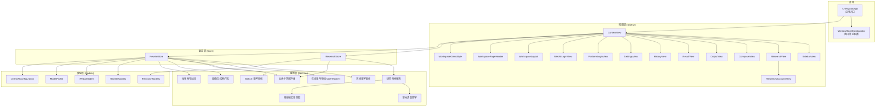
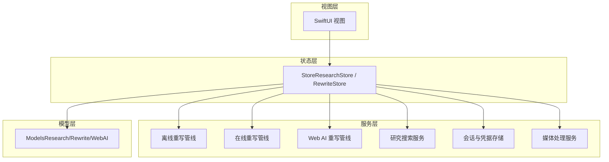
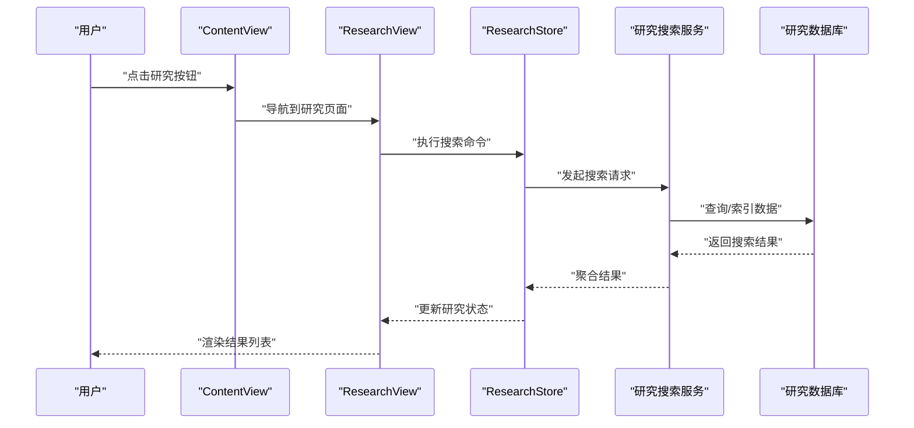
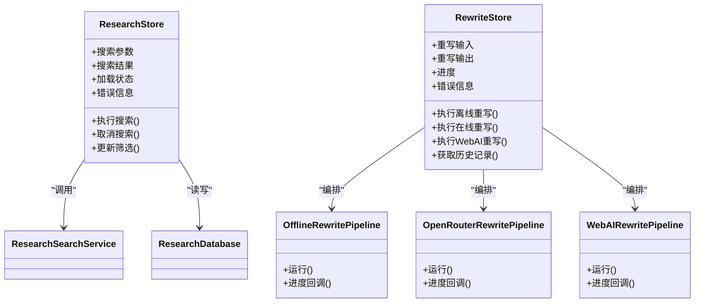
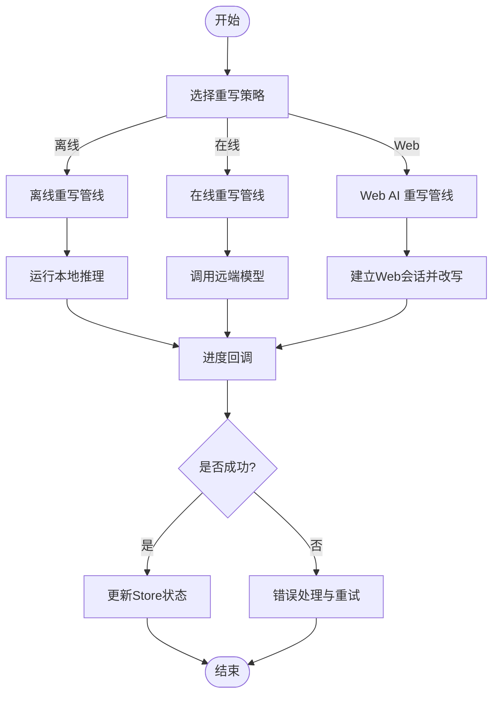
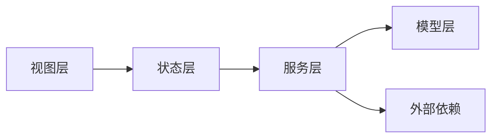

# 系统架构

<cite>
**本文引用的文件**
- [ChengGaoApp.swift](file://Sources/ChengGao/App/ChengGaoApp.swift)
- [WindowGlassConfigurator.swift](file://Sources/ChengGao/App/WindowGlassConfigurator.swift)
- [ContentView.swift](file://Sources/ChengGao/Views/ContentView.swift)
- [SidebarView.swift](file://Sources/ChengGao/Views/SidebarView.swift)
- [ResearchView.swift](file://Sources/ChengGao/Views/ResearchView.swift)
- [ComposerView.swift](file://Sources/ChengGao/Views/ComposerView.swift)
- [OutputView.swift](file://Sources/ChengGao/Views/OutputView.swift)
- [ResultView.swift](file://Sources/ChengGao/Views/ResultView.swift)
- [HistoryView.swift](file://Sources/ChengGao/Views/HistoryView.swift)
- [SettingsView.swift](file://Sources/ChengGao/Views/SettingsView.swift)
- [WorkspaceLayout.swift](file://Sources/ChengGao/Views/WorkspaceLayout.swift)
- [WorkspacePageHeader.swift](file://Sources/ChengGao/Views/WorkspacePageHeader.swift)
- [WorkspaceGlassStyle.swift](file://Sources/ChengGao/Views/WorkspaceGlassStyle.swift)
- [PlatformLoginView.swift](file://Sources/ChengGao/Views/PlatformLoginView.swift)
- [WebAILoginView.swift](file://Sources/ChengGao/Views/WebAILoginView.swift)
- [ResearchAccountsView.swift](file://Sources/ChengGao/Views/ResearchAccountsView.swift)
- [ResearchStore.swift](file://Sources/ChengGao/Stores/ResearchStore.swift)
- [RewriteStore.swift](file://Sources/ChengGao/Stores/RewriteStore.swift)
- [ModelProfile.swift](file://Sources/ChengGao/Models/ModelProfile.swift)
- [OnlineAIConfiguration.swift](file://Sources/ChengGao/Models/OnlineAIConfiguration.swift)
- [ResearchModels.swift](file://Sources/ChengGao/Models/ResearchModels.swift)
- [RewriteModels.swift](file://Sources/ChengGao/Models/RewriteModels.swift)
- [WebAIModels.swift](file://Sources/ChengGao/Models/WebAIModels.swift)
- [FocusedRewriteActions.swift](file://Sources/ChengGao/Support/FocusedRewriteActions.swift)
- [EmbeddedModelRuntime.swift](file://Sources/ChengGao/Services/EmbeddedModelRuntime.swift)
- [OfflineRewritePipeline.swift](file://Sources/ChengGao/Services/OfflineRewritePipeline.swift)
- [OpenRouterRewritePipeline.swift](file://Sources/ChengGao/Services/OpenRouterRewritePipeline.swift)
- [WebAIRewritePipeline.swift](file://Sources/ChengGao/Services/WebAIRewritePipeline.swift)
- [ResearchSearchService.swift](file://Sources/ChengGao/Services/ResearchSearchService.swift)
- [WebKitResearchSearchService.swift](file://Sources/ChengGao/Services/WebKitResearchSearchService.swift)
- [ResearchDatabase.swift](file://Sources/ChengGao/Services/ResearchDatabase.swift)
- [OpenRouterCredentialStore.swift](file://Sources/ChengGao/Services/OpenRouterCredentialStore.swift)
- [ResearchCredentialStore.swift](file://Sources/ChengGao/Services/ResearchCredentialStore.swift)
- [PlatformSessionStore.swift](file://Sources/ChengGao/Services/PlatformSessionStore.swift)
- [PlatformWebSessionPool.swift](file://Sources/ChengGao/Services/PlatformWebSessionPool.swift)
- [DouyinVideoResolver.swift](file://Sources/ChengGao/Services/DouyinVideoResolver.swift)
- [XiaohongshuContentResolver.swift](file://Sources/ChengGao/Services/XiaohongshuContentResolver.swift)
- [CoverArtworkGenerator.swift](file://Sources/ChengGao/Services/CoverArtworkGenerator.swift)
- [LocalSpeechTranscriber.swift](file://Sources/ChengGao/Services/LocalSpeechTranscriber.swift)
- [SpokenSubtitleFormatter.swift](file://Sources/ChengGao/Services/SpokenSubtitleFormatter.swift)
- [VideoFrameTextExtractor.swift](file://Sources/ChengGao/Services/VideoFrameTextExtractor.swift)
- [VideoSuggestionPlanner.swift](file://Sources/ChengGao/Services/VideoSuggestionPlanner.swift)
- [VisualPromptGenerator.swift](file://Sources/ChengGao/Services/VisualPromptGenerator.swift)
- [SourceExtractor.swift](file://Sources/ChengGao/Services/SourceExtractor.swift)
- [ChatGPTImageBatchDocument.swift](file://Sources/ChengGao/Services/ChatGPTImageBatchDocument.swift)
- [CompatibleImageGenerationClient.swift](file://Sources/ChengGao/Services/CompatibleImageGenerationClient.swift)
- [ShortVideoExportPackage.swift](file://Sources/ChengGao/Services/ShortVideoExportPackage.swift)
- [TerminologyVerifier.swift](file://Sources/ChengGao/Services/TerminologyVerifier.swift)
- [Package.swift](file://Package.swift)
</cite>

## 目录
1. [简介](#简介)
2. [项目结构](#项目结构)
3. [核心组件](#核心组件)
4. [架构总览](#架构总览)
5. [详细组件分析](#详细组件分析)
6. [依赖分析](#依赖分析)
7. [性能考虑](#性能考虑)
8. [故障排查指南](#故障排查指南)
9. [结论](#结论)
10. [附录](#附录)

## 简介
本架构文档面向 ChengGao 系统的开发者与贡献者，系统性阐述其基于 MVVM + Store 的整体架构模式、分层职责、数据流向与状态管理策略。文档重点解释 SwiftUI 视图层、Store 状态管理层、Service 业务逻辑层的职责分工与交互关系，并给出关键设计决策、架构约束与技术选型理由。同时明确系统边界、组件间通信机制与扩展点设计，辅以架构图与数据流图，帮助读者快速理解组织方式与扩展路径。

## 项目结构
ChengGao 采用模块化 Swift Package 组织，核心代码位于 Sources/ChengGao 下，按功能域划分为 App、Views、Stores、Services、Models、Support 等子模块：
- App：应用入口与窗口配置
- Views：SwiftUI 界面组件，遵循 MVVM 的 View 层
- Stores：集中式状态容器（Store），承载 UI 所需的状态与副作用
- Services：领域服务与外部集成（本地推理、在线模型、搜索、会话、导出等）
- Models：数据模型与传输对象
- Support：辅助能力（如焦点动作）

图表来源
- [ChengGaoApp.swift:1-200](file://Sources/ChengGao/App/ChengGaoApp.swift#L1-L200)
- [ContentView.swift:1-200](file://Sources/ChengGao/Views/ContentView.swift#L1-L200)
- [ResearchStore.swift:1-200](file://Sources/ChengGao/Stores/ResearchStore.swift#L1-L200)
- [RewriteStore.swift:1-200](file://Sources/ChengGao/Stores/RewriteStore.swift#L1-L200)

章节来源
- [Package.swift:1-200](file://Package.swift#L1-L200)
- [ChengGaoApp.swift:1-200](file://Sources/ChengGao/App/ChengGaoApp.swift#L1-L200)

## 核心组件
- 视图层（SwiftUI）：以声明式 UI 呈现用户界面，通过 @StateObject/@ObservedObject 订阅 Store 状态变更，触发用户操作事件。
- 状态层（Store）：集中管理 UI 状态与副作用，暴露可观察属性与命令方法，协调 Service 调用与结果回写。
- 服务层（Services）：封装领域逻辑与外部依赖，提供离线/在线重写、搜索、会话、凭据、媒体处理等能力。
- 模型层（Models）：定义跨层的数据契约，包括研究、重写、Web AI 相关的数据结构与配置。

职责边界与交互原则：
- View 不直接访问 Service，仅与 Store 交互；Store 负责编排 Service 调用与状态更新。
- Service 保持无副作用或显式副作用（网络、IO），对外暴露稳定接口。
- Models 作为不可变或轻量可变数据结构，贯穿各层传递。

章节来源
- [ResearchStore.swift:1-200](file://Sources/ChengGao/Stores/ResearchStore.swift#L1-L200)
- [RewriteStore.swift:1-200](file://Sources/ChengGao/Stores/RewriteStore.swift#L1-L200)
- [ResearchModels.swift:1-200](file://Sources/ChengGao/Models/ResearchModels.swift#L1-L200)
- [RewriteModels.swift:1-200](file://Sources/ChengGao/Models/RewriteModels.swift#L1-L200)
- [WebAIModels.swift:1-200](file://Sources/ChengGao/Models/WebAIModels.swift#L1-L200)

## 架构总览
ChengGao 采用 MVVM + Store 的分层架构：
- 视图层（View）：SwiftUI 组件，响应式渲染，绑定 Store 的可观察状态。
- 状态层（Store）：单一事实来源，持有 UI 状态与业务流程上下文，调度 Service。
- 服务层（Service）：领域能力与外部集成，解耦具体实现（本地/在线）。
- 模型层（Model）：统一数据契约，确保类型安全与一致性。

图表来源
- [ContentView.swift:1-200](file://Sources/ChengGao/Views/ContentView.swift#L1-L200)
- [ResearchStore.swift:1-200](file://Sources/ChengGao/Stores/ResearchStore.swift#L1-L200)
- [RewriteStore.swift:1-200](file://Sources/ChengGao/Stores/RewriteStore.swift#L1-L200)
- [OfflineRewritePipeline.swift:1-200](file://Sources/ChengGao/Services/OfflineRewritePipeline.swift#L1-L200)
- [OpenRouterRewritePipeline.swift:1-200](file://Sources/ChengGao/Services/OpenRouterRewritePipeline.swift#L1-L200)
- [WebAIRewritePipeline.swift:1-200](file://Sources/ChengGao/Services/WebAIRewritePipeline.swift#L1-L200)
- [ResearchSearchService.swift:1-200](file://Sources/ChengGao/Services/ResearchSearchService.swift#L1-L200)
- [PlatformSessionStore.swift:1-200](file://Sources/ChengGao/Services/PlatformSessionStore.swift#L1-L200)
- [ResearchDatabase.swift:1-200](file://Sources/ChengGao/Services/ResearchDatabase.swift#L1-L200)

## 详细组件分析

### 视图层（SwiftUI）
- 入口与布局：ContentView 作为根视图，组合 SidebarView、ResearchView、ComposerView、OutputView、ResultView、HistoryView、SettingsView 等页面；WorkspaceLayout、WorkspacePageHeader、WorkspaceGlassStyle 提供统一的布局与玻璃风格。
- 登录与会话：PlatformLoginView、WebAILoginView 负责平台与 Web AI 的认证流程，与 Session/Credential 服务协作。
- 交互原则：视图仅持有展示状态与用户输入，通过 Store 的命令方法发起操作，并通过可观察属性刷新 UI。

图表来源
- [ContentView.swift:1-200](file://Sources/ChengGao/Views/ContentView.swift#L1-L200)
- [ResearchView.swift:1-200](file://Sources/ChengGao/Views/ResearchView.swift#L1-L200)
- [ResearchStore.swift:1-200](file://Sources/ChengGao/Stores/ResearchStore.swift#L1-L200)
- [ResearchSearchService.swift:1-200](file://Sources/ChengGao/Services/ResearchSearchService.swift#L1-L200)
- [ResearchDatabase.swift:1-200](file://Sources/ChengGao/Services/ResearchDatabase.swift#L1-L200)

章节来源
- [ContentView.swift:1-200](file://Sources/ChengGao/Views/ContentView.swift#L1-L200)
- [SidebarView.swift:1-200](file://Sources/ChengGao/Views/SidebarView.swift#L1-L200)
- [ResearchView.swift:1-200](file://Sources/ChengGao/Views/ResearchView.swift#L1-L200)
- [ComposerView.swift:1-200](file://Sources/ChengGao/Views/ComposerView.swift#L1-L200)
- [OutputView.swift:1-200](file://Sources/ChengGao/Views/OutputView.swift#L1-L200)
- [ResultView.swift:1-200](file://Sources/ChengGao/Views/ResultView.swift#L1-L200)
- [HistoryView.swift:1-200](file://Sources/ChengGao/Views/HistoryView.swift#L1-L200)
- [SettingsView.swift:1-200](file://Sources/ChengGao/Views/SettingsView.swift#L1-L200)
- [WorkspaceLayout.swift:1-200](file://Sources/ChengGao/Views/WorkspaceLayout.swift#L1-L200)
- [WorkspacePageHeader.swift:1-200](file://Sources/ChengGao/Views/WorkspacePageHeader.swift#L1-L200)
- [WorkspaceGlassStyle.swift:1-200](file://Sources/ChengGao/Views/WorkspaceGlassStyle.swift#L1-L200)
- [PlatformLoginView.swift:1-200](file://Sources/ChengGao/Views/PlatformLoginView.swift#L1-L200)
- [WebAILoginView.swift:1-200](file://Sources/ChengGao/Views/WebAILoginView.swift#L1-L200)
- [ResearchAccountsView.swift:1-200](file://Sources/ChengGao/Views/ResearchAccountsView.swift#L1-L200)

### 状态层（Store）
- ResearchStore：管理研究相关的状态（搜索条件、结果、加载态、错误等），协调搜索服务与数据库，向视图发布状态变化。
- RewriteStore：管理重写任务的状态（输入、输出、进度、错误、历史），编排离线/在线/Web AI 重写管线，维护会话与凭据。

图表来源
- [ResearchStore.swift:1-200](file://Sources/ChengGao/Stores/ResearchStore.swift#L1-L200)
- [RewriteStore.swift:1-200](file://Sources/ChengGao/Stores/RewriteStore.swift#L1-L200)
- [OfflineRewritePipeline.swift:1-200](file://Sources/ChengGao/Services/OfflineRewritePipeline.swift#L1-L200)
- [OpenRouterRewritePipeline.swift:1-200](file://Sources/ChengGao/Services/OpenRouterRewritePipeline.swift#L1-L200)
- [WebAIRewritePipeline.swift:1-200](file://Sources/ChengGao/Services/WebAIRewritePipeline.swift#L1-L200)

章节来源
- [ResearchStore.swift:1-200](file://Sources/ChengGao/Stores/ResearchStore.swift#L1-L200)
- [RewriteStore.swift:1-200](file://Sources/ChengGao/Stores/RewriteStore.swift#L1-L200)

### 服务层（Services）
- 重写管线：
  - 离线重写管线：本地推理引擎驱动，适合隐私与离线场景。
  - 在线重写管线（OpenRouter）：通过 OpenRouter 接入多模型，支持云端能力。
  - Web AI 重写管线：基于 Web 会话的远程改写能力。
- 研究搜索：
  - 研究搜索服务：抽象搜索接口，支持多种后端实现。
  - WebKit 研究搜索服务：基于 WebKit 的网页内容抓取与解析。
  - 研究数据库：本地持久化与检索。
- 会话与凭据：
  - 平台会话存储：管理平台级会话生命周期。
  - Web 会话池：复用与管理 Web 会话连接。
  - OpenRouter 凭据存储：安全保存 API Key 与令牌。
  - 研究凭据存储：管理研究相关凭据。
- 媒体处理：
  - 本地语音转写：音频转文本。
  - 视频帧文本提取：从视频中提取字幕/OCR 文本。
  - 口语字幕格式化：将转写结果格式化为字幕。
  - 封面图生成：根据内容生成封面。
  - 视觉提示生成：为图像生成提供提示词。
  - 短视频导出包：打包导出短视频产物。
  - 兼容图像生成客户端：适配不同图像生成服务。
  - 批量文档处理：批量处理图像文档。
  - 术语校验：对专业术语进行校验与替换。
  - 源提取器：从多源提取结构化内容。

图表来源
- [OfflineRewritePipeline.swift:1-200](file://Sources/ChengGao/Services/OfflineRewritePipeline.swift#L1-L200)
- [OpenRouterRewritePipeline.swift:1-200](file://Sources/ChengGao/Services/OpenRouterRewritePipeline.swift#L1-L200)
- [WebAIRewritePipeline.swift:1-200](file://Sources/ChengGao/Services/WebAIRewritePipeline.swift#L1-L200)
- [RewriteStore.swift:1-200](file://Sources/ChengGao/Stores/RewriteStore.swift#L1-L200)

章节来源
- [EmbeddedModelRuntime.swift:1-200](file://Sources/ChengGao/Services/EmbeddedModelRuntime.swift#L1-L200)
- [OfflineRewritePipeline.swift:1-200](file://Sources/ChengGao/Services/OfflineRewritePipeline.swift#L1-L200)
- [OpenRouterRewritePipeline.swift:1-200](file://Sources/ChengGao/Services/OpenRouterRewritePipeline.swift#L1-L200)
- [WebAIRewritePipeline.swift:1-200](file://Sources/ChengGao/Services/WebAIRewritePipeline.swift#L1-L200)
- [ResearchSearchService.swift:1-200](file://Sources/ChengGao/Services/ResearchSearchService.swift#L1-L200)
- [WebKitResearchSearchService.swift:1-200](file://Sources/ChengGao/Services/WebKitResearchSearchService.swift#L1-L200)
- [ResearchDatabase.swift:1-200](file://Sources/ChengGao/Services/ResearchDatabase.swift#L1-L200)
- [OpenRouterCredentialStore.swift:1-200](file://Sources/ChengGao/Services/OpenRouterCredentialStore.swift#L1-L200)
- [ResearchCredentialStore.swift:1-200](file://Sources/ChengGao/Services/ResearchCredentialStore.swift#L1-L200)
- [PlatformSessionStore.swift:1-200](file://Sources/ChengGao/Services/PlatformSessionStore.swift#L1-L200)
- [PlatformWebSessionPool.swift:1-200](file://Sources/ChengGao/Services/PlatformWebSessionPool.swift#L1-L200)
- [DouyinVideoResolver.swift:1-200](file://Sources/ChengGao/Services/DouyinVideoResolver.swift#L1-L200)
- [XiaohongshuContentResolver.swift:1-200](file://Sources/ChengGao/Services/XiaohongshuContentResolver.swift#L1-L200)
- [CoverArtworkGenerator.swift:1-200](file://Sources/ChengGao/Services/CoverArtworkGenerator.swift#L1-L200)
- [LocalSpeechTranscriber.swift:1-200](file://Sources/ChengGao/Services/LocalSpeechTranscriber.swift#L1-L200)
- [SpokenSubtitleFormatter.swift:1-200](file://Sources/ChengGao/Services/SpokenSubtitleFormatter.swift#L1-L200)
- [VideoFrameTextExtractor.swift:1-200](file://Sources/ChengGao/Services/VideoFrameTextExtractor.swift#L1-L200)
- [VideoSuggestionPlanner.swift:1-200](file://Sources/ChengGao/Services/VideoSuggestionPlanner.swift#L1-L200)
- [VisualPromptGenerator.swift:1-200](file://Sources/ChengGao/Services/VisualPromptGenerator.swift#L1-L200)
- [SourceExtractor.swift:1-200](file://Sources/ChengGao/Services/SourceExtractor.swift#L1-L200)
- [ChatGPTImageBatchDocument.swift:1-200](file://Sources/ChengGao/Services/ChatGPTImageBatchDocument.swift#L1-L200)
- [CompatibleImageGenerationClient.swift:1-200](file://Sources/ChengGao/Services/CompatibleImageGenerationClient.swift#L1-L200)
- [ShortVideoExportPackage.swift:1-200](file://Sources/ChengGao/Services/ShortVideoExportPackage.swift#L1-L200)
- [TerminologyVerifier.swift:1-200](file://Sources/ChengGao/Services/TerminologyVerifier.swift#L1-L200)

### 模型层（Models）
- ResearchModels：研究相关的数据结构（查询、结果、元数据）。
- RewriteModels：重写任务输入/输出、进度、错误等。
- WebAIModels：Web AI 会话、配置、响应体。
- ModelProfile：模型配置文件（名称、版本、能力）。
- OnlineAIConfiguration：在线模型配置（端点、密钥、超时等）。

章节来源
- [ResearchModels.swift:1-200](file://Sources/ChengGao/Models/ResearchModels.swift#L1-L200)
- [RewriteModels.swift:1-200](file://Sources/ChengGao/Models/RewriteModels.swift#L1-L200)
- [WebAIModels.swift:1-200](file://Sources/ChengGao/Models/WebAIModels.swift#L1-L200)
- [ModelProfile.swift:1-200](file://Sources/ChengGao/Models/ModelProfile.swift#L1-L200)
- [OnlineAIConfiguration.swift:1-200](file://Sources/ChengGao/Models/OnlineAIConfiguration.swift#L1-L200)

### 支撑与工具（Support）
- FocusedRewriteActions：聚焦于重写操作的焦点行为与快捷键映射，提升交互效率。

章节来源
- [FocusedRewriteActions.swift:1-200](file://Sources/ChengGao/Support/FocusedRewriteActions.swift#L1-L200)

## 依赖分析
- 视图层依赖 Store：通过可观察对象订阅状态变化，避免直接耦合 Service。
- Store 依赖 Service：编排业务逻辑与外部依赖，屏蔽实现细节。
- Service 依赖 Models：使用统一数据契约，保证类型一致性与可测试性。
- 外部依赖隔离：网络、IO、第三方 SDK 均封装在 Service 层，便于替换与测试。

图表来源
- [ContentView.swift:1-200](file://Sources/ChengGao/Views/ContentView.swift#L1-L200)
- [ResearchStore.swift:1-200](file://Sources/ChengGao/Stores/ResearchStore.swift#L1-L200)
- [RewriteStore.swift:1-200](file://Sources/ChengGao/Stores/RewriteStore.swift#L1-L200)
- [ResearchSearchService.swift:1-200](file://Sources/ChengGao/Services/ResearchSearchService.swift#L1-L200)
- [OfflineRewritePipeline.swift:1-200](file://Sources/ChengGao/Services/OfflineRewritePipeline.swift#L1-L200)

章节来源
- [Package.swift:1-200](file://Package.swift#L1-L200)

## 性能考虑
- 异步与并发：Store 中长时间运行的任务应使用异步队列与取消令牌，避免阻塞主线程。
- 缓存策略：搜索结果与模型输出应结合内存与磁盘缓存，减少重复计算与网络开销。
- 资源复用：Web 会话池与平台会话存储需合理复用连接，降低握手成本。
- 增量更新：Store 状态变更应尽量细粒度，避免全量重绘。
- I/O 优化：大文件处理（视频帧提取、批量文档）应采用流式处理与分块读取。

[本节为通用指导，无需特定文件引用]

## 故障排查指南
- 常见问题定位：
  - 网络错误：检查凭据存储与在线服务配置，确认超时与重试策略。
  - 本地推理失败：验证嵌入式模型运行时环境与资源占用。
  - 搜索无结果：核对搜索服务实现与数据库索引状态。
  - 会话失效：检查平台会话存储与 Web 会话池的生命周期管理。
- 调试建议：
  - 在 Store 中增加日志与指标上报，记录关键步骤耗时与错误码。
  - 使用单元测试覆盖 Service 的关键路径，模拟外部依赖异常。
  - 针对 UI 卡顿，使用 Instruments 分析主线程负载与渲染热点。

章节来源
- [OpenRouterCredentialStore.swift:1-200](file://Sources/ChengGao/Services/OpenRouterCredentialStore.swift#L1-L200)
- [ResearchCredentialStore.swift:1-200](file://Sources/ChengGao/Services/ResearchCredentialStore.swift#L1-L200)
- [PlatformSessionStore.swift:1-200](file://Sources/ChengGao/Services/PlatformSessionStore.swift#L1-L200)
- [PlatformWebSessionPool.swift:1-200](file://Sources/ChengGao/Services/PlatformWebSessionPool.swift#L1-L200)
- [ResearchDatabase.swift:1-200](file://Sources/ChengGao/Services/ResearchDatabase.swift#L1-L200)
- [EmbeddedModelRuntime.swift:1-200](file://Sources/ChengGao/Services/EmbeddedModelRuntime.swift#L1-L200)

## 结论
ChengGao 系统通过 MVVM + Store 的分层架构实现了清晰的职责分离与良好的可扩展性。视图层专注 UI 渲染与交互，Store 集中管理状态与副作用，Service 封装领域逻辑与外部依赖，Models 提供统一数据契约。该设计有利于独立演进各层能力，降低耦合度，提升可测试性与可维护性。建议在后续迭代中持续完善错误处理、性能监控与扩展点设计，以支撑更多业务场景与第三方集成。

[本节为总结性内容，无需特定文件引用]

## 附录
- 系统边界：
  - 内部边界：View-Store-Service-Models 四层清晰划分，禁止越层调用。
  - 外部边界：网络、文件系统、第三方 SDK 均在 Service 层暴露稳定接口。
- 组件间通信机制：
  - 单向数据流：View 触发 Store 命令，Store 调用 Service，结果回写 Store，再通知 View 更新。
  - 事件与回调：Service 通过进度回调与错误回调向 Store 汇报，Store 转换为可观察状态。
- 扩展点设计：
  - 新增重写策略：实现新的 Pipeline 并在 Store 中注册切换。
  - 新增搜索后端：实现 SearchService 接口并在 Store 中注入。
  - 新增媒体处理：实现对应 Service 并在 Store 中编排。

[本节为概念性说明，无需特定文件引用]