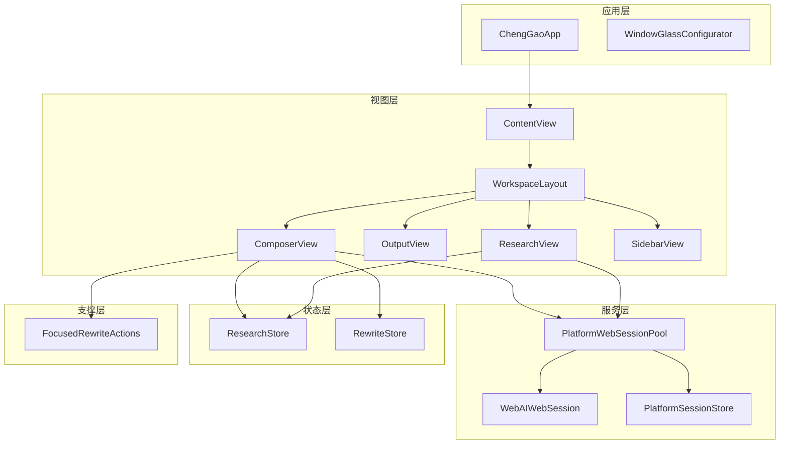
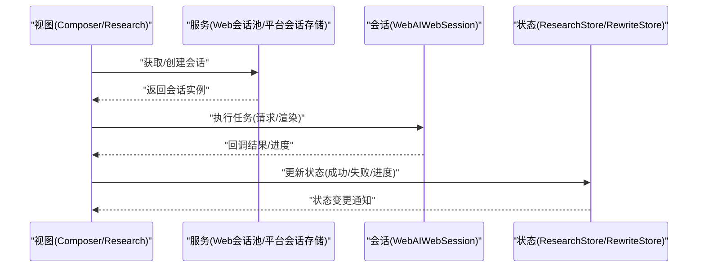
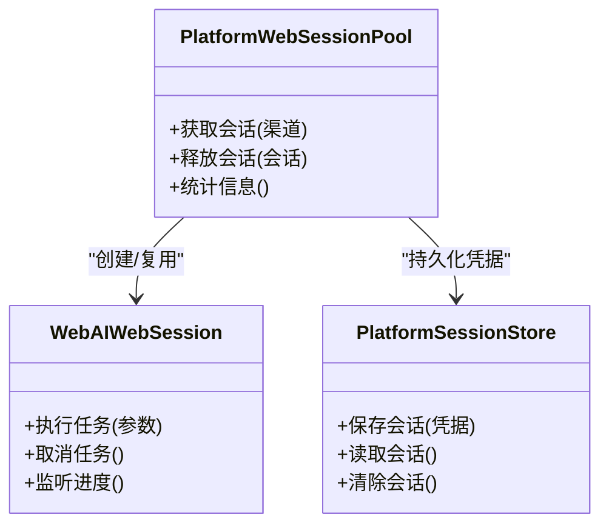
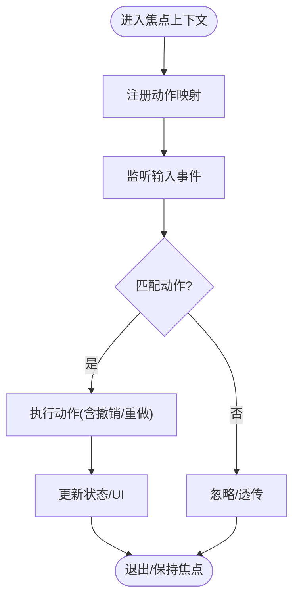
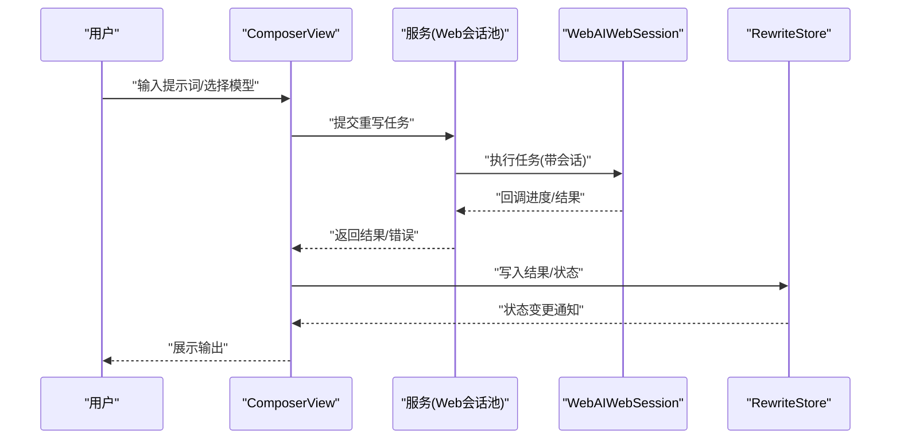
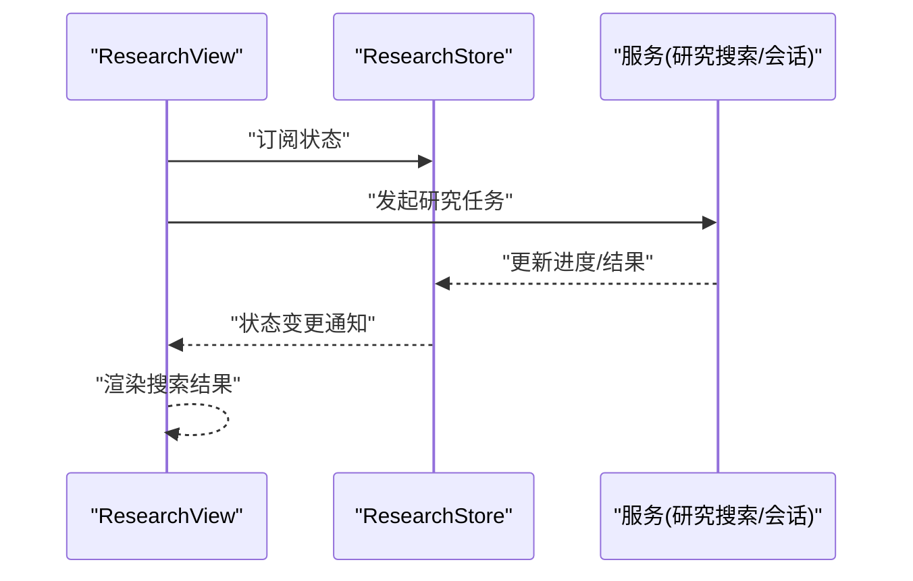
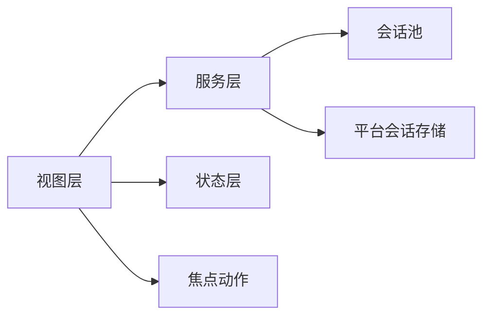

# 组件交互机制

<cite>
**本文引用的文件**   
- [ChengGaoApp.swift](file://Sources/ChengGao/App/ChengGaoApp.swift)
- [WindowGlassConfigurator.swift](file://Sources/ChengGao/App/WindowGlassConfigurator.swift)
- [ContentView.swift](file://Sources/ChengGao/Views/ContentView.swift)
- [ComposerView.swift](file://Sources/ChengGao/Views/ComposerView.swift)
- [OutputView.swift](file://Sources/ChengGao/Views/OutputView.swift)
- [ResearchView.swift](file://Sources/ChengGao/Views/ResearchView.swift)
- [SidebarView.swift](file://Sources/ChengGao/Views/SidebarView.swift)
- [WorkspaceLayout.swift](file://Sources/ChengGao/Views/WorkspaceLayout.swift)
- [PlatformWebSessionPool.swift](file://Sources/ChengGao/Services/PlatformWebSessionPool.swift)
- [WebAIWebSession.swift](file://Sources/ChengGao/Services/WebAIWebSession.swift)
- [PlatformSessionStore.swift](file://Sources/ChengGao/Services/PlatformSessionStore.swift)
- [FocusedRewriteActions.swift](file://Sources/ChengGao/Support/FocusedRewriteActions.swift)
- [ResearchStore.swift](file://Sources/ChengGao/Stores/ResearchStore.swift)
- [RewriteStore.swift](file://Sources/ChengGao/Stores/RewriteStore.swift)
</cite>

## 目录
1. [简介](#简介)
2. [项目结构](#项目结构)
3. [核心组件](#核心组件)
4. [架构总览](#架构总览)
5. [详细组件分析](#详细组件分析)
6. [依赖关系分析](#依赖关系分析)
7. [性能考量](#性能考量)
8. [故障排查指南](#故障排查指南)
9. [结论](#结论)
10. [附录](#附录)

## 简介
本文件系统化阐述 ChengGao 的组件交互机制，重点覆盖：
- 各层组件间的通信协议、事件传递与回调处理
- Session 管理、Web 会话池与焦点动作系统
- 组件解耦策略、依赖管理与接口设计规范
- 错误传播、日志记录与调试支持
- 组件关系图与典型交互序列图

## 项目结构
ChengGao 采用 SwiftUI + Swift Package 的组织方式，按功能域分层：
- App 层：应用入口、窗口配置
- Views 层：UI 视图与页面布局
- Services 层：业务服务（如 Web 会话池、平台会话存储、研究搜索等）
- Stores 层：状态管理（研究与重写相关）
- Support 层：辅助能力（如焦点动作）

图表来源
- [ChengGaoApp.swift](file://Sources/ChengGao/App/ChengGaoApp.swift)
- [WindowGlassConfigurator.swift](file://Sources/ChengGao/App/WindowGlassConfigurator.swift)
- [ContentView.swift](file://Sources/ChengGao/Views/ContentView.swift)
- [ComposerView.swift](file://Sources/ChengGao/Views/ComposerView.swift)
- [OutputView.swift](file://Sources/ChengGao/Views/OutputView.swift)
- @file://Sources/ChengGao/Views/ResearchView.swift
- [SidebarView.swift](file://Sources/ChengGao/Views/SidebarView.swift)
- [WorkspaceLayout.swift](file://Sources/ChengGao/Views/WorkspaceLayout.swift)
- [PlatformWebSessionPool.swift](file://Sources/ChengGao/Services/PlatformWebSessionPool.swift)
- [WebAIWebSession.swift](file://Sources/ChengGao/Services/WebAIWebSession.swift)
- [PlatformSessionStore.swift](file://Sources/ChengGao/Services/PlatformSessionStore.swift)
- [ResearchStore.swift](file://Sources/ChengGao/Stores/ResearchStore.swift)
- [RewriteStore.swift](file://Sources/ChengGao/Stores/RewriteStore.swift)
- [FocusedRewriteActions.swift](file://Sources/ChengGao/Support/FocusedRewriteActions.swift)

章节来源
- [ChengGaoApp.swift](file://Sources/ChengGao/App/ChengGaoApp.swift)
- [ContentView.swift](file://Sources/ChengGao/Views/ContentView.swift)
- [WorkspaceLayout.swift](file://Sources/ChengGao/Views/WorkspaceLayout.swift)

## 核心组件
- 应用与窗口配置：负责应用生命周期初始化与窗口样式配置。
- 视图层：承载用户交互，组织页面布局，驱动业务调用。
- 服务层：封装网络与会话能力，提供统一的 Web 会话池与平台会话存储。
- 状态层：集中管理研究与重写的状态数据，供视图订阅更新。
- 支撑层：提供焦点动作等通用交互能力。

章节来源
- [ChengGaoApp.swift](file://Sources/ChengGao/App/ChengGaoApp.swift)
- [WindowGlassConfigurator.swift](file://Sources/ChengGao/App/WindowGlassConfigurator.swift)
- [ContentView.swift](file://Sources/ChengGao/Views/ContentView.swift)
- [PlatformWebSessionPool.swift](file://Sources/ChengGao/Services/PlatformWebSessionPool.swift)
- [PlatformSessionStore.swift](file://Sources/ChengGao/Services/PlatformSessionStore.swift)
- [ResearchStore.swift](file://Sources/ChengGao/Stores/ResearchStore.swift)
- [RewriteStore.swift](file://Sources/ChengGao/Stores/RewriteStore.swift)
- [FocusedRewriteActions.swift](file://Sources/ChengGao/Support/FocusedRewriteActions.swift)

## 架构总览
ChengGao 采用“视图-服务-状态”三层解耦架构：
- 视图层通过依赖注入或单例访问服务层，发起操作并订阅状态变化。
- 服务层统一封装会话与网络逻辑，对外暴露稳定接口。
- 状态层以可观察对象形式向视图推送变更，保证 UI 与数据一致。

图表来源
- [PlatformWebSessionPool.swift](file://Sources/ChengGao/Services/PlatformWebSessionPool.swift)
- [WebAIWebSession.swift](file://Sources/ChengGao/Services/WebAIWebSession.swift)
- [PlatformSessionStore.swift](file://Sources/ChengGao/Services/PlatformSessionStore.swift)
- [ResearchStore.swift](file://Sources/ChengGao/Stores/ResearchStore.swift)
- [RewriteStore.swift](file://Sources/ChengGao/Stores/RewriteStore.swift)

## 详细组件分析

### 会话管理与 Web 会话池
- 目标：为多源 Web 能力提供统一会话生命周期管理，避免重复创建与资源泄漏。
- 关键点：
  - 会话工厂：根据平台/渠道选择具体会话实现。
  - 池化策略：复用活跃会话，限制最大并发与空闲回收。
  - 生命周期：创建、激活、挂起、销毁；异常时自动清理。
  - 线程安全：对共享池进行同步访问控制。
- 交互流程：
  - 视图请求会话 -> 池分配或创建 -> 绑定平台会话存储 -> 执行任务 -> 回调结果 -> 归还/销毁。

图表来源
- [PlatformWebSessionPool.swift](file://Sources/ChengGao/Services/PlatformWebSessionPool.swift)
- [WebAIWebSession.swift](file://Sources/ChengGao/Services/WebAIWebSession.swift)
- [PlatformSessionStore.swift](file://Sources/ChengGao/Services/PlatformSessionStore.swift)

章节来源
- [PlatformWebSessionPool.swift](file://Sources/ChengGao/Services/PlatformWebSessionPool.swift)
- [WebAIWebSession.swift](file://Sources/ChengGao/Services/WebAIWebSession.swift)
- [PlatformSessionStore.swift](file://Sources/ChengGao/Services/PlatformSessionStore.swift)

### 焦点动作系统
- 目标：在特定上下文（如重写编辑区）中提供一致的快捷键与焦点行为。
- 关键点：
  - 动作注册：定义可聚焦区域与对应动作映射。
  - 事件分发：键盘/手势事件路由到当前焦点上下文。
  - 撤销/重做：维护动作历史栈，支持批量回滚。
- 使用建议：
  - 将焦点动作与视图绑定，确保生命周期一致。
  - 对冲突按键进行优先级排序与覆盖策略。

图表来源
- [FocusedRewriteActions.swift](file://Sources/ChengGao/Support/FocusedRewriteActions.swift)

章节来源
- [FocusedRewriteActions.swift](file://Sources/ChengGao/Support/FocusedRewriteActions.swift)

### 视图与服务协作（典型场景）
- 场景：用户在 Composer 发起一次重写任务，并在 Output 查看结果。
- 要点：
  - 视图不直接持有网络/会话细节，仅调用服务接口。
  - 服务内部协调会话池与平台存储，完成认证与请求。
  - 状态层聚合结果，视图订阅后刷新。

图表来源
- [ComposerView.swift](file://Sources/ChengGao/Views/ComposerView.swift)
- [PlatformWebSessionPool.swift](file://Sources/ChengGao/Services/PlatformWebSessionPool.swift)
- [WebAIWebSession.swift](file://Sources/ChengGao/Services/WebAIWebSession.swift)
- [RewriteStore.swift](file://Sources/ChengGao/Stores/RewriteStore.swift)

章节来源
- [ComposerView.swift](file://Sources/ChengGao/Views/ComposerView.swift)
- [OutputView.swift](file://Sources/ChengGao/Views/OutputView.swift)
- [RewriteStore.swift](file://Sources/ChengGao/Stores/RewriteStore.swift)

### 研究视图与状态联动
- 目标：ResearchView 通过 ResearchStore 管理研究任务的状态与结果。
- 要点：
  - 视图订阅状态变化，触发 UI 刷新。
  - 服务层负责搜索、解析与缓存。
  - 错误与重试由服务层统一处理，视图仅感知最终状态。

图表来源
- [ResearchView.swift](file://Sources/ChengGao/Views/ResearchView.swift)
- [ResearchStore.swift](file://Sources/ChengGao/Stores/ResearchStore.swift)

章节来源
- [ResearchView.swift](file://Sources/ChengGao/Views/ResearchView.swift)
- [ResearchStore.swift](file://Sources/ChengGao/Stores/ResearchStore.swift)

## 依赖关系分析
- 视图依赖服务：通过依赖注入或全局容器访问，降低耦合。
- 服务依赖会话与存储：会话池统一管理 Web 会话，平台存储负责凭据持久化。
- 状态独立于视图：状态对象被多个视图订阅，保证一致性。
- 支撑模块低耦合：焦点动作作为可选能力，按需注入。

图表来源
- [ContentView.swift](file://Sources/ChengGao/Views/ContentView.swift)
- [WorkspaceLayout.swift](file://Sources/ChengGao/Views/WorkspaceLayout.swift)
- [PlatformWebSessionPool.swift](file://Sources/ChengGao/Services/PlatformWebSessionPool.swift)
- [PlatformSessionStore.swift](file://Sources/ChengGao/Services/PlatformSessionStore.swift)
- [ResearchStore.swift](file://Sources/ChengGao/Stores/ResearchStore.swift)
- [RewriteStore.swift](file://Sources/ChengGao/Stores/RewriteStore.swift)
- [FocusedRewriteActions.swift](file://Sources/ChengGao/Support/FocusedRewriteActions.swift)

章节来源
- [ContentView.swift](file://Sources/ChengGao/Views/ContentView.swift)
- [WorkspaceLayout.swift](file://Sources/ChengGao/Views/WorkspaceLayout.swift)
- [PlatformWebSessionPool.swift](file://Sources/ChengGao/Services/PlatformWebSessionPool.swift)
- [PlatformSessionStore.swift](file://Sources/ChengGao/Services/PlatformSessionStore.swift)
- [ResearchStore.swift](file://Sources/ChengGao/Stores/ResearchStore.swift)
- [RewriteStore.swift](file://Sources/ChengGao/Stores/RewriteStore.swift)
- [FocusedRewriteActions.swift](file://Sources/ChengGao/Support/FocusedRewriteActions.swift)

## 性能考量
- 会话复用：减少握手与鉴权开销，提升响应速度。
- 并发控制：限制同时进行的 Web 任务数量，避免资源争用。
- 状态合并：批量更新状态，减少 UI 重绘次数。
- 懒加载：按需加载视图与资源，缩短启动时间。
- 缓存策略：对搜索结果与中间数据进行本地缓存。

[本节为通用指导，无需引用具体文件]

## 故障排查指南
- 常见问题定位：
  - 会话创建失败：检查平台会话存储中的凭据是否有效。
  - 任务超时：确认网络连通性与服务端可用性。
  - 状态不同步：核对状态更新路径与订阅是否正确。
- 日志与调试：
  - 在服务层关键路径添加结构化日志（入参、出参、耗时）。
  - 为会话池增加统计指标（活跃数、命中率、错误率）。
  - 在视图层打印关键交互事件，便于复现问题。
- 错误传播：
  - 服务层捕获底层异常，转换为领域错误类型。
  - 视图层统一处理错误提示，避免崩溃。

章节来源
- [PlatformSessionStore.swift](file://Sources/ChengGao/Services/PlatformSessionStore.swift)
- [PlatformWebSessionPool.swift](file://Sources/ChengGao/Services/PlatformWebSessionPool.swift)
- [ResearchStore.swift](file://Sources/ChengGao/Stores/ResearchStore.swift)
- [RewriteStore.swift](file://Sources/ChengGao/Stores/RewriteStore.swift)

## 结论
ChengGao 通过清晰的层次划分与稳定的接口契约，实现了视图、服务、状态与支撑模块之间的松耦合协作。会话池与平台存储为 Web 能力提供了可靠的基础设施，焦点动作系统增强了交互一致性。建议在后续迭代中继续强化错误分类、日志可观测性与性能监控，以提升系统的稳定性与可维护性。

[本节为总结性内容，无需引用具体文件]

## 附录
- 术语说明：
  - 会话：用于维持与外部服务的连接与认证上下文。
  - 会话池：管理会话生命周期与复用的组件。
  - 状态层：集中管理应用状态，供视图订阅。
  - 焦点动作：在特定上下文中响应用户输入的交互能力。

[本节为概念性说明，无需引用具体文件]