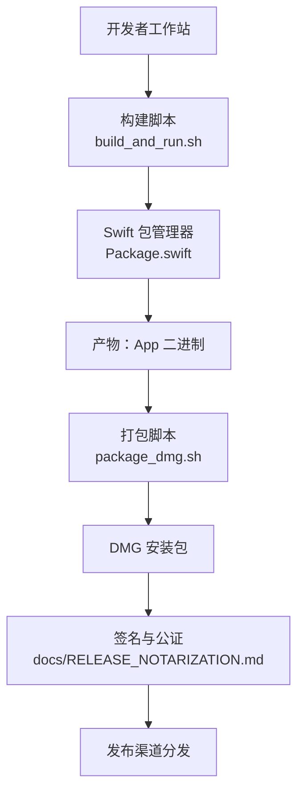
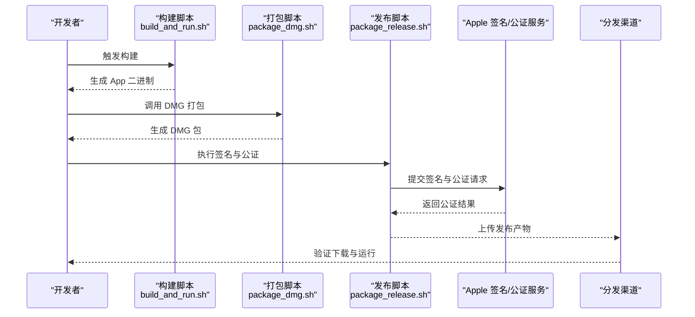
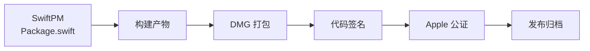

# 部署指南

<cite>
**本文引用的文件**   
- [package_dmg.sh](file://script/package_dmg.sh)
- [package_release.sh](file://script/package_release.sh)
- [build_and_run.sh](file://script/build_and_run.sh)
- [install_local.sh](file://script/install_local.sh)
- [release_local.sh](file://script/release_local.sh)
- [bootstrap_runtime.sh](file://script/bootstrap_runtime.sh)
- [RELEASE_NOTES.md](file://RELEASE_NOTES.md)
- [docs/RELEASE_NOTARIZATION.md](file://docs/RELEASE_NOTARIZATION.md)
- [Package.swift](file://Package.swift)
</cite>

## 目录
1. [简介](#简介)
2. [项目结构](#项目结构)
3. [核心组件](#核心组件)
4. [架构总览](#架构总览)
5. [详细组件分析](#详细组件分析)
6. [依赖分析](#依赖分析)
7. [性能考虑](#性能考虑)
8. [故障排查指南](#故障排查指南)
9. [结论](#结论)
10. [附录](#附录)

## 简介
本指南面向需要构建、打包、签名、公证与发布 macOS 应用（DMG）的工程师与维护者。内容覆盖：
- DMG 包制作流程与脚本使用
- 代码签名与公证配置要点
- 不同发布渠道的要求与差异
- 自动化构建脚本的使用方法与最佳实践
- 版本管理与变更日志维护规范
- 生产环境部署检查清单
- 性能优化与安全加固建议
- 回滚策略、监控告警与用户反馈收集机制
- 故障恢复与灾难恢复应急预案

## 项目结构
本项目采用 Swift Package Manager 组织源码，并通过 shell 脚本实现构建、打包、安装与发布的自动化。关键目录与职责如下：
- script：构建与发布相关脚本（打包 DMG、构建运行、本地安装、发布等）
- docs：发布与公证说明文档
- Package.swift：Swift 包描述与依赖声明
- RELEASE_NOTES.md：版本变更日志

**图表来源** 
- [build_and_run.sh](file://script/build_and_run.sh)
- [Package.swift](file://Package.swift)
- [package_dmg.sh](file://script/package_dmg.sh)
- [docs/RELEASE_NOTARIZATION.md](file://docs/RELEASE_NOTARIZATION.md)

**章节来源**
- [Package.swift](file://Package.swift)
- [docs/RELEASE_NOTARIZATION.md](file://docs/RELEASE_NOTARIZATION.md)

## 核心组件
- 构建与运行脚本 build_and_run.sh：负责编译 Swift 工程并启动调试或运行
- DMG 打包脚本 package_dmg.sh：生成 DMG 安装包，包含资源整理与元数据设置
- 发布脚本 package_release.sh：执行签名、公证与归档，输出可分发包
- 本地安装脚本 install_local.sh：将构建产物安装到系统指定位置用于测试
- 本地发布脚本 release_local.sh：在本地环境模拟发布流程（含校验与归档）
- 运行时引导脚本 bootstrap_runtime.sh：准备运行所需依赖与环境变量
- 变更日志 RELEASE_NOTES.md：记录版本更新内容与修复项
- 公证说明 docs/RELEASE_NOTARIZATION.md：Apple 公证流程与注意事项

**章节来源**
- [build_and_run.sh](file://script/build_and_run.sh)
- [package_dmg.sh](file://script/package_dmg.sh)
- [package_release.sh](file://script/package_release.sh)
- [install_local.sh](file://script/install_local.sh)
- [release_local.sh](file://script/release_local.sh)
- [bootstrap_runtime.sh](file://script/bootstrap_runtime.sh)
- [RELEASE_NOTES.md](file://RELEASE_NOTES.md)
- [docs/RELEASE_NOTARIZATION.md](file://docs/RELEASE_NOTARIZATION.md)

## 架构总览
下图展示了从源码到最终分发的端到端流水线，包括构建、打包、签名、公证与发布环节。

**图表来源** 
- [build_and_run.sh](file://script/build_and_run.sh)
- [package_dmg.sh](file://script/package_dmg.sh)
- [package_release.sh](file://script/package_release.sh)
- [docs/RELEASE_NOTARIZATION.md](file://docs/RELEASE_NOTARIZATION.md)

## 详细组件分析

### 构建与运行脚本（build_and_run.sh）
- 作用：编译 Swift 工程，支持 Debug/Release 模式切换，便于本地快速迭代
- 关键点：
  - 通过 SwiftPM 进行编译，确保依赖解析与缓存命中
  - 可选参数控制构建目标与运行入口
  - 错误码与日志输出便于定位问题

**章节来源**
- [build_and_run.sh](file://script/build_and_run.sh)

### DMG 打包脚本（package_dmg.sh）
- 作用：将编译产物与资源整理为 DMG 安装包
- 关键点：
  - 资源目录结构与图标、许可证等元数据的放置
  - DMG 卷宗名称、背景与安装提示文案
  - 版本号与构建号注入，保证产物唯一性

**章节来源**
- [package_dmg.sh](file://script/package_dmg.sh)

### 发布脚本（package_release.sh）
- 作用：执行代码签名、公证与归档，产出可用于分发的包
- 关键点：
  - 签名证书选择与团队 ID 配置
  - 公证工具链调用与重试逻辑
  - 产物命名规范与归档路径管理

**章节来源**
- [package_release.sh](file://script/package_release.sh)

### 本地安装脚本（install_local.sh）
- 作用：将构建产物安装至系统目录，供本地测试与演示
- 关键点：
  - 权限与路径校验
  - 清理旧版本残留
  - 安装后验证步骤（如启动检查）

**章节来源**
- [install_local.sh](file://script/install_local.sh)

### 本地发布脚本（release_local.sh）
- 作用：在本地模拟完整发布流程，包括签名、公证与归档校验
- 关键点：
  - 预检清单（证书、钥匙串、环境变量）
  - 失败回滚与中间产物清理
  - 生成发布报告与审计日志

**章节来源**
- [release_local.sh](file://script/release_local.sh)

### 运行时引导脚本（bootstrap_runtime.sh）
- 作用：准备运行环境与依赖，确保应用稳定启动
- 关键点：
  - 动态库与框架路径设置
  - 必要系统权限与沙盒配置
  - 环境变量注入与校验

**章节来源**
- [bootstrap_runtime.sh](file://script/bootstrap_runtime.sh)

### 变更日志（RELEASE_NOTES.md）
- 作用：记录每个版本的更新内容、修复与已知问题
- 关键点：
  - 版本语义化（主版本.次版本.修订号）
  - 分类条目（新增、改进、修复、已知问题）
  - 与发布产物一一对应，便于追溯

**章节来源**
- [RELEASE_NOTES.md](file://RELEASE_NOTES.md)

### 公证说明（docs/RELEASE_NOTARIZATION.md）
- 作用：Apple 公证流程说明与常见问题处理
- 关键点：
  - 签名与公证前置条件（开发者账号、证书、钥匙串）
  - 常见错误码与解决方案
  - 公证状态查询与重试策略

**章节来源**
- [docs/RELEASE_NOTARIZATION.md](file://docs/RELEASE_NOTARIZATION.md)

## 依赖分析
- 构建阶段依赖 SwiftPM 与 Xcode 工具链
- 打包阶段依赖 macOS 磁盘工具与资源目录结构
- 签名与公证依赖 Apple 开发者证书与工具链
- 发布阶段依赖网络连通性与分发平台 API

**图表来源** 
- [Package.swift](file://Package.swift)
- [package_dmg.sh](file://script/package_dmg.sh)
- [package_release.sh](file://script/package_release.sh)
- [docs/RELEASE_NOTARIZATION.md](file://docs/RELEASE_NOTARIZATION.md)

**章节来源**
- [Package.swift](file://Package.swift)

## 性能考虑
- 构建优化
  - 启用增量构建与并行编译
  - 合理划分模块，减少不必要的依赖
  - 使用 Release 模式关闭调试符号（按需保留）
- 打包优化
  - 精简资源体积，剔除无用文件
  - 使用压缩算法与分层 DMG 提升下载速度
- 运行优化
  - 延迟加载非关键资源
  - 合理使用内存与线程池
  - 避免在主线程执行耗时任务

[本节为通用指导，不直接分析具体文件]

## 故障排查指南
- 构建失败
  - 检查 SwiftPM 依赖解析与网络连通性
  - 确认 Xcode 工具链版本与命令行工具配置
- 签名失败
  - 验证证书有效期与信任链
  - 检查钥匙串访问权限与团队 ID 匹配
- 公证失败
  - 查看公证日志与错误码
  - 确认应用未包含受限功能或未正确声明权限
- 安装失败
  - 检查系统安全设置与沙盒规则
  - 确认 DMG 卷宗结构与安装路径权限

**章节来源**
- [docs/RELEASE_NOTARIZATION.md](file://docs/RELEASE_NOTARIZATION.md)

## 结论
通过标准化的脚本与流程，本项目实现了从构建到发布的端到端自动化。遵循本指南可显著提升打包质量与发布效率，同时保障安全性与可追溯性。建议在 CI/CD 中集成上述脚本，统一版本管理与变更日志，确保生产环境的稳定性与可回滚能力。

[本节为总结性内容，不直接分析具体文件]

## 附录

### 发布渠道要求与配置差异
- Mac App Store
  - 需使用 MAS 专用证书与描述文件
  - 提交前完成公证与完整性校验
  - 遵守审核指南与隐私声明
- 自托管分发（企业/内网）
  - 可使用企业签名或开发者签名
  - 提供 DMG 下载链接与校验哈希
  - 明确安装指引与权限说明

[本节为通用指导，不直接分析具体文件]

### 自动化构建脚本使用示例
- 本地构建与运行
  - 执行构建脚本以生成可运行产物
  - 根据参数切换构建模式
- DMG 打包
  - 调用打包脚本生成安装包
  - 校验产物完整性与元数据
- 签名与公证
  - 执行发布脚本完成签名与公证
  - 查看公证状态并处理异常
- 本地安装与验证
  - 使用安装脚本部署到系统目录
  - 启动应用进行基础功能验证

**章节来源**
- [build_and_run.sh](file://script/build_and_run.sh)
- [package_dmg.sh](file://script/package_dmg.sh)
- [package_release.sh](file://script/package_release.sh)
- [install_local.sh](file://script/install_local.sh)

### 版本管理与变更日志维护
- 版本语义化
  - 主版本：重大不兼容变更
  - 次版本：向后兼容的功能新增
  - 修订号：向后兼容的问题修复
- 变更日志规范
  - 按类别组织条目（新增、改进、修复、已知问题）
  - 与发布产物一一对应，附构建号与日期
  - 保持历史版本可追溯

**章节来源**
- [RELEASE_NOTES.md](file://RELEASE_NOTES.md)

### 生产环境部署检查清单
- 构建与产物
  - 构建模式为 Release
  - 产物签名与公证通过
  - 校验哈希一致且可复现
- 安全与合规
  - 证书有效且权限最小化
  - 隐私权限声明完整
  - 敏感信息未硬编码
- 运行与监控
  - 启动时间与健康检查正常
  - 日志采集与错误上报开启
  - 监控指标与告警阈值配置

[本节为通用指导，不直接分析具体文件]

### 性能优化与安全加固建议
- 性能优化
  - 启用 Link-Time Optimization 与死代码消除
  - 减少主线程阻塞与内存峰值
  - 按需加载资源与懒初始化
- 安全加固
  - 启用沙盒与最小权限原则
  - 输入校验与输出转义
  - 定期更新依赖与漏洞扫描

[本节为通用指导，不直接分析具体文件]

### 回滚策略、监控告警与用户反馈收集
- 回滚策略
  - 保留上一稳定版本产物与密钥
  - 灰度发布与快速回滚流程
  - 数据迁移兼容性保障
- 监控告警
  - 崩溃率、启动时长与错误码分布
  - 实时告警与自动降级
  - 日志聚合与检索
- 用户反馈
  - 内置反馈入口与匿名统计
  - 问题分类与优先级处理
  - 闭环跟踪与版本修复验证

[本节为通用指导，不直接分析具体文件]

### 故障恢复与灾难恢复应急预案
- 故障恢复
  - 快速定位与隔离问题
  - 临时热修复与补丁发布
  - 数据一致性校验与修复
- 灾难恢复
  - 多地域备份与异地容灾
  - 恢复演练与 RTO/RPO 目标
  - 事件复盘与流程改进

[本节为通用指导，不直接分析具体文件]