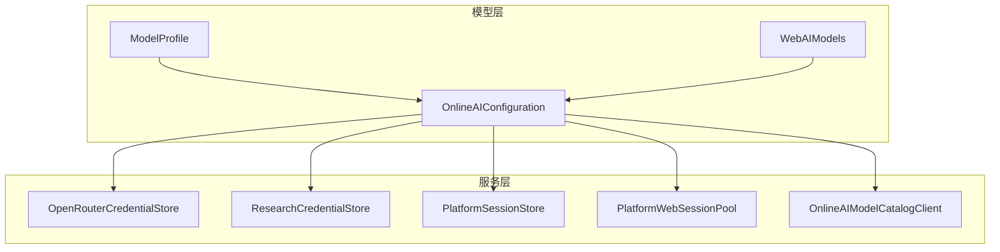
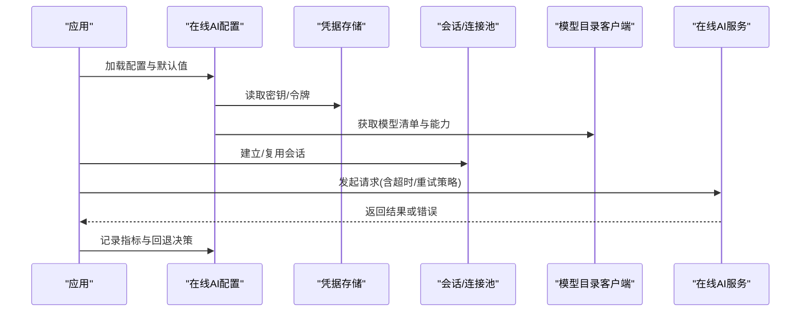
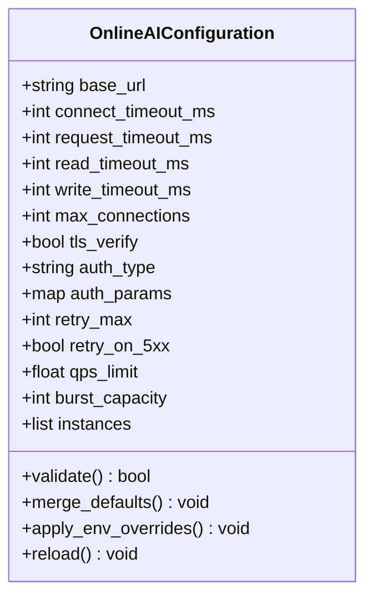
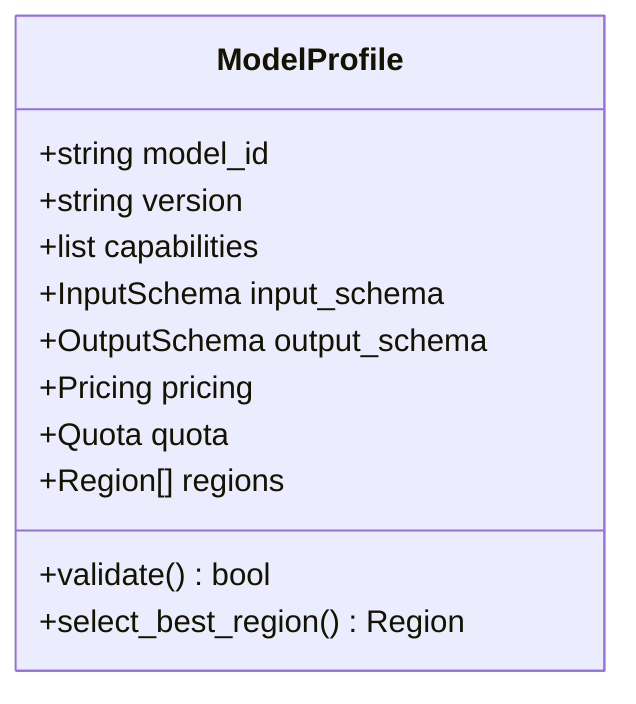
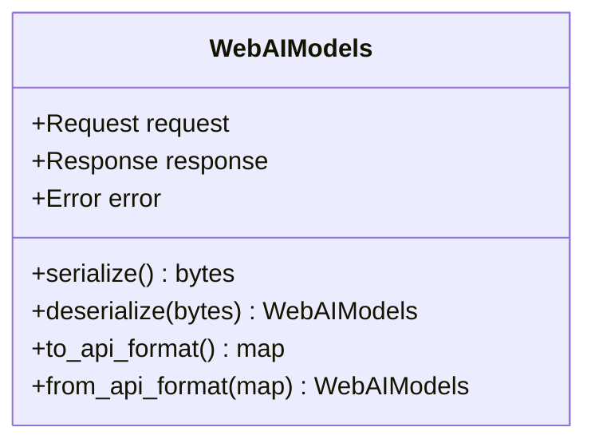
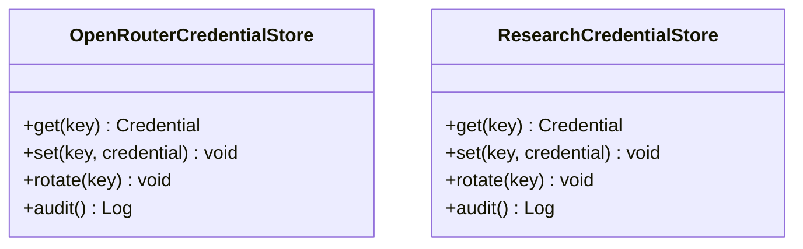
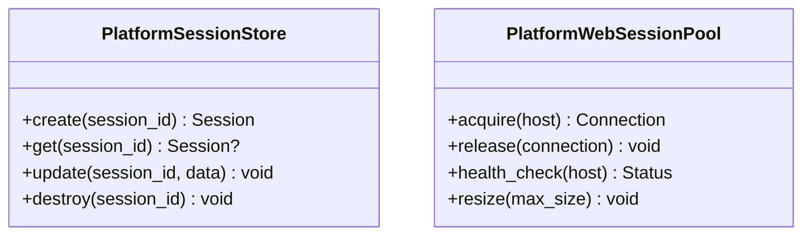
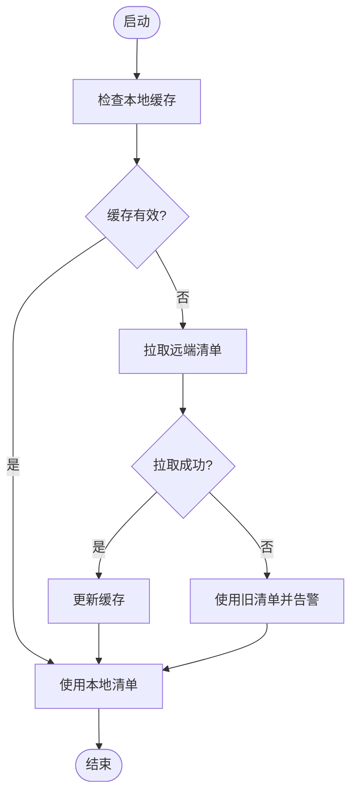
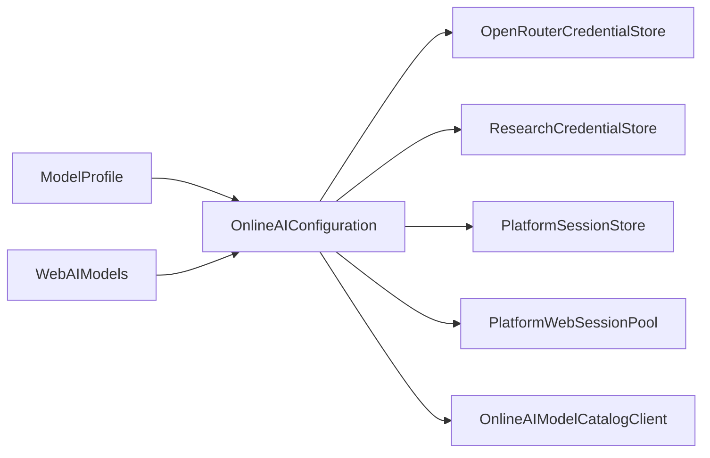

# AI服务配置

<cite>
**本文档引用的文件**
- [OnlineAIConfiguration.swift](file://Sources/ChengGao/Models/OnlineAIConfiguration.swift)
- [ModelProfile.swift](file://Sources/ChengGao/Models/ModelProfile.swift)
- [WebAIModels.swift](file://Sources/ChengGao/Models/WebAIModels.swift)
- [OpenRouterCredentialStore.swift](file://Sources/ChengGao/Services/OpenRouterCredentialStore.swift)
- [ResearchCredentialStore.swift](file://Sources/ChengGao/Services/ResearchCredentialStore.swift)
- [PlatformSessionStore.swift](file://Sources/ChengGao/Services/PlatformSessionStore.swift)
- [PlatformWebSessionPool.swift](file://Sources/ChengGao/Services/PlatformWebSessionPool.swift)
- [OnlineAIModelCatalogClient.swift](file://Sources/ChengGao/Services/OnlineAIModel目录客户端.swift)
</cite>

## 目录
1. [简介](#简介)
2. [项目结构](#项目结构)
3. [核心组件](#核心组件)
4. [架构总览](#架构总览)
5. [详细组件分析](#详细组件分析)
6. [依赖关系分析](#依赖关系分析)
7. [性能考虑](#性能考虑)
8. [故障排查指南](#故障排查指南)
9. [结论](#结论)
10. [附录](#附录)

## 简介
本文件面向在线AI服务的配置与集成，围绕配置模型、参数设置、连接选项、API端点、认证方式、超时策略、验证规则、默认值管理、环境适配、多服务配置、负载均衡与故障转移、配置模板与环境变量支持、动态更新机制以及测试调试与性能调优最佳实践进行系统化说明。目标是帮助开发者快速、安全、稳定地接入并运维多个在线AI服务。

## 项目结构
本项目采用Swift模块化组织，AI服务相关配置与运行时能力主要分布在以下位置：
- 配置与数据模型：Models/OnlineAIConfiguration.swift、Models/ModelProfile.swift、Models/WebAIModels.swift
- 凭据与会话存储：Services/OpenRouterCredentialStore.swift、Services/ResearchCredentialStore.swift、Services/PlatformSessionStore.swift、Services/PlatformWebSessionPool.swift
- 在线模型目录与发现：Services/OnlineAIModelCatalogClient.swift

图表来源
- [OnlineAIConfiguration.swift](file://Sources/ChengGao/Models/OnlineAIConfiguration.swift)
- [ModelProfile.swift](file://Sources/ChengGao/Models/ModelProfile.swift)
- [WebAIModels.swift](file://Sources/ChengGao/Models/WebAIModels.swift)
- [OpenRouterCredentialStore.swift](file://Sources/ChengGao/Services/OpenRouterCredentialStore.swift)
- [ResearchCredentialStore.swift](file://Sources/ChengGao/Services/ResearchCredentialStore.swift)
- [PlatformSessionStore.swift](file://Sources/ChengGao/Services/PlatformSessionStore.swift)
- [PlatformWebSessionPool.swift](file://Sources/ChengGao/Services/PlatformWebSessionPool.swift)
- [OnlineAIModelCatalogClient.swift](file://Sources/ChengGao/Services/OnlineAIModel目录客户端.swift)

章节来源
- [OnlineAIConfiguration.swift](file://Sources/ChengGao/Models/OnlineAIConfiguration.swift)
- [ModelProfile.swift](file://Sources/ChengGao/Models/ModelProfile.swift)
- [WebAIModels.swift](file://Sources/ChengGao/Models/WebAIModels.swift)
- [OpenRouterCredentialStore.swift](file://Sources/ChengGao/Services/OpenRouterCredentialStore.swift)
- [ResearchCredentialStore.swift](file://Sources/ChengGao/Services/ResearchCredentialStore.swift)
- [PlatformSessionStore.swift](file://Sources/ChengGao/Services/PlatformSessionStore.swift)
- [PlatformWebSessionPool.swift](file://Sources/ChengGao/Services/PlatformWebSessionPool.swift)
- [OnlineAIModelCatalogClient.swift](file://Sources/ChengGao/Services/OnlineAIModel目录客户端.swift)

## 核心组件
- 在线AI配置模型（OnlineAIConfiguration）：集中定义在线AI服务的连接、认证、超时、重试、限流、路由与多实例等关键配置项，提供校验与默认值合并逻辑。
- 模型档案（ModelProfile）：描述具体模型的能力、版本、输入输出约束、计费与配额信息，用于选择与编排。
- WebAI模型（WebAIModels）：封装Web侧AI交互所需的通用数据结构与协议抽象。
- 凭据存储（OpenRouterCredentialStore、ResearchCredentialStore）：负责密钥、令牌、会话Cookie等敏感信息的加密存储与访问控制。
- 会话管理与池化（PlatformSessionStore、PlatformWebSessionPool）：维护HTTP会话、连接复用、并发限制与资源回收。
- 在线模型目录客户端（OnlineAIModelCatalogClient）：拉取远端模型清单、能力元数据与可用性状态，支撑动态发现与切换。

章节来源
- [OnlineAIConfiguration.swift](file://Sources/ChengGao/Models/OnlineAIConfiguration.swift)
- [ModelProfile.swift](file://Sources/ChengGao/Models/ModelProfile.swift)
- [WebAIModels.swift](file://Sources/ChengGao/Models/WebAIModels.swift)
- [OpenRouterCredentialStore.swift](file://Sources/ChengGao/Services/OpenRouterCredentialStore.swift)
- [ResearchCredentialStore.swift](file://Sources/ChengGao/Services/ResearchCredentialStore.swift)
- [PlatformSessionStore.swift](file://Sources/ChengGao/Services/PlatformSessionStore.swift)
- [PlatformWebSessionPool.swift](file://Sources/ChengGao/Services/PlatformWebSessionPool.swift)
- [OnlineAIModelCatalogClient.swift](file://Sources/ChengGao/Services/OnlineAIModel目录客户端.swift)

## 架构总览
在线AI服务调用链路从配置加载开始，经过凭据解析、会话建立、请求发送、响应处理与错误恢复，最终返回结果或失败原因。

图表来源
- [OnlineAIConfiguration.swift](file://Sources/ChengGao/Models/OnlineAIConfiguration.swift)
- [OpenRouterCredentialStore.swift](file://Sources/ChengGao/Services/OpenRouterCredentialStore.swift)
- [ResearchCredentialStore.swift](file://Sources/ChengGao/Services/ResearchCredentialStore.swift)
- [PlatformSessionStore.swift](file://Sources/ChengGao/Services/PlatformSessionStore.swift)
- [PlatformWebSessionPool.swift](file://Sources/ChengGao/Services/PlatformWebSessionPool.swift)
- [OnlineAIModelCatalogClient.swift](file://Sources/ChengGao/Services/OnlineAIModel目录客户端.swift)

## 详细组件分析

### 在线AI配置模型（OnlineAIConfiguration）
- 职责：统一承载各在线AI服务的连接地址、认证方式、超时、重试、限流、路由与多实例配置；提供校验、默认值合并与环境变量注入。
- 关键要点：
  - 连接选项：基础URL、代理、TLS版本、证书校验开关、连接池大小、最大空闲时间。
  - 认证方式：Bearer Token、API Key、Cookie/JWT、OAuth2流程参数、签名算法。
  - 超时与重试：请求超时、连接超时、读/写超时、重试次数、指数退避、幂等性判断。
  - 限流与配额：QPS/QPM限制、突发容量、令牌桶/漏桶策略、配额告警阈值。
  - 路由与多实例：按模型/租户/地域分片、权重轮询、一致性哈希、健康检查与摘流。
  - 验证与默认值：必填字段校验、格式校验、范围校验、默认值覆盖、环境变量优先级。
  - 动态更新：热重载、增量刷新、变更通知、回滚策略。

图表来源
- [OnlineAIConfiguration.swift](file://Sources/ChengGao/Models/OnlineAIConfiguration.swift)

章节来源
- [OnlineAIConfiguration.swift](file://Sources/ChengGao/Models/OnlineAIConfiguration.swift)

### 模型档案（ModelProfile）
- 职责：描述模型能力、输入输出约束、版本与兼容性、计费与配额、可用区域与延迟特征。
- 关键要点：
  - 能力标签：文本生成、图像生成、语音转写、多模态等。
  - 输入输出：最大token数、分辨率、采样率、编码格式。
  - 版本与兼容：语义版本、向后兼容矩阵、弃用策略。
  - 计费与配额：单价、日限额、突发上限、超额降级策略。
  - 地域与延迟：数据中心分布、就近路由、跨域合规。

图表来源
- [ModelProfile.swift](file://Sources/ChengGao/Models/ModelProfile.swift)

章节来源
- [ModelProfile.swift](file://Sources/ChengGao/Models/ModelProfile.swift)

### WebAI模型（WebAIModels）
- 职责：抽象Web侧AI交互的通用数据结构与协议，便于统一序列化、反序列化和错误映射。
- 关键要点：
  - 请求体：消息列表、系统提示、工具调用、参数约束。
  - 响应体：内容片段、引用来源、使用量统计、错误码与诊断信息。
  - 错误映射：网络错误、鉴权失败、限流、模型不可用、内容过滤。

图表来源
- [WebAIModels.swift](file://Sources/ChengGao/Models/WebAIModels.swift)

章节来源
- [WebAIModels.swift](file://Sources/ChengGao/Models/WebAIModels.swift)

### 凭据存储（OpenRouterCredentialStore、ResearchCredentialStore）
- 职责：安全存取各类凭据（API Key、Token、Cookie、私钥），支持加密、轮换与最小权限访问。
- 关键要点：
  - 存储后端：Keychain/安全存储、本地加密文件、远程密钥管理服务。
  - 生命周期：创建、更新、过期检测、自动轮换。
  - 访问控制：作用域隔离、审计日志、越权拦截。

图表来源
- [OpenRouterCredentialStore.swift](file://Sources/ChengGao/Services/OpenRouterCredentialStore.swift)
- [ResearchCredentialStore.swift](file://Sources/ChengGao/Services/ResearchCredentialStore.swift)

章节来源
- [OpenRouterCredentialStore.swift](file://Sources/ChengGao/Services/OpenRouterCredentialStore.swift)
- [ResearchCredentialStore.swift](file://Sources/ChengGao/Services/ResearchCredentialStore.swift)

### 会话管理与池化（PlatformSessionStore、PlatformWebSessionPool）
- 职责：管理HTTP会话、连接复用、并发限制、超时与回收，提升吞吐与稳定性。
- 关键要点：
  - 会话缓存：按域名/租户隔离、Cookie/JWT持久化。
  - 连接池：最大连接数、空闲回收、长连接保活。
  - 并发控制：信号量、队列背压、取消传播。
  - 健康检查：探针、熔断、快速失败。

图表来源
- [PlatformSessionStore.swift](file://Sources/ChengGao/Services/PlatformSessionStore.swift)
- [PlatformWebSessionPool.swift](file://Sources/ChengGao/Services/PlatformWebSessionPool.swift)

章节来源
- [PlatformSessionStore.swift](file://Sources/ChengGao/Services/PlatformSessionStore.swift)
- [PlatformWebSessionPool.swift](file://Sources/ChengGao/Services/PlatformWebSessionPool.swift)

### 在线模型目录客户端（OnlineAIModelCatalogClient）
- 职责：拉取远端模型清单、能力元数据与可用性状态，支撑动态发现与切换。
- 关键要点：
  - 缓存策略：本地缓存、ETag/Last-Modified、增量更新。
  - 容错策略：降级到本地清单、重试与退避、告警上报。
  - 数据模型：模型ID、版本、能力、区域、延迟、价格。

图表来源
- [OnlineAIModelCatalogClient.swift](file://Sources/ChengGao/Services/OnlineAIModel目录客户端.swift)

章节来源
- [OnlineAIModelCatalogClient.swift](file://Sources/ChengGao/Services/OnlineAIModel目录客户端.swift)

## 依赖关系分析
- 配置层依赖凭据与会话组件，确保连接前完成鉴权与会话准备。
- 模型目录客户端为配置层提供动态能力与可用性信息，驱动路由与切换。
- 会话池与连接池为所有在线调用提供稳定的传输层保障。

图表来源
- [OnlineAIConfiguration.swift](file://Sources/ChengGao/Models/OnlineAIConfiguration.swift)
- [ModelProfile.swift](file://Sources/ChengGao/Models/ModelProfile.swift)
- [WebAIModels.swift](file://Sources/ChengGao/Models/WebAIModels.swift)
- [OpenRouterCredentialStore.swift](file://Sources/ChengGao/Services/OpenRouterCredentialStore.swift)
- [ResearchCredentialStore.swift](file://Sources/ChengGao/Services/ResearchCredentialStore.swift)
- [PlatformSessionStore.swift](file://Sources/ChengGao/Services/PlatformSessionStore.swift)
- [PlatformWebSessionPool.swift](file://Sources/ChengGao/Services/PlatformWebSessionPool.swift)
- [OnlineAIModelCatalogClient.swift](file://Sources/ChengGao/Services/OnlineAIModel目录客户端.swift)

章节来源
- [OnlineAIConfiguration.swift](file://Sources/ChengGao/Models/OnlineAIConfiguration.swift)
- [ModelProfile.swift](file://Sources/ChengGao/Models/ModelProfile.swift)
- [WebAIModels.swift](file://Sources/ChengGao/Models/WebAIModels.swift)
- [OpenRouterCredentialStore.swift](file://Sources/ChengGao/Services/OpenRouterCredentialStore.swift)
- [ResearchCredentialStore.swift](file://Sources/ChengGao/Services/ResearchCredentialStore.swift)
- [PlatformSessionStore.swift](file://Sources/ChengGao/Services/PlatformSessionStore.swift)
- [PlatformWebSessionPool.swift](file://Sources/ChengGao/Services/PlatformWebSessionPool.swift)
- [OnlineAIModelCatalogClient.swift](file://Sources/ChengGao/Services/OnlineAIModel目录客户端.swift)

## 性能考虑
- 连接与并发
  - 合理设置连接池大小与最大空闲时间，避免过多连接导致内存压力。
  - 启用长连接与Keep-Alive，减少握手开销。
  - 使用异步I/O与取消传播，避免阻塞线程。
- 超时与重试
  - 区分连接超时、读超时、写超时，按服务SLA设定合理阈值。
  - 对幂等请求启用指数退避重试，非幂等请求谨慎重试。
- 限流与配额
  - 基于令牌桶/漏桶实现平滑限流，防止突发打满上游。
  - 监控配额使用率，接近阈值时触发降级或扩容。
- 缓存与发现
  - 模型清单与能力元数据本地缓存，降低远端依赖。
  - 使用ETag/Last-Modified减少带宽与CPU消耗。
- 观测与调优
  - 采集延迟分位、错误率、吞吐、连接利用率等指标。
  - 结合业务峰值与上游容量，动态调整并发与超时。

[本节为通用指导，不直接分析具体文件]

## 故障排查指南
- 常见问题定位
  - 认证失败：检查密钥有效期、作用域、签名算法与网络可达性。
  - 超时与重试：确认超时阈值是否过小、重试是否造成雪崩。
  - 限流与配额：查看上游限流响应码与配额告警。
  - 模型不可用：核对模型清单、区域与健康状态。
- 调试建议
  - 开启请求/响应日志（脱敏），记录错误码与诊断信息。
  - 使用独立测试账号与沙箱环境，隔离生产影响。
  - 逐步缩小问题范围：先连通性，再鉴权，后业务逻辑。
- 恢复策略
  - 快速回退到备用服务或降级模型。
  - 熔断与隔离异常实例，避免级联故障。
  - 告警与自愈：自动化重启、扩容与流量切换。

章节来源
- [OpenRouterCredentialStore.swift](file://Sources/ChengGao/Services/OpenRouterCredentialStore.swift)
- [ResearchCredentialStore.swift](file://Sources/ChengGao/Services/ResearchCredentialStore.swift)
- [PlatformWebSessionPool.swift](file://Sources/ChengGao/Services/PlatformWebSessionPool.swift)
- [OnlineAIModelCatalogClient.swift](file://Sources/ChengGao/Services/OnlineAIModel目录客户端.swift)

## 结论
通过统一的配置模型、严格的验证与默认值管理、健壮的凭据与会话管理、动态模型发现与路由，以及完善的观测与恢复策略，可构建高可用、可扩展且易运维的在线AI服务集成方案。建议在开发阶段即引入配置测试与性能基准，持续优化以匹配业务需求与上游SLA。

[本节为总结性内容，不直接分析具体文件]

## 附录

### 配置模板与环境变量支持
- 配置模板
  - 提供基础模板与按服务/环境的扩展模板，包含连接、认证、超时、重试、限流、路由与多实例等键。
  - 模板继承与覆盖：基础模板 -> 环境模板 -> 实例模板 -> 运行时覆盖。
- 环境变量
  - 支持通过环境变量注入或覆盖配置项，优先级高于配置文件。
  - 命名规范：服务名前缀+键名，如 OR_BASE_URL、OR_AUTH_TOKEN。
  - 类型转换与校验：字符串、布尔、整数、数组、对象等类型的自动转换与校验。
- 动态更新
  - 支持热重载配置，监听文件或外部配置中心变更。
  - 变更生效策略：立即生效、滚动生效、灰度生效与回滚。

[本节为概念性说明，不直接分析具体文件]

### 多服务配置、负载均衡与故障转移
- 多服务配置
  - 每个服务独立配置块，包含基础URL、认证、超时、限流与实例列表。
  - 共享配置抽取：公共超时、重试、TLS、代理等。
- 负载均衡
  - 策略：轮询、加权轮询、一致性哈希、最少连接、延迟感知。
  - 健康检查：探针间隔、失败阈值、恢复阈值。
- 故障转移
  - 主备切换、同域内多副本、跨域多区域。
  - 快速失败与熔断，避免放大错误。

[本节为概念性说明，不直接分析具体文件]

### 配置验证规则与默认值管理
- 验证规则
  - 必填校验、格式校验（URL、邮箱、正则）、范围校验（超时、并发、配额）。
  - 组合校验：认证方式与参数一致性、实例间唯一性。
- 默认值管理
  - 分层默认值：框架默认 -> 模板默认 -> 环境默认 -> 运行时覆盖。
  - 默认值变更需记录审计日志与版本迁移。

[本节为概念性说明，不直接分析具体文件]

### 配置测试、调试与性能调优最佳实践
- 测试
  - 单元测试：配置解析、校验、默认值合并、环境变量注入。
  - 集成测试：端到端连通性、认证、限流、超时与重试。
  - 混沌工程：模拟上游故障、网络抖动、证书过期。
- 调试
  - 结构化日志、请求追踪、指标埋点。
  - 本地Mock与回放，加速问题定位。
- 性能调优
  - 基线测试：不同并发、超时、连接池大小的吞吐与延迟。
  - 容量规划：根据峰值与SLA确定资源上限与弹性策略。

[本节为概念性说明，不直接分析具体文件]