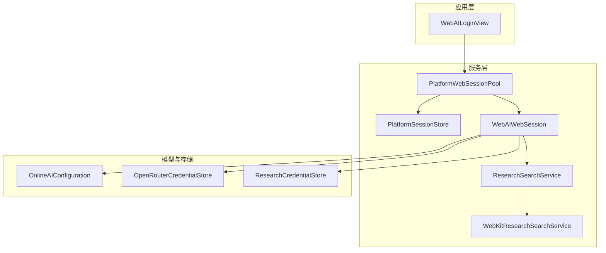
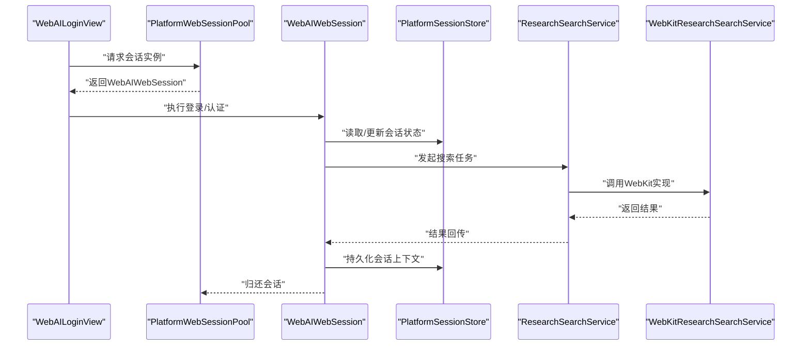
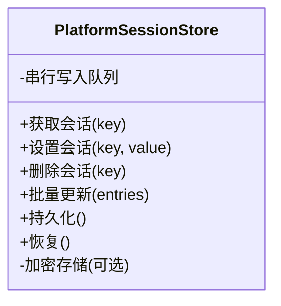
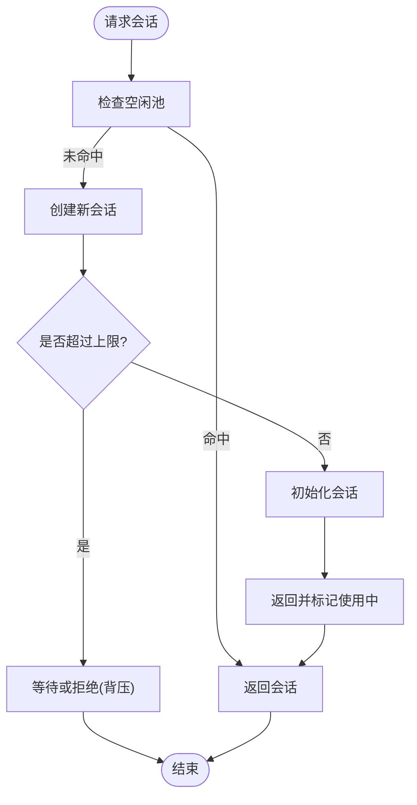
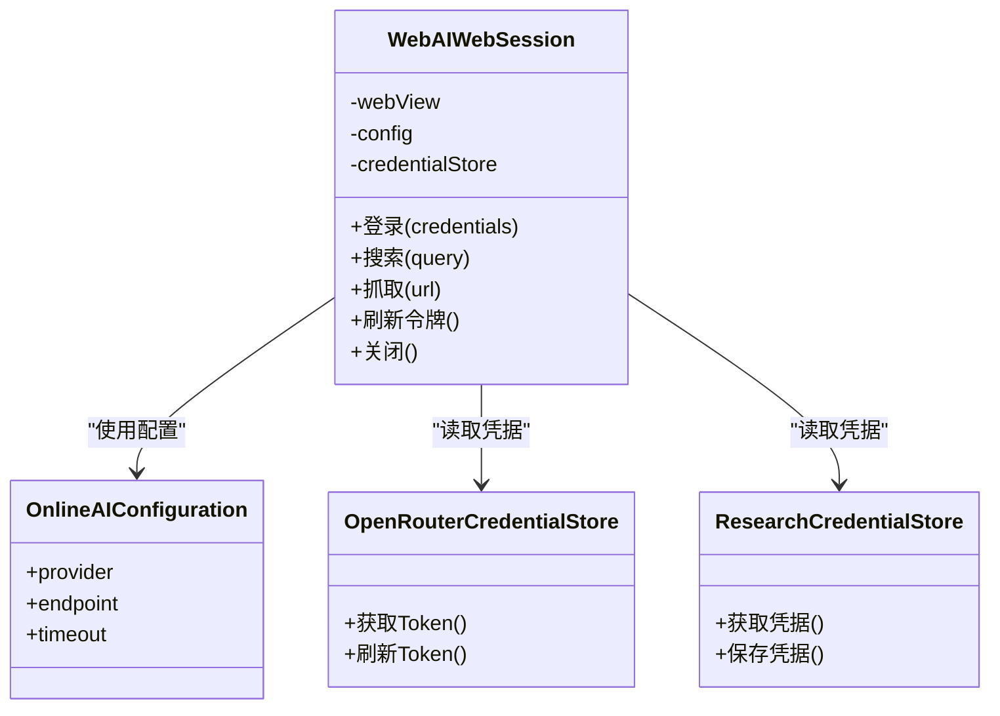
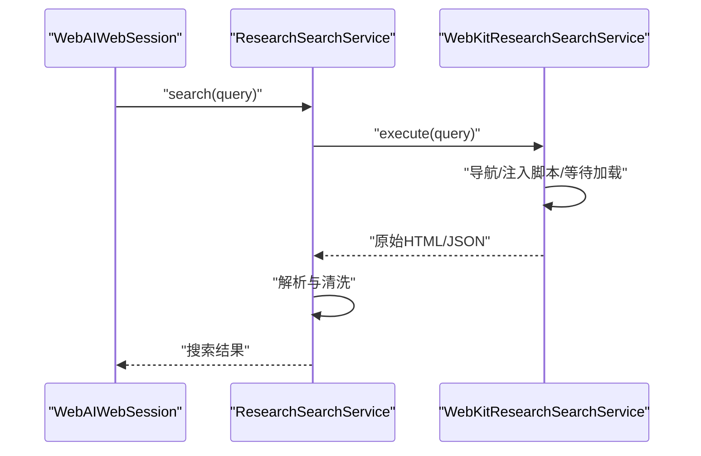
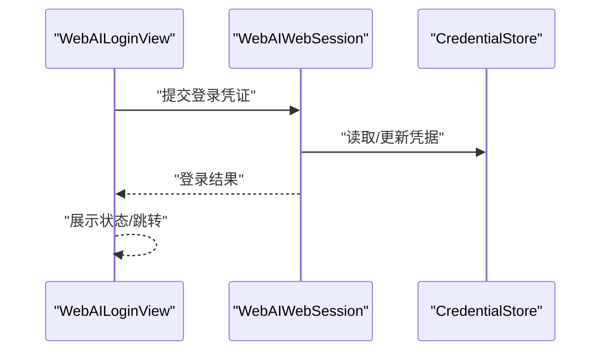
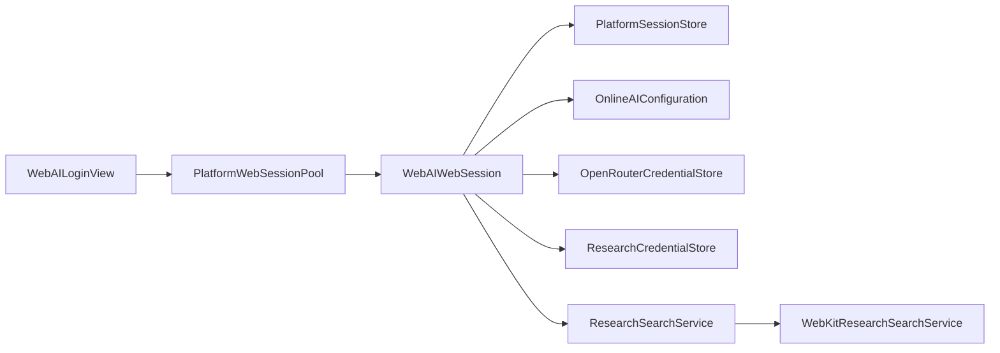

# 会话管理

<cite>
**本文引用的文件**   
- [PlatformSessionStore.swift](file://Sources/ChengGao/Services/PlatformSessionStore.swift)
- [PlatformWebSessionPool.swift](file://Sources/ChengGao/Services/PlatformWebSessionPool.swift)
- [WebAIWebSession.swift](file://Sources/ChengGao/Services/WebAIWebSession.swift)
- [WebAILoginView.swift](file://Sources/ChengGao/Views/WebAILoginView.swift)
- [ResearchSearchService.swift](file://Sources/ChengGao/Services/ResearchSearchService.swift)
- [WebKitResearchSearchService.swift](file://Sources/ChengGao/Services/WebKitResearchSearchService.swift)
- [OnlineAIConfiguration.swift](file://Sources/ChengGao/Models/OnlineAIConfiguration.swift)
- [OpenRouterCredentialStore.swift](file://Sources/ChengGao/Services/OpenRouterCredentialStore.swift)
- [ResearchCredentialStore.swift](file://Sources/ChengGao/Services/ResearchCredentialStore.swift)
- [Package.swift](file://Package.swift)
</cite>

## 目录
1. [简介](#简介)
2. [项目结构](#项目结构)
3. [核心组件](#核心组件)
4. [架构总览](#架构总览)
5. [详细组件分析](#详细组件分析)
6. [依赖关系分析](#依赖关系分析)
7. [性能考虑](#性能考虑)
8. [故障排除指南](#故障排除指南)
9. [结论](#结论)
10. [附录](#附录)

## 简介
本文件面向“平台会话存储、Web会话池与Web AI会话”的会话管理系统，系统性说明其架构设计、生命周期管理、状态同步与持久化策略，以及并发控制、资源分配、内存管理、认证授权与安全验证机制。同时提供监控与调试建议、性能优化方法、使用示例与常见问题排查路径，帮助开发者快速理解并高效使用该子系统。

## 项目结构
与会话管理相关的代码主要位于 Services 层（平台会话存储、Web会话池、Web AI会话）与部分 Models/Stores 层（配置与凭据），以及 Views 层的登录交互入口。整体采用分层组织：
- Services：实现会话存储、会话池、Web AI会话封装及搜索服务集成
- Models：承载在线AI配置等数据模型
- Stores：凭据存储（如研究凭据、OpenRouter凭据）
- Views：用户交互（如Web AI登录视图）

图表来源
- [WebAILoginView.swift](file://Sources/ChengGao/Views/WebAILoginView.swift)
- [PlatformWebSessionPool.swift](file://Sources/ChengGao/Services/PlatformWebSessionPool.swift)
- [WebAIWebSession.swift](file://Sources/ChengGao/Services/WebAIWebSession.swift)
- [ResearchSearchService.swift](file://Sources/ChengGao/Services/ResearchSearchService.swift)
- [WebKitResearchSearchService.swift](file://Sources/ChengGao/Services/WebKitResearchSearchService.swift)
- [OnlineAIConfiguration.swift](file://Sources/ChengGao/Models/OnlineAIConfiguration.swift)
- [OpenRouterCredentialStore.swift](file://Sources/ChengGao/Services/OpenRouterCredentialStore.swift)
- [ResearchCredentialStore.swift](file://Sources/ChengGao/Services/ResearchCredentialStore.swift)

章节来源
- [Package.swift](file://Package.swift)

## 核心组件
- 平台会话存储（PlatformSessionStore）：负责跨模块共享的会话上下文与持久化，提供统一的存取接口，确保会话在进程内外的稳定性。
- Web会话池（PlatformWebSessionPool）：维护一组可复用的Web会话实例，支持并发获取与归还、超时回收、容量限制与背压策略。
- Web AI会话（WebAIWebSession）：封装浏览器内核或WebView能力，执行网页级操作（如登录、搜索、抓取），并与上层服务解耦。
- 搜索服务（ResearchSearchService / WebKitResearchSearchService）：抽象搜索行为，底层由WebKit驱动的具体实现完成页面交互与结果提取。
- 配置与凭据（OnlineAIConfiguration / OpenRouterCredentialStore / ResearchCredentialStore）：集中管理在线AI相关配置与敏感凭据，保障安全访问。

章节来源
- [PlatformSessionStore.swift](file://Sources/ChengGao/Services/PlatformSessionStore.swift)
- [PlatformWebSessionPool.swift](file://Sources/ChengGao/Services/PlatformWebSessionPool.swift)
- [WebAIWebSession.swift](file://Sources/ChengGao/Services/WebAIWebSession.swift)
- [ResearchSearchService.swift](file://Sources/ChengGao/Services/ResearchSearchService.swift)
- [WebKitResearchSearchService.swift](file://Sources/ChengGao/Services/WebKitResearchSearchService.swift)
- [OnlineAIConfiguration.swift](file://Sources/ChengGao/Models/OnlineAIConfiguration.swift)
- [OpenRouterCredentialStore.swift](file://Sources/ChengGao/Services/OpenRouterCredentialStore.swift)
- [ResearchCredentialStore.swift](file://Sources/ChengGao/Services/ResearchCredentialStore.swift)

## 架构总览
会话管理以“存储-池-会话-服务”的分层模式组织，强调职责分离与可测试性。关键流程包括：
- 登录与认证：通过WebAILoginView触发，调用WebAIWebSession进行网页登录，凭据由CredentialStore管理。
- 会话获取与复用：上层通过PlatformWebSessionPool获取WebAIWebSession实例，池内部进行并发控制与资源回收。
- 业务调用：WebAIWebSession委托ResearchSearchService执行具体任务，底层由WebKitResearchSearchService驱动。
- 状态同步与持久化：PlatformSessionStore统一维护会话状态，并在必要时落盘持久化。

图表来源
- [WebAILoginView.swift](file://Sources/ChengGao/Views/WebAILoginView.swift)
- [PlatformWebSessionPool.swift](file://Sources/ChengGao/Services/PlatformWebSessionPool.swift)
- [WebAIWebSession.swift](file://Sources/ChengGao/Services/WebAIWebSession.swift)
- [PlatformSessionStore.swift](file://Sources/ChengGao/Services/PlatformSessionStore.swift)
- [ResearchSearchService.swift](file://Sources/ChengGao/Services/ResearchSearchService.swift)
- [WebKitResearchSearchService.swift](file://Sources/ChengGao/Services/WebKitResearchSearchService.swift)

## 详细组件分析

### 平台会话存储（PlatformSessionStore）
- 职责：统一管理会话上下文、令牌、Cookie、用户态信息；提供线程安全的读写接口；支持序列化持久化到本地存储。
- 并发控制：内部使用串行队列或锁保护临界区，避免竞态条件；对外暴露异步API，便于上层非阻塞调用。
- 持久化策略：增量更新与快照结合，减少IO开销；失败时回滚至上一稳定版本。
- 错误处理：区分网络异常、权限不足、磁盘不可用等场景，向上抛出明确错误类型。

图表来源
- [PlatformSessionStore.swift](file://Sources/ChengGao/Services/PlatformSessionStore.swift)

章节来源
- [PlatformSessionStore.swift](file://Sources/ChengGao/Services/PlatformSessionStore.swift)

### Web会话池（PlatformWebSessionPool）
- 职责：维护WebAIWebSession实例集合，提供获取/归还、创建/销毁、健康检查与回收。
- 并发控制：基于信号量或互斥锁限制最大并发；空闲会话缓存，命中则直接复用，未命中则按需创建。
- 资源分配：按负载动态扩容，设置上限防止内存暴涨；支持优先级队列，保证关键任务优先。
- 内存管理：弱引用持有活跃会话，定期扫描释放长时间未使用的实例；监听系统内存警告主动收缩。
- 生命周期：会话创建后进入可用状态，使用后标记为待回收，经健康检查后决定销毁或复用。

图表来源
- [PlatformWebSessionPool.swift](file://Sources/ChengGao/Services/PlatformWebSessionPool.swift)

章节来源
- [PlatformWebSessionPool.swift](file://Sources/ChengGao/Services/PlatformWebSessionPool.swift)

### Web AI会话（WebAIWebSession）
- 职责：封装WebView/WebKit能力，执行网页级操作（登录、搜索、抓取、解析）。
- 认证与授权：从CredentialStore加载凭据，注入到页面环境；支持多提供商（如OpenRouter）的配置切换。
- 状态同步：与PlatformSessionStore保持会话状态一致，自动刷新过期令牌。
- 错误处理：捕获网络错误、页面异常、脚本错误，转换为统一错误码并上报。
- 资源清理：任务完成后清理DOM缓存、移除事件监听，避免内存泄漏。

图表来源
- [WebAIWebSession.swift](file://Sources/ChengGao/Services/WebAIWebSession.swift)
- [OnlineAIConfiguration.swift](file://Sources/ChengGao/Models/OnlineAIConfiguration.swift)
- [OpenRouterCredentialStore.swift](file://Sources/ChengGao/Services/OpenRouterCredentialStore.swift)
- [ResearchCredentialStore.swift](file://Sources/ChengGao/Services/ResearchCredentialStore.swift)

章节来源
- [WebAIWebSession.swift](file://Sources/ChengGao/Services/WebAIWebSession.swift)
- [OnlineAIConfiguration.swift](file://Sources/ChengGao/Models/OnlineAIConfiguration.swift)
- [OpenRouterCredentialStore.swift](file://Sources/ChengGao/Services/OpenRouterCredentialStore.swift)
- [ResearchCredentialStore.swift](file://Sources/ChengGao/Services/ResearchCredentialStore.swift)

### 搜索服务（ResearchSearchService / WebKitResearchSearchService）
- 职责：抽象搜索接口，屏蔽底层实现差异；WebKitResearchSearchService负责具体页面交互与结果提取。
- 数据流：接收查询参数，构造请求，驱动WebKit执行导航与脚本，解析响应并返回结构化数据。
- 错误处理：区分网络超时、页面加载失败、选择器匹配失败等错误，提供重试与降级策略。

图表来源
- [ResearchSearchService.swift](file://Sources/ChengGao/Services/ResearchSearchService.swift)
- [WebKitResearchSearchService.swift](file://Sources/ChengGao/Services/WebKitResearchSearchService.swift)

章节来源
- [ResearchSearchService.swift](file://Sources/ChengGao/Services/ResearchSearchService.swift)
- [WebKitResearchSearchService.swift](file://Sources/ChengGao/Services/WebKitResearchSearchService.swift)

### 登录与认证（WebAILoginView）
- 职责：提供用户界面输入账号密码或选择第三方登录，调用WebAIWebSession完成认证流程。
- 安全验证：对输入进行校验，敏感信息不落盘；认证成功后将令牌存入CredentialStore。
- 状态反馈：显示登录进度、错误提示，支持重试与取消。

图表来源
- [WebAILoginView.swift](file://Sources/ChengGao/Views/WebAILoginView.swift)
- [WebAIWebSession.swift](file://Sources/ChengGao/Services/WebAIWebSession.swift)
- [OpenRouterCredentialStore.swift](file://Sources/ChengGao/Services/OpenRouterCredentialStore.swift)
- [ResearchCredentialStore.swift](file://Sources/ChengGao/Services/ResearchCredentialStore.swift)

章节来源
- [WebAILoginView.swift](file://Sources/ChengGao/Views/WebAILoginView.swift)
- [WebAIWebSession.swift](file://Sources/ChengGao/Services/WebAIWebSession.swift)
- [OpenRouterCredentialStore.swift](file://Sources/ChengGao/Services/OpenRouterCredentialStore.swift)
- [ResearchCredentialStore.swift](file://Sources/ChengGao/Services/ResearchCredentialStore.swift)

## 依赖关系分析
- 组件耦合：WebAIWebSession依赖配置与凭据存储；PlatformWebSessionPool依赖PlatformSessionStore；搜索服务依赖WebKit实现。
- 外部依赖：WebKit框架用于页面渲染与脚本执行；Keychain或安全存储用于凭据保护。
- 潜在循环依赖：通过接口抽象（如ResearchSearchService）避免直接耦合，降低循环风险。

图表来源
- [WebAILoginView.swift](file://Sources/ChengGao/Views/WebAILoginView.swift)
- [PlatformWebSessionPool.swift](file://Sources/ChengGao/Services/PlatformWebSessionPool.swift)
- [WebAIWebSession.swift](file://Sources/ChengGao/Services/WebAIWebSession.swift)
- [PlatformSessionStore.swift](file://Sources/ChengGao/Services/PlatformSessionStore.swift)
- [OnlineAIConfiguration.swift](file://Sources/ChengGao/Models/OnlineAIConfiguration.swift)
- [OpenRouterCredentialStore.swift](file://Sources/ChengGao/Services/OpenRouterCredentialStore.swift)
- [ResearchCredentialStore.swift](file://Sources/ChengGao/Services/ResearchCredentialStore.swift)
- [ResearchSearchService.swift](file://Sources/ChengGao/Services/ResearchSearchService.swift)
- [WebKitResearchSearchService.swift](file://Sources/ChengGao/Services/WebKitResearchSearchService.swift)

章节来源
- [Package.swift](file://Package.swift)

## 性能考虑
- 会话池调优：合理设置最大并发与空闲阈值，避免频繁创建销毁；启用连接复用与缓存。
- 内存管理：及时释放DOM与脚本对象，监听内存警告并主动回收；避免闭包强引用循环。
- IO优化：批量持久化与延迟写入，减少磁盘抖动；使用压缩与分片存储大对象。
- 网络优化：超时与重试策略，指数退避；缓存热点数据，减少重复请求。
- 监控指标：记录会话创建/销毁耗时、命中率、错误率、内存峰值、CPU占用。

[本节为通用指导，不直接分析具体文件]

## 故障排除指南
- 登录失败：检查凭据是否正确、网络连通性、页面验证码或反爬策略；查看CredentialStore日志。
- 会话丢失：确认PlatformSessionStore持久化是否成功，磁盘空间是否充足；检查序列化兼容性。
- 池耗尽：观察并发数是否超限，调整上限或增加回收频率；排查未归还会话的代码路径。
- 内存泄漏：使用Instruments检测 retained objects，定位未释放的WebView或闭包；确保事件监听已移除。
- 搜索异常：核对URL与选择器，处理页面结构变更；增加重试与降级逻辑。

章节来源
- [PlatformSessionStore.swift](file://Sources/ChengGao/Services/PlatformSessionStore.swift)
- [PlatformWebSessionPool.swift](file://Sources/ChengGao/Services/PlatformWebSessionPool.swift)
- [WebAIWebSession.swift](file://Sources/ChengGao/Services/WebAIWebSession.swift)
- [ResearchSearchService.swift](file://Sources/ChengGao/Services/ResearchSearchService.swift)
- [WebKitResearchSearchService.swift](file://Sources/ChengGao/Services/WebKitResearchSearchService.swift)
- [OpenRouterCredentialStore.swift](file://Sources/ChengGao/Services/OpenRouterCredentialStore.swift)
- [ResearchCredentialStore.swift](file://Sources/ChengGao/Services/ResearchCredentialStore.swift)

## 结论
本会话管理系统通过清晰的层次划分与职责分离，实现了高可用的平台会话存储、可扩展的Web会话池与灵活的Web AI会话封装。配合完善的认证授权、状态同步与持久化策略，能够在复杂网络与页面环境下稳定运行。通过合理的并发控制、资源管理与监控手段，可有效提升性能与可维护性。

[本节为总结，不直接分析具体文件]

## 附录
- 使用示例（步骤概述）
  - 初始化：加载配置与凭据，启动PlatformSessionStore。
  - 获取会话：从PlatformWebSessionPool获取WebAIWebSession。
  - 执行任务：调用WebAIWebSession进行登录、搜索等操作。
  - 归还会话：任务完成后归还至池，触发健康检查与回收。
  - 持久化：PlatformSessionStore定期保存会话状态。
- 最佳实践
  - 始终使用池获取会话，避免手动创建。
  - 对敏感数据使用安全存储，禁止明文落盘。
  - 为所有外部调用设置超时与重试。
  - 监控关键指标，建立告警与日志采集。

[本节为补充内容，不直接分析具体文件]