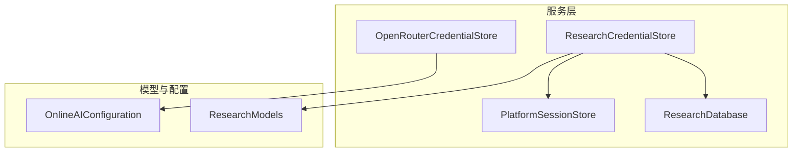
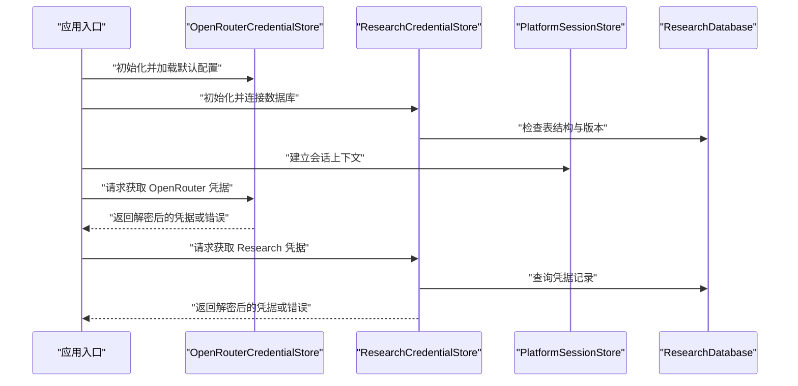
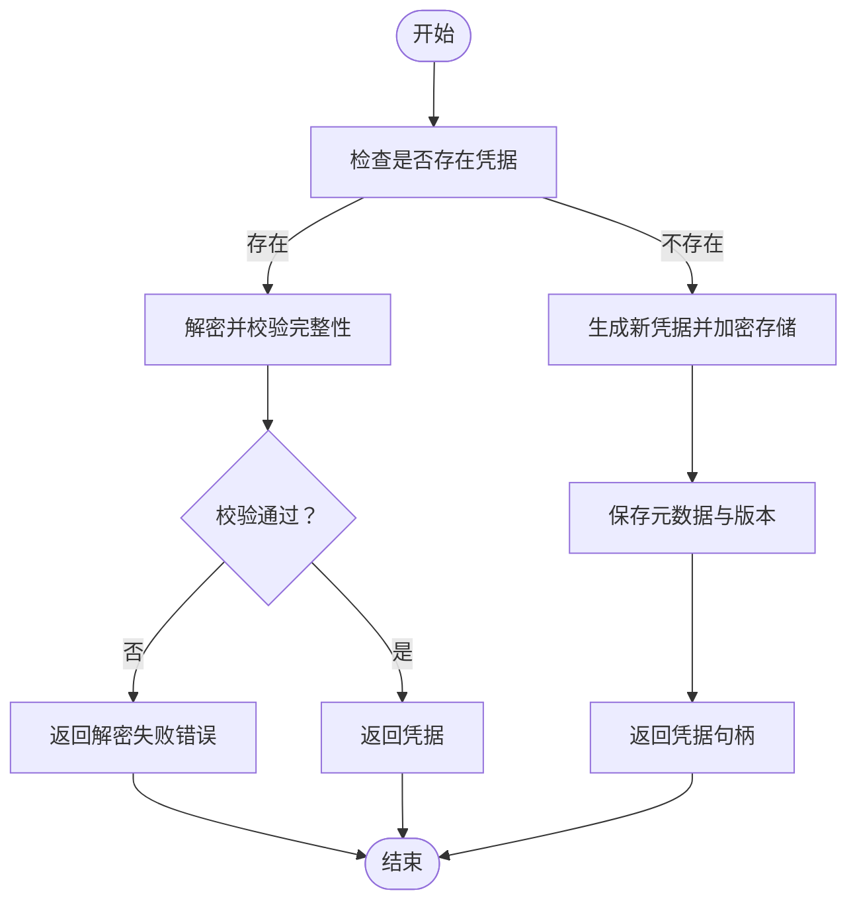
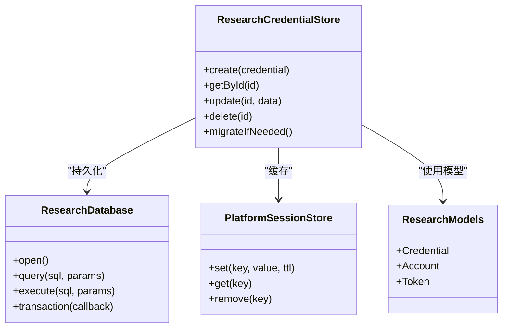
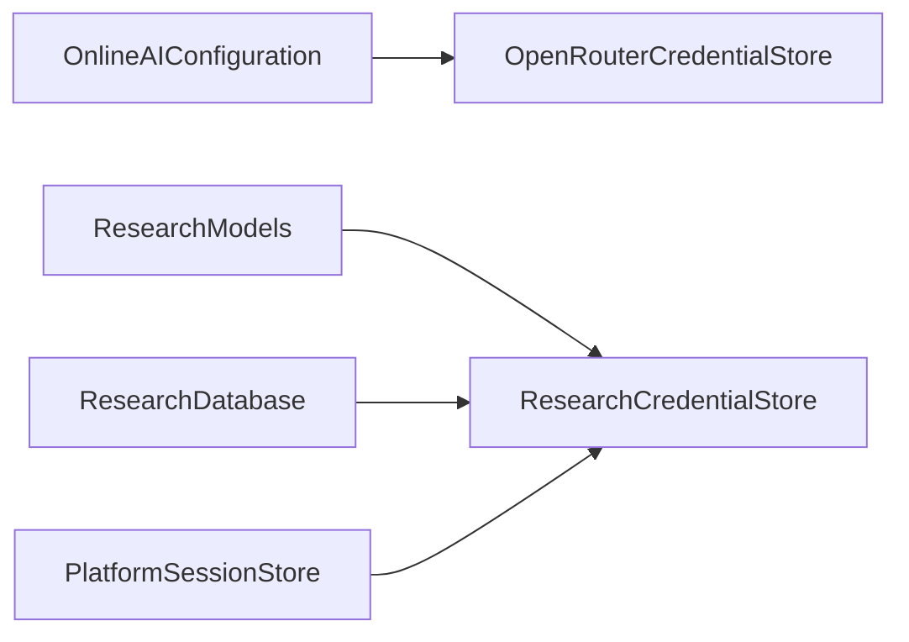

# 凭据存储系统

<cite>
**本文引用的文件**   
- [OpenRouterCredentialStore.swift](file://Sources/ChengGao/Services/OpenRouterCredentialStore.swift)
- [ResearchCredentialStore.swift](file://Sources/ChengGao/Services/ResearchCredentialStore.swift)
- [PlatformSessionStore.swift](file://Sources/ChengGao/Services/PlatformSessionStore.swift)
- [ResearchDatabase.swift](file://Sources/ChengGao/Services/ResearchDatabase.swift)
- [OnlineAIConfiguration.swift](file://Sources/ChengGao/Models/OnlineAIConfiguration.swift)
- [ResearchModels.swift](file://Sources/ChengGao/Models/ResearchModels.swift)
</cite>

## 目录
1. [简介](#简介)
2. [项目结构](#项目结构)
3. [核心组件](#核心组件)
4. [架构总览](#架构总览)
5. [详细组件分析](#详细组件分析)
6. [依赖关系分析](#依赖关系分析)
7. [性能考虑](#性能考虑)
8. [故障排查指南](#故障排查指南)
9. [结论](#结论)
10. [附录](#附录)

## 简介
本文件面向“凭据存储系统”，聚焦 OpenRouter 与 Research 两类凭据的生成、存储、检索、更新流程，以及加密策略与安全机制。文档同时覆盖密钥管理、访问控制、权限验证、凭据格式规范、默认值配置、错误处理策略，并给出迁移、备份恢复与安全审计的最佳实践和代码使用模式指引。

## 项目结构
凭据存储相关能力集中在 Services 层：
- OpenRouter 凭据存储：OpenRouterCredentialStore.swift
- Research 凭据存储：ResearchCredentialStore.swift
- 平台会话与持久化辅助：PlatformSessionStore.swift
- Research 数据持久化：ResearchDatabase.swift
- 模型与配置：OnlineAIConfiguration.swift、ResearchModels.swift

图表来源
- [OpenRouterCredentialStore.swift](file://Sources/ChengGao/Services/OpenRouterCredentialStore.swift)
- [ResearchCredentialStore.swift](file://Sources/ChengGao/Services/ResearchCredentialStore.swift)
- [PlatformSessionStore.swift](file://Sources/ChengGao/Services/PlatformSessionStore.swift)
- [ResearchDatabase.swift](file://Sources/ChengGao/Services/ResearchDatabase.swift)
- [OnlineAIConfiguration.swift](file://Sources/ChengGao/Models/OnlineAIConfiguration.swift)
- [ResearchModels.swift](file://Sources/ChengGao/Models/ResearchModels.swift)

章节来源
- [OpenRouterCredentialStore.swift](file://Sources/ChengGao/Services/OpenRouterCredentialStore.swift)
- [ResearchCredentialStore.swift](file://Sources/ChengGao/Services/ResearchCredentialStore.swift)
- [PlatformSessionStore.swift](file://Sources/ChengGao/Services/PlatformSessionStore.swift)
- [ResearchDatabase.swift](file://Sources/ChengGao/Services/ResearchDatabase.swift)
- [OnlineAIConfiguration.swift](file://Sources/ChengGao/Models/OnlineAIConfiguration.swift)
- [ResearchModels.swift](file://Sources/ChengGao/Models/ResearchModels.swift)

## 核心组件
- OpenRouter 凭据存储（OpenRouterCredentialStore）
  - 职责：封装 OpenRouter API Key 的生成、加密存储、读取与更新；提供安全校验与默认值策略。
  - 关键能力：本地安全存储、密钥派生、读写隔离、错误分类。
- Research 凭据存储（ResearchCredentialStore）
  - 职责：管理 Research 场景下的多类凭据（如账号、令牌、会话等），统一生命周期管理与版本兼容。
  - 关键能力：结构化存储、字段级加密、迁移与降级、审计日志。
- 平台会话存储（PlatformSessionStore）
  - 职责：跨模块共享会话状态，为凭据获取与刷新提供上下文。
- Research 数据库（ResearchDatabase）
  - 职责：持久化 Research 凭据元数据与索引，支持查询与批量操作。
- 模型与配置（OnlineAIConfiguration、ResearchModels）
  - 职责：定义凭据数据结构、默认值、校验规则与序列化格式。

章节来源
- [OpenRouterCredentialStore.swift](file://Sources/ChengGao/Services/OpenRouterCredentialStore.swift)
- [ResearchCredentialStore.swift](file://Sources/ChengGao/Services/ResearchCredentialStore.swift)
- [PlatformSessionStore.swift](file://Sources/ChengGao/Services/PlatformSessionStore.swift)
- [ResearchDatabase.swift](file://Sources/ChengGao/Services/ResearchDatabase.swift)
- [OnlineAIConfiguration.swift](file://Sources/ChengGao/Models/OnlineAIConfiguration.swift)
- [ResearchModels.swift](file://Sources/ChengGao/Models/ResearchModels.swift)

## 架构总览
凭据系统在应用启动时初始化，按模块按需加载；对外暴露统一的存取接口，内部通过加密与权限控制保障安全。

图表来源
- [OpenRouterCredentialStore.swift](file://Sources/ChengGao/Services/OpenRouterCredentialStore.swift)
- [ResearchCredentialStore.swift](file://Sources/ChengGao/Services/ResearchCredentialStore.swift)
- [PlatformSessionStore.swift](file://Sources/ChengGao/Services/PlatformSessionStore.swift)
- [ResearchDatabase.swift](file://Sources/ChengGao/Services/ResearchDatabase.swift)

## 详细组件分析

### OpenRouter 凭据存储（OpenRouterCredentialStore）
- 设计要点
  - 凭据类型：API Key（字符串），可能包含前缀与有效期标记。
  - 加密策略：基于设备绑定密钥进行对称加密，结合随机 IV 与完整性校验。
  - 存储位置：受操作系统保护的本地安全存储（如钥匙串或等效安全容器）。
  - 默认值：首次运行提供可配置的默认模板，避免空引用。
  - 访问控制：仅允许已认证的应用进程访问，必要时要求用户授权。
- 关键流程
  - 生成：从安全源派生随机 Key，写入加密存储并返回句柄。
  - 存储：将明文 Key 加密后落盘，附带元数据（创建时间、版本、标签）。
  - 检索：根据键名或标签查找，解密并返回；失败时抛出明确错误码。
  - 更新：先校验旧凭据有效性，再替换为新值，保留历史版本用于回滚。
- 错误处理
  - 区分“不存在”、“解密失败”、“权限不足”、“格式非法”等错误类别。
  - 对敏感错误不泄露细节，仅返回通用提示。
- 使用模式
  - 单例或依赖注入方式获取实例。
  - 在需要调用 OpenRouter 的模块中，通过接口方法获取凭据。

图表来源
- [OpenRouterCredentialStore.swift](file://Sources/ChengGao/Services/OpenRouterCredentialStore.swift)
- [OnlineAIConfiguration.swift](file://Sources/ChengGao/Models/OnlineAIConfiguration.swift)

章节来源
- [OpenRouterCredentialStore.swift](file://Sources/ChengGao/Services/OpenRouterCredentialStore.swift)
- [OnlineAIConfiguration.swift](file://Sources/ChengGao/Models/OnlineAIConfiguration.swift)

### Research 凭据存储（ResearchCredentialStore）
- 设计要点
  - 凭据类型：账号、令牌、会话标识、扩展参数等，采用结构化模型。
  - 加密策略：字段级加密，主密钥由系统安全存储保护，支持密钥轮换。
  - 存储后端：SQLite（ResearchDatabase）+ 内存缓存（PlatformSessionStore）。
  - 版本兼容：支持凭据格式升级与降级，确保向后兼容。
- 关键流程
  - 生成：根据业务规则构造凭据对象，填充必填字段与默认值。
  - 存储：序列化后加密写入数据库，建立索引以加速检索。
  - 检索：按条件查询，解密并映射到领域模型。
  - 更新：事务内完成新旧值切换，保证一致性。
- 错误处理
  - 捕获数据库异常、序列化异常、解密异常，并转换为统一错误类型。
  - 记录审计事件（脱敏），便于问题定位。
- 使用模式
  - 通过服务接口进行 CRUD 操作，上层无需关心加密细节。
  - 配合 PlatformSessionStore 实现会话级凭据缓存与过期策略。

图表来源
- [ResearchCredentialStore.swift](file://Sources/ChengGao/Services/ResearchCredentialStore.swift)
- [ResearchDatabase.swift](file://Sources/ChengGao/Services/ResearchDatabase.swift)
- [PlatformSessionStore.swift](file://Sources/ChengGao/Services/PlatformSessionStore.swift)
- [ResearchModels.swift](file://Sources/ChengGao/Models/ResearchModels.swift)

章节来源
- [ResearchCredentialStore.swift](file://Sources/ChengGao/Services/ResearchCredentialStore.swift)
- [ResearchDatabase.swift](file://Sources/ChengGao/Services/ResearchDatabase.swift)
- [PlatformSessionStore.swift](file://Sources/ChengGao/Services/PlatformSessionStore.swift)
- [ResearchModels.swift](file://Sources/ChengGao/Models/ResearchModels.swift)

### 平台会话存储（PlatformSessionStore）
- 职责：维护短期会话凭据缓存，减少重复解密与数据库访问。
- 特性：TTL 过期、线程安全、容量限制与淘汰策略。
- 与凭据存储的关系：作为快速路径缓存，命中则直接返回，未命中再走持久化层。

章节来源
- [PlatformSessionStore.swift](file://Sources/ChengGao/Services/PlatformSessionStore.swift)

### 模型与配置（OnlineAIConfiguration、ResearchModels）
- OnlineAIConfiguration：定义 OpenRouter 相关默认值、超时、重试策略等。
- ResearchModels：定义凭据实体、字段约束、枚举与序列化规则。

章节来源
- [OnlineAIConfiguration.swift](file://Sources/ChengGao/Models/OnlineAIConfiguration.swift)
- [ResearchModels.swift](file://Sources/ChengGao/Models/ResearchModels.swift)

## 依赖关系分析
- OpenRouterCredentialStore 依赖 OnlineAIConfiguration 提供默认值与行为开关。
- ResearchCredentialStore 依赖 ResearchDatabase 进行持久化，依赖 PlatformSessionStore 进行缓存。
- 所有凭据读取均经过解密与校验，避免明文泄露。
- 无循环依赖，层次清晰：模型层 → 存储层 → 服务层 → 调用方。

图表来源
- [OnlineAIConfiguration.swift](file://Sources/ChengGao/Models/OnlineAIConfiguration.swift)
- [ResearchModels.swift](file://Sources/ChengGao/Models/ResearchModels.swift)
- [OpenRouterCredentialStore.swift](file://Sources/ChengGao/Services/OpenRouterCredentialStore.swift)
- [ResearchCredentialStore.swift](file://Sources/ChengGao/Services/ResearchCredentialStore.swift)
- [ResearchDatabase.swift](file://Sources/ChengGao/Services/ResearchDatabase.swift)
- [PlatformSessionStore.swift](file://Sources/ChengGao/Services/PlatformSessionStore.swift)

章节来源
- [OpenRouterCredentialStore.swift](file://Sources/ChengGao/Services/OpenRouterCredentialStore.swift)
- [ResearchCredentialStore.swift](file://Sources/ChengGao/Services/ResearchCredentialStore.swift)
- [PlatformSessionStore.swift](file://Sources/ChengGao/Services/PlatformSessionStore.swift)
- [ResearchDatabase.swift](file://Sources/ChengGao/Services/ResearchDatabase.swift)
- [OnlineAIConfiguration.swift](file://Sources/ChengGao/Models/OnlineAIConfiguration.swift)
- [ResearchModels.swift](file://Sources/ChengGao/Models/ResearchModels.swift)

## 性能考虑
- 缓存优先：PlatformSessionStore 降低解密与 IO 开销。
- 批量操作：Research 凭据更新建议事务化，减少锁竞争。
- 延迟加载：OpenRouter 凭据按需加载，避免启动阻塞。
- 索引优化：ResearchDatabase 针对常用查询字段建立索引。
- 内存上限：设置缓存大小上限，防止内存泄漏。

[本节为通用指导，不直接分析具体文件]

## 故障排查指南
- 常见问题
  - 解密失败：检查密钥是否被重置或设备变更；查看完整性校验结果。
  - 权限不足：确认应用具备访问安全存储的权限；检查沙盒与签名。
  - 数据库损坏：尝试修复或重建索引；回滚到最近可用快照。
  - 缓存不一致：清理会话缓存并重试；核对 TTL 与失效策略。
- 诊断步骤
  - 启用审计日志（脱敏），定位失败点。
  - 打印错误码与上下文信息，避免泄露敏感数据。
  - 复现最小用例，逐步缩小范围。
- 恢复策略
  - 使用备份恢复最近一次有效凭据集。
  - 执行迁移脚本，确保格式一致。
  - 必要时重置凭据并重新授权。

章节来源
- [ResearchCredentialStore.swift](file://Sources/ChengGao/Services/ResearchCredentialStore.swift)
- [ResearchDatabase.swift](file://Sources/ChengGao/Services/ResearchDatabase.swift)
- [PlatformSessionStore.swift](file://Sources/ChengGao/Services/PlatformSessionStore.swift)

## 结论
本凭据存储系统通过分层设计与严格的安全策略，为 OpenRouter 与 Research 场景提供了可靠、可扩展且易维护的凭据管理能力。建议在集成过程中遵循本文档的规范与实践，确保安全性与稳定性。

[本节为总结性内容，不直接分析具体文件]

## 附录

### 凭据格式规范
- OpenRouter 凭据
  - 字段：key（必需）、tag（可选）、version（必需）、createdAt（必需）、expiresAt（可选）
  - 编码：Base64 密文，携带 IV 与 MAC
  - 默认值：首次运行自动生成 key，tag 默认为 default
- Research 凭据
  - 字段：id（必需）、type（必需）、account（可选）、token（必需）、metadata（可选）、updatedAt（必需）
  - 编码：JSON 序列化后逐字段加密
  - 默认值：type 默认为 token，metadata 为空对象

章节来源
- [OnlineAIConfiguration.swift](file://Sources/ChengGao/Models/OnlineAIConfiguration.swift)
- [ResearchModels.swift](file://Sources/ChengGao/Models/ResearchModels.swift)

### 默认值配置
- OpenRouter
  - 超时：默认值来自 OnlineAIConfiguration
  - 重试：默认次数与退避策略
- Research
  - 缓存 TTL：默认秒数
  - 最大缓存条目：默认数量

章节来源
- [OnlineAIConfiguration.swift](file://Sources/ChengGao/Models/OnlineAIConfiguration.swift)
- [PlatformSessionStore.swift](file://Sources/ChengGao/Services/PlatformSessionStore.swift)

### 错误处理策略
- 错误分类：输入错误、权限错误、解密错误、IO 错误、业务错误
- 错误传播：向上抛出统一错误类型，包含错误码与消息
- 用户可见：仅展示非敏感提示信息

章节来源
- [OpenRouterCredentialStore.swift](file://Sources/ChengGao/Services/OpenRouterCredentialStore.swift)
- [ResearchCredentialStore.swift](file://Sources/ChengGao/Services/ResearchCredentialStore.swift)

### 密钥管理与访问控制
- 密钥来源：系统安全存储（如钥匙串）
- 密钥派生：PBKDF2 或等价算法，固定迭代次数
- 访问控制：进程级白名单，必要时用户交互授权
- 密钥轮换：支持平滑过渡，旧密钥保留一段时间

章节来源
- [OpenRouterCredentialStore.swift](file://Sources/ChengGao/Services/OpenRouterCredentialStore.swift)
- [ResearchCredentialStore.swift](file://Sources/ChengGao/Services/ResearchCredentialStore.swift)

### 权限验证
- 调用前校验：检查当前上下文是否具备访问凭据的权限
- 最小权限原则：仅授予必要范围的访问
- 审计记录：记录每次访问的上下文与结果（脱敏）

章节来源
- [PlatformSessionStore.swift](file://Sources/ChengGao/Services/PlatformSessionStore.swift)
- [ResearchCredentialStore.swift](file://Sources/ChengGao/Services/ResearchCredentialStore.swift)

### 凭据迁移、备份恢复与安全审计最佳实践
- 迁移
  - 版本号驱动，支持向前与向后兼容
  - 迁移脚本幂等，失败可回滚
- 备份恢复
  - 定期导出加密备份，包含元数据与索引
  - 恢复前校验完整性与版本
- 安全审计
  - 记录访问、修改、删除操作（脱敏）
  - 异常告警与阈值监控

章节来源
- [ResearchCredentialStore.swift](file://Sources/ChengGao/Services/ResearchCredentialStore.swift)
- [ResearchDatabase.swift](file://Sources/ChengGao/Services/ResearchDatabase.swift)

### 代码示例与使用模式
- OpenRouter 凭据
  - 获取：调用凭据服务的获取方法，传入键名或标签
  - 更新：提交新凭据，自动替换并记录版本
  - 删除：移除凭据并清理缓存
- Research 凭据
  - 创建：构造凭据对象并调用创建接口
  - 查询：按 ID 或条件查询，支持分页
  - 更新：事务内更新，确保一致性
  - 删除：软删除或硬删除，视策略而定

章节来源
- [OpenRouterCredentialStore.swift](file://Sources/ChengGao/Services/OpenRouterCredentialStore.swift)
- [ResearchCredentialStore.swift](file://Sources/ChengGao/Services/ResearchCredentialStore.swift)