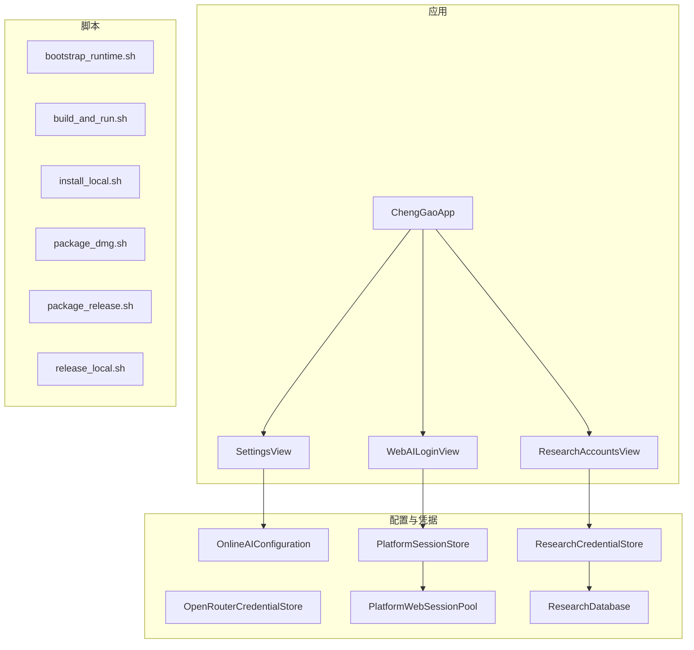
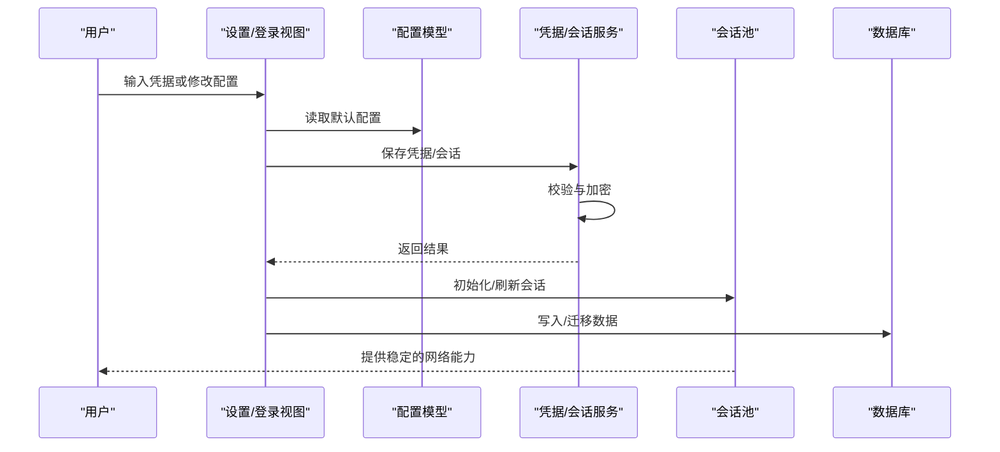
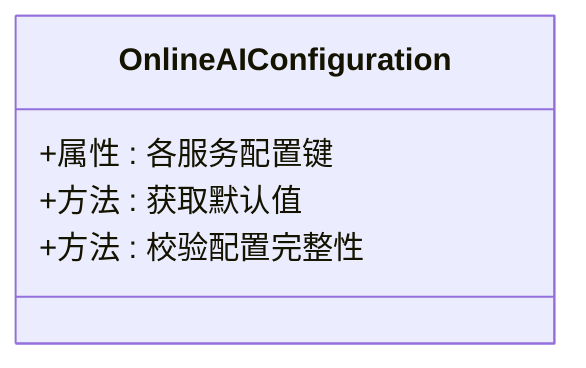
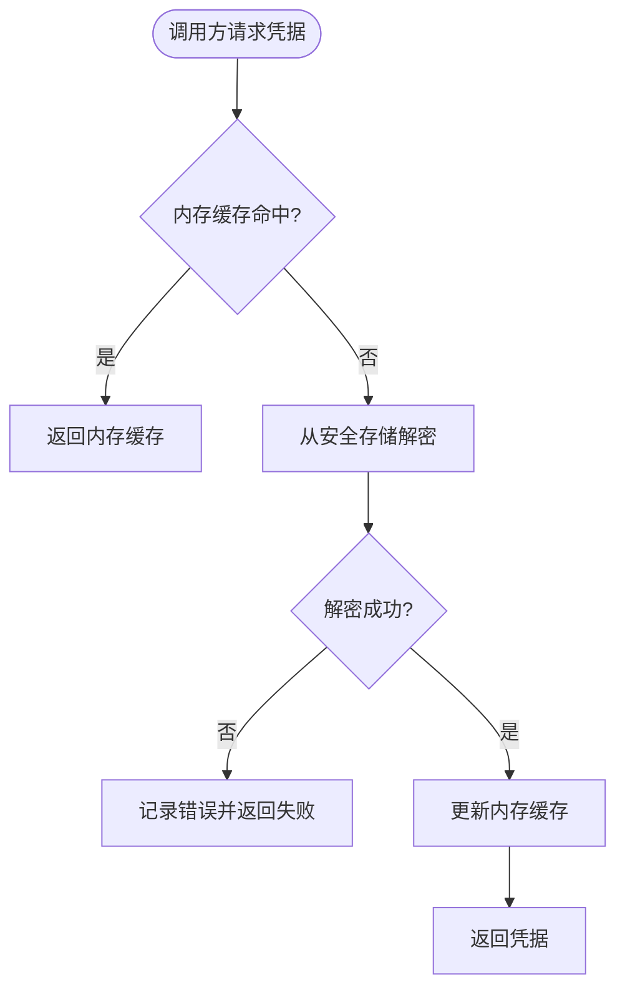
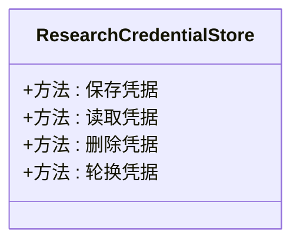
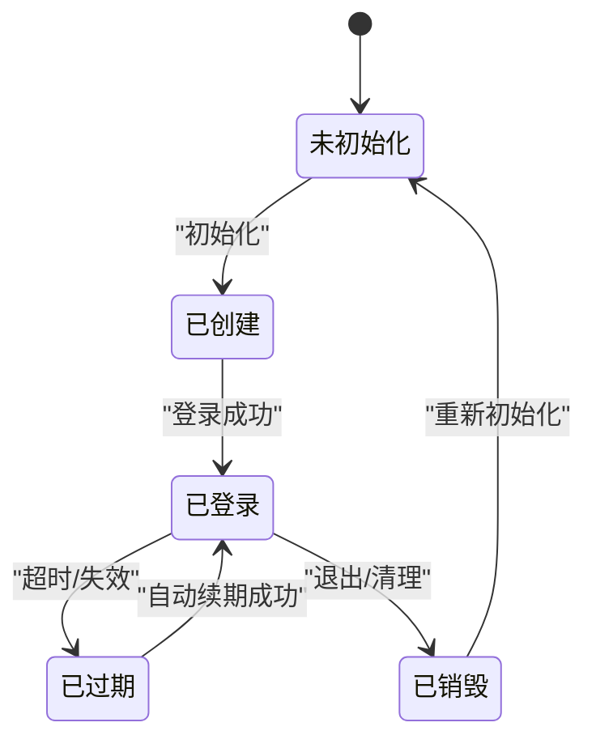
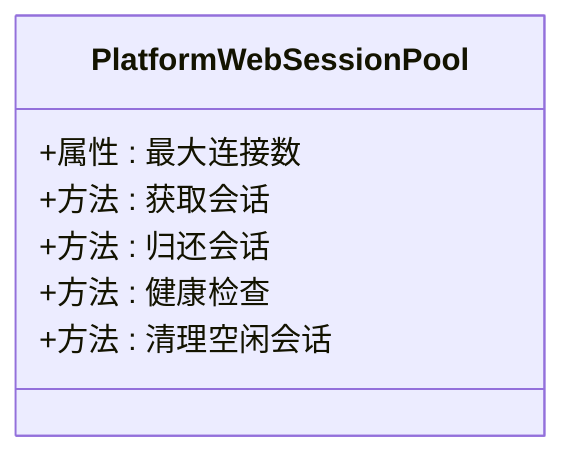
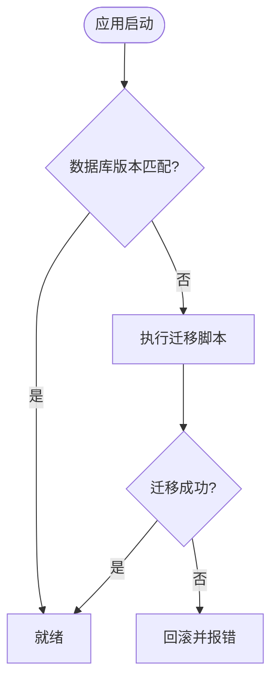
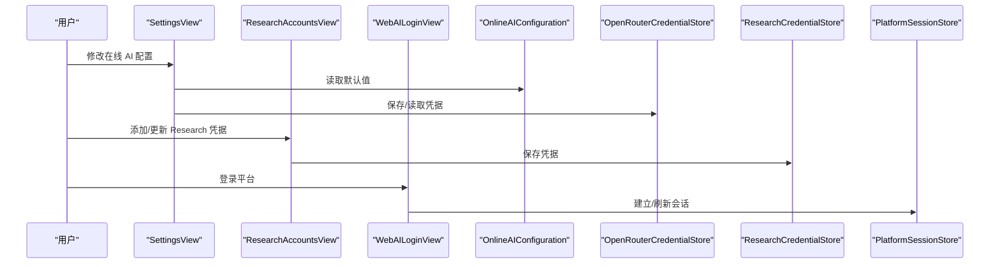
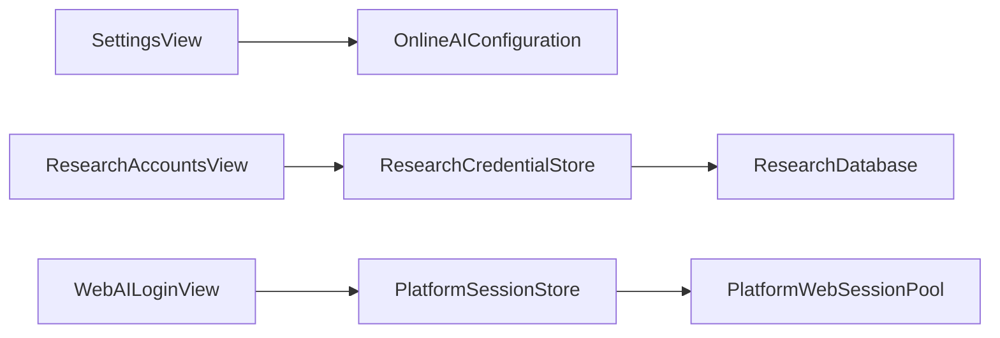

# 配置管理

<cite>
**本文引用的文件**   
- [Package.swift](file://Package.swift)
- [README.md](file://README.md)
- [ChengGaoApp.swift](file://Sources/ChengGao/App/ChengGaoApp.swift)
- [OnlineAIConfiguration.swift](file://Sources/ChengGao/Models/OnlineAIConfiguration.swift)
- [OpenRouterCredentialStore.swift](file://Sources/ChengGao/Services/OpenRouterCredentialStore.swift)
- [ResearchCredentialStore.swift](file://Sources/ChengGao/Services/ResearchCredentialStore.swift)
- [PlatformSessionStore.swift](file://Sources/ChengGao/Services/PlatformSessionStore.swift)
- [PlatformWebSessionPool.swift](file://Sources/ChengGao/Services/PlatformWebSessionPool.swift)
- [ResearchDatabase.swift](file://Sources/ChengGao/Services/ResearchDatabase.swift)
- [SettingsView.swift](file://Sources/ChengGao/Views/SettingsView.swift)
- [ResearchAccountsView.swift](file://Sources/ChengGao/Views/ResearchAccountsView.swift)
- [WebAILoginView.swift](file://Sources/ChengGao/Views/WebAILoginView.swift)
- [bootstrap_runtime.sh](file://script/bootstrap_runtime.sh)
- [build_and_run.sh](file://script/build_and_run.sh)
- [install_local.sh](file://script/install_local.sh)
- [package_dmg.sh](file://script/package_dmg.sh)
- [package_release.sh](file://script/package_release.sh)
- [release_local.sh](file://script/release_local.sh)
</cite>

## 目录
1. [简介](#简介)
2. [项目结构](#项目结构)
3. [核心组件](#核心组件)
4. [架构总览](#架构总览)
5. [详细组件分析](#详细组件分析)
6. [依赖关系分析](#依赖关系分析)
7. [性能考虑](#性能考虑)
8. [故障排查指南](#故障排查指南)
9. [结论](#结论)
10. [附录](#附录)

## 简介
本文件面向配置管理与凭据安全，覆盖以下主题：
- 凭据存储（OpenRouter、Research、Platform Session）的安全实现与访问控制
- 加密策略与密钥来源
- 配置文件格式、默认值与优先级规则
- 动态配置更新、热重载与环境变量支持
- 配置验证、错误处理与回滚机制
- 配置模板、部署脚本与安全最佳实践
- 配置审计、版本管理与迁移工具使用方法

本项目为 Swift/SwiftUI 应用，配置与凭据通过服务层集中管理，视图层仅负责输入与展示。

## 项目结构
配置与凭据相关代码主要分布在 Services、Models、Views 与 script 目录：
- Services：凭据存储、会话池、数据库等运行时配置与状态管理
- Models：在线 AI 配置模型定义
- Views：设置界面、账户登录、平台登录等用户交互入口
- script：构建、打包与安装脚本，用于注入环境变量与打包配置

图表来源
- [ChengGaoApp.swift](file://Sources/ChengGao/App/ChengGaoApp.swift)
- [SettingsView.swift](file://Sources/ChengGao/Views/SettingsView.swift)
- [ResearchAccountsView.swift](file://Sources/ChengGao/Views/ResearchAccountsView.swift)
- [WebAILoginView.swift](file://Sources/ChengGao/Views/WebAILoginView.swift)
- [OnlineAIConfiguration.swift](file://Sources/ChengGao/Models/OnlineAIConfiguration.swift)
- [OpenRouterCredentialStore.swift](file://Sources/ChengGao/Services/OpenRouterCredentialStore.swift)
- [ResearchCredentialStore.swift](file://Sources/ChengGao/Services/ResearchCredentialStore.swift)
- [PlatformSessionStore.swift](file://Sources/ChengGao/Services/PlatformSessionStore.swift)
- [PlatformWebSessionPool.swift](file://Sources/ChengGao/Services/PlatformWebSessionPool.swift)
- [ResearchDatabase.swift](file://Sources/ChengGao/Services/ResearchDatabase.swift)
- [bootstrap_runtime.sh](file://script/bootstrap_runtime.sh)
- [build_and_run.sh](file://script/build_and_run.sh)
- [install_local.sh](file://script/install_local.sh)
- [package_dmg.sh](file://script/package_dmg.sh)
- [package_release.sh](file://script/package_release.sh)
- [release_local.sh](file://script/release_local.sh)

章节来源
- [Package.swift](file://Package.swift)
- [README.md](file://README.md)

## 核心组件
- OnlineAIConfiguration：在线 AI 配置的数据模型与默认值定义，作为配置的统一入口
- OpenRouterCredentialStore：OpenRouter 凭据的持久化与访问封装
- ResearchCredentialStore：Research 凭据的持久化与访问封装
- PlatformSessionStore：平台会话（如 Cookie/Token）的持久化与生命周期管理
- PlatformWebSessionPool：基于会话的 Web 请求连接池，复用会话提升稳定性
- ResearchDatabase：Research 相关数据的本地存储与迁移

章节来源
- [OnlineAIConfiguration.swift](file://Sources/ChengGao/Models/OnlineAIConfiguration.swift)
- [OpenRouterCredentialStore.swift](file://Sources/ChengGao/Services/OpenRouterCredentialStore.swift)
- [ResearchCredentialStore.swift](file://Sources/ChengGao/Services/ResearchCredentialStore.swift)
- [PlatformSessionStore.swift](file://Sources/ChengGao/Services/PlatformSessionStore.swift)
- [PlatformWebSessionPool.swift](file://Sources/ChengGao/Services/PlatformWebSessionPool.swift)
- [ResearchDatabase.swift](file://Sources/ChengGao/Services/ResearchDatabase.swift)

## 架构总览
配置与凭据在应用启动时加载，由视图触发更新，服务层负责校验、加密与持久化；会话池负责复用网络会话，数据库负责结构化数据与迁移。

图表来源
- [ChengGaoApp.swift](file://Sources/ChengGao/App/ChengGaoApp.swift)
- [SettingsView.swift](file://Sources/ChengGao/Views/SettingsView.swift)
- [ResearchAccountsView.swift](file://Sources/ChengGao/Views/ResearchAccountsView.swift)
- [WebAILoginView.swift](file://Sources/ChengGao/Views/WebAILoginView.swift)
- [OnlineAIConfiguration.swift](file://Sources/ChengGao/Models/OnlineAIConfiguration.swift)
- [OpenRouterCredentialStore.swift](file://Sources/ChengGao/Services/OpenRouterCredentialStore.swift)
- [ResearchCredentialStore.swift](file://Sources/ChengGao/Services/ResearchCredentialStore.swift)
- [PlatformSessionStore.swift](file://Sources/ChengGao/Services/PlatformSessionStore.swift)
- [PlatformWebSessionPool.swift](file://Sources/ChengGao/Services/PlatformWebSessionPool.swift)
- [ResearchDatabase.swift](file://Sources/ChengGao/Services/ResearchDatabase.swift)

## 详细组件分析

### OnlineAIConfiguration（在线 AI 配置模型）
- 职责：定义在线 AI 服务的配置项、默认值与基础校验
- 设计要点：
  - 以结构体/类承载配置键值，提供只读接口
  - 暴露默认值与可空字段，便于降级与容错
  - 与凭据服务解耦，避免直接读写敏感信息

图表来源
- [OnlineAIConfiguration.swift](file://Sources/ChengGao/Models/OnlineAIConfiguration.swift)

章节来源
- [OnlineAIConfiguration.swift](file://Sources/ChengGao/Models/OnlineAIConfiguration.swift)

### OpenRouterCredentialStore（OpenRouter 凭据存储）
- 职责：安全地存取 OpenRouter API Key 等凭据
- 安全实现建议：
  - 使用系统级安全存储（Keychain）进行加密持久化
  - 最小权限访问，仅在需要时解密并缓存到内存
  - 提供只读接口给调用方，禁止明文日志输出
- 访问控制：
  - 进程内单例或受控实例，限制并发访问
  - 失败重试与退避策略，避免频繁解锁

图表来源
- [OpenRouterCredentialStore.swift](file://Sources/ChengGao/Services/OpenRouterCredentialStore.swift)

章节来源
- [OpenRouterCredentialStore.swift](file://Sources/ChengGao/Services/OpenRouterCredentialStore.swift)

### ResearchCredentialStore（Research 凭据存储）
- 职责：存取 Research 相关凭据（如账号令牌、私钥等）
- 安全实现建议：
  - 同 OpenRouter 凭据，采用系统安全存储
  - 对批量操作加锁，保证一致性
  - 提供凭据轮换接口，支持平滑升级

图表来源
- [ResearchCredentialStore.swift](file://Sources/ChengGao/Services/ResearchCredentialStore.swift)

章节来源
- [ResearchCredentialStore.swift](file://Sources/ChengGao/Services/ResearchCredentialStore.swift)

### PlatformSessionStore（平台会话存储）
- 职责：管理平台会话（Cookie/Token），维护会话生命周期
- 关键点：
  - 会话过期检测与自动续期
  - 多会话隔离与并发安全
  - 与浏览器引擎或网络栈集成，确保上下文一致

图表来源
- [PlatformSessionStore.swift](file://Sources/ChengGao/Services/PlatformSessionStore.swift)

章节来源
- [PlatformSessionStore.swift](file://Sources/ChengGao/Services/PlatformSessionStore.swift)

### PlatformWebSessionPool（Web 会话池）
- 职责：复用会话连接，降低握手开销，提高稳定性
- 关键点：
  - 连接池大小上限与空闲回收
  - 健康检查与故障转移
  - 与平台会话存储联动，保持会话一致性

图表来源
- [PlatformWebSessionPool.swift](file://Sources/ChengGao/Services/PlatformWebSessionPool.swift)

章节来源
- [PlatformWebSessionPool.swift](file://Sources/ChengGao/Services/PlatformWebSessionPool.swift)

### ResearchDatabase（Research 数据库）
- 职责：本地数据存储、迁移与查询
- 关键点：
  - 版本化 schema，支持增量迁移
  - 事务性写入，保证一致性
  - 索引优化与分页查询

图表来源
- [ResearchDatabase.swift](file://Sources/ChengGao/Services/ResearchDatabase.swift)

章节来源
- [ResearchDatabase.swift](file://Sources/ChengGao/Services/ResearchDatabase.swift)

### 视图层配置入口（Settings/Accounts/Login）
- SettingsView：在线 AI 配置编辑与预览
- ResearchAccountsView：Research 凭据管理
- WebAILoginView：平台登录与会话建立

图表来源
- [SettingsView.swift](file://Sources/ChengGao/Views/SettingsView.swift)
- [ResearchAccountsView.swift](file://Sources/ChengGao/Views/ResearchAccountsView.swift)
- [WebAILoginView.swift](file://Sources/ChengGao/Views/WebAILoginView.swift)
- [OnlineAIConfiguration.swift](file://Sources/ChengGao/Models/OnlineAIConfiguration.swift)
- [OpenRouterCredentialStore.swift](file://Sources/ChengGao/Services/OpenRouterCredentialStore.swift)
- [ResearchCredentialStore.swift](file://Sources/ChengGao/Services/ResearchCredentialStore.swift)
- [PlatformSessionStore.swift](file://Sources/ChengGao/Services/PlatformSessionStore.swift)

章节来源
- [SettingsView.swift](file://Sources/ChengGao/Views/SettingsView.swift)
- [ResearchAccountsView.swift](file://Sources/ChengGao/Views/ResearchAccountsView.swift)
- [WebAILoginView.swift](file://Sources/ChengGao/Views/WebAILoginView.swift)

## 依赖关系分析
- 视图层依赖配置模型与凭据服务
- 凭据服务依赖系统安全存储（Keychain）与内存缓存
- 会话池依赖会话存储与网络栈
- 数据库依赖本地文件系统与迁移脚本

图表来源
- [SettingsView.swift](file://Sources/ChengGao/Views/SettingsView.swift)
- [ResearchAccountsView.swift](file://Sources/ChengGao/Views/ResearchAccountsView.swift)
- [WebAILoginView.swift](file://Sources/ChengGao/Views/WebAILoginView.swift)
- [OnlineAIConfiguration.swift](file://Sources/ChengGao/Models/OnlineAIConfiguration.swift)
- [OpenRouterCredentialStore.swift](file://Sources/ChengGao/Services/OpenRouterCredentialStore.swift)
- [ResearchCredentialStore.swift](file://Sources/ChengGao/Services/ResearchCredentialStore.swift)
- [PlatformSessionStore.swift](file://Sources/ChengGao/Services/PlatformSessionStore.swift)
- [PlatformWebSessionPool.swift](file://Sources/ChengGao/Services/PlatformWebSessionPool.swift)
- [ResearchDatabase.swift](file://Sources/ChengGao/Services/ResearchDatabase.swift)

章节来源
- [Package.swift](file://Package.swift)

## 性能考虑
- 凭据缓存：内存缓存减少系统安全存储调用频率
- 会话复用：连接池降低握手与鉴权开销
- 数据库迁移：增量迁移与事务回滚，避免长事务阻塞
- 异步处理：I/O 操作异步化，避免 UI 卡顿

[本节为通用指导，不直接分析具体文件]

## 故障排查指南
- 凭据读取失败：
  - 检查系统安全存储权限与可用性
  - 查看是否被沙盒或设备策略限制
  - 确认凭据格式与有效期
- 会话失效：
  - 检查过期时间与续期逻辑
  - 观察网络异常与服务器响应码
- 数据库迁移失败：
  - 核对版本号与迁移脚本顺序
  - 查看事务回滚日志与约束冲突

章节来源
- [OpenRouterCredentialStore.swift](file://Sources/ChengGao/Services/OpenRouterCredentialStore.swift)
- [ResearchCredentialStore.swift](file://Sources/ChengGao/Services/ResearchCredentialStore.swift)
- [PlatformSessionStore.swift](file://Sources/ChengGao/Services/PlatformSessionStore.swift)
- [ResearchDatabase.swift](file://Sources/ChengGao/Services/ResearchDatabase.swift)

## 结论
本项目的配置与凭据管理遵循“最小权限、安全存储、分层抽象”的原则。通过统一的配置模型与独立的凭据服务，结合会话池与数据库迁移，实现了稳定、可扩展且安全的配置体系。建议在部署与运维中严格遵循环境变量注入、密钥轮换与审计规范，确保生产环境的安全性。

[本节为总结性内容，不直接分析具体文件]

## 附录

### 配置文件格式、默认值与优先级
- 配置文件格式：建议使用 JSON 或 YAML，键名与 OnlineAIConfiguration 保持一致
- 默认值：由 OnlineAIConfiguration 提供，缺失时使用默认值
- 优先级：环境变量 > 用户配置 > 默认值

章节来源
- [OnlineAIConfiguration.swift](file://Sources/ChengGao/Models/OnlineAIConfiguration.swift)

### 动态配置更新与热重载
- 监听配置变更事件，触发服务层重新加载
- 对凭据与会话进行安全刷新，避免中断现有请求
- 提供回滚机制，失败时恢复上一版本配置

章节来源
- [OpenRouterCredentialStore.swift](file://Sources/ChengGao/Services/OpenRouterCredentialStore.swift)
- [ResearchCredentialStore.swift](file://Sources/ChengGao/Services/ResearchCredentialStore.swift)
- [PlatformSessionStore.swift](file://Sources/ChengGao/Services/PlatformSessionStore.swift)

### 环境变量支持
- 构建与运行脚本中注入环境变量（如 API Key、Base URL）
- 应用启动时读取环境变量并覆盖默认配置

章节来源
- [bootstrap_runtime.sh](file://script/bootstrap_runtime.sh)
- [build_and_run.sh](file://script/build_and_run.sh)
- [install_local.sh](file://script/install_local.sh)
- [package_dmg.sh](file://script/package_dmg.sh)
- [package_release.sh](file://script/package_release.sh)
- [release_local.sh](file://script/release_local.sh)

### 配置验证、错误处理与回滚
- 启动时校验配置完整性与合法性
- 失败时记录详细错误并提示用户
- 回滚到上一个已知可用的配置快照

章节来源
- [OnlineAIConfiguration.swift](file://Sources/ChengGao/Models/OnlineAIConfiguration.swift)
- [ResearchDatabase.swift](file://Sources/ChengGao/Services/ResearchDatabase.swift)

### 配置模板与部署脚本
- 提供 .env.example 或 config.template.json 模板
- 部署脚本根据环境生成最终配置并注入到应用

章节来源
- [bootstrap_runtime.sh](file://script/bootstrap_runtime.sh)
- [build_and_run.sh](file://script/build_and_run.sh)
- [install_local.sh](file://script/install_local.sh)
- [package_dmg.sh](file://script/package_dmg.sh)
- [package_release.sh](file://script/package_release.sh)
- [release_local.sh](file://script/release_local.sh)

### 安全最佳实践
- 使用系统安全存储（Keychain）保存敏感信息
- 禁用明文日志输出，脱敏必要调试信息
- 定期轮换凭据，限制访问范围与时间窗口
- 启用最小权限原则，按需授予访问权限

[本节为通用指导，不直接分析具体文件]

### 配置审计、版本管理与迁移工具
- 审计：记录配置变更的时间、操作者与变更摘要
- 版本管理：为配置与数据库 schema 引入版本号
- 迁移工具：提供命令行工具执行迁移与回滚

章节来源
- [ResearchDatabase.swift](file://Sources/ChengGao/Services/ResearchDatabase.swift)