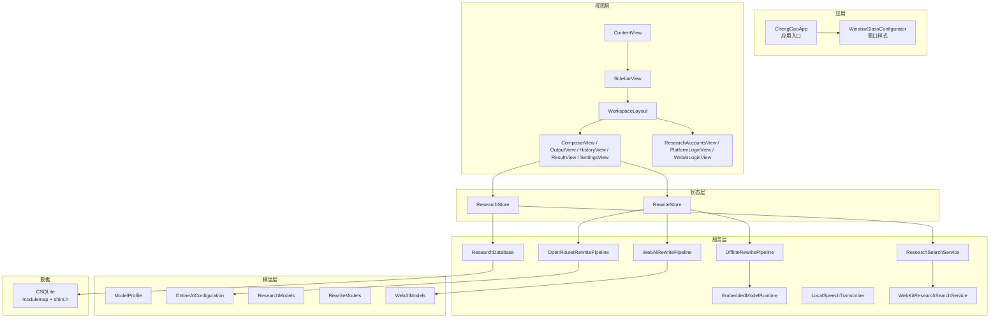
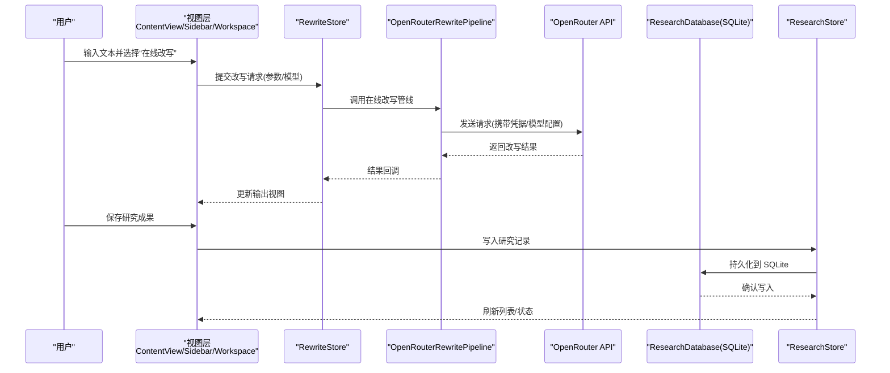
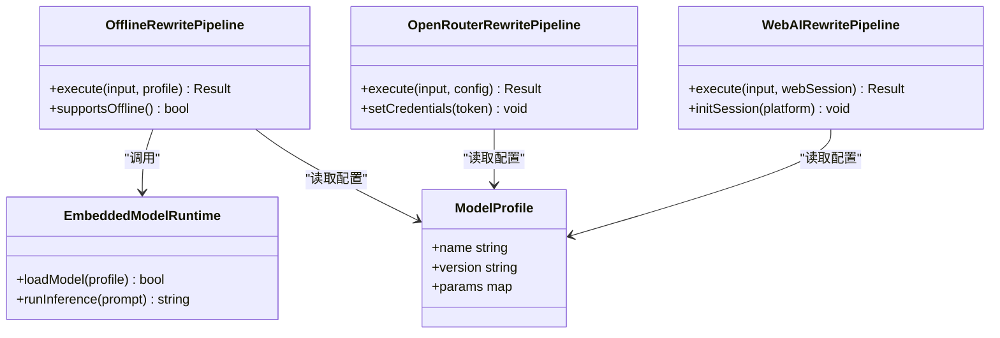
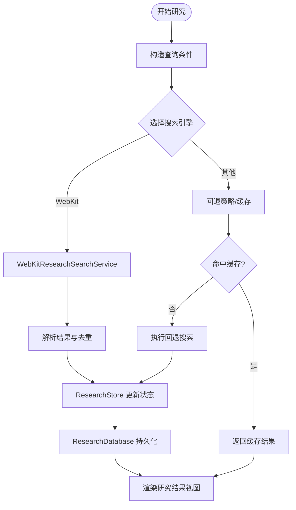
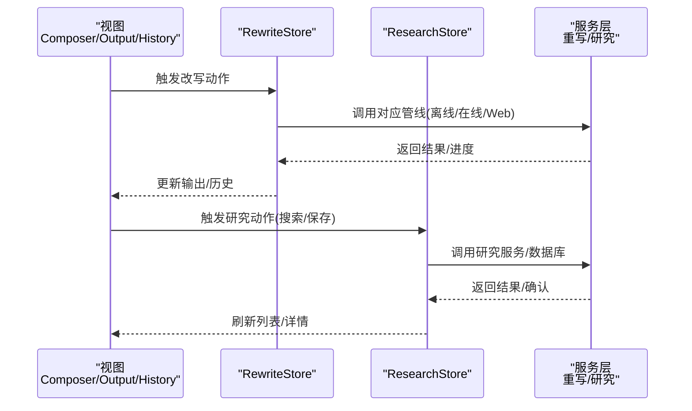
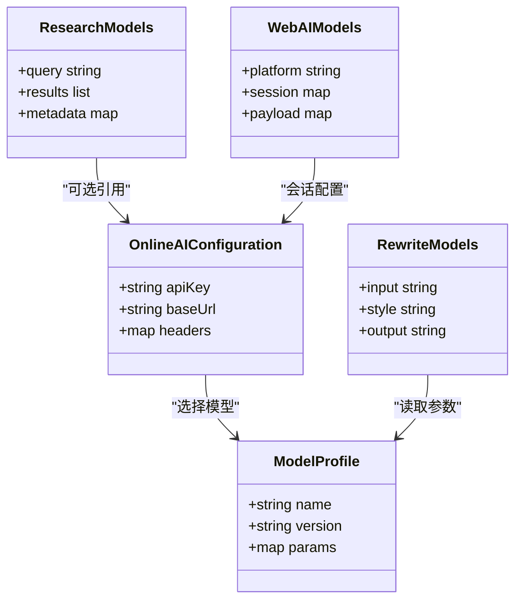
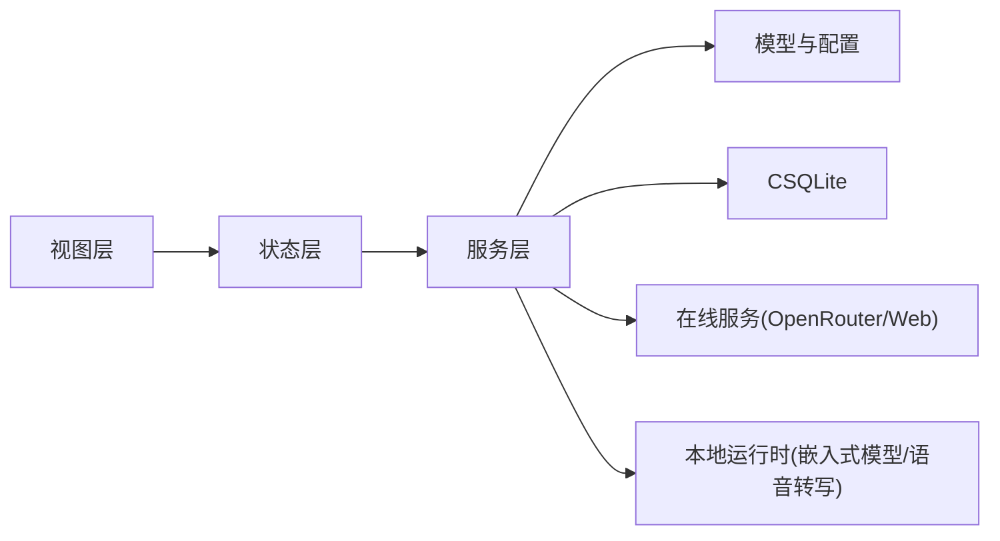

# 项目概览

<cite>
**本文引用的文件**   
- [Package.swift](file://Package.swift)
- [README.md](file://README.md)
- [ChengGaoApp.swift](file://Sources/ChengGao/App/ChengGaoApp.swift)
- [WindowGlassConfigurator.swift](file://Sources/ChengGao/App/WindowGlassConfigurator.swift)
- [ModelProfile.swift](file://Sources/ChengGao/Models/ModelProfile.swift)
- [OnlineAIConfiguration.swift](file://Sources/ChengGao/Models/OnlineAIConfiguration.swift)
- [ResearchModels.swift](file://Sources/ChengGao/Models/ResearchModels.swift)
- [RewriteModels.swift](file://Sources/ChengGao/Models/RewriteModels.swift)
- [WebAIModels.swift](file://Sources/ChengGao/Models/WebAIModels.swift)
- [OfflineRewritePipeline.swift](file://Sources/ChengGao/Services/OfflineRewritePipeline.swift)
- [OpenRouterRewritePipeline.swift](file://Sources/ChengGao/Services/OpenRouterRewritePipeline.swift)
- [WebAIRewritePipeline.swift](file://Sources/ChengGao/Services/WebAIRewritePipeline.swift)
- [EmbeddedModelRuntime.swift](file://Sources/ChengGao/Services/EmbeddedModelRuntime.swift)
- [LocalSpeechTranscriber.swift](file://Sources/ChengGao/Services/LocalSpeechTranscriber.swift)
- [ResearchDatabase.swift](file://Sources/ChengGao/Services/ResearchDatabase.swift)
- [ResearchSearchService.swift](file://Sources/ChengGao/Services/ResearchSearchService.swift)
- [WebKitResearchSearchService.swift](file://Sources/ChengGao/Services/WebKitResearchSearchService.swift)
- [ResearchStore.swift](file://Sources/ChengGao/Stores/ResearchStore.swift)
- [RewriteStore.swift](file://Sources/ChengGao/Stores/RewriteStore.swift)
- [ContentView.swift](file://Sources/ChengGao/Views/ContentView.swift)
- [SidebarView.swift](file://Sources/ChengGao/Views/SidebarView.swift)
- [WorkspaceLayout.swift](file://Sources/ChengGao/Views/WorkspaceLayout.swift)
- [ComposerView.swift](file://Sources/ChengGao/Views/ComposerView.swift)
- [OutputView.swift](file://Sources/ChengGao/Views/OutputView.swift)
- [HistoryView.swift](file://Sources/ChengGao/Views/HistoryView.swift)
- [ResultView.swift](file://Sources/ChengGao/Views/ResultView.swift)
- [SettingsView.swift](file://Sources/ChengGao/Views/SettingsView.swift)
- [ResearchAccountsView.swift](file://Sources/ChengGao/Views/ResearchAccountsView.swift)
- [PlatformLoginView.swift](file://Sources/ChengGao/Views/PlatformLoginView.swift)
- [WebAILoginView.swift](file://Sources/ChengGao/Views/WebAILoginView.swift)
- [CSQLite modulemap](file://Sources/CSQLite/module.modulemap)
- [CSQLite shim.h](file://Sources/CSQLite/shim.h)
</cite>

## 目录
1. [简介](#简介)
2. [项目结构](#项目结构)
3. [核心组件](#核心组件)
4. [架构总览](#架构总览)
5. [详细组件分析](#详细组件分析)
6. [依赖关系分析](#依赖关系分析)
7. [性能考量](#性能考量)
8. [故障排查指南](#故障排查指南)
9. [结论](#结论)
10. [附录](#附录)

## 简介
ChengGao 是一个基于 Swift/SwiftUI 的 macOS 应用程序，聚焦于 AI 驱动的文本重写、研究辅助与内容创作。它提供本地与在线两种模式：
- 本地模式：通过嵌入式模型运行时与本地语音转写等能力，保障隐私与离线可用性。
- 在线模式：对接 OpenRouter 等外部服务，支持多模型编排与网页会话管理。

目标用户包括内容创作者、研究人员与需要高效文本改写与资料检索的办公人群。主要使用场景包括：
- 一键改写与风格迁移（学术、营销、社交媒体等）
- 研究辅助（搜索、摘要、术语校验、知识库存储）
- 多媒体内容处理（视频帧文本提取、字幕格式化、封面生成）
- 工作流集成（历史记录、结果对比、导出打包）

技术栈要点：
- SwiftUI 构建原生 macOS 界面
- SQLite（通过 CSQLite 桥接）用于本地数据持久化
- 模块化 Services 层封装离线/在线重写管线与研究服务
- Stores 层统一状态管理与 UI 绑定

**章节来源**
- [README.md](file://README.md)
- [Package.swift](file://Package.swift)

## 项目结构
ChengGao 采用分层与按功能域结合的目录组织方式：
- App：应用入口与窗口样式配置
- Models：领域模型与配置（模型档案、在线配置、研究与重写模型、Web AI 模型）
- Services：核心业务逻辑（重写管线、研究服务、媒体处理、会话与凭据管理）
- Stores：状态存储（研究、重写）
- Views：SwiftUI 视图（主界面、侧边栏、工作区布局、各功能页面）
- Sources/CSQLite：SQLite 桥接模块（modulemap 与头文件）

**图表来源**
- [ChengGaoApp.swift](file://Sources/ChengGao/App/ChengGaoApp.swift)
- [WindowGlassConfigurator.swift](file://Sources/ChengGao/App/WindowGlassConfigurator.swift)
- [ContentView.swift](file://Sources/ChengGao/Views/ContentView.swift)
- [SidebarView.swift](file://Sources/ChengGao/Views/SidebarView.swift)
- [WorkspaceLayout.swift](file://Sources/ChengGao/Views/WorkspaceLayout.swift)
- [ComposerView.swift](file://Sources/ChengGao/Views/ComposerView.swift)
- [OutputView.swift](file://Sources/ChengGao/Views/OutputView.swift)
- [HistoryView.swift](file://Sources/ChengGao/Views/HistoryView.swift)
- [ResultView.swift](file://Sources/ChengGao/Views/ResultView.swift)
- [SettingsView.swift](file://Sources/ChengGao/Views/SettingsView.swift)
- [ResearchAccountsView.swift](file://Sources/ChengGao/Views/ResearchAccountsView.swift)
- [PlatformLoginView.swift](file://Sources/ChengGao/Views/PlatformLoginView.swift)
- [WebAILoginView.swift](file://Sources/ChengGao/Views/WebAILoginView.swift)
- [RewriteStore.swift](file://Sources/ChengGao/Stores/RewriteStore.swift)
- [ResearchStore.swift](file://Sources/ChengGao/Stores/ResearchStore.swift)
- [OfflineRewritePipeline.swift](file://Sources/ChengGao/Services/OfflineRewritePipeline.swift)
- [OpenRouterRewritePipeline.swift](file://Sources/ChengGao/Services/OpenRouterRewritePipeline.swift)
- [WebAIRewritePipeline.swift](file://Sources/ChengGao/Services/WebAIRewritePipeline.swift)
- [EmbeddedModelRuntime.swift](file://Sources/ChengGao/Services/EmbeddedModelRuntime.swift)
- [LocalSpeechTranscriber.swift](file://Sources/ChengGao/Services/LocalSpeechTranscriber.swift)
- [ResearchDatabase.swift](file://Sources/ChengGao/Services/ResearchDatabase.swift)
- [ResearchSearchService.swift](file://Sources/ChengGao/Services/ResearchSearchService.swift)
- [WebKitResearchSearchService.swift](file://Sources/ChengGao/Services/WebKitResearchSearchService.swift)
- [ModelProfile.swift](file://Sources/ChengGao/Models/ModelProfile.swift)
- [OnlineAIConfiguration.swift](file://Sources/ChengGao/Models/OnlineAIConfiguration.swift)
- [ResearchModels.swift](file://Sources/ChengGao/Models/ResearchModels.swift)
- [RewriteModels.swift](file://Sources/ChengGao/Models/RewriteModels.swift)
- [WebAIModels.swift](file://Sources/ChengGao/Models/WebAIModels.swift)
- [CSQLite modulemap](file://Sources/CSQLite/module.modulemap)
- [CSQLite shim.h](file://Sources/CSQLite/shim.h)

**章节来源**
- [Package.swift](file://Package.swift)
- [README.md](file://README.md)

## 核心组件
- 应用入口与窗口配置：负责启动应用、设置窗口玻璃效果与主题。
- 视图层：以 SwiftUI 构建主界面、侧边导航与工作区布局，承载各功能页面。
- 状态层：RewriteStore 与 ResearchStore 分别管理重写与研究相关状态，供视图观察更新。
- 服务层：
  - 重写管线：离线（本地模型）、OpenRouter（云端多模型）、Web AI（网页会话）。
  - 研究服务：数据库、搜索服务（含 WebKit 实现）、术语校验、语音转写、媒体处理。
- 模型层：定义模型档案、在线配置、研究与重写数据结构、Web AI 模型信息。
- 数据层：通过 CSQLite 桥接 SQLite，支撑本地持久化。

**章节来源**
- [ChengGaoApp.swift](file://Sources/ChengGao/App/ChengGaoApp.swift)
- [WindowGlassConfigurator.swift](file://Sources/ChengGao/App/WindowGlassConfigurator.swift)
- [RewriteStore.swift](file://Sources/ChengGao/Stores/RewriteStore.swift)
- [ResearchStore.swift](file://Sources/ChengGao/Stores/ResearchStore.swift)
- [OfflineRewritePipeline.swift](file://Sources/ChengGao/Services/OfflineRewritePipeline.swift)
- [OpenRouterRewritePipeline.swift](file://Sources/ChengGao/Services/OpenRouterRewritePipeline.swift)
- [WebAIRewritePipeline.swift](file://Sources/ChengGao/Services/WebAIRewritePipeline.swift)
- [EmbeddedModelRuntime.swift](file://Sources/ChengGao/Services/EmbeddedModelRuntime.swift)
- [LocalSpeechTranscriber.swift](file://Sources/ChengGao/Services/LocalSpeechTranscriber.swift)
- [ResearchDatabase.swift](file://Sources/ChengGao/Services/ResearchDatabase.swift)
- [ResearchSearchService.swift](file://Sources/ChengGao/Services/ResearchSearchService.swift)
- [WebKitResearchSearchService.swift](file://Sources/ChengGao/Services/WebKitResearchSearchService.swift)
- [ModelProfile.swift](file://Sources/ChengGao/Models/ModelProfile.swift)
- [OnlineAIConfiguration.swift](file://Sources/ChengGao/Models/OnlineAIConfiguration.swift)
- [ResearchModels.swift](file://Sources/ChengGao/Models/ResearchModels.swift)
- [RewriteModels.swift](file://Sources/ChengGao/Models/RewriteModels.swift)
- [WebAIModels.swift](file://Sources/ChengGao/Models/WebAIModels.swift)
- [CSQLite modulemap](file://Sources/CSQLite/module.modulemap)
- [CSQLite shim.h](file://Sources/CSQLite/shim.h)

## 架构总览
ChengGao 遵循“视图-状态-服务-数据”的分层架构：
- 视图层（SwiftUI）仅负责展示与交互，不直接访问网络或数据库。
- 状态层（Stores）暴露可观察状态，驱动 UI 刷新。
- 服务层（Services）封装具体业务逻辑，协调本地与在线资源。
- 数据层（CSQLite）提供轻量级本地存储。

**图表来源**
- [ContentView.swift](file://Sources/ChengGao/Views/ContentView.swift)
- [SidebarView.swift](file://Sources/ChengGao/Views/SidebarView.swift)
- [WorkspaceLayout.swift](file://Sources/ChengGao/Views/WorkspaceLayout.swift)
- [RewriteStore.swift](file://Sources/ChengGao/Stores/RewriteStore.swift)
- [OpenRouterRewritePipeline.swift](file://Sources/ChengGao/Services/OpenRouterRewritePipeline.swift)
- [ResearchStore.swift](file://Sources/ChengGao/Stores/ResearchStore.swift)
- [ResearchDatabase.swift](file://Sources/ChengGao/Services/ResearchDatabase.swift)

## 详细组件分析

### 重写子系统（离线/在线/Web AI）
- 离线重写管线：基于嵌入式模型运行时，适合隐私敏感与离线场景。
- OpenRouter 重写管线：动态选择云端模型，支持多提供商与凭据管理。
- Web AI 重写管线：通过网页会话执行任务，适配特定平台能力。

**图表来源**
- [OfflineRewritePipeline.swift](file://Sources/ChengGao/Services/OfflineRewritePipeline.swift)
- [OpenRouterRewritePipeline.swift](file://Sources/ChengGao/Services/OpenRouterRewritePipeline.swift)
- [WebAIRewritePipeline.swift](file://Sources/ChengGao/Services/WebAIRewritePipeline.swift)
- [EmbeddedModelRuntime.swift](file://Sources/ChengGao/Services/EmbeddedModelRuntime.swift)
- [ModelProfile.swift](file://Sources/ChengGao/Models/ModelProfile.swift)

**章节来源**
- [OfflineRewritePipeline.swift](file://Sources/ChengGao/Services/OfflineRewritePipeline.swift)
- [OpenRouterRewritePipeline.swift](file://Sources/ChengGao/Services/OpenRouterRewritePipeline.swift)
- [WebAIRewritePipeline.swift](file://Sources/ChengGao/Services/WebAIRewritePipeline.swift)
- [EmbeddedModelRuntime.swift](file://Sources/ChengGao/Services/EmbeddedModelRuntime.swift)
- [ModelProfile.swift](file://Sources/ChengGao/Models/ModelProfile.swift)

### 研究子系统（搜索/数据库/会话）
- ResearchDatabase：封装 SQLite 操作，存储研究记录、搜索结果与元数据。
- ResearchSearchService：抽象搜索接口，由 WebKitResearchSearchService 提供浏览器内核实现。
- ResearchStore：管理研究状态（查询、结果、收藏、标签等），驱动研究页面更新。

**图表来源**
- [ResearchSearchService.swift](file://Sources/ChengGao/Services/ResearchSearchService.swift)
- [WebKitResearchSearchService.swift](file://Sources/ChengGao/Services/WebKitResearchSearchService.swift)
- [ResearchStore.swift](file://Sources/ChengGao/Stores/ResearchStore.swift)
- [ResearchDatabase.swift](file://Sources/ChengGao/Services/ResearchDatabase.swift)

**章节来源**
- [ResearchSearchService.swift](file://Sources/ChengGao/Services/ResearchSearchService.swift)
- [WebKitResearchSearchService.swift](file://Sources/ChengGao/Services/WebKitResearchSearchService.swift)
- [ResearchStore.swift](file://Sources/ChengGao/Stores/ResearchStore.swift)
- [ResearchDatabase.swift](file://Sources/ChengGao/Services/ResearchDatabase.swift)

### 视图与状态绑定
- ContentView/Sidebar/WorkspaceLayout：构成主界面与工作区布局，承载功能入口与页面切换。
- ComposerView/OutputView/HistoryView/ResultView/SettingsView：分别对应输入、输出、历史、结果与设置页。
- RewriteStore/ResearchStore：为视图提供响应式状态，确保 UI 与业务逻辑解耦。

**图表来源**
- [ContentView.swift](file://Sources/ChengGao/Views/ContentView.swift)
- [SidebarView.swift](file://Sources/ChengGao/Views/SidebarView.swift)
- [WorkspaceLayout.swift](file://Sources/ChengGao/Views/WorkspaceLayout.swift)
- [ComposerView.swift](file://Sources/ChengGao/Views/ComposerView.swift)
- [OutputView.swift](file://Sources/ChengGao/Views/OutputView.swift)
- [HistoryView.swift](file://Sources/ChengGao/Views/HistoryView.swift)
- [ResultView.swift](file://Sources/ChengGao/Views/ResultView.swift)
- [SettingsView.swift](file://Sources/ChengGao/Views/SettingsView.swift)
- [RewriteStore.swift](file://Sources/ChengGao/Stores/RewriteStore.swift)
- [ResearchStore.swift](file://Sources/ChengGao/Stores/ResearchStore.swift)

**章节来源**
- [ContentView.swift](file://Sources/ChengGao/Views/ContentView.swift)
- [SidebarView.swift](file://Sources/ChengGao/Views/SidebarView.swift)
- [WorkspaceLayout.swift](file://Sources/ChengGao/Views/WorkspaceLayout.swift)
- [ComposerView.swift](file://Sources/ChengGao/Views/ComposerView.swift)
- [OutputView.swift](file://Sources/ChengGao/Views/OutputView.swift)
- [HistoryView.swift](file://Sources/ChengGao/Views/HistoryView.swift)
- [ResultView.swift](file://Sources/ChengGao/Views/ResultView.swift)
- [SettingsView.swift](file://Sources/ChengGao/Views/SettingsView.swift)
- [RewriteStore.swift](file://Sources/ChengGao/Stores/RewriteStore.swift)
- [ResearchStore.swift](file://Sources/ChengGao/Stores/ResearchStore.swift)

### 模型与配置
- ModelProfile：描述模型名称、版本与参数，供离线/在线管线读取。
- OnlineAIConfiguration：集中管理在线服务的凭据与端点配置。
- ResearchModels/RewriteModels/WebAIModels：定义研究、重写与 Web AI 的数据结构与传输格式。

**图表来源**
- [ModelProfile.swift](file://Sources/ChengGao/Models/ModelProfile.swift)
- [OnlineAIConfiguration.swift](file://Sources/ChengGao/Models/OnlineAIConfiguration.swift)
- [ResearchModels.swift](file://Sources/ChengGao/Models/ResearchModels.swift)
- [RewriteModels.swift](file://Sources/ChengGao/Models/RewriteModels.swift)
- [WebAIModels.swift](file://Sources/ChengGao/Models/WebAIModels.swift)

**章节来源**
- [ModelProfile.swift](file://Sources/ChengGao/Models/ModelProfile.swift)
- [OnlineAIConfiguration.swift](file://Sources/ChengGao/Models/OnlineAIConfiguration.swift)
- [ResearchModels.swift](file://Sources/ChengGao/Models/ResearchModels.swift)
- [RewriteModels.swift](file://Sources/ChengGao/Models/RewriteModels.swift)
- [WebAIModels.swift](file://Sources/ChengGao/Models/WebAIModels.swift)

## 依赖关系分析
- 视图层依赖 Stores，Stores 依赖 Services，Services 依赖 Models 与数据层（SQLite）。
- 在线服务依赖凭据与配置；离线服务依赖嵌入式模型运行时。
- 研究服务依赖数据库与搜索实现（WebKit）。

**图表来源**
- [RewriteStore.swift](file://Sources/ChengGao/Stores/RewriteStore.swift)
- [ResearchStore.swift](file://Sources/ChengGao/Stores/ResearchStore.swift)
- [OfflineRewritePipeline.swift](file://Sources/ChengGao/Services/OfflineRewritePipeline.swift)
- [OpenRouterRewritePipeline.swift](file://Sources/ChengGao/Services/OpenRouterRewritePipeline.swift)
- [WebAIRewritePipeline.swift](file://Sources/ChengGao/Services/WebAIRewritePipeline.swift)
- [EmbeddedModelRuntime.swift](file://Sources/ChengGao/Services/EmbeddedModelRuntime.swift)
- [LocalSpeechTranscriber.swift](file://Sources/ChengGao/Services/LocalSpeechTranscriber.swift)
- [ResearchDatabase.swift](file://Sources/ChengGao/Services/ResearchDatabase.swift)
- [CSQLite modulemap](file://Sources/CSQLite/module.modulemap)
- [CSQLite shim.h](file://Sources/CSQLite/shim.h)

**章节来源**
- [RewriteStore.swift](file://Sources/ChengGao/Stores/RewriteStore.swift)
- [ResearchStore.swift](file://Sources/ChengGao/Stores/ResearchStore.swift)
- [OfflineRewritePipeline.swift](file://Sources/ChengGao/Services/OfflineRewritePipeline.swift)
- [OpenRouterRewritePipeline.swift](file://Sources/ChengGao/Services/OpenRouterRewritePipeline.swift)
- [WebAIRewritePipeline.swift](file://Sources/ChengGao/Services/WebAIRewritePipeline.swift)
- [EmbeddedModelRuntime.swift](file://Sources/ChengGao/Services/EmbeddedModelRuntime.swift)
- [LocalSpeechTranscriber.swift](file://Sources/ChengGao/Services/LocalSpeechTranscriber.swift)
- [ResearchDatabase.swift](file://Sources/ChengGao/Services/ResearchDatabase.swift)
- [CSQLite modulemap](file://Sources/CSQLite/module.modulemap)
- [CSQLite shim.h](file://Sources/CSQLite/shim.h)

## 性能考量
- 离线优先：在可用情况下优先使用本地模型与本地转写，降低网络延迟与成本。
- 并发与队列：对重写与搜索任务进行排队与取消控制，避免阻塞 UI。
- 缓存策略：对搜索结果与中间结果进行缓存，减少重复计算与网络请求。
- I/O 优化：SQLite 批量写入与事务包裹，提升持久化效率。
- 内存管理：大文本与媒体处理时注意分块与释放，防止内存峰值过高。

[本节为通用指导，无需源码引用]

## 故障排查指南
- 登录与凭据：检查平台登录与 Web AI 登录流程，确认凭据有效且未过期。
- 网络错误：在线改写失败时，查看 OpenRouter/Web 服务返回码与重试策略。
- 本地模型加载：确认嵌入式模型路径与权限，必要时重新安装运行时。
- 数据库异常：检查 SQLite 文件完整性与表结构，必要时重建索引。
- UI 无响应：检查 Store 状态更新是否被正确触发，避免长时间同步阻塞主线程。

**章节来源**
- [PlatformLoginView.swift](file://Sources/ChengGao/Views/PlatformLoginView.swift)
- [WebAILoginView.swift](file://Sources/ChengGao/Views/WebAILoginView.swift)
- [OpenRouterRewritePipeline.swift](file://Sources/ChengGao/Services/OpenRouterRewritePipeline.swift)
- [WebAIRewritePipeline.swift](file://Sources/ChengGao/Services/WebAIRewritePipeline.swift)
- [EmbeddedModelRuntime.swift](file://Sources/ChengGao/Services/EmbeddedModelRuntime.swift)
- [ResearchDatabase.swift](file://Sources/ChengGao/Services/ResearchDatabase.swift)

## 结论
ChengGao 通过清晰的层次化架构与模块化设计，将 SwiftUI 界面、状态管理、服务逻辑与数据存储解耦，既支持本地隐私优先的重写与语音处理，又具备灵活的在线模型接入与网页会话能力。其研究子系统提供强大的搜索与持久化能力，满足内容创作与研究的复合需求。开发者可基于现有管线快速扩展新的模型与服务，同时保持 UI 与业务逻辑的稳定演进。

[本节为总结性内容，无需源码引用]

## 附录
- 安装与使用说明：参考仓库文档中的安装说明与使用示例。
- 发布与签名：参考脚本与文档了解 DMG 打包与公证流程。

**章节来源**
- [README.md](file://README.md)
- [Package.swift](file://Package.swift)